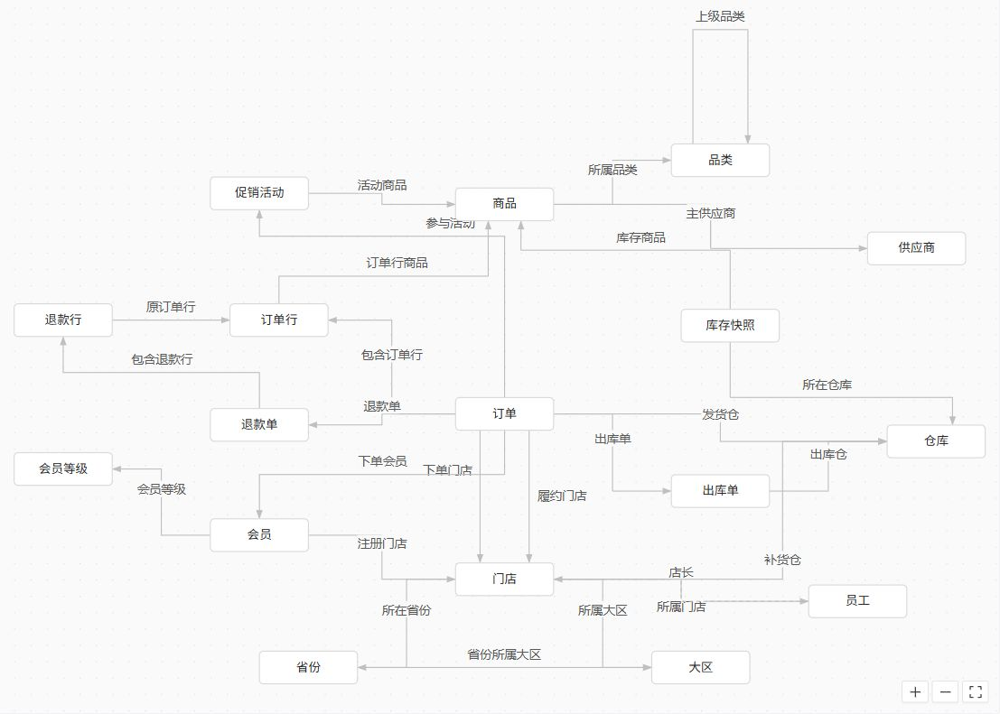
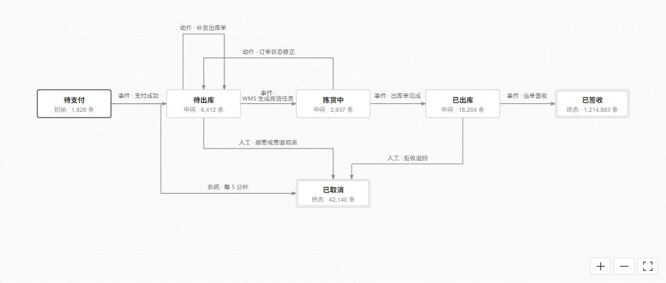

# 关系图与生命周期图连线调整

日期：2026-10-27。

本次调整覆盖本体总览的对象关系图，以及对象类型的生命周期图。两处原先使用 `smooth` 连接器和法线偏移控制点，平行关系、自关联和回退迁移会形成较大的曲线。本次改为直线与正交折线，并保留真实数据、关系名、方向、箭头和发布实线／草稿虚线。

## 实现

- `frontend/src/components/graphEdges.ts` 统一生成连线：同排或同列优先直线，同向平行关系分配独立端口，自关联采用矩形回路，回退迁移走上轨，取消支路分配下轨；路径遇到其他节点时复用已安装 X6 的 Manhattan 路由避障。
- `frontend/src/components/GraphCanvas.vue` 在 X6 的 `render:done` 阶段读取实际 `routePoints`，将标签放在最终路径较长的水平段上。局部避让仅尝试上下20px；斜向互逆关系的标签分别放在线段上下16px。比较位置未变化时不再更新标签，避免反复触发图更新。
- `frontend/src/pages/ontology/OntologyOverview.vue` 接入共享路由，沿用原有节点坐标与数据加载流程。
- `frontend/src/pages/ontology/parts/object/ObjBehaviorLifecycle.vue` 接入共享路由，保持主链水平、回退和自环分层、取消支路下行；较长的迁移来源分两行显示，保留原有详情与选择行为。

未新增依赖，未修改接口、权限、mock 数据或生命周期状态坐标。

## 实际检查证据

以下结果来自本次实际浏览器检查；截图为最终图画布局部。

| 检查项 | 结果 |
| --- | --- |
| 1920×1080 本体总览 | 17个对象、26条关系，共43个 SVG 文字；文字框相交0处，连线路径中曲线指令0处。所属门店／店长标签分层清楚。 |
| 订单生命周期 | 水平主链、上方回退／自关联、下方取消支路清晰；WMS 迁移来源两行显示，没有上轨穿字。 |
| 生命周期交互 | 实际操作节点选择、已取消状态详情、返回概要、放大及适应画布，行为正常。 |
| 两档视口 | 1920×1080、2560×1440 均未出现外层页面滚动；图画布继续独立平移和缩放。 |
| 浏览器控制台 | 最终检查未新增异常。日志中保留的01:58／01:59标签兼容错误属于已修复版本的旧记录。 |

### 本体总览

### 订单生命周期

## 轻量验证与边界

已通过前端 `npm run typecheck`。`node scripts/check-graph-edges.mjs` 的最小断言覆盖直线、回退、自关联、跨节点、平行端口，以及按实际路径重复定位时不重复更新标签。

当前方案沿用现有节点布局，通过简单轨道规则、X6节点避障与有限标签位移改善可读性。它不进行全局交叉最小化，也不保证未来任意密集图都没有边交叉或文字相交。关系数量明显增加、节点间距不足或关系名变长时，应结合实际图局部调整节点位置或轨道；现有检查结果仅覆盖本次数据与上述两档视口。

本次未运行后台测试、集成测试、迁移或完整构建，未执行全量截图巡检。
