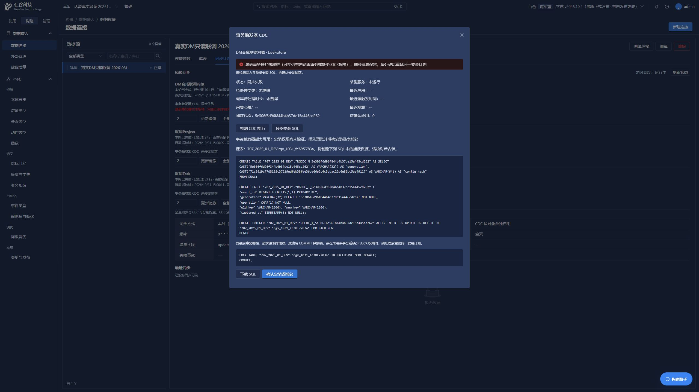
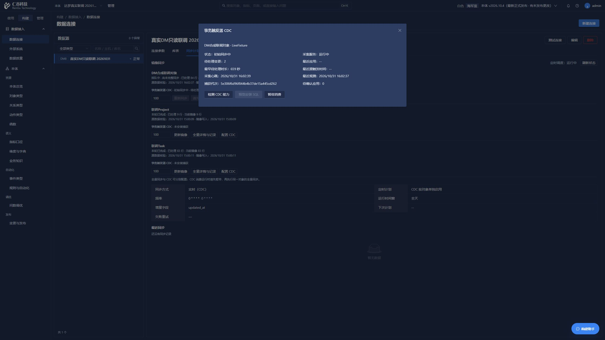
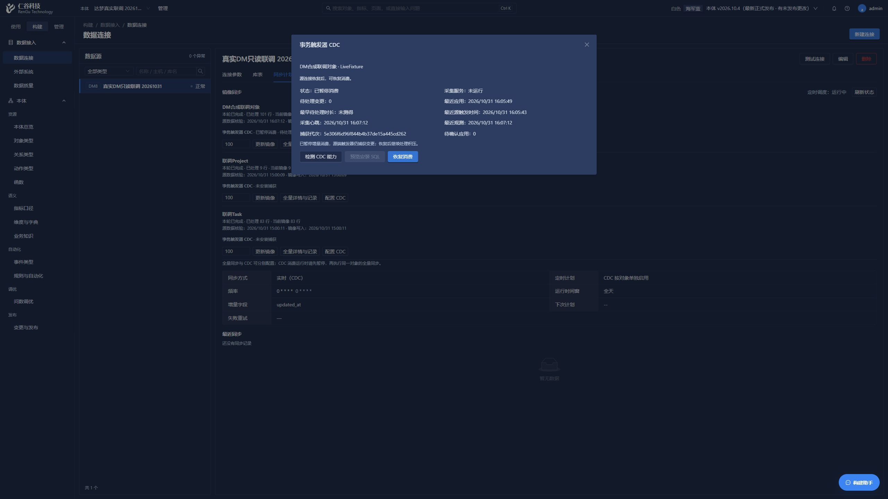

# 事务触发器 CDC 真实联调记录（2026-10-31）

本记录为本轮真实结果入口。验证复用工作空间 `15 / dm-live-20261031`、对象 `LiveFixture` 与唯一允许写入的独立合成源表 `rgv_1031_fc38f7783a`。捕获 generation 为 `5e306f6d96f844b4b37de15a445cd262`。原 `project`、`task` 未安装触发器，未执行 DML；没有新建验证工作空间，也没有启动通用事件或动作工作者。

实现、操作及边界分别见 [源能力与实际安装修复](26-10-31-cdc-source-capabilities.md)、[sink 接入契约](26-10-31-cdc-sink-integration.md)、[界面使用说明](26-10-31-cdc-ui.md)、[交给另一台电脑 AI 的保留数据部署单](26-10-31-cdc-deployment-ai-guide.md)。本轮是限定合成表的针对性真实联调，不是 pytest、后台全量回归、迁移升降级测试或打包验证。

## 数据库升级与正式 GUI 安装

本机仅在完整 custom 备份及清单检查之后，从 0048 应用明确的 `data_0049_external_cdc`。原镜像 289 条物理行的分组计数与全部物理 ID hash 前后相同。新增订阅表的工作空间 RLS、唯一约束、外键及 scoped 表/序列授权已只读核对。备份大小、SHA256 与执行细节见源能力记录；没有执行 restore、seed、清库或 downgrade。

Root 使用正常已登录前端实际完成能力探测、计划预览、SQL 下载、选表安装确认和启用。没有从浏览器提取 Cookie、绕过登录限流，真实脚本不执行 HTTP 登录。SQL 下载实际保留完整触发器体和 disql 分隔符，单独展示安装后事务栅栏；下载文件没有被当作已执行证据。

真实安装暴露并修复了三类问题：DM 的触发器目录返回完整 CREATE 语句而非仅 body；对象 ID 返回 Decimal 导致本地 JSON 持久化失败；前端 CDC 父弹窗遮住共用确认框。修复后沿用同一 generation 和受管资源重试，没有 DROP 或换代绕过失败。详细失败与修复证据见源能力记录和界面说明。

有效忙栅栏测试明确核对 `autoCommit=False`，并用另一源连接证明未提交业务值及日志不可见。GUI 安装真实返回 409 `CDC_BOOTSTRAP_REQUIRED`；释放事务后，同计划安装成功，显示已安装待启用及 pending 2。早先直接 dmPython 默认 autoCommit=1 的试探已撤回，不能据此推断未提交事务或 MDL 行为。

## 初始扫描实际强停与恢复

GUI 将现有每批输入设置为 2 后启用 CDC，生成 `runId=18 / scanId=18`。Source 代理作为唯一进程操作者，在基线处于 running 且已有 2 行成功提交的前缀时精确强停当时 API，随后按原配置恢复 8000；未改 `.env`，未启动动作工作者。

重启后保持同一 run、scan 与已提交前缀，实际界面先后观察到继续处理 54、84 行，最终 101 行 complete 并进入持续同步，pending/pendingAck 均为 0。没有从头创建新扫描冒充恢复。重启窗口暴露的前端旧错误不自动清除问题已修复：本地状态 GET 恢复成功后替换错误并继续刷新，未通过反复连接源库刷新界面。

## 真实增量、回滚与迟提交低 ID

实际执行脚本为 `backend/scripts/check_cdc_live_fixture.py`。它硬限定上述工作空间、对象和源表，每次写连接核对真实 DBAPI `autoCommit=False/0`，在源写入前碰撞检查本次合成键。所有消费观测同时断言 `runId=18`、`scanId=18`、订阅基线运行号及 generation 不变，以证明没有另起全量扫描完成这些变化。

脚本最初在任何 DML 前因“整数主键”的错误前提停止；已按真实捕获配置支持当前字符串主键。该修正不属于 CDC 投递失败，也没有因此重复已完成的运行阶段。

| 真实阶段 | 结果 |
| --- | --- |
| INSERT | 新合成键已进入镜像，选列 payload 与源当前态一致 |
| UPDATE | 所选字段新值已进入同一业务键镜像 |
| 主键变化 | 旧键退出 current，新键 payload 与源一致；平台物理行 ID 与业务键仍分离 |
| DELETE | 已存在的测试镜像行退出 current，物理行保留 |
| 未提交与整体回滚 | 独立源连接断言未提交行不可见；镜像连续观测没有该行，rollback 后仍未出现 |
| 保存点回滚 | INSERT 后 `ROLLBACK TO SAVEPOINT`，外层 commit，镜像没有该行 |
| 逆序提交 | 两连接真实分配 low ID 和 high ID，断言 low < high；high 先提交并被应用确认，low 后提交仍被追回 |

CRUD 四步从源 commit 返回到“镜像匹配且本地精确待确认批次为 0”的实际观测等待分别为 3.938、6.594、7.266、7.594 秒。它们包含源核验、消费、确认及观测开销，不是源 commit timestamp、commit LSN 或承诺的延迟 SLA。

三个阶段串行执行并退出 0，首失败停止机制未触发。收尾只删除本次碰撞检查过的测试键，不清理任何未知源日志。随后单独执行真实只读 `observe --require-equal`：源 101 行、镜像 current 101 行，主键集合和全部已选择列 payload 完全一致，源独有/镜像独有/变化 payload 数均为 0，run/scan 仍为 18，pendingAck 为 0。该次瞬时阶段为 catching_up、pendingCount 2，是清理批次确认前的最近观测值，没有将其误报为此刻已 streaming。

## 暂停积压及实际 GUI 恢复

Root 通过正式 GUI 暂停，界面显示已暂停消费、采集未运行；generation 未变。脚本只在收到暂停信号后，对本次全新合成键执行同事务 INSERT 和 UPDATE，源提交成功后等待 2 秒：镜像 101 行整份已选 payload 与暂停前完全相同，而源私有 journal 中与该测试键对应的真实 pending 为 2。

这张暂停截图中的待处理 0 是暂停前最后一次**本地观测**值，不是暂停后的源队列实测值；GET 状态不会在暂停期间反复连接 DM。实际积压 2 来自脚本对该私有 journal 的受控只读查询，两种证据不混用。

Root 随后通过 GUI 实际提交恢复消费。脚本等待恢复后，已按键追回源最终值并完成精确确认；`runId=18 / scanId=18` 与 generation 全程未变，没有另起全量扫描。仅定向清理本次测试键后，脚本退出 0。

最后一次真实只读 `observe --require-equal` 结果为：源 101 / 镜像 current 101；主键及全部已选列 payload 完全相等；sourceOnly、mirrorOnly、changedPayload 均 0；phase=`streaming`，enabled/installed 均 true；pending=0、pendingAck=0，appliedCount=13，run/scan 仍 18，无错误、无需重新基线。

## 源 ACK 成功、本地清理失败窗口

仅对上述私有 capture 做了一次真正的隔离进程故障注入，正常 API 保持运行。脚本先取得该对象既有会话锁，实际确认私有 journal 为空、没有未知 pending，再提交 1 个本次独有合成键。调用正常消费实现，在镜像和精确 pendingAck 已提交、源端这 1 个 ID 的精确 ACK 也已成功提交之后，仅在隔离脚本进程一次性拒绝 PG 清空 pendingAck 的 commit；该 PG 事务实际回滚。没有安装生产故障钩子、修改 API 代码、改变 `.env` 或操作其他订阅。

故障后受控只读证据为：源私有 journal pending=0，本地仍保留同一精确 pendingAck=1，镜像 payload 已持久化，run/scan 仍 18。随后立即还原进程内 monkeypatch 并释放对象锁，保留旧消费者 token 及尚未到期的租约，交给保持运行的正常 API 接管。

正常 API 随即取得同对象锁、替换旧 token，重试已经不存在的精确源 ID（可删除数为 0）并安全清理本地 checkpoint。`appliedCount` 仅因原事件增加 1，没有因 ACK 重试再次应用或计数；旧 token 再做租约核验明确返回 `CDC_LEASE_LOST`。此场景证明可重放确认与租约接管，不是跨两库 exactly-once。

脚本按范围清理本次测试键并退出 0。最终真实 `observe --require-equal`：源 101、镜像 current 101，全部所选 payload 和主键集合相等；phase=streaming，pending=0、pendingAck=0、appliedCount=15，runId=18、scanId=18，generation 不变，无错误或重新基线要求。

故障阶段第一次启动曾在源 INSERT/注入之前因隔离脚本没有注册 ORM 外键目标而停止；补充正常 `app.db.models` 元数据注册后才真正执行上述一次故障。没有把该脚本初始化错误当作消费者事务失败，也没有因它重复已成功的 CRUD 或回滚阶段。

## 持续阶段正常进程重启

唯一进程操作者为加载已批准的其他模块修复，实际按原配置做了两次必要正常重启，未执行源 DML/DDL或启动通用工作者：

| 重启 | 前后真实结果 |
| --- | --- |
| API 56840 → 27060 | 前后均 streaming/enabled、101 complete、pending/ACK 0、run18/scan18/generation 不变；新进程实际推进 lastObservedAt/heartbeat 到 UTC `2026-10-31T08:12:03.492287+00:00` |
| API 27060 → 最终 23236 | 前后同样保留上述状态；lastObservedAt 从 UTC `08:18:53.887223` 推进到 `08:19:10.817419+00:00`，新 heartbeat 为 `08:19:11.849205+00:00` |

两次均检查 `/readyz` 正常、`.env` 文件 hash 未变，Vite 仍为原 63072。这些是新进程实际消费心跳及状态证据，不是只证明端口启动；没有自动新建基线或换 capture。最终保留合成对象 CDC 启用、持续同步，其余源表没有因此安装捕获。

## 已核实的能力边界

当前机制是事务触发器日志与按键当前态重读，正常增量不全表扫描；事件 ID 不是提交水位，精确 ACK 的未确认集合不使用 `MAX(id)` 或 `id > last_id`。它不提供每个中间版本、源提交位点或跨多行/多表事务在 PG 中的原子可见性。

暂停消费保留源捕获并继续积累日志，不是卸载。未 ACK 日志不按时间自动淘汰。TRUNCATE、绕过触发器的装载及管理员无痕篡改不在普通 DML 触发器覆盖范围，相关维护后须重新基线；不能宣称识别任意管理员删除日志的缺口。临时断线与所选结构/捕获/授权永久失效采用不同状态，不降级为伪 CDC 全量轮询。
