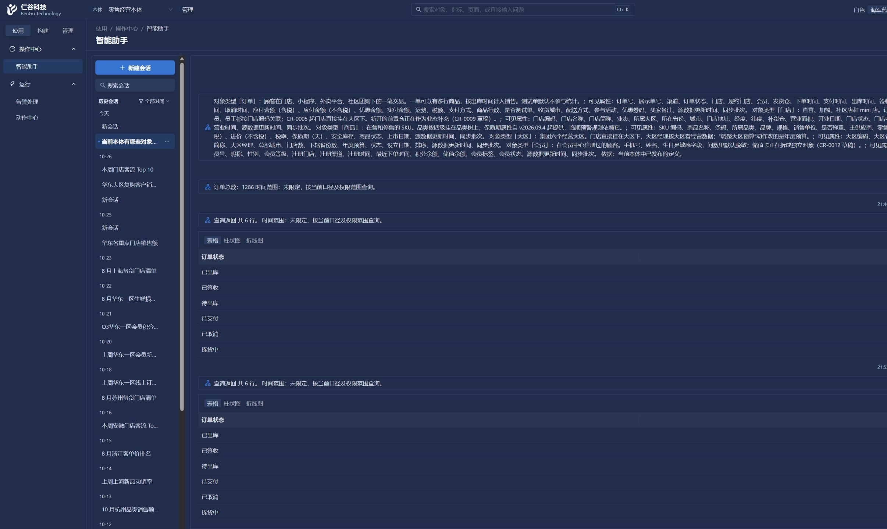
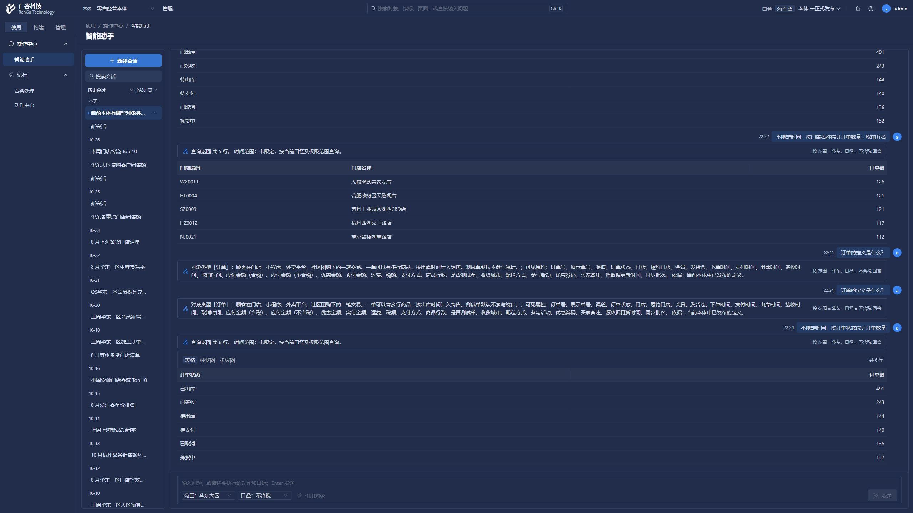

# 智能助手等待时间检查（2026-11-02）

本次只沿正常浏览器登录、HTTP API 检查问数工作台，没有直连平台、业务或源数据库，没有执行动作、后台全量测试或打包。操作视口固定为 2560×1440。现有其他未提交改动保留。

## 实际测量

本体 1、会话 S0106，问题为“不限定时间，按订单状态统计订单数量”。界面当前保留的会话范围、口径不变；这不是业务口径的重新验收。

| 测量 | 结果 |
| --- | --- |
| 修改前同题端到端 | 4.760 秒 |
| 修改后同题端到端 | 5.231 秒 |
| 修改后 chain.answer | 5.016 秒 |
| 逻辑模型调用 | 1 次，4.203 秒 |
| 首次模型前准备 | 0.766 秒 |
| 查询执行阶段 | 约 0.015 秒 |
| 提示长度 | 28,606 字符，不等于 token 数 |

这两个单次样本不能证明整体速度提升，也没有复现每问 15–30 秒。该样本主要等待模型调用；计时包含模型服务、网络及 SDK 原有传输重试，不能再拆成纯模型推理时间。查询后的说明和图表不另调用模型。

## 已修复的等待与重复执行问题

- 流式请求受理后遇到网络异常、非 SSE 或丢失 done，前端不再重新 POST 同一问题。只有明确的路由/方法不支持才回退同步入口；业务会话 404 不回退。
- 收到终态 done/error 即结束读取，不再等待代理关闭连接。现有流仍主要发送阶段提示与最终回答，本轮没有改为模型逐字输出。
- 切换会话或本体会取消旧请求。后端流断开后取消并等待工作任务、清理连接和未提交事务；不保证远端模型服务一定终止已开始的计算。
- 后端先提交回答和事件，再发送终态。提交失败不发送成功 done，避免前端立即显示并断开时丢失轮次。

实际回答 6 行，完成后立即刷新仍恢复该回答。随后在模型生成阶段新建会话，后台记录本地工作任务 `CancelledError`：总计 0.781 秒，其中模型等待 0.234 秒；旧会话刷新后没有新增被取消的问题，新会话没有混入旧回答。浏览器检查无 error 日志。

## 为下一条慢问保留的诊断

`app.qa.timing` INFO 日志按现有 requestId 记录 qa_stage、qa_model、qa_total，只含本体编号、毫秒、逻辑调用次数及字符数，不含问题、提示、SQL、地址、密码或密钥。阶段耗时包含相应模型调用，不能重复相加；chain 总计不包含全部认证、连接获取和轮次提交耗时。

源码存在多类独立的模型纠正分支，复杂问题可能串行多次生成。模型前还会取样例、名称、取值和定义证据，部分读取重叠；没有凭这条样本加入跨请求缓存或擅改所选模型/推理参数。后续 15–30 秒请求应以对应 requestId 的 modelCount/modelMs/prepareMs 判断，不能一概归咎于数据库或浏览器。

前端 typecheck 通过；新增的三个窄离线检查分别覆盖流终态/安全回退/取消边界、计时与内容不泄漏、服务端先提交后完成及断连清理。未运行 pytest、后台全量、迁移/恢复测试，也未对其他本体、所有模型服务或部署电脑进行性能认证。

## 核心链路修改及页面复测（22:21–22:25）

这部分已实际修改并正常重启 API 加载，不只是等待提示调整。没有改动模型选择、模型服务地址或推理参数。

- **同一提问复用读取**：动作目录和定义证据共用当前请求的能力目录。原目录访问权限保持原样；只读对象视图从该目录复制并过滤，外部 API 不变。相同表、列、绑定、会话、本体及 limit 的取值/计数读取可复用，limit 不同仍分别查询。缓存只活到该问题完成或取消，跨问题不复用。
- **缩短模型输入**：DDL 的重复 COMMENT ON 表名/字段名改为列旁单行说明，保留全部可见表、字段、类型、约束、枚举和注释。补充定义用 `[id, 内容]` 紧凑表示；只有唯一明确名称/编码命中才收窄补充条目，并保留直接关联条目。多目标、同名、未知或总览问题保持完整证据。SQL 的表结构、关系、口径、时间、维度、权限和校验规则不做裁剪。
- **避免定义重复生成**：模型选中的定义必须在本次提供的证据中且通过原有快照校验，直接返回原文及来源。澄清、拒答或无效定义选择会用完整证据再核对一次。按名称选择相关定义不等于对所有间接知识完成语义检索，因此不能保证每个复杂定义问题都完整。
- **统一纠正预算**：首次生成和各类纠正共用最多 3 次逻辑模型调用；不能每个分支各自再加重试。耗尽明确返回 `QA_GENERATION_LIMIT`，不放松 SQL 校验，也不把失败当成功。原 SDK 传输重试未改，所以这不是固定秒数的超时保证。

下表为同一浏览器、本体 1、会话 S0106 中的实际发送到回答出现时间；后台数值仅取不含问题内容的计时日志。

| 问题/轮次 | 页面耗时 | chain 耗时 | 模型调用/耗时 | 首次模型前准备 | 首次提示字符数 |
| --- | --- | --- | --- | --- | --- |
| 按订单状态统计，第 1 次 | 7.105 秒 | 6.672 秒 | 1 次 / 5.688 秒 | 0.937 秒 | 26,776 |
| 同题，第 2 次 | 5.809 秒 | 5.625 秒 | 1 次 / 5.125 秒 | 0.453 秒 | 26,776 |
| 按门店名称统计订单前五名 | 5.895 秒 | 5.704 秒 | 1 次 / 4.125 秒 | 0.547 秒 | 26,781 |
| 订单定义（去掉重复核对后） | 2.924 秒 | 2.687 秒 | 1 次 / 1.734 秒 | 0.953 秒 | 19,145 |
| 按订单状态统计，最终版本 | 3.915 秒 | 3.718 秒 | 1 次 / 3.344 秒 | 0.343 秒 | 26,776 |

同题提示从 28,606 降到 26,776 字符（约 6.4%，不是 token 数）。定义回答第一次检查原本发生两次模型调用，发现后去掉有效条目的重复核对，最终复测为一次。准备时间有冷/热差异；以上小样本只能证明本机这些路径正常，不能声称整体速度有固定幅度提升，也没有证明所有 15–30 秒场景已消失。该模型调用仍是本轮主要等待来源。

页面核对结果：状态统计始终为 491、243、144、140、136、132；门店关联返回真实名称和 5 行结果；定义回答引用已发布定义且未编造条件。最终回答立即刷新后恢复，同题历史共 5 条，控制台 error 为 0。未执行任何业务动作，保留会话原有范围和口径，因此这不是其业务口径的重新认证。

新增窄离线断言已通过：DDL 引号/注释/枚举/可见性及取值/计数复用；请求、权限与本体边界；能力目录 full/readable 两种视图在当前实现下等价；补充定义选择及有效/无效快照；全链共享三次预算、异常和取消传播。新增文件的定点 Ruff 通过，`chain.py` 的 F 类检查通过。未进行后台全量测试、真实外部动作、迁移测试、打包、提交或推送。

维护边界：将来若能力目录的 `readable_only` 不再仅过滤对象列表，需要同步更新 QA 适配器及其等价断言。模型服务端及网络速度仍会波动；本轮不引入跨用户/跨问题的全局业务数据缓存。
