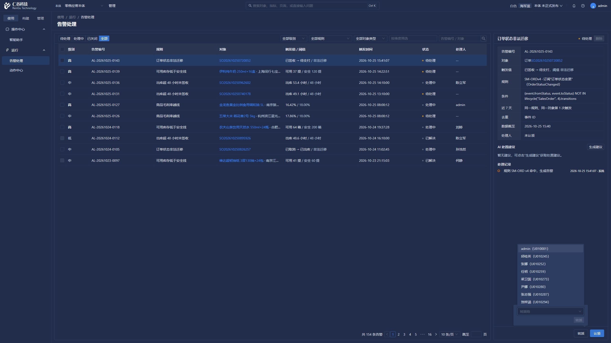
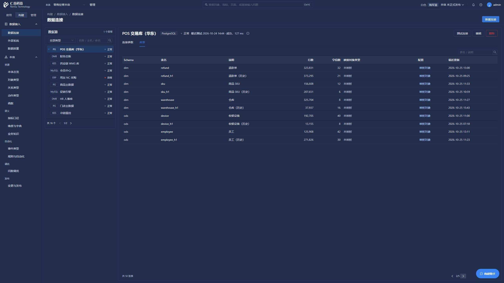

# 常用页面性能与交互检查（2026-11-03）

本轮通过正常管理员登录 Cookie、页面与 HTTP API 检查，视口固定为 2560×1440，没有直连平台、业务或源数据库。已消除明确的重复请求与无用装载，修复库表分页遮挡。以下有限样本**不能证明整体提速**。

## 修复及实际行为

动作列表原在第 2 页输入“物流”，先请求 `kw=物流&page=2`，再请求第 1 页。修复后仅请求 `kw=物流&page=1`，返回 200。逐字输入 `ACT-20261024` 只发送 1 次最终查询，显示正确的 4 条结果。

告警列表在“全部”第 2 页逐字输入 `AL-20261025`，只发送 1 次第 1 页列表请求和 1 次分面请求。翻页不再读取转派人员，点击“转派”时才读取。核查中发现受控 `category_l1` 计算表达式丢失导致人员接口 400，已恢复物理表原有受控表达式、保留镜像显式列映射。复测人员接口 200、候选可见。本轮仅打开转派界面，没有提交转派。

数据连接库表分页的右箭头原位置为 `x=2498,y=1392,w=29,h=24`，被助手区域 `x=2418,y=1368,w=118,h=48` 覆盖。局部增加 160px 留白后，箭头移至 `x=2338`，鼠标成功翻到含 `dim.refund` 的页面，助手未打开（`assistantOpened=0`）。

本体总览当前视图只读取维度卡片需要的编码、类型、状态，跳过维度取值、映射等完整详情。对象摘要跳过属性装载，历史视图跳过随后会被快照覆盖的当前对象、指标读取。图谱完整目录不变。复测卡片仍为对象 17、关系 25、动作 17、事件 15、指标 13、维度与码表 17（9 个维度、8 个码表），待处理 11 项。

绑定装载中，对象、数据源、`current_database()` 三类显式 SELECT 从每绑定各一次（合计 `3N`）改为本次装载合计 3 次，这不是全部 SQL 数量。指定 owner 权限路径的角色范围查询从 2 次变为 1 次。SQLAlchemy Inspector 仅在本次装载内复用，连接映射读取不再装载无用对象属性。没有新增跨请求业务缓存，绑定的 RLS、字段和权限校验保留。

前端使用 AbortController 取消浏览器读取，并继续防止旧响应覆盖新状态。这不保证 FastAPI 普通 GET 已开始的 SQL 会立即停止，也不代表所有后端连接立即释放。

数据源兼容存在一项行为变化。当对象来源标签同时匹配不同数据源的 code/name 时，批量装载会拒绝该歧义绑定，旧路径取首条匹配。应先消除来源冲突，不以猜选数据源继续读取。

## 单次耗时记录

| 场景 | 修改前 | 修改后 | 解读 |
| --- | --- | --- | --- |
| 首页翻页基线 | 206ms | 未单独复测 | 仅作基线 |
| 动作列表第 2 页 | 193ms | 570ms | 本次样本未变快 |
| 本体总览完整刷新 | 431ms | 628ms | 本次样本未变快，卡片数据一致 |
| 库表翻页 | 鼠标被遮挡，键盘 179ms | 鼠标 295ms | 交互不同，不能据此比较性能 |
| 动作列表第 2 页后续 3 轮 | 原单次 193ms | 694 / 243 / 216ms | 连续复测仍有波动 |
| 本体总览完整刷新后续 3 轮 | 原单次 431ms | 535 / 515 / 506ms | 连续复测不足以证明整体提速 |

后续 3 轮仍使用同一 2560×1440 页面连续操作。请求数与指定查询数减少已得到核对，这些耗时样本不支持明显提速的结论。

最终问数结果 6 个值为 `491、243、144、140、136、132`，与预期一致。后台 `chain` 为 5922ms，其中模型 5313ms、逻辑模型调用 1 次、首次模型前准备 547ms。这些阶段不能重复相加。前端计时读取到了旧历史，样本无效，已舍弃。没有据此宣称问数整体提速。

## 验证边界与证据

前端 typecheck 与 `frontend/scripts/check-ops-read-scheduling.mjs` 均退出码为 0。后者执行实际 watcher、loader 及 usePagedQuery/useDebouncedRef 的内存断言，覆盖防抖、第 2 页筛选回第 1 页仅 1 次 GET、列表/详情/分面独立取消、跨本体与卸载后迟到响应不覆盖，以及转派候选按需读取、错误时不可提交。后端仅运行针对性内存断言与局部 lint。这些检查不替代真实数据库、全部权限组合或生产负载验证。本轮未运行 pytest 全量、迁移、打包，也未提交或推送。

