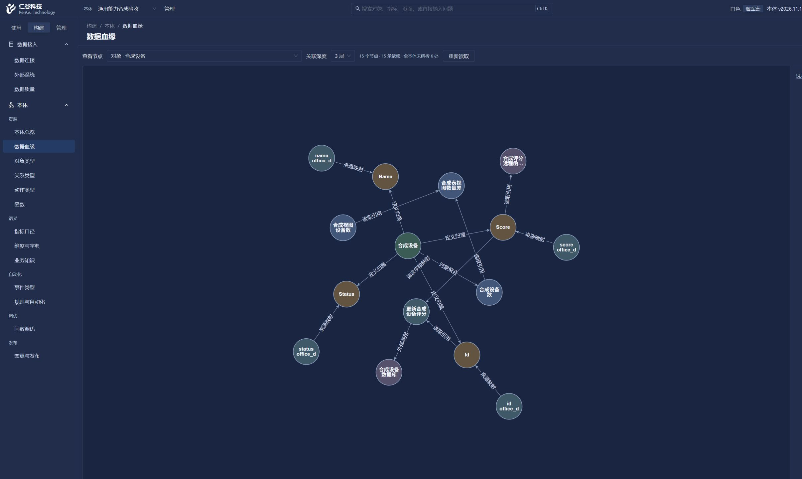

# 平台能力进度与边界（2026-11-03）

本文区分源码完成、离线检查和真实 UI 观察。最新现场记录与保留数据的升级步骤见 [本轮迁移与接续验收](26-11-03-capability-migration.md)。

## 本轮已完成

- **指标快照汇总**：不再因缺少时间字段而一律排除可解析指标。计数等无时间指标通过内置编译器确定性执行，返回实际 `backend=builtin`；这没有放开原生 MetricFlow 的时间契约。明确无时间字段的指标不能请求时间窗口或 `metric_time`。
- **指标时间与镜像映射**：共享时间解析按所选指标及派生分项的度量声明确定唯一时间字段，不借用同对象另一个指标的默认时间。旧清单未带新时间标记时保留默认字段兼容。已同步镜像的主键、属性及维度使用受控来源列映射，经既有 `source_sql` 和查询守卫执行，保留本体、公开列及行级范围限制。
- **MySQL 通道**：真实 binlog CDC 按已提交事务应用行镜像；一致快照与交叠回放完成后才公开镜像。视图可显式声明唯一非空键，经验证后镜像，不能伪装为 binlog CDC。数据库动作增加独立写授权与源事务幂等回执。实际本机页面已完成表 CDC、视图镜像各3行，并从智能助手执行源更新，经CDC事件、原生规则与远程函数求值生成真实告警。
- **定义血缘**：新增只读 API `GET /api/ontology/v1/ontology/lineage` 和页面 `/build/ontology/lineage`。沿用 `meta:read`、页面及属性可见性和 API Key 动作白名单；不输出凭据、URL 或固定载荷。无法可靠解析的依赖标为 `unresolved`，历史查询不借用当前定义补图。这是定义依赖图，不是运行时全链路追踪。
- **受控远程纯计算函数**：新增远程执行模式、部署授权目标和固定修订/schema 快照，共享测试、机器、动作和规则异步入口。原本地解释器保留。真实页面已登记函数并调用本机受控 HTTP 服务，输入 3 返回 6；原生事件规则实际以评分45调用固定版本函数、读取result=90并命中阈值50，详见 [远程函数合同](26-11-03-remote-functions.md)。
- **复杂指标**：固定版本指标引用、跨对象独立聚合组合、日历窗口与点间球面距离；普通公式增加条件聚合、去重计数、空值处理和取整。语义清单标识平台确定性执行程序，不让原生 MetricFlow 接受不支持的表达式。实际新建表、视图计数及组合指标，经智能助手查询返回 0，无须强加时间条件。
- **治理**：新增最多四跳的稳定关系路径、分类集合/等级传播、用途授权、后端属性掩码及显式降级。配置默认空，旧本体保持原行为；启用后无法证明的依赖拒绝。源码与窄离线检查已落地，单账号页面已验证无用途拒绝、授权用途明文返回及无明文聚合拒绝；其余场景不混称完整矩阵，见 [治理合同](26-11-03-governance.md)。

## 已有验证及限制

| 范围 | 证据与结论 |
| --- | --- |
| 指标快照与镜像导出 | `backend/scripts/check_metric_snapshot_export.py` 离线通过。 |
| 共享时间解析 | `backend/scripts/check_metric_time_dimension.py` 离线通过：不同时间字段不串用、派生分项共同校验、快照拒绝时间查询、旧清单兼容、内置后端选择。三个相关文件定向 Ruff 通过。 |
| MySQL 合同 | 新源通道窄断言通过；实际独立合成 MySQL 的目录、表/视图导入、读取授权、CDC 基线和视图镜像已走页面核对。尚不代表生产库或 DM 写回已验收。 |
| 血缘解析与权限 | `backend/scripts/check_lineage.py` 离线通过。清除 SQL 局部别名、Python 局部绑定及口径变体产生的伪依赖，检查可见属性、本体和动作白名单边界。未签发新 API Key 做真实生命周期验证。 |
| 血缘实际页面 | 2560×1440 正常管理员登录，点选指标显示 5 个节点、6 条依赖；能够沿指标、规则、动作查看至外部系统。公式、时间及过滤中未解析部分显示具体依据位置。全本体未解析 124 处，清楚区别于当前子图。点击上下游节点能切换焦点；重复标题、来源列名截断和大图切小图后的缩放问题均已修复。 |
| 前端 | 最后一次 `npm run typecheck` 通过，实际页面控制台未见 error。 |

本轮未运行后台全量测试或 pytest。运行时仅通过平台 API/前端访问本体，没有代理直连源库取数；独立合成源通过受控部署准备，必要增量迁移已应用。真实验证范围及保留异常见迁移记录；生产来源、多组织和所有边界仍不以离线检查替代。

## 明确边界

- 跨对象组合不等于任意明细 JOIN；几何首版为两点球面距离，不包含任意 GIS 拓扑和投影。
- 任意代码上传及隔离函数执行环境。新增远程模式调用部署授权的独立纯计算服务，没有放开本地导入库或任意 Python 执行；机器测试调用与动作固定版本调用的历史本地类型约束不同，本轮未直接收紧旧注解语义。
- 源数据库写回仅支持独立授权列的参数化 UPDATE，不开放任意 SQL、INSERT/DELETE；视图必须验证显式键，不能绕过唯一性。
- 标签与用途由管理员显式配置，不能从业务名称猜。历史动态自由文本不能可靠逐字段掩码时拒绝或过滤，不能输出原文后仅加免责声明。

## 远程纯计算函数合同与后续边界

复杂算法或模型在平台外部署，保留现有本地解释器。本轮远程通道已实现固定函数版本及实现修订、严格 JSON 输入输出 schema、部署端精确主机/路径与网络授权、仅服务端持有认证、TLS、全程超时和响应大小上限。动作、规则、测试及机器调用共享执行入口，规则另有整轮时间和调用次数预算，避免逐行无界远程请求。

`check_remote_functions.py` 内存合同检查已通过，但不等于真实服务或模型推理验收。首版限无业务写副作用的计算，不自动重试 POST，不以样例兜底；有副作用的业务继续使用动作确认、幂等和结果未知对账流程。任意代码上传、长时 GPU 任务及沙箱调度需另行设计。

## 11月4日收尾

完整合成本体已正式发布v2026.11.12；ACT-20261103-0003、0004在对话内确认后均取得源数据库成功回执，CDC-3726…投递规则成功并生成告警，命中记录包含Score45与函数result90。旧ACT0001保持结果未知，原回执查无但未重发；ACT0002保留明确未提交记录。

数据血缘复用本体总览的GraphCanvas、圆形节点、连线路由、箭头、标签和选择效果；数据库固定写列映射及主键读取加入真实血缘。首屏性能实测、重复CTE遍历根因和部署边界见[首屏性能记录](26-11-03-first-screen-performance.md)。

实际切换发现 X6 的异步删除任务会被相同 ID 的新增任务覆盖，留下旧节点和连线。血缘和总览均改为一次 `fromJSON` 原子替图，不再先清空再逐个添加；没有改动布局、颜色或公共画布调度。窄检查直接运行两个页面的绘图函数和主题监听，快速替图后每个 cell 只有一个 view。正常页面复验：血缘对象焦点为15节点/15边，动作焦点为11节点/11边；总览在海军蓝→白色→海军蓝切换后始终为2节点/0边，无残留。操作视口固定2560×1440；血缘截图受浏览器捕获范围影响为2412×1440，不能视为完整视口截图。
