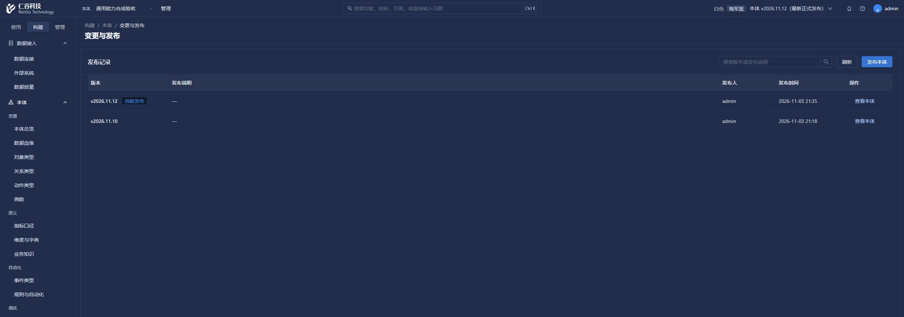
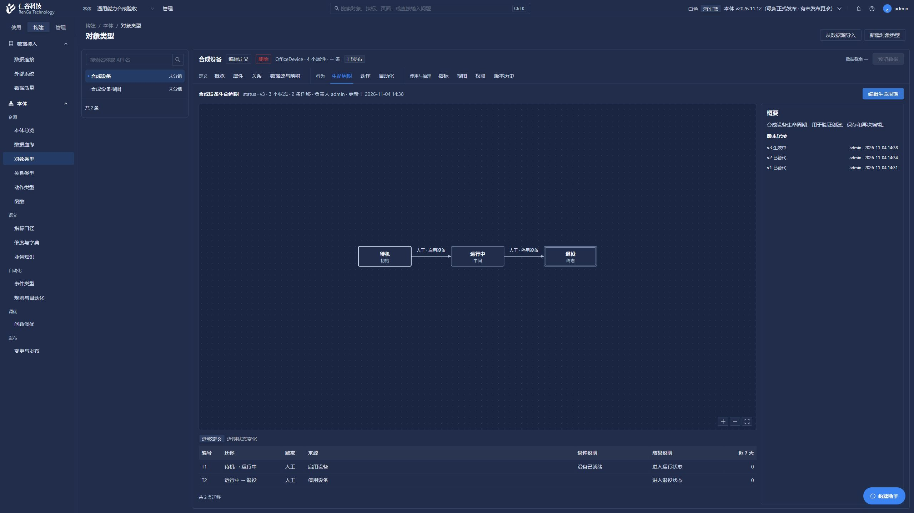

# 整本体发布记录调整（2026-11-04）

## 页面行为

- “变更与发布”只显示当前本体整体验证后正式发布的版本，不再显示逐次保存产生的变更单。
- 删除顶部重复的“正式发布记录”列表及旧变更单详情、审核与操作记录页签。
- 主表提供版本、发布说明、发布人、发布时间和“查看本体”；保留整本体发布入口。
- 搜索版本或发布说明、分页均调用后台；后台只查 `scope=formal`，不加载列表无须使用的大快照。
- 原有版本选择器的不分页接口合同保持兼容；内部工作版本及历史记录没有物理删除。
- 发布已成功但后续刷新失败时，保留成功版本和成功回执，只提示刷新失败。

## 本次检查

- 前端类型检查通过。
- `frontend/scripts/check-release-history.mjs`：真实页面脚本的内存请求检查与 SFC 编译通过，覆盖分页搜索、失败、权限、跨本体迟到响应、卸载及发布后的刷新边界。
- `backend/scripts/check_release_pagination.py`：窄内存检查通过，覆盖正式发布过滤、搜索转义、SQL 分页、页码收拢、大快照排除与原接口合同；未连接数据库。
- 普通后台启动后，在 2560×1440 页面读取本体 8，显示既有两条正式发布 v2026.11.12、v2026.11.10。
- 页面搜索 v2026.11.10 只返回一条，搜索不存在版本显示空结果，清空恢复列表；实际请求为 `/releases?page=1&size=…&kw=…`，返回 200。
- 切换本体 1 显示“暂无本体发布记录”，没有把既有逐次保存记录当作正式发布，也没有串入本体 8 的记录。
- 发布弹窗已打开并取消，未实际创建新版本。现有记录不足一页，未为验证翻页新增发布；分页分支由窄检查覆盖。

无数据库表结构变化，不需要迁移。没有运行后台全量、集成、迁移测试，没有打包。

页面本次控制台未记录 error 或 warn。效果图为固定 2560×1440 视口的上部截图：

## 生命周期入口补全

生命周期用于表达对象状态及允许的迁移。入口为“构建 → 对象类型 → 生命周期”。配置概念包括状态字段、初始/中间/终态、源与目标状态、触发方式、条件和后续行为。

新对象的生命周期创建入口已补全。当前真实模式直接保存，不需要创建变更单、提交审核或手动发布单个生命周期：

1. 在对象属性中准备一个文本或枚举状态字段。
2. 进入“生命周期”，点击“新建生命周期”，选择状态字段；没有可选字段时可点“前往属性”。
3. 添加状态值、显示名称和类型，必须有且只有一个初始状态。
4. 添加迁移，选择起止状态及人工、事件、动作或系统触发来源。事件和动作从当前本体已发布的能力目录选择；终态不允许设置离开迁移。
5. 保存后立即显示状态图与迁移表，刷新后保留。已有生命周期通过“编辑生命周期”修改；无修改时不重复保存。

新增 `PUT /object-types/{object_id}/lifecycle`，使用当前生命周期版本及本体版本锁防止覆盖别处的修改，校验字段及事件/动作引用所属对象。继续使用现有生命周期、状态、迁移和版本表，不需要数据库迁移。后台正常重启后生效；本次没有打包。

实际页面在固定 2560×1440 下，给本体 8 的合成设备 OfficeDevice 新建了 3 个状态、2 条迁移，修改显示名称和说明后刷新恢复，版本保留至 v3。切换 OfficeDeviceView 显示独立空态；查看创建前的正式版本 v2026.11.12 不会显示后建生命周期，且新建按钮禁用。前端针对性检查覆盖新建、编辑、校验、坐标、只读、冲突、迟到响应和能力目录对象隔离，类型检查通过；没有运行后台测试。

条件、结果字段目前为说明文字，状态图本身不会执行动作或写入业务状态；实际执行仍由动作与规则配置承担。本次未新增自动执行器。已有旧生命周期草稿不会被静默覆盖，存在此类草稿时保存会提示先处理。

