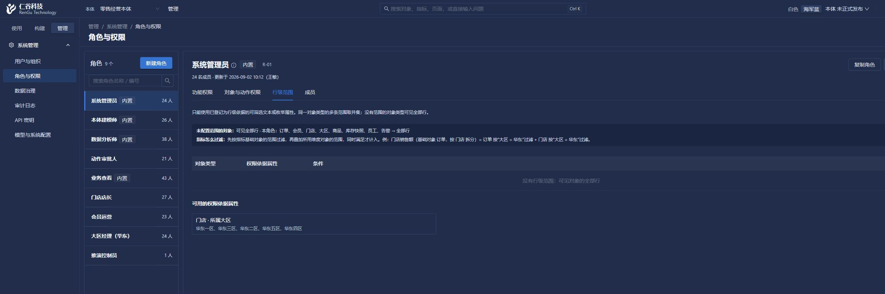

# 首屏加载同类问题扩查（2026-11-04）

本轮承接业务知识、维度和工作流首屏慢的问题，扩查对象、关系、指标、函数、动作、事件、规则、数据连接、外部系统及管理配置。没有通过取消鉴权、伪造分页或缓存用户权限来提速。运行观察使用正常登录的前端和 HTTP 请求；代理没有直连平台库、业务库或源库取数。

## 确认的问题与修改

1. 对象、关系、指标详情与知识详情具有相同的监听问题：已发布视图也订阅工作流的 loading 变化，导致同一详情重读。三页均条件化该依赖；草稿、新目标、变更单加载/错误、本体/版本变化和迟到响应保护保留。对象页也避免了详情清空回填引起的运行概览连带重读。维度页没有此无条件依赖，无须照搬修改。
2. 关系页在没有草稿时读取同一个全局关联目录，却把选中条目放进目录键。首屏自动选中首条会重读。现在仅草稿目录保留条目标识，写后显式刷新不变。
3. 纯定义 GET 在多个模块仍承担完整业务绑定准备。按实际处理器逐项审阅后，将对象/关系/指标/函数/动作等纯定义、数据源和已登记库表目录、外部系统定义、纯管理配置纳入明确白名单。能力目录、就绪检查、业务取数、行级范围取值、事件详情中的真实计数、投递/动作运行记录等仍保留完整初始化。
4. 规则首屏重复预取全部对象、指标和动作/事件轻目录，虽然规则元数据已有对象和指标名称。当前真实模式复用规则元数据，动作/事件及参数目录按动作页签、事件触发、实际编辑或助手需要加载；历史版和显式混合演示模式保留原目录分支。动作记录、版本列表也延后到各自页签，首屏只读必要命中摘要。
5. 规则元数据逐条关系重新查询关系定义、两端对象和属性。现在同本体批量读关系并复用已加载对象，与运行时共用纯校验器；仍检查 code/API 歧义、发布状态、两端对象、授权列、敏感/隐藏字段、转换字段和真实外键。普通规则运行时仍按需查单条关系，不变成全量预读。
6. 规则元数据仅消费人员目录，却使用了会附带动作子定义、规则和命中统计的完整目录。复用既有轻目录后，人员成员范围、同名歧义及旧名称兼容保持相同，移除了未被使用的数据读取。
7. 账号信息页只展示当前身份，却查询用户列表并跨所有本体统计审批任务。现在通过已有 `/me?includeAccount=true` 读取当前账号资料，不返回或伪造待办数；旧用户列表、成员列表及停用用户的待办保护合同不变。
8. 数据连接的 CDC、镜像和调度状态在慢请求未完成时仍继续定时请求。现在周期请求不重叠，显式刷新可以替换旧请求；本体/数据源/页签变化及卸载后的迟到结果丢弃，隐藏页面停止周期刷新。此修改只影响浏览器状态读取，不停止后台 CDC 或镜像任务。顺手修正同步说明的列跨度警告。
9. 角色页默认功能权限视图也预先读取权限属性的真实业务取值和关系路径。现在默认使用 `/roles/meta?withScopeValues=false`，打开行范围页或弹窗后才读取完整候选，保留加载、错误、重试及未就绪禁止提交。参数默认true，其他调用者兼容。继续计数发现仅延后取值还留有183条SQL，原因是同一目录构建中多个动作重复解析相同对象、关联和事件定义。现仅该次目录构建传入局部解析缓存，按会话、本体、事务、调用身份、解析种类和完整标识隔离；没有缓存权限或执行结果，普通动作执行的默认调用仍完整重新绑定和校验。

## 请求级观测

临时 ASGI 计数器只记录 SQL 数、耗时、状态和响应大小，不记录 SQL、参数、凭据或业务响应。以下是本机正常 UI 操作中的单次观测，SQL 数包含身份和本体上下文开销，不是压测均值或整页首屏时间。

| 请求 | 修改前 SQL / 耗时 | 修改后 SQL / 耗时 | 响应体 |
| --- | --- | --- | --- |
| 关系目录 `/link-types/catalog` | 28 / 435.67ms | 13 / 32.29ms | 均33027字节 |
| 关系列表 `/link-types?page=1&size=10` | 27 / 443.35ms | 12 / 34.11ms | 均10952字节 |
| 指标列表 `/metrics?page=1&size=18` | 26 / 174.49ms | 11 / 50.98ms | 均3798字节 |
| 指标详情 `/metrics/gmv` | 25 / 27.75ms | 10 / 78.02ms | 均2493字节 |
| 规则元数据 `/rules/meta` | 79 / 342.24–420.42ms | 40 / 145.09ms | 均14936字节 |
| 角色元数据首屏 `/roles/meta?withScopeValues=false` | 原完整读取189 / 285.50ms | 91 / 133.67ms | 完整6119字节；首屏5923字节，明确延后取值 |

不是每次单请求耗时都下降：例如指标详情这一次耗时上升，虽然 SQL 数明显减少。规则第一次仅批量化关系时曾观察到50条 SQL、857ms，其中数据库占790ms；后续移除完整目录后观测为上表40条、145ms。保留这些差异，不把不同并发、缓存或数据库负载下的单次数字冒充稳定性能承诺。

合成本体8的其他观测：数据源列表12条/18.79ms，连接详情12条/22.48ms，映射目录11条/16.49ms，外部系统列表12条/13.39ms，系统详情16条/57.46ms，接口目录10条/40.47ms；已有远程函数详情15条/43.30ms。账号资料请求11条/21.20ms，正常显示当前admin，未发出 `/users` 请求。

角色页实际切入行级范围后，完整元数据97条/128.58ms，返回6119字节；页面显示真实「门店·所属大区」候选及华东各区取值，未改角色权限。仅延后取值、尚未复用解析的中间版本为183条/277.33ms，不能把该版本称为优化完成。当前首屏不请求完整取值及关系路径，打开行范围才请求。此接口仍需解析受控执行绑定，未纳入轻量初始化白名单。

另核对了直接打开或刷新 `tab=row` / `form=scope` 的入口：若一开始已需要范围数据，直接读取一次完整元数据，不先读基础再补全；若基础请求在途时才切入范围页，才补读完整数据。普通后端启动后实际刷新行范围，日志只出现一次 `roles/meta?withScopeValues=true`，没有false请求，真实候选正常显示。这个边界也纳入定向检查。

最终规则首屏只有列表、元数据、选中定义和两组必要命中摘要；没有 `/action-runs`、版本列表或全对象/指标/动作/事件目录预取。随后实际打开「版本历史」和「动作」页签，版本表、参数映射和原有记录正常出现，没有执行或回滚任何记录。

## 检查与边界

- 正常页面核对对象、关系、指标、规则条件、按需动作参数、已有函数、动作/事件定义、账号、角色、连接参数、同步状态及外部系统。观察真实返回内容和请求，不执行旧动作、不修改业务数据。
- 窄内存检查执行真实 Vue 监听和加载函数，覆盖草稿等待、错误恢复、本体/版本/页签切换、旧请求晚到、卸载、慢轮询不叠加及显式刷新。规则关系正常与批量路径的校验等价性、白名单之外的业务请求及机器调用保留完整边界，也有离线断言。
- 前端完整类型检查通过；本轮新增/扩展的定向脚本为 `check-definition-detail-requests.mjs`、`check-rules-lazy-catalog.mjs`、`check-role-meta-loading.mjs`、`check-connection-polling.mjs`、`check_account_profile.py`、`check_role_operation_catalog.py`、`check_definition_read_context.py`、`check_rule_relation_fields.py`。均为纯内存或编译检查，不连接数据库或发出HTTP请求。
- 人类纯定义读取仍逐次检查身份、功能权限、成员关系、工作空间生命周期和事务 RLS；没有跨请求权限缓存。该路径的空行授权按拒绝处理。任何 Authorization 请求及所有写操作均不走轻量白名单。
- 初始浏览器重连恢复到默认视口时及时改回2560×1440；后续页面操作固定2K。截图实际捕获范围以文件为准，不把工具裁切称作布局缺失。
- 未运行后台全量测试、pytest、集成或迁移测试，也没有进行生产负载、海量对象或弱网压测。本机未复现原部署环境完整5秒延迟；源库网络、数据库争用、规则运行取数等不能用定义页面优化替代。

本轮不新增表结构，无需数据迁移；没有打包、导出或清理业务数据。临时计时入口已退出，后端恢复普通 `app.main:app` 启动，前端5280和后端8000保持运行。

