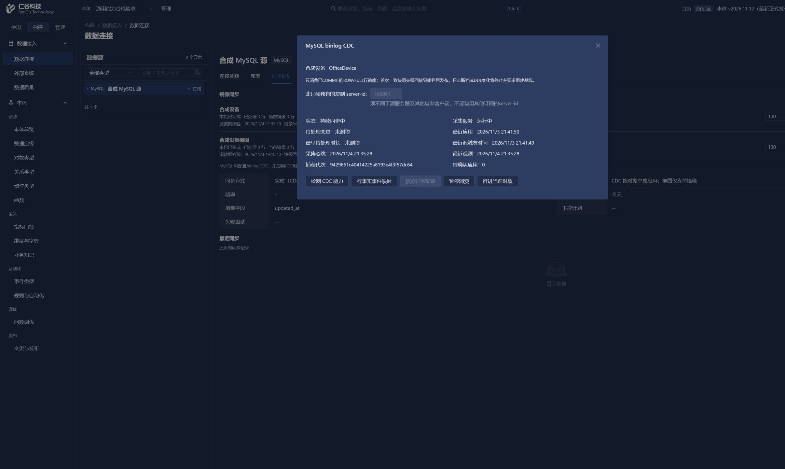

# 绑定一致性首批实现与实际验证

对应 [开发计划](palantir-gap-development-plan.md) 的 DATA-01，以及 DATA-02 的同步状态真实性部分。

## 修改

1. 外部读取授权保存先检查权限、当前映射、预期版本、公开列和主键。来源、字段集合及视图唯一键均未变化时直接返回当前授权，`changed=false`；不更新绑定版本，不生成虚假修改审计，不暂停 CDC、不改游标或基线。
2. 实际修改仍须先暂停 CDC；视图唯一键、来源、字段和版本冲突检查保留。源表真实大小写原样比较，不以小写归一化合并不同标识。
3. 前端普通表和视图均使用同一后台保存合同；未变化显示“读取授权未变化”，不再要求重新同步。CDC 运行期间字段不可改，但允许核对原样授权。旧页面或旧本体的迟到响应不关闭当前表单。
4. MySQL 成功读取并提交后清除旧重连错误；失败事务不提交清除结果。永久错误仍会停止订阅，不会因这个修改自动放行。
5. 空轮询只更新数据核验时间；有真实行事件或首次基线发布才更新镜像写入时间，首次发布单独记录发布时间。不会猜测或重写修复前已经保存的旧时间值。
6. 外部授权页按实际捕获模式显示 MySQL binlog 或达梦事务触发器，不再将 MySQL 标为事务触发器。

## 实际页面

正常 admin 登录，固定 2560×1440，限现有合成本体 8“通用能力合成验收”。运行时仅操作前端或 HTTP 健康检查，没有代理直连数据库。

页面实际 innerWidth/innerHeight 为 2560×1440；浏览器截图工具只捕获 2412×1440 区域，所附图片不能当作完整视口截图。受影响页面控制台未见 error。

| 路径 | 操作 | 实际观察 |
| --- | --- | --- |
| 数据连接 → 合成 MySQL 源 → 库表 → office_device → 配置 → 读取授权 | CDC 开启时不改字段，保存 | 显示“读取授权未变化”，表单关闭，无需暂停或重新初始化 |
| 同上 → office_device_view | 保留 id 唯一键声明及原 4 个字段，保存 | 表单正常关闭；返回同步计划后镜像仍完整，3 行，无配置失效 |
| 数据连接 → 同步计划 | 核对两个对象 | 表与视图均保留原 3 行；没有重建或重新扫描视图 |
| 同步计划 → 合成设备 → 配置 CDC | 保存前后核对 | 捕获代次均为 9429661c40414225a8193e4f3f57dc64；消费和采集运行，待确认应用为 0，未暂停或重建 |
| 同上，加载修复后 | 观察自动轮询 | 先前残留的“源连接或消费暂时失败”消失；心跳及核验时间继续更新，镜像写入时间保持，不把空轮询算作写入 |

MySQL 的待处理数量仍显示“未测得”，没有伪造为 0 或“已追平”。本次没有新增源业务写入，也没有重发旧 UNKNOWN 动作。

## 定向检查

- `node scripts/check-external-binding-save.mjs`：执行真实 Vue setup 和内存响应，覆盖表/视图无变更、字段重排、活动 CDC 禁止实际变更、实际变更反馈、请求错误、跨本体迟到响应和只读拒绝，已通过。
- `npm run typecheck`：已通过。
- 两个修改的 Python 文件语法解析与定向 Ruff F 检查：已通过；不是后台业务测试。
- 计划范围与 FR/AC 对应检查：已通过。
- 正常配置重启后台后，前端和 `/readyz` 均 HTTP 200；没有额外启动事件或动作 worker。

## 变更文件

- backend/app/modules/data/governed_router.py
- backend/app/modules/data/external_cdc.py
- frontend/src/pages/data/ExternalReadBindingModal.vue
- frontend/scripts/check-external-binding-save.mjs

## 保留边界

本批无表结构变更、无新依赖，不需要数据库迁移。旧失效订阅不会自动恢复；首次空基线发布和真实新事件后的时间写入分支尚未在本批重新制造数据验收。未运行后台测试、全量回归、集成或迁移测试；未打包、提交或推送。

当前仅完成首项和同步状态的两处修复，不代表 DATA-02 的统一诊断、DATA-03 多表融合或其他 Palantir 对照能力已经完成。
