# 本体平台完整操作手册：从零建模到智能问数与规则动作执行

本手册面向第一次使用平台的业务建模人员，以民用设备维护为例，从准备数据、建立本体，到查询、规则触发、动作执行和正式发布。按顺序操作即可；已有本体的使用者可从相应章节开始。文中的名称和编号是示例，请按实际业务替换，不需要使用特定工作空间编号。

完成后，应能在对象页面查看设备和维护任务，在问数中查询与画图，按事件或时间条件生成动作，并在动作中心查看结果。外部工单只有在接收系统、授权和运行进程均已配置且实际成功时才算完成。

插图均取自本机合成验收环境；图中的名称、数值、时间和版本仅代表截图时点。图片按原文件保存，可打开 [配图目录](assets/ontology-guide/) 查看原图中的细节。

## 目录与阅读路线

1. [认识平台和准备环境](#1-认识平台和准备环境)
2. [准备设备维护示例数据](#2-准备设备维护示例数据)
3. [创建和管理本体工作空间](#3-创建和管理本体工作空间)
4. [连接数据并建立设备对象](#4-连接数据并建立设备对象)
5. [配置补充表、维护任务和关系](#5-配置补充表维护任务和关系)
6. [建立函数并修改已有函数](#6-建立函数并修改已有函数)
7. [建立动作及外部接口](#7-建立动作及外部接口)
8. [建立事件及检查载荷](#8-建立事件及检查载荷)
9. [建立字典、业务知识和指标](#9-建立字典业务知识和指标)
10. [配置和查看数据质量](#10-配置和查看数据质量)
11. [使用 AI 构建助手](#11-使用-ai-构建助手)
12. [智能问数和图表](#12-智能问数和图表)
13. [保存查询页面](#13-保存查询页面)
14. [配置规则和自动化](#14-配置规则和自动化)
15. [执行动作并查看回执](#15-执行动作并查看回执)
16. [正式发布完整本体和查看版本](#16-正式发布完整本体和查看版本)
17. [从零验收清单](#17-从零验收清单)
18. [常见问题与处理](#18-常见问题与处理)
19. [能力边界与管理员准备](#19-能力边界与管理员准备)

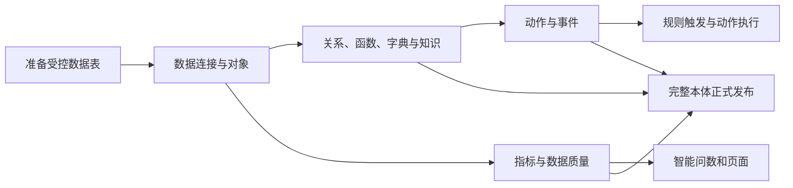

## 先理解这个业务故事

一家设备维护团队把设备编号和状态保存在主表，把校准备注保存在另一张表，把维护任务保存在任务表。业务人员想知道“哪些设备待保养”，还希望设备达到条件时生成维修工单。直接看三张表，需要反复解释字段、关联方式和状态名称；本体把这些数据的**业务含义、关系与可执行行为**组织在同一个工作空间中，让查询和操作使用共同口径。

“使用”区是业务人员看对象、问数、查看告警和动作结果的地方；“构建”区定义这些对象、规则和指标；“管理”区维护账号、权限等平台设置。它们不是三个独立的数据副本。先在构建区保存定义，再到使用区验证数据和结果。

| 内容 | 解决什么问题、得到什么 | 设备例子与前置关系 |
| --- | --- | --- |
| 对象和属性 | 说明业务中有什么，以及每个对象有哪些信息 | 设备对象包含编号、状态和维护时间；先有源表和字段 |
| 关系 | 说明不同对象怎样对应 | 维护任务属于哪台设备；先有设备和任务两个对象 |
| 函数 | 从输入计算输出，本身不写业务数据 | 根据状态计算标签；动作或规则可以引用固定版本 |
| 动作 | 定义允许做的具体操作及其影响 | 更新状态或发送工单；依赖对象、参数和明确授权 |
| 外部系统 | 定义发送请求的受控目标及返回处理 | 本机工单接口；动作使用它，但连接配置本身不会发单 |
| 事件 | 记录一件事情已经发生 | 收到设备待维护事件；包含设备标识等载荷 |
| 规则 | 判断何时、对什么对象采取什么行为 | 事件到达且状态待维护时生成动作；引用事件、条件和动作 |
| 指标 | 定义可重复使用的统计口径 | 当前设备数；可按状态分组 |
| 维度与字典 | 统一分类和规范取值 | 状态字典规定“待维护”等取值，供筛选和分组 |
| 业务知识 | 解释业务词与用户常用说法 | 将“待保养”解释为“待维护”，供问数理解 |
| 数据质量 | 检查源数据是否符合约定 | 检查编号是否为空或重复，结果帮助判断数据能否放心使用 |

### 最短可跑通路线

1. 管理员准备三张合成表、只读账号和隔离；确认接收端及工作进程可用。
2. 创建本体并连接数据源。
3. 导入设备对象，设置主键、标题和读写授权。
4. 配置 1:1 补充表，导入任务对象并建立 N:1 关系。
5. 建立函数，并用示例输入试运行。
6. 配置工单动作、受控外部系统与输入输出映射。
7. 定义事件和载荷，模拟检查结构；添加规则订阅。
8. 配置字典、知识、指标，再用问数核对设备与任务。
9. 建立事件规则，先试跑，再按需要选择自动或人工确认；在动作中心核对回执。
10. 检查完整本体后正式发布；查看顶部是否仍有未发布更改。

初次学习可先完成只读查询，不接外部系统，也不启用规则；需要自动工单时再完成步骤 5–7、9。数据质量、页面订阅和版本比较可在主线跑通后按需深入。

## 1. 认识平台和准备环境

顶部的“使用”“构建”“管理”分别用于查询和处理业务、维护本体定义、管理平台设置。一个**本体工作空间**是一套相互隔离的对象、关系、指标、规则等定义及其业务上下文。切换空间后，页面目录、权限和可见数据随之变化。

本机演示采用单用户操作：有相应权限的账号可以创建、编辑和保存定义，无需为每一步指定审核人。一般定义保存后立即在当前工作空间可见；**正式发布**是对完整本体做一次统一校验和版本快照，见第 16 节。历史数据中若出现旧审核状态，应按历史记录理解，不把它当作新工作流程。

打开已部署的平台并使用分配的账号。当前本机示例前端通常为 `http://127.0.0.1:5280`，后端为 `http://127.0.0.1:8000`。管理员若已完成示例配置，可在项目根目录运行 `backend/scripts/start_rescue_demo.ps1` 启动本机 API、受控接收端及示例工作进程；前端在 `frontend` 目录运行 `npm run dev`。该脚本依赖现有本机配置，不能视为生产部署或开机自启。账号、连接密码和签名材料由管理员安全配置，不写入本文或聊天。

## 2. 准备设备维护示例数据

请管理员事先准备下列业务数据与访问权限。连接可用不代表平台已经自动获得查询或写入权限。

| 数据 | 用途 | 示例字段及要求 |
| --- | --- | --- |
| 设备主表 | 一个设备一行 | `id` 为真实、唯一、非空的单列主键；`code` 为显示编号；`status` 为状态；`maintenance_at` 为维护时间；带工作空间隔离列 |
| 校准补充表 | 为一个设备补充校准信息 | `asset_id` 与设备主表关联；在工作空间范围内唯一；`calibration_note` 为补充信息 |
| 维护任务表 | 一个设备可有多条任务 | 唯一主键、任务编号和指向设备的关联字段；作为独立对象，通过关系连接 |

本机已验收的设备表有三条合成记录，覆盖不同状态及 9 月、10 月日期。自动动作会改变状态，因此查询结果取决于操作时点；不要把早先“三类状态各一条”当作始终成立的固定结果。第 10 节的错误数据在**独立质量样例表**中，不要为了体验质量检查修改正常业务表。

受控对象读取目前面向本应用 PostgreSQL 同库 `public` 业务表，要求标准工作空间行级隔离及对应表、列的读取权限；动作还需明确授权可写字段。补充表须满足唯一键和隔离要求。请管理员根据现有数据源和安全策略准备；仓库不提供适用于任意新领域的一键造表脚本。真实业务接入应先确认数据合法性及授权。

## 3. 创建和管理本体工作空间

1. 点击顶部本体名称旁的“管理”，进入“本体工作空间”，选择“新建本体”。
2. 填写名称，例如“设备维护”，填写唯一的小写标识，例如 `equipment-maintenance`，可填写领域和描述；点击“创建并进入”。
3. 进入后顶部显示当前本体；切换本体时先核对名称，再继续操作。新空间自动初始化标准动作事件。早于该能力创建的旧空间不一定自动回填。
4. 在管理列表中，所有者可对非默认空间选择“删除”，输入完整名称确认。删除后空间不可访问，但源业务表和既有记录不随之删除；已发送到外部的请求无法撤回。当前空间被删除时会切换到可访问空间。
5. 在“已删除的工作空间”选择“恢复”。恢复后自动化仍暂停，需所有者确认“启用自动化”；启用后可能处理积压任务，请先核查。删除遇到正在执行的任务可能提示稍后重试。默认空间不可删除。

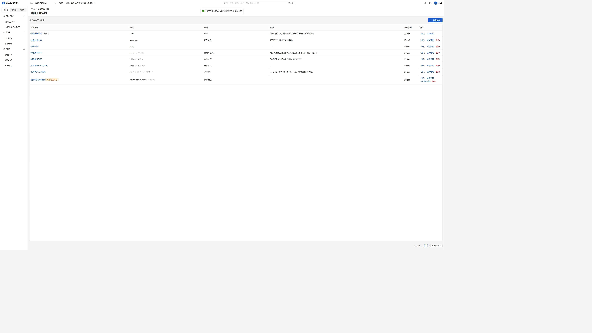

**图 1 看哪里：**列表中临时验收空间旁有“自动化已暂停”，右侧是“启用自动化”；其他工作空间仍可进入。

图为本机临时验收空间恢复后的状态，其他空间名称和列表可能不同。

## 4. 连接数据并建立设备对象

**为什么先做这一步：**对象让平台知道“一台设备”是什么；连接、属性映射和授权分别回答数据在哪里、字段是什么意思、谁能读写。只有对象定义时，真实数据未必可读。

1. 进入“构建 → 数据接入 → 数据连接”，点击“新建连接”，填写管理员提供的连接信息和负责人；点击“测试连接”，成功后保存。
2. 选择连接并打开“库表”，找到设备主表。行数为“—”表示尚无可用统计值，不能理解为零行；实际为零的统计值显示 0。
3. 从数据源导入对象，选择主表和需要的字段。为设备填写名称和唯一 API 名，例如 `MaintenanceAsset`；核对每个属性对应的真实来源列及类型。
4. 在“主键”选择真实的单列唯一非空源属性，例如 `id`；在“显示标题”选择便于识别的 `code`。主键和标题可不同，不要把普通显示编号误当成物理唯一键。
5. 确认后保存，对象定义立即生效。导入定义本身不会授予数据表访问权限。
6. 返回库表行的“配置”，按对象选择“受控权限”，检查主表及候选列，分别勾选允许读取的列和需要写入的主表列。设备示例可读取 `id`、`code`、`status`、`maintenance_at`，仅在确有需求时授权 `status` 写入；点击“保存授权”。行权限和动作权限仍独立生效。
7. 进入“使用 → 对象 → 对象搜索”，选择设备对象，核对列表、详情和实际记录数。看不到数据时检查连接账号、工作空间隔离和字段授权，而不是随意扩大权限。

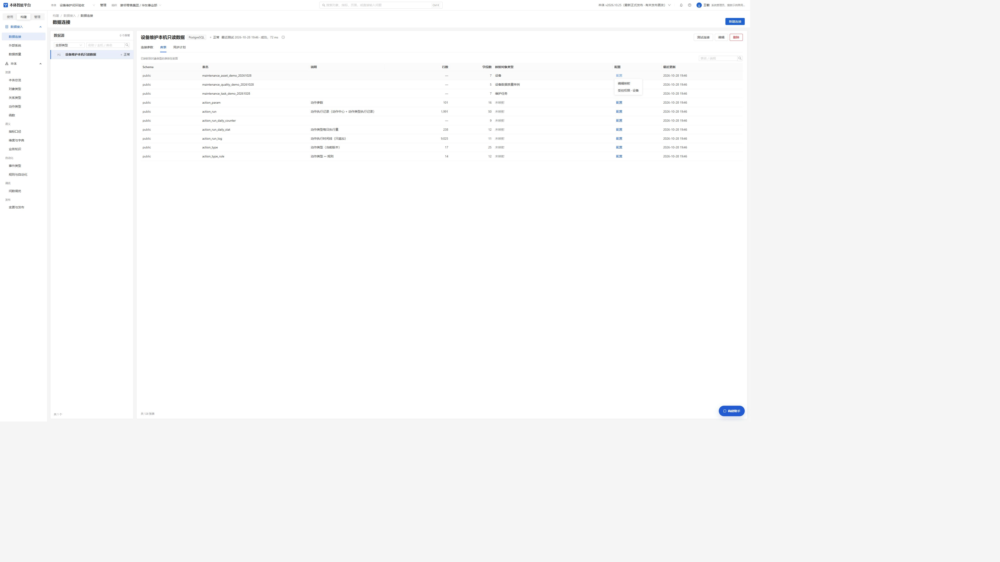

**图 2 看哪里：**库表行显示映射对象，右侧“配置”进入编辑映射或受控权限；“—”表示无可用行数统计。

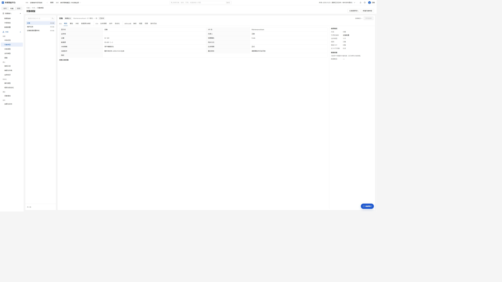

**图 3 看哪里：**设备的主键是 Id，标题属性是 Code；主键用于稳定识别同一条设备，标题用于让人看懂列表。右侧的属性和数据源页签可继续检查。

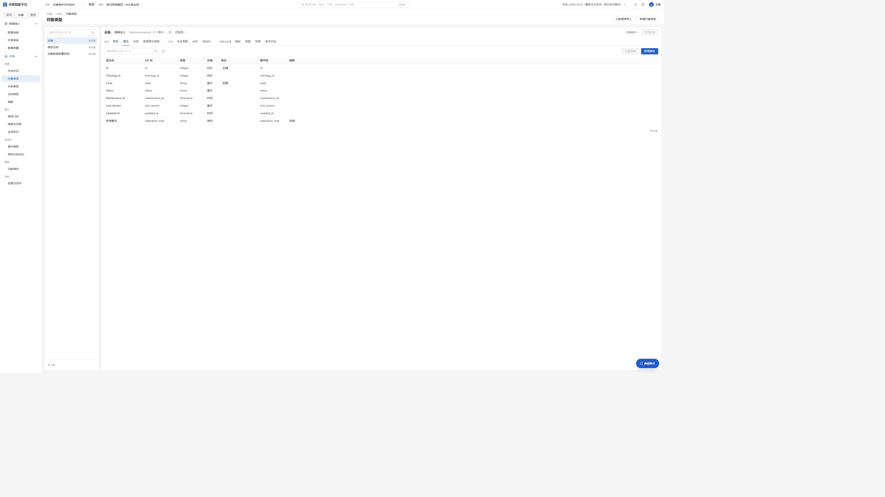

**图 4 看哪里：**每行显示业务属性、类型和来源列；`status` 来自主表，校准备注是补充信息。导入后还须另行配置读取和写入授权。

## 5. 配置补充表、维护任务和关系

**什么时候需要：**校准备注与设备一一对应时用补充表；一台设备有多条维护任务时必须用独立对象和关系。只有主表数据时可暂跳补充表。

在设备的“配置 → 受控权限”中启用“补充表（1:1）”：填写管理员准备的补充表名，点“检查表”，选择主表关联列、补充表关联列及“补充字段映射”，确认唯一键和工作空间隔离检查通过后保存。可将补充表 `calibration_note` 映射为设备属性。补充字段当前只读，动作写回限定主表授权字段；界面如不满足唯一键、权限或隔离条件会阻止保存。

再从任务表导入 `MaintenanceTask` 对象。在“构建 → 本体 → 关系类型”新建关系，选择源对象“维护任务”和目标对象“设备”，将任务中的设备关联字段对应设备真实主键，核对方向和关联字段类型后保存。打开任务详情中的关联对象，确认能进入对应设备。

一个设备有多条任务属于 **1:N**，应建子对象和关系，不能把多行任意取一条并冒充设备的单个属性。本轮 1:1 支持同库受控表，不是跨库连接或通用 ETL；补充字段的指标、规则使用范围尚未全面实测。

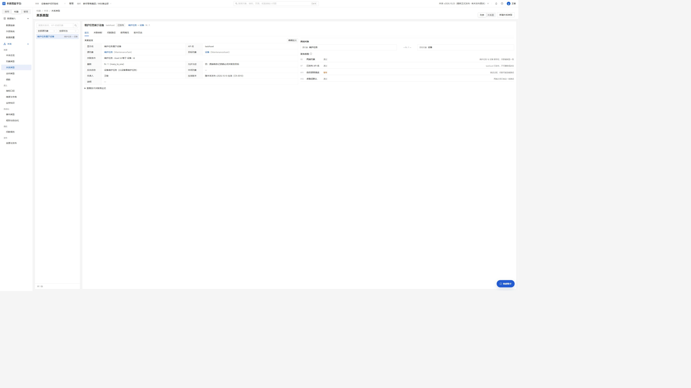

**图 5 看哪里：**源端是维护任务、目标端是设备，任务的 Asset Id 对应设备 Id；N:1 表示多条任务可以指向同一设备。关系描述过短的提示是改进建议，不能当作数据匹配成功的证据。

## 6. 建立函数并修改已有函数

**什么时候需要：**多个动作或规则需要复用同一计算时建立函数；只查原始数据可暂跳。函数负责计算，动作才负责业务写入或外发。

1. 进入“构建 → 本体 → 函数”，点击“新建函数”。填写名称、API 名、参数和返回类型。例如 `maintenance_label` 接收文本参数 `status`，返回维护标签。
2. 在受限纯计算表达式中实现规则，保存后进入“测试运行”，输入与参数一致的示例值，点击“运行”，核对输出。函数只支持页面列出的受限语法；不可导入、访问数据库或网络，也不应编写任意代码。
3. 已有函数可点击“编辑”，表单带入当前参数、返回类型和表达式；检查引用后修改并保存，生成新版本。
4. 要让 AI 帮助修改，在该函数详情点击“AI 辅助修改”，描述想改什么。核对目标函数和源版本，在差异中**只勾选需要接受的字段**，进入编辑表单再次检查，再由用户保存。源版本已变化时应重新生成或重新打开，不能套用过期建议。
5. 在“版本历史”可查看旧版本。已有动作绑定的固定函数版本不会自动升级；确需使用新版本时，另行检查并修改动作绑定，避免无声改变业务行为。

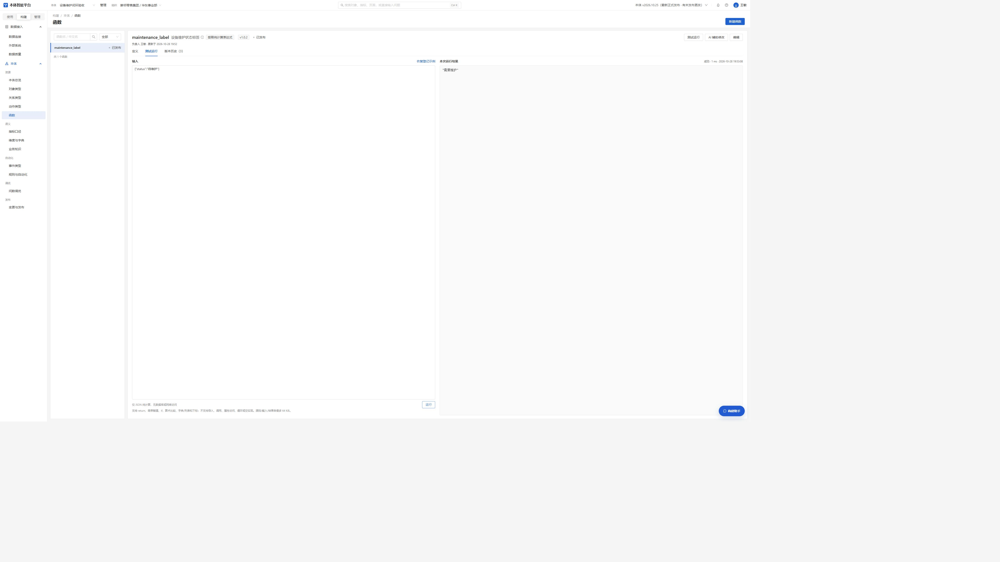

**图 6 看哪里：**左侧输入与参数相符的示例值，点击运行；右侧显示本次运行结果。

图中是本机合成函数 v1.0.2 的一次实际运行，输入状态“待维护”，输出“需要维护”。

## 7. 建立动作及外部接口

**什么时候需要：**要改变设备状态或发送工单时建立动作；只问数可以暂跳。参数决定操作对象和输入，响应映射决定如何判断外部是否成功。

在“构建 → 本体 → 动作类型”新建动作，明确业务名称、作用对象和输入参数。设置提交条件、允许操作的字段以及参数来源：固定值、对象属性、用户输入或固定版本函数。若要用函数结果更新设备状态，先选择真实函数版本，逐项映射参数，确认输出类型与目标 `status` 一致；只有主表已授权的可写字段可写回。

如需创建外部工单，先在“数据接入 → 外部系统”配置经授权的 HTTP 接收系统，再在动作中选择该系统、允许的动作和路径，并配置请求字段、响应字段、成功或失败判断及幂等键。界面支持 HTTP REST/Webhook 的受控映射，不代表任意协议已接入。地址、证书、签名、超时和部署层白名单由管理员配置；不要在聊天或截图中泄露密钥。

接口地址可填写 `http://` 或 `https://` 的来源地址（主机和端口，不包含路径、凭据或查询参数）。保存后打开“探测配置”，填写同源的只读健康检查路径，再通过“测试调用 → 开始探测”检查连通性；真实请求还需落在管理员配置的网络范围和端口内。探测使用不携带已保存凭据的 GET，成功只证明该接口可访问，不代表业务写回已执行；要求认证的健康检查需要服务端另行提供适用的只读探测入口。HTTP 本身不加密传输，HTTPS 仍验证服务证书。

选择动作的执行策略，确认参数、权限、额度和业务影响。规则可以要求自动执行或生成待确认动作，但动作自身更严格的确认策略优先。单用户正常确认不是要求另找审核人。保存定义不会直接发送外部请求。

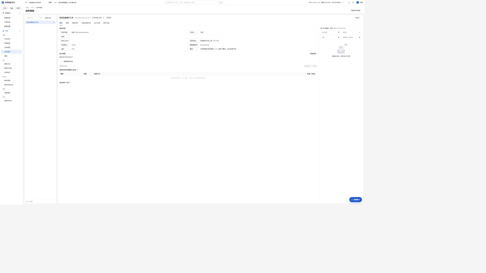

**图 7 看哪里：**目标对象是设备，写回系统和路径标明接收位置，幂等键用于识别同一次动作；超时显示结果未知，需要先对账。动作自身策略也会约束规则的自动执行。

## 8. 建立事件及检查载荷

**什么时候需要：**外部系统或平台要告知某件事已发生时使用事件；纯手动查询可以暂跳。事件载荷是这次事实携带的信息，订阅决定谁接收。

在“构建 → 本体 → 事件类型”选择“新建”，填写事件名称、来源和关联对象。按照业务逐项添加载荷字段、类型和必填要求；对象和数组可在结构编辑器中继续添加子字段。保存后在事件详情的“订阅方”中配置需要接收事件的已启用规则。

点击“模拟触发”，在可视化字段中填写测试值，检查必填项、嵌套对象和数组，查看验证结果。模拟用于检查载荷和过滤，不等于真实事件已经投递或外部动作已执行。来源、时间单位及关联对象必须按真实目录选择；未知内容先补齐，不要为了保存猜测。

**图 8 看哪里：**“检查报告”是必填对象，其中“检查项”是数组；必填约束和元素类型决定真实接收时怎样校验。此图仅打开编辑器查看，未保存或投递。

## 9. 建立字典、业务知识和指标

**为什么需要：**状态字典统一分类，业务知识解释“待保养”这类说法，指标固定“设备数怎么计算”。三者可分别使用，配合时可让问数按共同口径统计。

**字典和维度。** 在“维度与字典”新建状态字典，例如维护状态；登记真实状态值“待维护”“已完成”“需要维护”，并与设备状态字段对应。保存后核对列表及详情。已有取值的层级若界面不允许改名，先处理引用，不要通过删除重建伪装改名。

**业务知识。** 在“业务知识”新建词条并关联正确对象或字段。例如将用户说法“待保养”解释为字典中的“待维护”。保存后通过问数检查实际筛选是否使用了规范值；同义词不是自动证明所有回答都正确。

**指标。** 在“指标口径”新建设备总数，选择设备对象及计数聚合，使用当前快照并保存；试算应与当前可见设备数一致。按状态分组时选择已配置的状态维度。当前快照计数不必为了试算强行指定时间字段；按月或同比、环比等时间计算需要真实、有业务含义的时间字段和可用历史数据，缺少历史快照不能用当前值冒充历史。

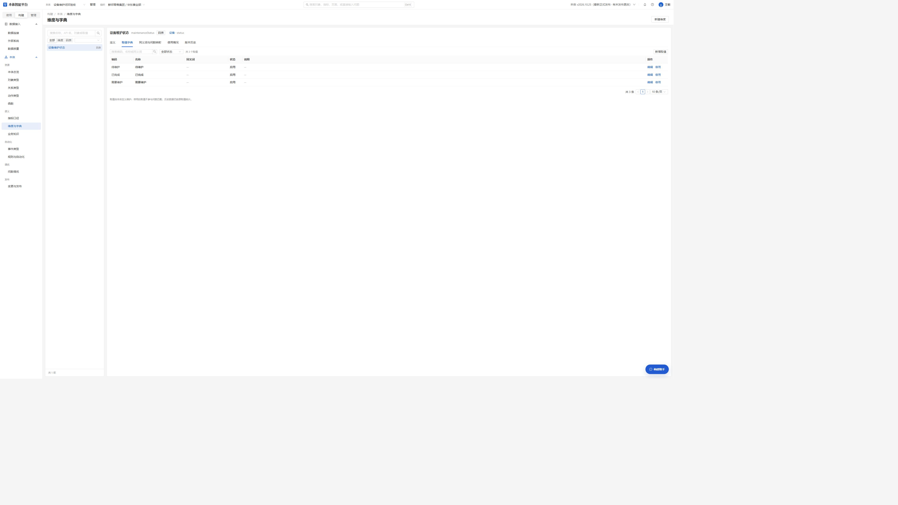

**图 9 看哪里：**编码、名称和启用状态共同约束状态的可选值；停用不会删除历史记录。字典帮助平台统一状态，业务知识则解释用户怎么称呼它。

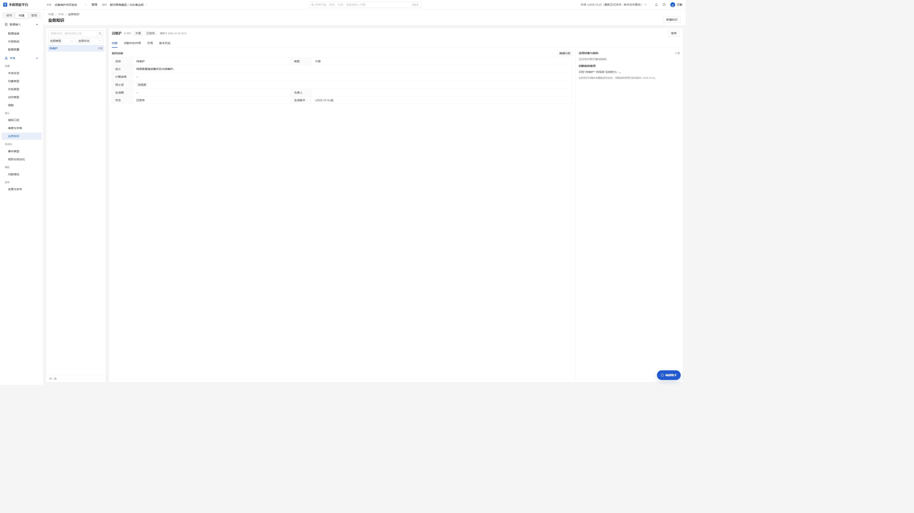

**图 10 看哪里：**定义和同义词把“待保养”解释为“待维护”；图中映射位置显示空值，说明还应结合真实问数检查，不应仅凭词条页面宣称映射已完成。

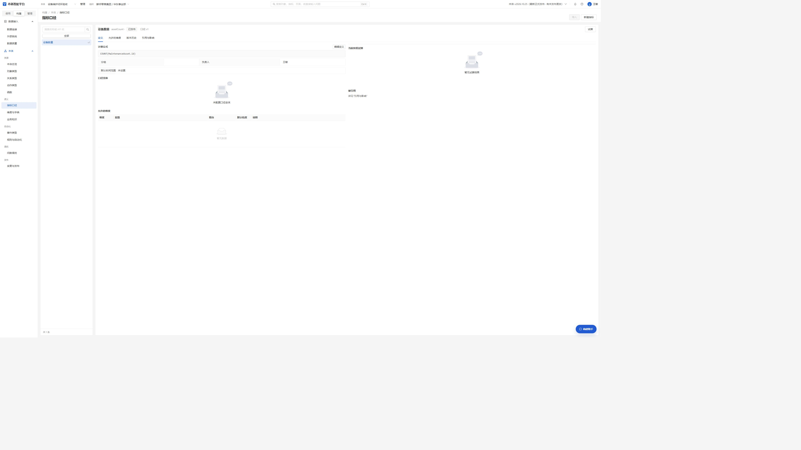

**图 11 看哪里：**公式使用设备主键计数，默认时间范围未设置；这表示当前快照口径，不应理解为某个月或历史趋势。

## 10. 配置和查看数据质量

**什么时候需要：**当编号缺失、重复或数据过旧会影响查询和动作时，先配置检查；仅做建模预览时可暂跳。检查报告问题，不自动修复源表。

在“构建 → 数据接入 → 数据质量”点击新建检查，选择对象、检查类型、字段、阈值和调度，保存后运行；选择检查行，右侧显示运行历史和结果。可选择空值率、唯一性、格式、数据源新鲜度、记录时效和引用完整性，具体可选项取决于对象和字段。

| 检查 | 如何理解 |
| --- | --- |
| 空值率 | 字段为空的记录占比，按设置阈值判断。 |
| 唯一性 | 统计重复的附加行数，设置允许的重复条数。 |
| 格式 | 可选非空白、非负整数字符串或邮箱基本结构；空值不计格式不合格。 |
| 数据源新鲜度 | 根据数据源最新更新时间判断整体是否及时，不等同要求每条历史记录都新。 |
| 记录时效 | 指定时间字段，逐行统计超时和空时间；例如阈值 48 小时。 |
| 引用完整性 | 检查关联是否能找到目标，先确认真实关联字段和权限。 |

独立合成质量表在某次运行中为 3 行：空值 1/3、重复附加行 1、邮箱基本格式异常 2、48 小时记录时效陈旧 1/3 且空时间 0/3；四项均按零容忍阈值显示失败。它们是该时点的验收数据，不是对其他数据源的预期。目前汇总和运行历史可见，尚不提供命中行详情。引用完整性和数据源新鲜度未在该四项样例中实测。

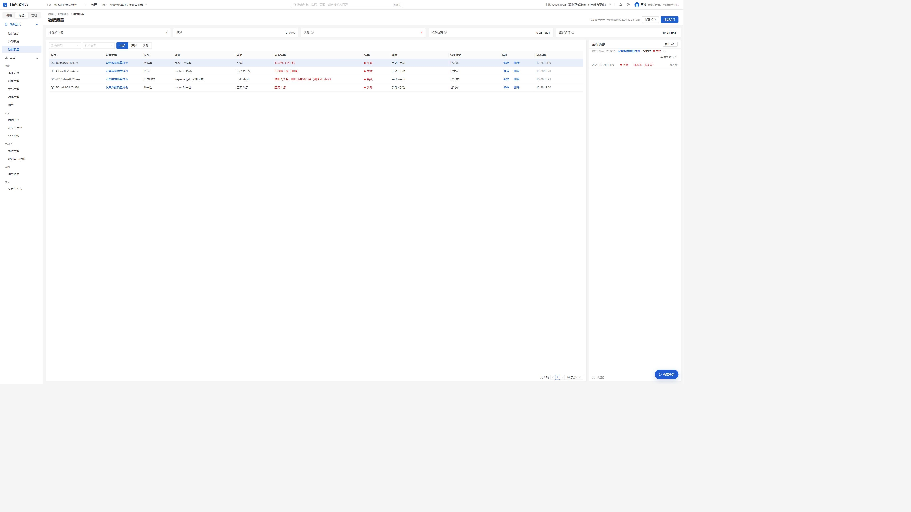

**图 12 看哪里：**左侧选中一项检查，右侧查看该项的运行历史；检查较多时左表内部可横向滚动。

## 11. 使用 AI 构建助手

**什么时候需要：**不熟悉字段或受限函数写法时，用它先生成可编辑建议；已有清晰定义时可直接使用表单。

构建区点击右下角“构建助手”。上方是可滚动的对话和候选草稿，下方输入需求；Enter 发送，Shift+Enter 换行，可放大或恢复窗口。助手根据当前页面和文字识别对象、关系、函数、动作、指标、维度字典、知识、事件或规则的建议类型；跨模块需求应在文字中明确说明。

例如在函数页描述：“建立一个接收设备状态并返回维护标签的纯计算函数，待维护返回需要维护，其他返回正常。”可以继续追问或修改；检查候选的名称、字段、参数、条件和引用，选择应用到表单，再由用户补齐、保存。规则条件需在编辑器核对；事件候选的未知来源可能留空，需人工选择。助手不会直接执行动作或自动保存定义。

当前函数详情支持第 6 节的**针对已有函数修改**。其他类型的建议主要进入新建表单，不应当作已有定义的自动编辑；重名不应覆盖原定义。只读空间不可保存。页面或空间变化后旧候选不能用于新上下文；本浏览器标签内可恢复对话和未发送输入，切换本体会隔离会话。七轮实操中曾出现未要求的描述改写，重申后恢复，因此长对话仍需逐项核对，尤其是未要求改变的内容。

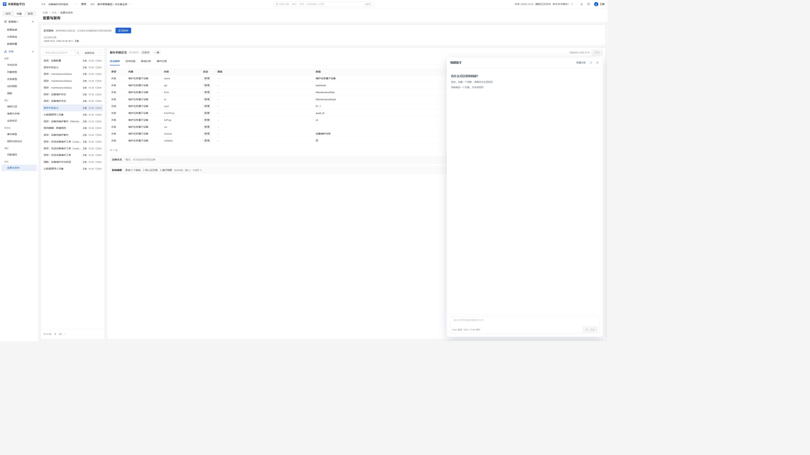

**图 13 看哪里：**上方是对话及候选区，下方输入框用于继续描述，右侧发送；右上角可放大或关闭。助手使用当前页面上下文，建议仍须人工检查并保存。

## 12. 智能问数和图表

**作用：**将业务问题转成基于当前本体和权限的数据查询，让使用者不必手写 SQL；先确保对象、字段和所需关系可读。

进入“使用 → 智能问数 → 问数工作台”，确认顶部本体后，用自然语言描述需要的数据。以下是可直接改写的输入示例：

- 列出当前所有设备的编号、状态和维护时间。
- 统计当前设备总数，不限时间；按状态分组。
- 查询 2026 年 9 月维护的设备；再单独查询 10 月的数据。
- 列出状态为“待维护”的设备；使用已配置的同义词“待保养”查询并核对范围。
- 列出设备编号和校准说明；查询每个维护任务对应的设备。

查看回答的数据来源、口径、时间范围、状态范围及实际结果；条件不清楚时补充说明。对有分组结果的回答选择柱状图等展示，并确认图表与表格使用同一口径。图形正确显示不保证查询语义正确；应抽查字段、筛选和数量。普通知识性回答应理解为对应来源的说明，不可冒充实时业务查询。

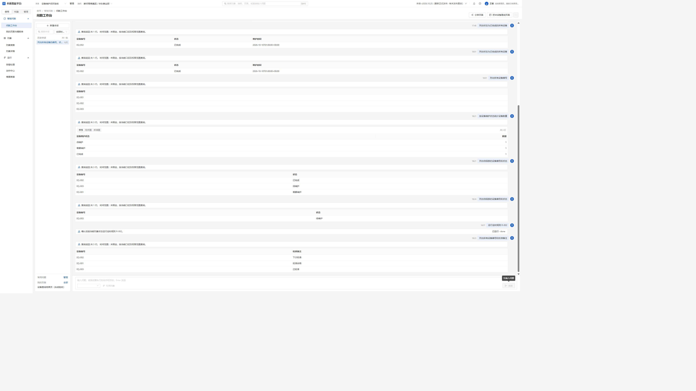

**图 14 看哪里：**回答列出设备编号和校准备注，来自同一设备对象的主表和 1:1 补充表。结果是截图时点的合成记录，后续状态或数据变化以重新查询为准。

## 13. 保存查询页面

**作用：**把已核对的查询固定成可再次查看的卡片；一次性查询可以不建页面。页面刷新重新取数，不重复发起业务动作。

核对成功查询后，在回答中选择“固定到页面”，选择已有页面或创建页面；也可进入“我的页面与模板库”管理。页面可查看卡片、调整名称、配置刷新与订阅或导出，具体操作取决于页面所有者权限与部署的调度、推送通道。

“立即刷新”会按当前权限重新执行可兼容的只读查询；普通保存或新增无关字段不会仅因版本号变化锁死所有卡片。被引用字段、来源或口径发生不兼容变化时，受影响卡片单独提示处理，其余卡片仍可刷新。若历史查询遗漏了用户明确的知识筛选条件，应重新提问并固定正确结果，不能把旧缓存当实时结果。页面刷新不会自动重放历史规则或动作请求。定时刷新和导出使用共同校验，但本轮未分别实操验收。

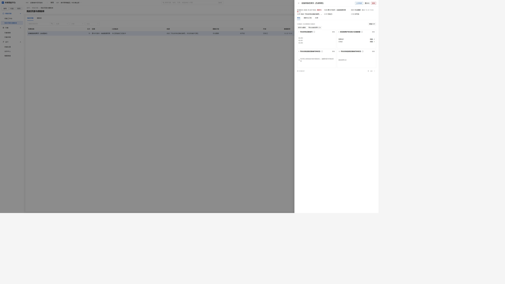

**图 15 看哪里：**这是一次部分刷新示例：有兼容卡片更新，也有历史卡因筛选不符合要求被单独阻断。失败提示不是正常成功状态；应重新提问固定受影响卡片。

## 14. 配置规则和自动化

**作用：**规则把“什么时候需要处理”和“要做什么”连接起来。例如收到设备事件且状态待维护时生成工单。仅手动处理时可以暂跳。

1. 在“构建 → 本体 → 规则与自动化”点击“新建规则”，选择名称、对象及业务目的，进入编辑。
2. 添加条件并选择取值来源：对象属性、事件载荷、已发布指标、固定版本函数或关联对象属性。选择字段、比较方式和目标值；函数条件需选择固定版本并逐个映射入参，关联属性当前限定受控一跳。
3. 设置去重键和冷却时间，避免重复命中：去重键判断是否同一次事件，冷却控制一段时间内是否再次触发；外发幂等键则防止同一动作产生重复工单，三者各有作用。历史事件没有真实对象快照时，不能假称使用了事件发生时的对象状态；没有所需快照时应阻止或按页面说明处理。
4. 在“触发方式”选择“事件”或“定时”。事件规则选择与对象匹配的已发布事件并设置过滤条件，检查事件的规则订阅；定时规则填写调度和时区。定时规则不能把事件字段作为动作参数。
5. 在“命中后生成动作”选择动作和参数映射，再选择“自动执行”或“生成待确认”。确认触发及动作配置已启用，保存后当前定义生效。先用当前数据推演或历史回放检查条件、命中和去重；试跑不等于实际提交动作。
6. 问数中可提出运行规则：定时规则需要确认；事件规则需要选择真实事件并确认，事件候选支持分页。不要把模拟载荷或不存在的事件当成真实事件。超过 100 条的分页代码已接入，尚未在本轮页面跨 100 条实测。

实际自动触发还依赖启用的事件订阅、内部路由、工作空间授权及正在运行的事件和动作工作进程；界面保存成功不代表部署侧已运行。外部通道仍须配置，不应假定任意新空间默认能够外发。

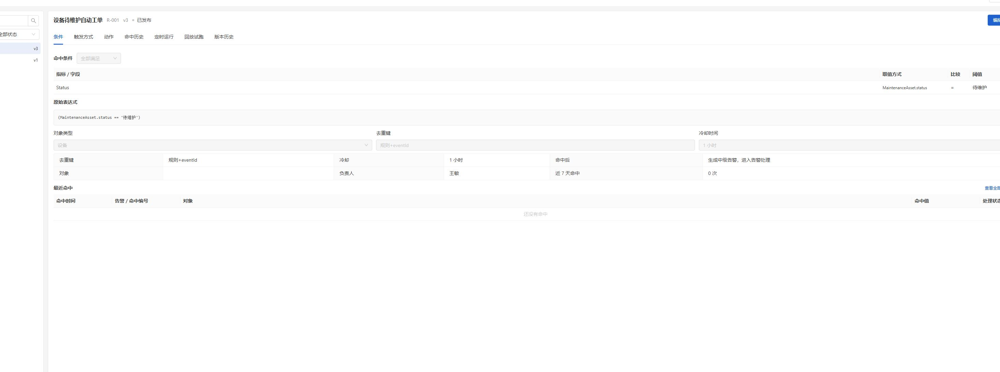

**图 16 看哪里：**条件是设备状态等于待维护；去重键确定哪些命中属于同一事件，冷却时间控制一段时间内重复触发。两者用途不同。

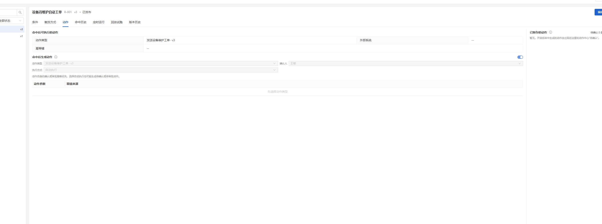

**图 17 看哪里：**选择要生成的动作和“执行方式”；图中为自动执行。动作自身若要求确认，仍以更严格策略为准。下方记录可追踪已经生成的动作。

## 15. 执行动作并查看回执

**作用：**动作记录回答“做了什么”，回执和对账回答“外部是否确实完成”。事件、规则命中和动作成功是不同阶段，应分别查看。

手动操作可从对象详情或“使用 → 运行 → 动作中心”进入，选择动作、对象和参数，检查影响并按策略确认。问数发起的业务动作同样应查看候选和确认，不因同一历史卡反复创建动作。规则自动模式在动作策略允许时可无需人工确认；人工模式生成待确认记录，由当前有权限账号确认。

对于外部工单，在事件详情查看近期事件、投递和规则命中；再在动作中心查看动作状态、外部回执与对账。完整路径应为：**真实事件 → 规则命中 → 动作 → 本机或授权外部接收 → 回执 → 对账**；如配置了函数写回，再到对象详情核对真实字段。不要以“请求已排队”代替外部成功。

若超时或结果未知，先查看动作、接收端回执和对账状态；有证据确认未完成时，按页面提供的重试方式使用原幂等记录，避免重复工单。版本不匹配的旧动作应重新核对，不强制执行。

本机合成空间的两次自动动作 `ACT-20261028-0001` 和 `ACT-20261028-0002` 曾分别取得受控接收端回执并完成对账；同一事件重复接收未新增动作。它们是验收记录，不应作为新业务操作的编号或真实外部联调证明。

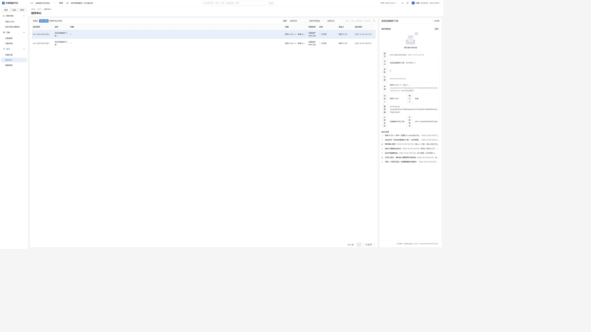

**图 18 看哪里：**动作中心展示合成工单的状态和对账信息。只有外部回执和对账证明成功，才可说这次工单已完成；截图不代表生产接口已联调。

## 16. 正式发布完整本体和查看版本

**作用：**日常保存让当前工作立即可用；正式发布在一个确定时点为完整本体留下可追溯快照。每修改一个字段都不需要单独正式发布。

在构建过程中，对象、函数、规则等正常保存即在当前工作空间可见，也形成操作记录或内部工作修订；它们不应各自冒充一次完整本体正式发布。准备对外使用完整版本时，进入“构建 → 本体 → 变更与发布”，检查完整本体的对象、关系、函数版本、动作、事件、规则、指标、字典、知识及绑定等，执行页面提供的完整校验，解决阻断项，再确认正式发布。

顶部显示最新正式版本；如果之后又保存了定义，会提示“有未发布更改”。正式记录和当前工作内容应分别理解。后续正式快照包含非密钥的受控对象绑定定义；历史版本实例读取不以当前映射冒充历史数据。编号沿内部工作修订序列递增，不表示正式发布次数。本机旧正式版本 v2026.10.25 早于绑定快照段加入，不能认为它包含之后的绑定。

规则详情的版本历史可以比较已保存版本；恢复旧规则会生成新的当前版本，旧版本保留。缺少真实快照的历史版本不可恢复。修改函数、规则或引用后，要重新检查动作绑定与影响。

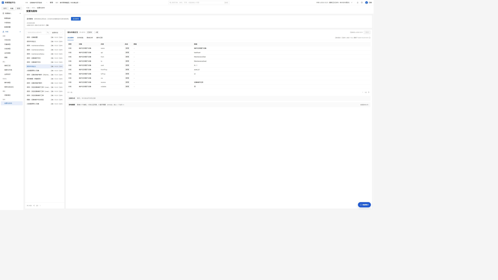

**图 19 看哪里：**顶部“正式发布”是对当前完整本体统一校验并留存快照；下方逐项保存记录是工作改动历史，不能把每条记录当成一次正式发布。顶部还显示已有未发布更改。

## 17. 从零验收清单

按实际业务和授权范围逐项核对，不必运行后台测试：

- [ ] 创建并进入新本体，顶部名称正确，标准动作事件存在。
- [ ] 连接测试成功，主键和标题选择正确；设备对象读取真实数据，未授权字段不可写。
- [ ] 1:1 补充信息与主表逐条对应，设备数量不因关联增加；1:N 任务可通过关系进入设备。
- [ ] 函数使用有效输入试运行；修改函数后版本历史可见，动作固定版本已核对。
- [ ] 字典、同义词和当前快照指标已保存，试算与当前记录一致；质量检查显示实际结果。
- [ ] 问数分别核对全部状态、明确状态、日期、补充字段及关系；图表和表格口径一致。
- [ ] 页面固定的是有真实来源的成功查询，刷新后查看逐卡结果，不重放动作。
- [ ] 规则试跑结果符合预期；人工模式生成待确认，自动模式仅在已授权条件下执行。
- [ ] 在受控本机环境核对一次事件、命中、动作、外部回执与对账；重复事件不重复执行。
- [ ] 完整校验后正式发布，并确认工作修改和正式版本状态可区分。

## 18. 常见问题与处理

| 现象 | 处理 |
| --- | --- |
| 连接成功但对象读不到 | 核对当前本体、源表/列读取权限、工作空间行隔离、对象映射和真实主键；连接成功不等于业务授权。 |
| 找不到字段或关联数据重复 | 核对真实列和类型，检查映射是否保存；1:1 补充表必须唯一，1:N 使用任务对象和关系。 |
| 列表找不到记录 | 检查当前本体、筛选与分页，不把未显示的第一页当作全量。 |
| AI 提示连接失败 | 检查管理员配置的模型服务和网络；保留需求后重试，不在页面粘贴密钥。 |
| `PAGE_EXECUTION_UNAVAILABLE` | 查看该回答是否有真实成功查询或有效来源，以及当前权限和引用字段是否仍兼容；失败或无来源回答不能伪装为实时卡片。 |
| 卡片提示口径或字段不兼容 | 单独检查变化和来源；确有不兼容或原查询语义错误时重新提问并固定，不强制使用旧结果。 |
| 事件待投递、动作执行器不可用 | 检查订阅、工作进程、空间范围、动作版本和授权；外部写入前确认接收地址、证书与路径。 |
| 外部结果未知或超时 | 先查回执和对账，确认幂等记录后再按证据处理，不盲目重复发送。 |
| 名称重复或旧建议不可用 | 使用唯一名称，或显式进入已有函数编辑；若源版本、页面或空间已变化，重新生成并核对。 |
| 恢复本体后自动化未运行 | 恢复默认保持暂停；所有者确认积压影响后再启用。 |
| 查询结果不符合问题 | 比较实际状态、时间和业务口径，必要时查看查询详情、补充条件并重新查询；不要只凭自然语言回答判断正确。 |

## 19. 能力边界与管理员准备

- 数据源、表及列授权、工作空间 RLS、外部系统地址和证书均由管理员按环境准备；凭据保存在本机受保护配置中，不放入文档或对话。外部生产数据和第三方系统必须单独授权和联调。
- 本机后端从被忽略的 `backend/.env` 读取配置。真实数据库连接需 `RENGU_DS_REAL_CONNECT=1`、稳定保存的数据源加密密钥 `RENGU_DS_SECRET_KEY`，以及精确主机列表 `RENGU_DS_ALLOWED_HOSTS`；例如填写 `db.example.internal`，多个主机用逗号分隔。请使用实际授权地址，勿更换已有加密密钥造成密码无法解密。
- 数据源会检查解析结果并固定连接 IP；PostgreSQL 和金仓启用 TLS 时仍按原主机名校验证书。本机已验证 PostgreSQL 驱动的匹配和不匹配证书握手，尚未对真实生产库联调。达梦驱动的 TLS 认证和禁止降级能力尚未确认，界面启用达梦 SSL 时会明确阻止测试；请勿关闭证书校验来掩盖问题。
- 达梦 DM8 使用项目 Python 环境中的 `dmPython` 与 `dmSQLAlchemy` 方言；项目锁定的版本及 SQLAlchemy 2.0 兼容范围见 `backend/pyproject.toml` 和 `backend/uv.lock`。安装依赖后需重启后端；真实主机必须先获得数据源主机白名单授权，连接测试只执行只读探测。驱动加载成功不代表目标网络、账号或密码已验证。
- 达梦的“兼容模式”用于记录数据库已有配置，不写入连接串，也不会修改服务器参数；“不兼容”对应服务端模式 0。连接预览不包含密码。
- 外部只读探测需 `RENGU_INTEGRATION_REAL_CONNECT=true` 与 `RENGU_INTEGRATION_PROBE_NETWORKS`，后者按允许网段和端口配置，例如 `[{"cidr":"192.0.2.0/24","ports":[8080]}]`；这是文档保留地址示例，须由管理员替换为真实受信范围。域名解析的所有地址必须落入允许范围，禁止链路本地和云元数据地址、重定向及代理；HTTPS 使用原主机名验证证书。修改配置后重启相关服务。探测授权不授予动作写入权限；业务调用仍需部署端精确来源、路径和动作授权。
- 本机启动脚本是受控合成演示，不等于通用生产部署、开机自启或所有新本体的外部接口自动配置。请依据部署环境配置 API、事件消费、动作派发、对账、调度和监控。
- 补充表目前是同库受控 1:1，只读；1:N 用子对象关系。跨库任意组合、通用 ETL、ERP 和 Kafka 不在本手册的已验证范围。
- 规则函数使用受限表达式并固定版本，关联条件为一跳；历史快照缺失时不提供真实历史状态。复杂历史时序和预测模型不能由当前值替代。
- AI 草稿、自然语言生成查询及数据质量检查都需要人工核对业务含义。质量检查当前无命中行详情；分页跨 100 条、并发外发删除、生产环境与第三方联调等未在本轮实操覆盖。
