# 从零构建本体操作手册

更新：2026-10-27。面向首次搭建业务本体的业务负责人、建模人员和管理员。

本手册以“设备运维”为一条主线：建立**设备、维修工单**两个对象，用设备编号建立关系，补充状态字典和术语，再定义一个单对象工单数量指标，最后审核发布、查询核对。使用区和管理区的全部菜单放在附录，先不用逐个学习。

**示例是待建设计，不是平台已有的数据。** 主线截图没有创建本例工作空间、源表、连接、对象或业务记录，没有发布或执行动作；但在现有空间 2 打开新建关系并“进入草稿”时，实际生成了 `CR-0001`（0 处改动，未发布，留存未删除），未保存关系定义。不能将这次截图过程描述为全程没有数据库写入，也不能把空草稿当作例子已经搭建成功。

**先分清两件事：定义能保存发布，不等于业务数据已经接通。** 当前新领域的真实数据读取需要技术管理员完成受控关联；指标、规则和动作还有各自的执行条件，不能承诺在空白空间照着填表就全部可运行。

## 目录

1. [先看目标与人员分工](#先看目标与人员分工)
2. [八步搭建路线](#八步搭建路线)
3. [第一步：建立空白工作空间与权限](#第一步建立空白工作空间与权限)
4. [第二步：准备两张真实源表](#第二步准备两张真实源表)
5. [第三步：登记连接并读取库表](#第三步登记连接并读取库表)
6. [第四步：先发起变更再建立对象](#第四步先发起变更再建立对象)
7. [第五步：完成真实数据关联](#第五步完成真实数据关联)
8. [第六步：建立关系字典和术语](#第六步建立关系字典和术语)
9. [第七步：建立工单数量指标并发布](#第七步建立工单数量指标并发布)
10. [第八步：查询真实实例并核对数量](#第八步查询真实实例并核对数量)
11. [可选进阶：质量规则事件与动作](#可选进阶质量规则事件与动作)
12. [页面模板与日常使用](#页面模板与日常使用)
13. [当前边界与常见问题](#当前边界与常见问题)
14. [附录：全部菜单速查](#附录全部菜单速查)
15. [相关说明](#相关说明)

## 先看目标与人员分工

### 本例最终应得到什么

- 一个独立的“设备运维”本体工作空间。
- 一个“设备”对象 `Device`，一个“维修工单”对象 `RepairOrder`。
- 一条关系：`RepairOrder.device_no` 对应 `Device.device_no`。
- 一个设备状态字典及几条业务术语。
- 一个“维修工单创建量”指标，按创建时间计数，不做跨对象预测。
- 一批通过审核的发布定义；具备真实关联和权限后，可以搜索记录、查看关联并核数。

这不是要求一次把所有模块配置齐。**先跑通对象的定义、发布和实际查询，再增加指标或自动化。**

| 人员 | 负责的事 | 开始前需要具备 |
| --- | --- | --- |
| 业务负责人／建模人员 | 确定对象、字段含义、关系和指标，填写定义及变更原因。 | 当前空间的编辑资格及对应构建菜单权限。 |
| 平台／空间管理员 | 用户、角色、成员、数据范围与审核人员配置。 | 平台管理权限及该空间相应管理权限。 |
| 数据／技术管理员 | 准备真实表、连接账号、字段对应和获准的数据读取；确认指标及执行能力是否已适配。 | 已获准的数据来源及部署配置权限。 |
| 审核人员 | 核对业务定义、依赖和影响，按权限审核发布。 | 对应目标的真实审核／发布权限。 |

## 八步搭建路线

| 步骤 | 操作位置 | 这一阶段的完成标准 |
| --- | --- | --- |
| 1 | 本体工作空间、成员管理、角色与权限 | 进入正确空白空间，编辑者和审核人员具有实际权限。 |
| 2 | 由数据管理员准备业务库 | 两张表及其主键、关联字段、状态值和时间含义明确。 |
| 3 | 构建 → 数据接入 → 数据连接 | 测试成功，能读取真实库表及字段。 |
| 4 | 构建 → 本体 → 对象类型 | 两个对象及属性保存到变更单，经审核完成首次发布。 |
| 5 | 对象来源映射＋技术管理员配置 | 对象确实可以读取授权源数据；缺配置时明确停在这里，不冒充接通。 |
| 6 | 关系类型、维度与字典、业务知识 | 关系端点、状态含义及术语保存为明确的定义。 |
| 7 | 指标口径、变更与发布 | 单对象公式有明确时间与过滤；第二批定义审核发布；试算能力单独核对。 |
| 8 | 使用 → 对象搜索／对象详情 | 在一致权限和范围下，对象、关联及可用指标与源数据核对。 |

## 第一步：建立空白工作空间与权限

1. 打开“本体工作空间”，点击“新建本体”。
2. 本例可填写名称“设备运维入门本体”、标识 `asset-ops-guide`、领域“设备运维”，描述写清业务范围。若标识已占用，另选唯一标识，不覆盖已有空间。
3. 点击“创建并进入”。新空间应没有零售对象、实例或发布版本。
4. 所有者在“成员管理”添加建模人员、业务查看人员及审核人员，选择适当的成员身份。
5. 平台管理员配置相应菜单、对象操作和数据范围；在该空间选择适用角色。

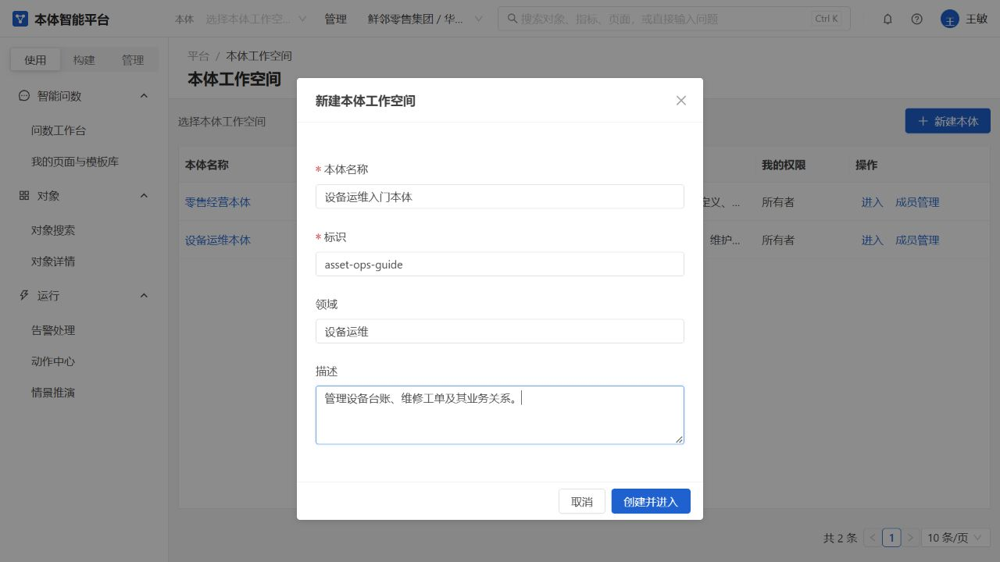

*图：实际新建入口。本手册截图过程只打开表单，不提交创建。*

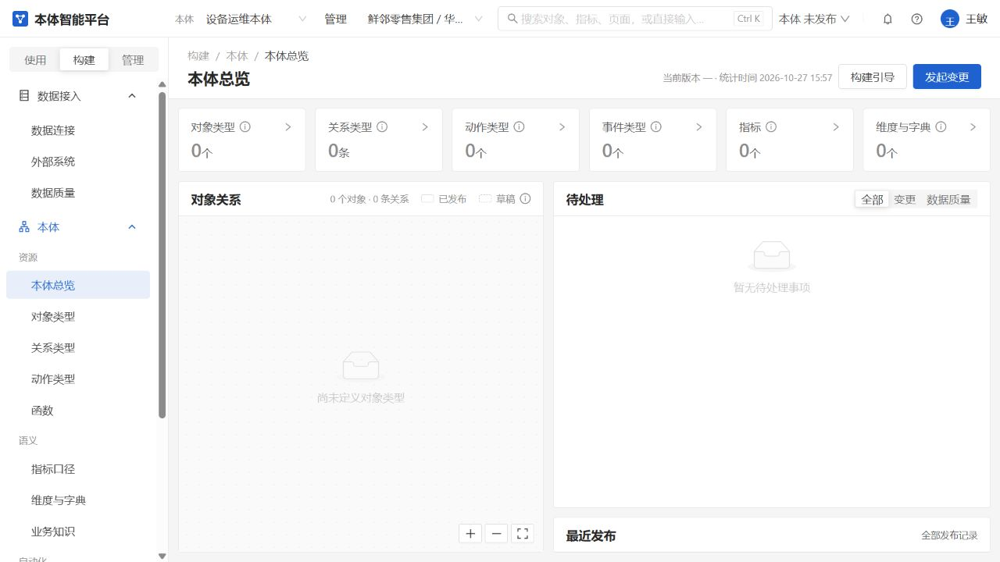

*图：现有空白空间用于说明初始状态，不代表本例已创建对象或导入数据。*

**完成标准：** 明确当前空间；人员能进入需要的菜单，有人能编辑，也有符合要求的审核人员。

**常见问题：** 看不到“新建本体”通常是权限不足；成为所有者或成员不等于自动拥有全部业务数据和动作权限。不要以其他空间已有角色名称相同为由认为授权已复制。

## 第二步：准备两张真实源表

下面仅提供**字段设计样例**，没有在平台或数据库创建这些表。数据管理员应使用企业实际表和真实记录，确认编号、状态及时间的业务含义。

### 设备表 `equipment`

| 源列 | 建议类型 | 约束／含义 | 对象属性 API 名 |
| --- | --- | --- | --- |
| device_no | 文本 | 主键，唯一且非空的设备编号。 | device_no |
| device_name | 文本 | 设备名称，建议非空。 | device_name |
| status | 文本 | 设备状态代码，例如 `running`、`maintenance`、`retired`；代码由实际业务确认。 | status |
| commissioned_at | 带时区时间 | 投用时间，可按实际业务允许为空。 | commissioned_at |

### 维修工单表 `repair_order`

| 源列 | 建议类型 | 约束／含义 | 对象属性 API 名 |
| --- | --- | --- | --- |
| order_no | 文本 | 主键，唯一且非空的维修工单编号。 | order_no |
| device_no | 文本 | 非空；关联 `equipment.device_no`，类型及取值必须一致。 | device_no |
| status | 文本 | 工单状态代码，例如 `open`、`in_progress`、`closed`、`cancelled`。 | status |
| created_at | 带时区时间 | 非空的工单创建时间；本例用于按日统计。 | created_at |
| closed_at | 带时区时间 | 关闭时间；未关闭时可为空。 | closed_at |

设备到工单是一对多：一台设备可能有多张工单，每张工单对应一台设备。建议源库通过真实外键或等效业务约束保证编号有效；在平台画一条关系，不会替源库修复错误编号。

**完成标准：** 两表、主键、外键／关联规则和字段类型已核对；工单 `created_at` 无缺失，状态代码有固定含义。

**常见问题：** 同一设备名称不一定唯一，应使用编号关联；时间字符串未清洗、重复编号、工单指向不存在设备，应先处理数据，不靠本体定义掩盖。

## 第三步：登记连接并读取库表

入口：**构建 → 数据接入 → 数据连接**。

1. 点击“新建连接”，选择实际数据库类型，填写名称、主机、端口、库名、账号和密码等必填内容。
2. 用获准账号“测试连接”，按实际结果处理失败原因，再保存。
3. 进入“库表”，确认能读取实际 schema 下的 `equipment`、`repair_order` 及字段；实际表名不同时，以真实名称为准。
4. 需要从源表生成定义时，进入导入流程，预览拟生成的对象、属性和关系；核对名称、主键及字段后选择变更单。

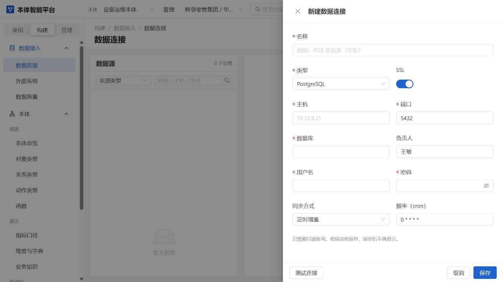

*图：只读打开的连接表单，截图未保存连接或向外部系统发送测试请求。*

**完成标准：** 对你真正使用的数据源测试成功，库表和列可读取；导入预览对应真实源结构。

**重要区别：** 这里的“导入”生成本体**定义草稿**，不会自动复制业务数据、发布定义、授予查询权限或配置所有执行器。页面的“同步计划”也不等于全部自动同步方式已经投入运行。

外部数据库需要部署支持和授权驱动。ERP 连接器、Kafka 不作为本例的前提，它们仍在延期范围。

## 第四步：先发起变更再建立对象

### 先选择变更单

入口：**构建 → 本体 → 对象类型 → 新建对象类型**。

1. 先出现“发起变更”，选择“新建变更单”或“加入已有变更单”。
2. 本例第一批可取标题“设备运维基础对象定义”，说明记录两对象的数据来源、主键和业务用途。
3. 点击“进入草稿”，再填写对象定义；不要跳过前面的变更单选择。
4. “进入草稿”是进入编辑流程，不应当作保存完成；以表单“保存到草稿”后的实际成功提示及变更单记录为准。

**入口差异：** 当前新建对象／指标／码表的定义表单先选择变更方案，保存定义时才实际创建或加入变更；新建关系的“进入草稿”会立即建立变更单和目标登记。因此不能把“还没有填写字段”理解为肯定没有写入。取消表单、放弃本目标和删除整张草稿也不是同一操作。

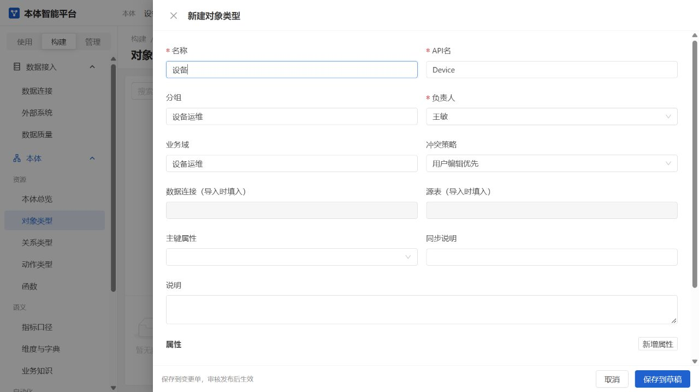

*图：设备定义的基础信息表单上半，未保存该对象；属性设置另见下图。应先选择变更方案，再编辑定义。*

### 建立设备 `Device`

在对象定义表单中按实际字段填写：

| 表单字段 | 本例填写建议 |
| --- | --- |
| 名称 | 设备 |
| API名 | `Device`；作为业务对象标识，不是源表名。 |
| 分组／业务域 | 如“运维资源”／“设备运维”。 |
| 负责人 | 从真实人员目录选择有资格的人员，不填写不存在的名字。 |
| 属性 | 按设备表新增 `device_no`、`device_name`、`status`、`commissioned_at`。 |
| 属性类型 | 编号、名称及状态先用 `string`；时间用 `timestamp`。 |
| 属性来源列 | 分别对应真实源列，如 `device_no`，不填推测的表达式。 |
| 主键属性 | 选择已添加的 `device_no`。 |
| 标题属性 | 仅将 `device_name` 标为标题；按需要选择可搜索、可筛选、列表显示。 |

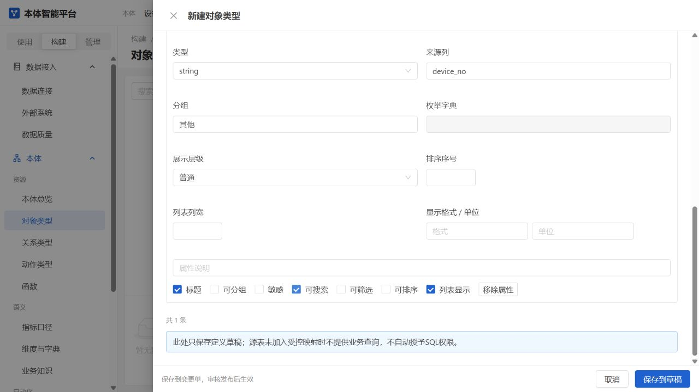

*图：属性设置局部，展示类型、来源列及展示选项，不是完整对象表单或已保存属性清单。*

当前手动新建表单中的“数据连接（导入时填入）”“源表（导入时填入）”是只读项。**不能在这里直接手填一个表名，就完成连接。** 可从真实导入带入来源，或在后续来源映射中按页面实际能力维护。

API名需字母开头，只用字母、数字和下划线；属性 API 名使用小写字母、数字和下划线。不要将隐藏／敏感字段设成公共查询依据。

### 建立维修工单 `RepairOrder`

重复“新建对象类型”，选择加入本例的同一草稿变更单（若已不可编辑，则使用新的合适变更单），设置：

- 名称“维修工单”，API名 `RepairOrder`，负责人从目录选择。
- 属性 `order_no`、`device_no`、`status` 为 `string`，`created_at`、`closed_at` 为 `timestamp`，来源列对应实际列。
- 主键属性为 `order_no`，可将 `order_no` 同时作为标题属性。
- `created_at` 应按实际需要允许筛选，`status` 选择可筛选；只勾选确实需要公开的字段。

### 完成第一批发布

入口：**构建 → 本体 → 变更与发布**。

1. 找到实际保存的变更单，核对包含两个对象及属性的真实新增内容；只有标题或说明不算完成。
2. 按页面进行校验、查看依赖和影响，处理错误。
3. 选择有权审核的人提交审核；通过后由有权人员发布。
4. 返回当前发布版本，确认两对象和属性存在。

先完成基础对象发布，再建立关系和指标，可以避免空空间后续候选目录尚无对象的问题。若页面允许同单依赖，也必须真实保存依赖定义，不能只在说明中写“同时创建”。

**完成标准：** 两对象的基本信息、属性、主键及来源说明已保存并发布；这只证明定义完成，还没有证明实例可查询。

## 第五步：完成真实数据关联

这一阶段需要技术管理员，**目前并非普通用户在新空间点击几次按钮即可全部完成**。

### 交给技术管理员的清单

| 内容 | 本例需明确什么 |
| --- | --- |
| 所属本体 | 实际工作空间编号，不借用零售空间。 |
| 已发布对象 | `Device`、`RepairOrder` 的真实对象标识。 |
| 真实来源 | 当前空间登记的数据连接，以及实际 schema、表和列。 |
| 唯一标识 | `Device.device_no`、`RepairOrder.order_no` 与真实单列主键对应。 |
| 读取许可 | 仅获准表、列和只读连接；人员的数据范围必须有已登记的依据。 |
| 两类能力 | 对象实例只读关联是否可用；指标／规则／动作各自是否已适配，不能只确认前者。 |

技术管理员完成配置后，先核对对象搜索与详情能读取授权记录。未登记的数据范围依据、隐藏主键、不支持的跨来源关系或缺少字段映射都可能阻止读取，应按实际提示处理。

新来源的单对象指标试算可复用管理员明确配置的获准只读绑定：公式属性、时间字段及过滤必须映射到同一真实对象，且满足字段和行权限。缺绑定、未公开字段及跨对象聚合／过滤仍不能试算；对象列表能读也不代表规则、动作或指标语义层导出已支持该来源。不能通过改 API 名、复制零售对象或泛化权限绕过。

**完成标准：** 管理员确认真实关联与只读授权，并有同空间、同身份的实际对象查询证据；没有这些证据，就将状态写为“定义已发布，真实读取待配置”。指标能力未完成时，可以继续定义，但不得写成试算已通过。

## 第六步：建立关系字典和术语

建议在第一批对象发布后，为这批语义定义选择或新建可编辑的变更单。

### 建立工单与设备的关系

入口：**构建 → 本体 → 关系类型 → 新建**。在“发起变更”选择新建／加入并点击“进入草稿”时，会实际生成或更新变更元数据，之后再填关系定义并保存；不要只为看表单而假定该步骤完全只读。

| 字段 | 本例含义 |
| --- | --- |
| 显示名 | 工单所属设备 |
| API 名 | 如 `repair_order_device`，使用唯一标识。 |
| 源对象／源端属性 | 维修工单 `RepairOrder`／`device_no`。 |
| 目标对象／目标端属性 | 设备 `Device`／`device_no`。 |
| 基数 | 选择 `N : 1`，即多张工单对应一台设备。 |
| 反向名称 | 设备的维修工单。 |
| 说明 | 明确按设备编号等值关联，不按名称猜测。 |

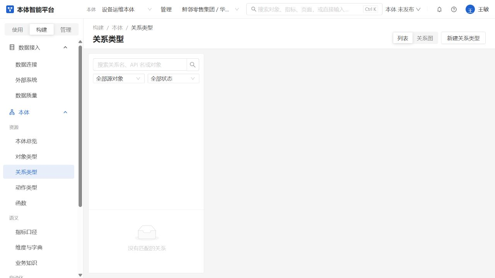

*图：关系起点。新建前先发布两个对象；此图不是关系已创建的示范。*

新关系尚未保存时，定义页“放弃草稿”可能提示去变更单处理；“变更与发布”中的“删除草稿”会删除草稿及关联改动，**不是可恢复的软废弃**。请先核对单号、空间、内容和授权，不能随手清理其他人或已有业务的草稿。

变更选择和保存时按页面要求操作。两端属性须真实存在；发布后，关联查询还需两端数据和权限、直接连接方式均满足。

### 建立设备状态字典

入口：**构建 → 本体 → 维度与字典 → 新建**。

1. 先选择变更单并进入定义编辑，填写名称“设备状态”、API名 `device_status`、真实负责人。
2. 类型选择“码表”。若暂不关联来源对象，可留空，作为独立码表；不要误选必须提供来源对象的“维度”。
3. 保存定义草稿后，根据页面开放的取值维护入口登记业务确认的代码及含义，例如 `running`＝运行中、`maintenance`＝维修中、`retired`＝已退役。
4. 核对源表实际值是否一致；对需要的属性明确设置枚举字典／映射，并通过相应变更发布。

上述状态值仅为本例设计，不代表当前源库已有这些值。创建独立码表不会自动更改源表数据，也不保证各页面自动显示中文；取值映射要明确配置并实际核对。

### 补充业务术语

入口：**构建 → 本体 → 业务知识**。例如解释“维修工单”为对一台设备的一次维修任务，“关闭工单”为完成业务约定的关闭动作，“已退役设备”不等于删除历史设备。

保存到变更单并按流程发布。术语帮助统一理解，不会自动生成字段、计算公式或执行操作。

**完成标准：** 关系端点与源列一致；状态代码有明确解释和实际取值维护；术语不与字段含义冲突。

## 第七步：建立工单数量指标并发布

目标是**按工单创建时间统计非取消工单数量**，不做跨对象聚合或预测。前提是 `RepairOrder` 及相关属性已发布，并且技术管理员已确认该对象可以用于指标引擎。

入口：**构建 → 本体 → 指标口径 → 新建指标**。仍先在“发起变更”选择新建／加入变更单，点击“进入草稿”，再填定义。

| 实际表单字段 | 本例建议 |
| --- | --- |
| 名称 | 维修工单创建量 |
| API名 | `repair_order_count` |
| 分组 | 运维统计；可选已有分组或输入新分组。 |
| 负责人 | 真实有资格的人员。 |
| 单位 | 单 |
| 口径版本 | `v1` |
| 公式（口径定义） | 见下方单对象公式。 |
| 时间字段 | 现在可单独填写 `RepairOrder.created_at`；本例公式已显式计数该时间属性，也可以沿用公式中的时间依据。 |
| 默认过滤 | 现在可单独编辑同对象条件。本例已在公式 WHERE 排除取消，无须重复填写。多个条件用 `；` 分隔。 |
| 允许维度／口径变体 | 第一个最小指标可暂不配置；不要选未发布或无实际定义的项目。 |

```text
COUNT(RepairOrder.created_at) WHERE RepairOrder.status <> 'cancelled'
```

该写法使用当前引擎支持的单对象 `COUNT` 和明确属性比较：

- `RepairOrder` 是对象 API 名，`created_at`、`status` 是属性 API 名，大小写和标识应与保存的定义一致。
- 显式计数一个日期／时间属性，同时明确统计所用时间。本例源字段非空，统计的是具备创建时间的非取消工单。
- `WHERE` 限定同一工单对象，`'cancelled'` 必须与真实状态代码一致。若业务不排除取消单，应先确认含义，再删除该过滤，不要套用与真实状态不同的示例。
- 新建及编辑指标已有独立“时间字段”“默认过滤”输入，保存到变更单后参与草稿试算和发布。也可保留本例写法；不要只写 `COUNT(RepairOrder)` 却没有时间依据。
- 不填写整段 `SELECT ... FROM ...` 查询；该入口填写的是受支持的指标表达式。

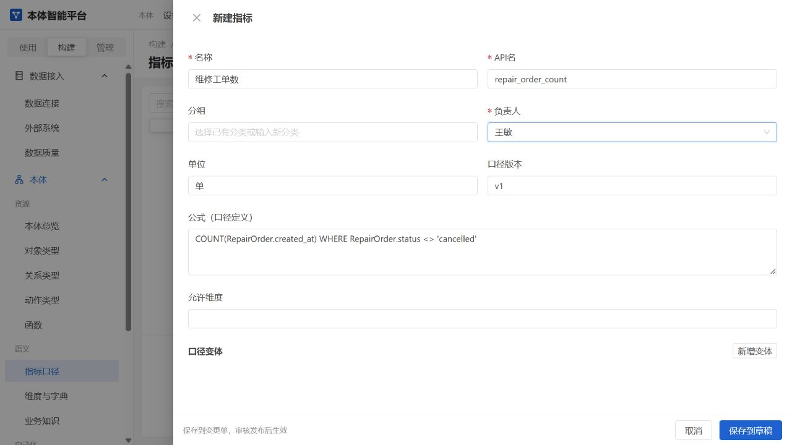

*图：当时的真实新建入口；当前已新增时间字段、默认过滤，旧图不代表当前表单全部字段，也不代表本例公式已保存或空白本体已具备试算条件。*

### 保存、审核与发布第二批定义

1. 保存指标到草稿，核对变更单是否包含本批真实关系、码表／术语和指标改动，按需分单。
2. 在“变更与发布”校验依赖、查看差异，处理缺对象、缺属性、冲突及权限问题。
3. 提交审核，通过后发布。若没有足够有权审核的人员，先由管理员完善授权，不把提交失败当成发布完成。

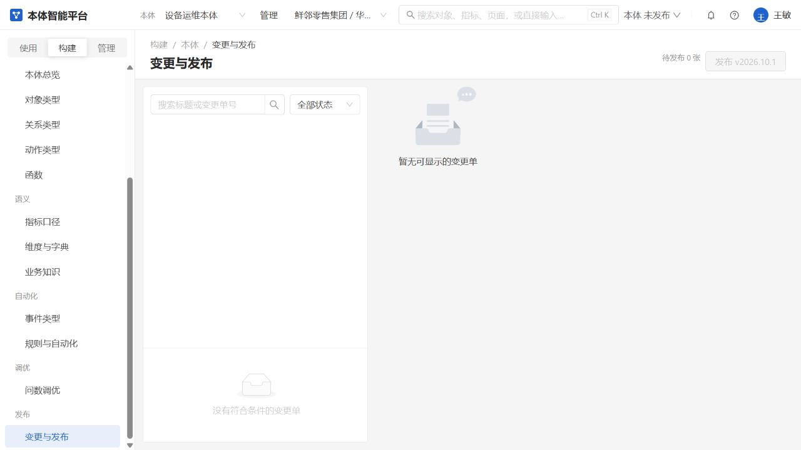

*图：进入新关系草稿之前的空发布页。此后截图过程登记的 `CR-0001` 仍是 0 改动未发布草稿；本次没有提交审核或发布。*

### 单独判断能不能试算

查看“近 30 日试算”的具体条件。只有对象、字段、时间和对应指标执行能力都就绪时，才进行试算并核数。

**本例在新领域里可能仍不能试算：** 填完公式、发布定义或完成对象只读查询，都不会自动把任意外部表加入指标引擎。若提示“对象尚未绑定受治理业务表”等原因，交技术管理员确认适配，明确记录为“指标定义完成，试算待配置”。不要把候选属性提示当作自动修复。

**完成标准：** 口径及状态过滤可解释，定义真实保存发布；“能试算”另外核验，不用假数据补结果。当前主库既有 15 项指标也仍有未解决缺项，不能借其显示名称证明本例已可算。

## 第八步：查询真实实例并核对数量

1. 选择本例空间及当前发布版本，进入**使用 → 对象 → 对象搜索**。
2. 选择设备，搜索一条源库中真实存在的设备编号，打开详情核对名称、状态和字段值。
3. 选择维修工单，核对一条真实工单及设备编号；在关联对象中查看“工单所属设备”，再从设备侧核查相关工单。
4. 用获准的数据范围检查完整数量，翻页确认不同记录。不要拿第一页的行数当总量。
5. 指标可运行时，按其实际显示的近 30 日时间窗、时区、排除取消条件和本人权限，与同源数据逐项核对；不能拿全表总数直接比较按期统计。
6. 指标未适配时，只记录对象查询和关联的实际结果，保留试算待配置状态，不写“整个链路全部成功”。

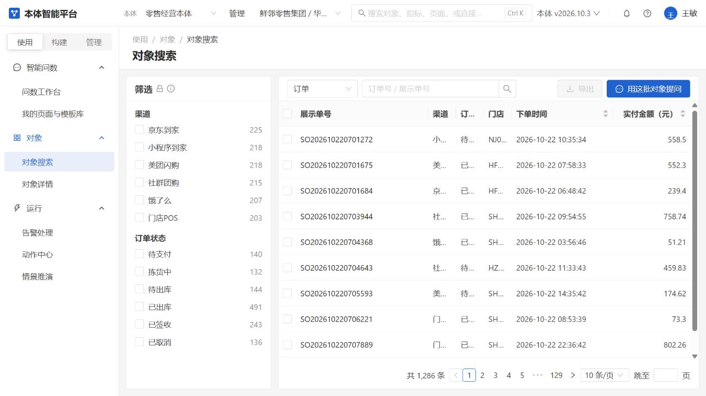

*图：现有业务空间的查询界面，仅用于定位操作；其中记录不是本例设备运维数据。*

**完成标准：** 真实字段、主键、关联和授权范围一致；有条件的统计与同范围数据对上。没有记录时区分“真实为空”“权限无范围”“读取未配置／失败”，不回退到零售样本。

## 可选进阶：质量规则事件与动作

先完成前面的对象、来源、权限及发布。下面每层都应独立确认条件，不能从一条定义自动推导全部业务流程。

| 能力 | 本例可以怎样设计 | 完成标准 | 常见阻断 |
| --- | --- | --- | --- |
| 数据质量 | 选择当前支持的检查类型，对设备编号、工单字段等真实对象设置检查；先保存到变更单，审核发布，再手动或明确启用调度。 | 有实际检查结果，清楚时区和执行范围。 | 检查类型或字段不支持；只有定义没有可执行读取；未发布。 |
| 规则与自动化 | 先从工单某个明确状态条件开始，配置真实对象、触发方式和运行身份；先只读试跑，再审核发布并明确启用。 | 能解释满足／不满足／缺输入的原因，实际触发与记录一致。 | 新对象未接规则引擎；指标不可算；缺事件通道、原始输入或权限。 |
| 事件类型 | 定义“工单状态变化”的必要字段与订阅，发布后由已授权的真实来源发送。 | 确实接收到合规事件并有真实处理记录。 | 只定义了事件但系统未发送；缺本体授权与接收／投递通道；Kafka 延期。 |
| 动作类型与动作中心 | 明确选择目标及修改字段，例如将设备状态改为业务确认的值；配置参数、条件、审批和执行方式，先校验再暂存确认。 | 真实权限和执行通道就绪，确认后的业务状态与执行结果一致。 | 自然语言修改说明不能执行；新对象无写入适配；缺审批人、参数或外部通道。 |

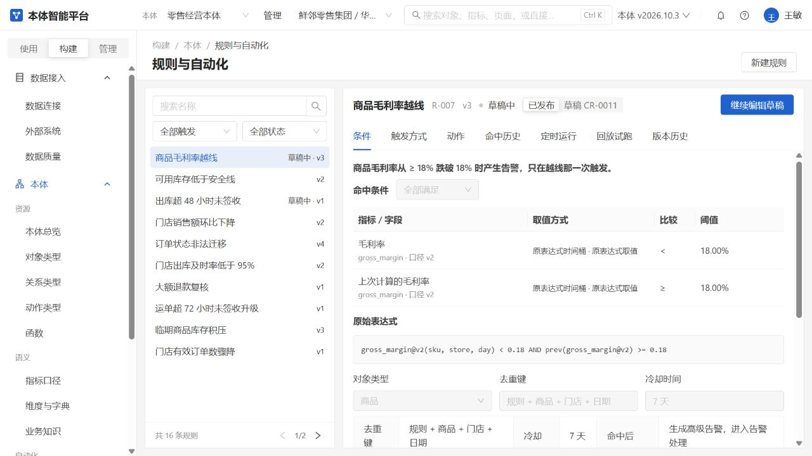

*图：现有业务规则页面参考，不是本例已经建立或运行的设备规则。只读试跑不等于生成告警。*

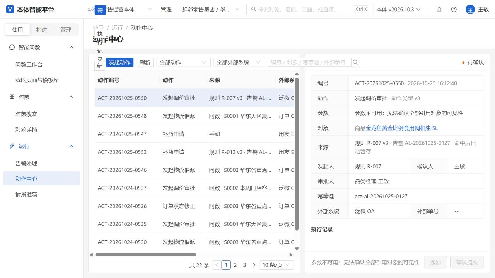

*图：现有运行记录参考。校验、暂存、待执行、成功与结果未知含义不同；未知结果应先对账，不能直接重复写入。*

函数目前可管理定义及版本，并做独立 JSON 纯计算测试，不访问数据库或网络，也不表示自动接入所有规则和动作。情景推演的真实预测模型及执行器仍延期，不作为本例完成条件。

## 页面模板与日常使用

对象与查询条件真正可用后，再考虑把重复工作保存为页面：

1. 在对象搜索中使用当前支持的数量或公开数值汇总，或在问数工作台获得可重新执行的成功回答；不假设任意新领域自然语言都已支持。
2. 从有效回答整理或分享页面，编辑名称、卡片和顺序并保存。
3. 复用结构时保存模板，再从模板新建页面。模板不复制旧计算结果。
4. 设置共享成员。成员按自己的权限重新查数据，不能借用创建者的范围；导出另需权限。
5. 页面拥有者进入抽屉的“刷新与订阅”，可选择手动、每小时、每天、每周或每月。自动刷新要求卡片有当前有效的执行定义和发布依据；缺定义或版本过期时先修复，不会借旧缓存假装刷新。保存后重新打开，核对实际频率、时区及下次时间。失败处理当前支持保留上次结果。
6. 需要更新提醒时，开启站内信并从当前有效的拥有者／已有共享成员中选择收件人；空名单表示拥有者本人。共享成员不能替拥有者设置后台任务，历史和预览视图只读。邮件、企业微信暂不可启用。铃铛消息只提示打开页面，查看时仍按当前权限读取；取消共享后旧消息也不再提供页面内容。

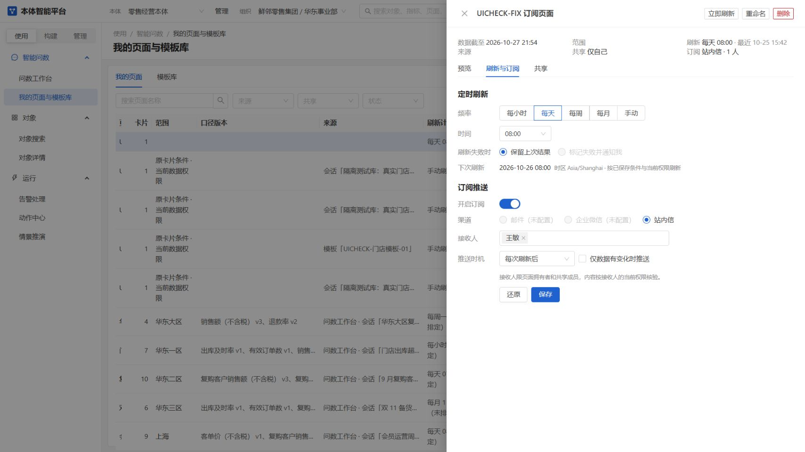

*图：隔离测试库的 UICHECK 页面，使用固定测试时钟 2026-10-25，实际保存并重新读取每日 08:00／本人站内信；不是设备运维示例已经建成，也不是生产任务已按时自动运行的证据。*

告警处理用于查看来源、认领、转派和关闭；动作中心用于已定义操作的发起、确认及结果跟踪。未结束的关联动作可能限制告警关闭或转派，以页面真实原因和实际处理数量为准。

## 当前边界与常见问题

### 当前哪些步骤还不能仅靠普通用户点界面完成

- 新领域真实数据读取需技术管理员配置获准来源及权限；导入定义或填写来源列不等于数据已经接通。
- 对象只读来源与指标、规则、动作执行能力要分别适配；当前不能把任意外部表自动用于全部运行模块。
- 时间字段／默认过滤已有编辑入口，但仍须使用真实属性 API 和受支持的同对象表达式；填写了文字不等于来源已经接通。
- 新对象、指标、码表的定义编辑以变更选择为前置；保存内容、审核和发布是另外的实际写入步骤。空空间候选不足时先发布基础对象。
- 当前主库 15 项指标仍有属性引用、真实关联、时间／过滤、空公式、下线状态或跨对象能力等缺项，不能视为现成可算的示范。
- ERP、Kafka、真实预测、真实模型评测和提分仍延期；外部通知和生产登录／登录安全执行器也不是当前完整可用能力。

### 新空间为什么没有任何数据？

它本来就是独立空白空间，不复制零售对象或实例。按本手册从真实来源建立定义及数据关联；不要期待创建完成就有设备样例。

### 进入草稿后为什么还找不到已经保存的对象？

选择变更方案只是进入编辑流程。要检查是否在定义表单点击“保存到草稿”且收到成功提示，变更单是否有实际对象和属性内容；最后还要审核发布。

### 没保存关系字段，为什么已有一张 0 改动变更单？

关系的新建流程在“进入草稿”时就登记变更单和新目标，之后才保存定义字段。这与新对象定义表单的保存时机不同。0 改动不表示已建成关系，也不代表可以直接提交；需要继续填写或由有权人员按明确授权处置。删除草稿不可当作可撤销的取消按钮。

### 连接测试成功，为什么对象搜索还是不可用？

连接测试只证明连接及授权能够完成对应检查。继续核对对象是否发布、来源和字段是否对应、技术管理员的真实读取配置以及本人数据范围。

### 对象搜索能读，为什么指标仍不能试算？

两个能力的执行条件不同。当前指标引擎还要求对象及字段有对应受控业务绑定；普通只读来源配置不自动满足它。按试算提示交技术管理员处理，不修改业务口径来迎合系统。

### 关系图上有线，为什么关联对象查不到？

图上展示的是定义。还需真实连接字段一致、两端均可读、所选关系执行方式受支持，并有实际对应记录。跨来源或未实现的中间表关系不能猜着查。

[“关系类型不存在”异常图](images/user-guide/18-relation-empty-error.png)保留的是修复前真实记录。新关系草稿误请求尚不存在的已发布详情已修复，当前会先恢复变更单目标再显示草稿；进入草稿仍不等于关系定义已经保存或发布。若仍报错，应核对具体对象、关系及变更单权限，不要覆盖原草稿来排错。

### 指标为什么使用创建时间计数，而不是直接写工单总数？

近 30 日试算需要明确时间依据。本例 `created_at` 非空，计数该日期／时间字段同时明确“按创建时间”的口径；`WHERE` 明确排除取消。若实际业务含义不同，应先调整设计。

### 我是空间所有者，为什么还不能读或执行？

所有者用于管理空间，不替代实际菜单、对象操作和数据范围权限。角色还需在当前空间适用；身份预览和历史浏览通常只读。

### 为什么不能直接修改当前发布定义？

需要保留业务含义和版本记录。通过变更单保存改动，核对依赖、审核后发布；有冲突或缺定义时先解决，不强行覆盖或用说明文字代替真实定义。

### 问数、预测或模型评测是不是接好模型就全都可用？

不是。模型设置保存不代表已经调用成功，更不能替代缺少的业务数据、指标口径或权限；真实预测和真实模型提分评测仍延期。

## 附录：全部菜单速查

以下用于完成主线后找入口，不建议首次使用从头逐个配置。

### 使用区：7 个菜单

| 菜单 | 用途与最短操作 |
| --- | --- |
| 问数工作台 | 选会话与范围 → 提问 → 查看回答；模型和业务能力需就绪。 |
| 我的页面与模板库 | 从有效回答创建页面 → 拥有者配置有效刷新计划／站内订阅 → 按权限共享或复用模板。 |
| 对象搜索 | 选类型 → 搜索筛选 → 翻页／范围提问；导出另需权限。 |
| 对象详情 | 查看属性、时间信息和已发布真实关系对应的关联记录。 |
| 告警处理 | 看原因 → 按权限认领、转派、填写原因关闭或批量处理。 |
| 动作中心 | 选已配置动作及目标 → 填参数校验 → 暂存确认 → 跟踪结果／对账。 |
| 情景推演 | 管理方案及查看已有历史结果；真实预测执行仍延期。 |

### 构建区：15 个菜单

| 菜单 | 用途与最短操作 |
| --- | --- |
| 数据连接 | 登记连接 → 测试并读取库表 → 导入定义或维护来源映射。 |
| 外部系统 | 登记系统、看调用；真实探测／写回需技术管理员配置通道。 |
| 数据质量 | 定义检查 → 保存审核发布 → 在具备执行条件时手动或按计划运行。 |
| 本体总览 | 看定义、关系及待办，从新建引导进入建模。 |
| 对象类型 | 先选择变更 → 编辑对象、属性与来源说明 → 保存发布。 |
| 关系类型 | 选择真实两端对象及属性，按明确连接含义保存发布。 |
| 动作类型 | 定义目标、参数、条件、审批和具体执行方式，先试运行再发布。 |
| 函数 | 编辑计算定义 → 独立 JSON 测试 → 保存变更发布。 |
| 指标口径 | 定义公式与明确含义，先处理试算缺项，再核数发布。 |
| 维度与字典 | 维护分类、层级、取值和映射；独立码表可无来源对象。 |
| 业务知识 | 维护术语、解释与同义词，核对作用后发布。 |
| 事件类型 | 定义载荷和订阅，实际收发另需通道与授权。 |
| 规则与自动化 | 定义条件及触发 → 只读试跑 → 审核发布并明确启用。 |
| 问数调优 | 整理认证问答、题库、反馈及推荐；不把题库当真实模型评测完成。 |
| 变更与发布 | 看真实改动 → 校验依赖与影响 → 提交审核 → 发布／查看版本。 |

### 管理区：5 个菜单

| 菜单 | 用途与最短操作 |
| --- | --- |
| 用户与组织 | 管理人员、部门及主角色；批量导入先预览，停用要处理实际待办。 |
| 角色与权限 | 配功能、对象操作和数据范围，再配置人员及空间适用角色。 |
| 审计日志 | 按人员、时间、操作或空间筛选，查看详情或按权限导出。 |
| API 密钥 | 按实际用途选择 scope、固定本体范围及允许目标，安全保存一次性展示值，按需收紧或吊销；仍与当前账号权限取交集。 |
| 模型与系统配置 | 维护租户基础信息与按用途的模型连接；站内审核通知已接，外部渠道未配置，安全策略暂不可用。 |

公共入口：工作空间管理用于选业务空间及成员；版本选择用于当前／历史定义；零售首页展示现有零售看板；铃铛显示当前本人、当前空间有权查看的审核消息与页面更新通知。不能把历史定义理解为过去时点的完整业务数据快照。

API 密钥当前支持7类 scope：`meta:read` 元数据读取、`objects:read` 对象读取、`functions:invoke` 函数调用、`actions:dry-run` 动作试运行、`actions:execute` 动作执行、`events:ingest` 事件写入、`dynamic:read` 动态读取。选择 scope 不会额外授予账号没有的功能、对象或本体权限。

选择函数调用时，可配置“函数白名单”，只允许所列函数编码。既有密钥的未另限状态兼容保留，空名单则全部拒绝；已有名单只能缩小，扩大或改回不限需重新签发。函数测试、机器调用及工具目录都使用同一名单。动作/事件另有其目标白名单与执行条件，不能把函数授权当动作授权。

### 截图索引

主线优先看 09—17；01—08 用于认识现有页面，18 保留修前实际异常。01—18 来自主界面；19 来自隔离测试库并使用固定测试时钟。现有零售页面和隔离 UICHECK 页面都不作为本例设备运维的数据结果。

| 截图 | 实际内容与边界 |
| --- | --- |
| [01 工作空间](images/user-guide/01-workspaces.png) | 现有工作空间列表。 |
| [02 本体总览](images/user-guide/02-overview.png) | 现有业务空间总览，不是本例搭建结果。 |
| [03 对象搜索](images/user-guide/03-object-search.png) | 现有业务记录查询界面。 |
| [04 问数工作台](images/user-guide/04-workbench.png) | 已有空会话及工作台入口，没有新发模型问题，不是新领域问答成功证明。 |
| [05 规则](images/user-guide/05-rules.png) | 现有规则查看界面，未创建设备规则或运行任务。 |
| [06 动作中心](images/user-guide/06-actions.png) | 现有执行记录界面，未执行设备业务动作。 |
| [07 角色权限](images/user-guide/07-admin-roles.png) | 权限配置入口，未调整人员授权。 |
| [08 指标缺项](images/user-guide/08-metric-readiness.png) | 现有指标的真实阻断提示，不是可算结果。 |
| [09 新建空间](images/user-guide/09-new-workspace.png) | 填写“设备运维入门本体”／`asset-ops-guide` 的新建表单，未提交，不是已存在空间。 |
| [10 空白总览](images/user-guide/10-empty-ontology.png) | 现有空间 2，拍摄时尚未登记此次关系草稿。 |
| [11 新建连接](images/user-guide/11-new-connection.png) | 空连接表单，未保存或发起连接测试。 |
| [12 设备定义](images/user-guide/12-new-object.png) | 对象基础信息表单上半，未保存，取消后放弃输入。属性局部见 17。 |
| [13 关系起点](images/user-guide/13-new-relation.png) | 不带新关系参数的空列表；先发布两对象再新建，不表示已建立关系。 |
| [14 指标定义](images/user-guide/14-new-metric.png) | 填写 `repair_order_count` 等字段，未保存，取消后放弃输入。 |
| [15 发布入口](images/user-guide/15-release.png) | 此次关系草稿登记前的空发布页，无发布操作。 |
| [16 发起变更](images/user-guide/16-start-change.png) | 指标定义编辑前的变更选择窗口，未保存定义。 |
| [17 属性设置](images/user-guide/17-property-settings.png) | 属性卡局部，仅展示实际拍到的类型、来源列和展示选项。 |
| [18 关系入口异常](images/user-guide/18-relation-empty-error.png) | 保留修前真实“关系类型不存在”及空端点记录；该误读已修，不把旧截图当当前正常行为。原记录仅登记空变更，未保存关系定义。 |
| [19 页面刷新订阅](images/user-guide/19-page-schedule.png) | 隔离 UICHECK 页面每日08:00／本人站内信的真实保存与重新读取；固定测试时钟，不是设备运维数据或生产定时执行证据。 |

## 相关说明

- 技术管理员：[对象实例只读关联说明](../backend/docs/backend/object-read-adapter.md)。配置文件、只读账号及部署开关由技术人员维护，不将凭据写进业务说明或截图。
- [本体工作空间说明](../backend/docs/ontology-workspaces.md)：空间和权限约定。
- [管理与构建进度](26-10-27-admin-build-progress.md)、[使用区测试总报告](26-10-27-use-tests.md)：实施和实际验证范围；不代表本例已逐步执行通过。
- [SQL 快照恢复](../database/exports/README.md)：去凭据的数据快照不是本例初始化工具，恢复后先保持任务关闭，按说明处理配置与待办。
