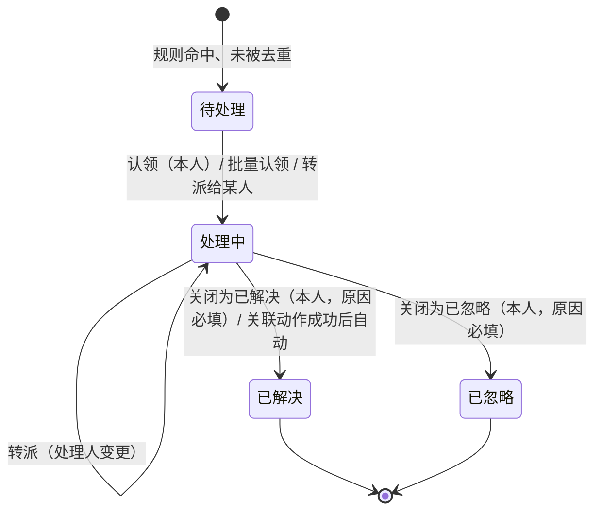
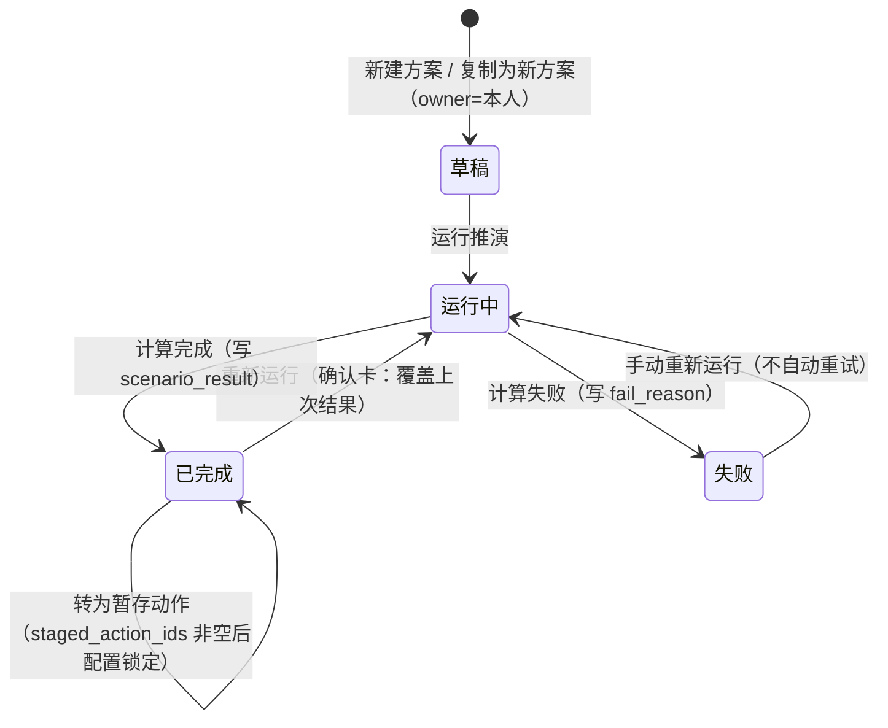

# 动态本体：后台实体、业务链路与接口（v0.1 草案）

> 依据：`/workspace/ui-vue` master `5fb26ab`（同 GitHub `zhenhuiwu/rengu_ontology` main 的 `frontend/`），只读，未改源码。
> 范围：告警处理 `ops/Alerts.vue`、动作中心 `ops/Actions.vue`、规则与自动化 `ontology/Rules.vue`、情景推演 `ops/Scenarios.vue`、对象类型「行为」页签 `ObjBehaviorLifecycle / ObjBehaviorActions / ObjBehaviorAutomation.vue`；mock：`dynamic.ts`、`actions.ts`、`rules.ts`、`scenarios.ts`、`lifecycle.ts`、`changes.ts`（引用 `actionEvent.ts`、`extsys.ts`、`releases.ts`）；公共：`stageAction`、`useDraftView`、`useReadonly`、`CHANGE_REQUESTS`。
> **总原则 [已定：PDE、Palantir专家]**：后台**完全照前端实现**；前端没有的功能**默认不实现**，统一列在 7.1「待用户定的 [推断] 项」，正文只引用编号（如 `[推断 P3]`）。
> 标注：**[推断]**（不带编号）= 实现细节，代码里没有直接体现，按页面行为推出；**[待定]** = 见第 7 节；**[已定]** = 群里已拍板，第 7 节注明谁定的。全站路径与字段清单以 PDE 汇总为准，本文第 4 节只列关键业务接口。
> 用户要求：**后台逐条实现前端界面逻辑（1:1），当前 mock 数据作为种子数据入库**（第 5、6 节）。
> 前缀统一 `/api/ontology/v1`（PDE 定：`/api/<模块>/v1`，动态归 `ontology` 模块）。分页参数一律 `page`、`size`，返回 `{items, total, page, size}`（与静态一致）。
> **接口字段与枚举 = 前端 mock 原样** [已定：PDE]：JSON 字段 camelCase，状态等枚举返回 mock 里的中文值；数据库用 snake_case + 英文码，由 Pydantic 层转换，对照见 1.3。与 Palantir专家 `action-event-api.md`（v0.5，`b7ffba4`）的分工见 2.7。mock 里的当前用户固定为 `王敏`（`CURRENT_USER` / `ME`），后台改为登录身份。

## 1. 总览：核心实体与表结构

### 1.1 实体与关系

| 实体 | 前端来源 | 说明 |
|---|---|---|
| 告警 alert | `mock/dynamic.ts` `ALERTS`（`Alert`） | 规则命中且输出=告警、未被去重时生成；级别、对象、触发值/阈值、数据截至、状态、处理人 |
| 告警处理记录 alert_log | `alertTimeline()`、`Alerts.vue` 各操作 `log.push` | 生成、认领、转派、关闭、发起动作、动作结果联动 |
| 规则 rule（按版本） | `mock/rules.ts` `RULE_DEFS`、`dynamic.ts` `RULES` | 条件（引用 `metric@version`）、逻辑、表达式、去重键、冷却、触发方式、输出、自动暂存配置、负责人 |
| 规则命中 rule_hit | `hitsOf()`（`Hit`） | 每次命中一行；结果 = 告警状态 / 已通知 / 已去重 |
| 回放试跑 rule_replay | `replay()`（`ReplaySample`） | 用历史数据重算，只读结果，不生成告警和动作 |
| 动作执行 action_run | `mock/actions.ts` `ACTIONS`（`ActionRecord`） | 一次动作实例：来源、对象、参数、确认人、审批人、幂等键、外部系统、外部单号、状态、重新提交链 |
| 动作执行记录 action_run_log | `buildLog()`、`Actions.vue` 各操作 | 触发 → 生成 → 确认 → 审批 → 调用 → 结果 / 对账。**与 Palantir 的 `action_run_step` 合成这一张，归动态** [已定：本体小白] |
| 外部调用 writeback_call、外部系统 ext_system | `extsys.ts`（`ExtCall`、`EXT_SYSTEMS`） | **归 Palantir（integration 模块）** [已定：PDE]：动态原来的 `ext_call` 并入 `writeback_call`；`ext_system`（含 `timeoutMs`、`maxRetry`、幂等键字段）也归 Palantir。动态不建表，只读引用 |
| 情景方案 scenario | `mock/scenarios.ts` `SCENARIOS` | 范围（区域、品类、周数）+ 驱动（价格、补货、安全库存、促销）、基于的本体版本、状态、已暂存动作 |
| 推演结果 scenario_result | `simulate()`（`ScResult`） | 周序列、KPI、SKU×门店影响；每次运行覆盖 |
| 生命周期 lifecycle / lifecycle_state / lifecycle_transition | `mock/lifecycle.ts` `LIFECYCLES` | 对象类型的状态字段、状态（初始/中间/终态、SLA）、迁移（触发、来源、条件、结果）、版本 |
| 状态变化 lifecycle_change | `changesOf()`（`LcChange`） | 数据同步收到的逐条状态变化；`trId=null` 即非法迁移 |
| 转派候选人（用户 sys_user） | `mock/dynamic.ts` `PEOPLE`（7 人） | **`sys_user` 归 admin 模块（PDE）**，动态不建表、只读；这 7 人带 `alert_assignable` 标记，见 4、5 [已定：群决定] |
| 变更单 change_request 等 | `mock/changes.ts`、`useDraftView` | **复用静态文档 `static-api.md` 第 1、2 节**；动态侧 target_kind = `rule`、`object`（生命周期）、`action`、`event` |

关系要点：
- 规则 → 命中 → （未去重且输出=告警）告警 → （配了自动暂存）动作 `待确认`。**规则永远不直接执行动作。**
- 动作来源五类：`规则`、`告警`（告警页人工发起）、`问数`、`手动`、`推演`；`source` 里带 `ruleId/ruleVersion/alertId/session/scenarioId/confirmer`。
- 生命周期 `order` v4 与规则 `SM-ORD`、动作类型 `correct_order_status` 同一口径：不在迁移表里的变化 = 非法迁移 → SM-ORD 告警 → 暂存「订单状态修正」。
- 规则、生命周期的定义按「已发布快照 + CR 草稿增量」存，与静态一致；告警、命中、动作、方案是运行数据，不进版本快照，但记录产生时的 `rule_version` / `type_version` / `base_release`。

### 1.2 表与字段

库内状态值统一存英文码；**接口返回前端 mock 原值**（对照见 1.3）。时间一律 `timestamptz`，mock 字符串为北京时间；接口格式见 1.3「时间字段」。

**表规范** [已定：PDE]：
- 表名 snake_case、单数业务名词，**不加模块前缀**；只有撞关键字或有歧义时才加限定词。
- **单列主键** + 业务键唯一约束；mock 里的复合键一律改成这样（下面 rule、lifecycle 系列已改）。
- **可变表**都带 `created_at, updated_at, created_by, is_seed, lock_version`（下面各表不再重复列出）。
- **只追加表**（日志、版本、命中、事件：alert_log、action_run_log、rule_version、rule_hit、lifecycle_version、lifecycle_state、lifecycle_transition、lifecycle_change）只带 `created_at, created_by, is_seed`，**没有 `lock_version`、没有软删除**。
- **软删除**只在前端有删除 / 恢复的地方用；动态页面没有（生命周期「删除迁移 / 删除状态」是 CR 草稿里的改动，落在 cr_item），所以动态的表都不软删。

| 表 | 类型 | 主键 | 业务唯一键 |
|---|---|---|---|
| alert | 可变 | `id`（AL-…） | — |
| alert_log | 只追加 | `id` bigint | — |
| rule | 可变（当前发布版） | `id`（R-007） | — |
| rule_version | 只追加 | `id` bigint | `(rule_id, version)` |
| rule_hit | 只追加 | `id`（告警编号或 HIT-…） | — |
| action_run | 可变 | `id`（ACT-…） | `idem_key WHERE NOT is_seed`（部分唯一） |
| action_run_log | 只追加 | `id` bigint | — |
| scenario | 可变 | `id`（SCN-…） | — |
| scenario_result | 可变（每次运行覆盖） | `scenario_id` | — |
| scenario_impact | 可变（随结果覆盖） | `id` bigint | `(scenario_id, sku, store_id)` |
| lifecycle | 可变（当前生效版） | `id` = 对象类型 id（order） | — |
| lifecycle_version | 只追加 | `id` bigint | `(lifecycle_id, version)` |
| lifecycle_state | 只追加（随版本） | `id` bigint | `(lifecycle_version_id, key)` |
| lifecycle_transition | 只追加（随版本） | `id` bigint | `(lifecycle_version_id, code)`（code = T1…） |
| lifecycle_change | 只追加 | `id` bigint | — |
| sys_user | **归 admin（PDE）**，动态不写定义 | 按 admin 约定 | 按 admin 约定；动态只用 `alert_assignable` 列 |

回放试跑（`replay()`）只算不存，没有表。

**alert**

| 字段 | 类型 | 说明 / mock 对应 |
|---|---|---|
| id PK | varchar | `AL-20261025-0143` |
| rule_id FK, rule_version | varchar, int | `ruleId`，命中时的规则版本 |
| hit_id FK | varchar | 产生本告警的命中 |
| level | varchar | `high/medium/low` = 高/中/低（来自规则） |
| obj_kind, obj_id, obj_label | varchar | `store/product/order`（规则 R-027 为 region，只发通知） |
| store_id, store_label | varchar | 商品类告警所在门店（R-007/R-012 去重键含门店） |
| value, threshold | varchar | 触发值 / 阈值展示串 |
| dedupe_key | varchar | 按规则去重键拼出，见 2.6 |
| triggered_at, data_cutoff | timestamptz | `triggeredAt`、`cutoff`（数据截至） |
| status | varchar | `open/processing/resolved/ignored` = 待处理/处理中/已解决/已忽略 |
| assignee | varchar null | 未认领为空 |
| close_reason | text | 关闭必填 |
| action_run_id FK null | varchar | 关联动作（`actionRef`，按 `source.alertId` 匹配最近一条） |

**alert_log**：`id, alert_id FK, at, actor（'系统' 或用户）, op（created/claim/transfer/close/start_action/action_result）, text, from_status, to_status, abnormal bool`。

**rule**（每条规则一行，存当前已发布版本；每个已发布版本的快照存只追加表 `rule_version`，唯一键 `(rule_id, version)`；草稿在 cr_item）

| 字段 | 类型 | 说明 |
|---|---|---|
| id PK, version | varchar, int | `R-007`；当前版本整数 v3 |
| name, desc, owner | varchar | |
| status | varchar | `published/changing/disabled` = 已发布/变更中/已停用；列表显示的「草稿中/审核中」由所在 CR 状态推导（`ruleStatus()`） |
| core | bool | 5 条核心规则（产生告警）|
| obj_kind | varchar | store/product/order/region |
| level | varchar | 高/中/低 |
| output | varchar | `alert/notify` = 告警/通知 |
| conds | jsonb | `[{metric, metricVer, field, op, value}]` |
| logic, expr | varchar, text | 且/或；编译后表达式 |
| dedupe, cooldown | varchar | 如「规则 + 商品 + 门店 + 日期」/「7 天」「不重复」 |
| trigger | jsonb | `{kind: 定时/事件, cron, text, eventId, filter}` |
| action_type_id | varchar | 绑定的动作类型 |
| auto_stage | jsonb | `{enabled, actionTypeId, confirmer, mapping:[{param, from}]}` |
| release | varchar | 随哪次本体发布生效 |
| published_by, published_at, change_note | | 版本历史 `ruleVersions()` |

**rule_hit**：`id PK（告警编号或 HIT-R003-102500）, rule_id, rule_version, at, obj_kind, obj_id, obj_label, store_id, store_label, value, threshold, dedupe_key, result（alert/notified/deduped = 产生告警/已通知/已去重）, alert_id FK null`。

**action_run**

| 字段 | 类型 | 说明 |
|---|---|---|
| id PK | varchar | `ACT-20261025-0552`，后台序列分配 |
| action_type_id, type_version | varchar | 名称取动作类型目录；`typeVersion` 如 v3 |
| source_type, source_label | varchar, varchar | 库内码 rule/alert/qa/manual/scenario；`source_label` 存该条记录的**原文**（ACTIONS 为「告警」、RUNS 为「告警处理」），接口原样返回 [已定：PDE] |
| rule_id, rule_version, alert_id, qa_session, scenario_id | varchar null | `source.*` |
| obj_kind, obj_id, obj_label | varchar | 含 member/segment/region/alert |
| params, params_text | jsonb, text | `params_text` = mock 摘要串（ACTIONS `params` / RUNS `summary`）；`params` 结构化值 [推断：按动作类型参数存] |
| elapsed_ms, result_code, retry_count | int, varchar, int | RUNS 的 `ms`、`code`、`retries`；ACTIONS 没有，为空 [已定：本体小白] |
| initiator | varchar | 规则来源记「规则 R-xxx」 |
| confirmer | varchar | 规则来源 = 规则固定确认人；推演 = 方案 owner；其余 = 发起人 |
| approver | varchar | 照前端：动作中心按动作名取 `actions.ts` `LOCAL[].approver`；告警页按对象类型写死（`Alerts.vue` L173）。改为读动作类型审批配置见 `[推断 P5]` |
| idem_key | varchar | 传给外部系统的幂等键，`act-…`，见 2.1。**部分唯一索引 `UNIQUE (idem_key) WHERE NOT is_seed`**：只约束新记录，种子里的 31 个重复原样保留（页面就是这样显示的）[已定：PDE] |
| is_seed | bool | 种子导入的行为 true，新产生的为 false |
| biz_key | varchar null | 按动作类型业务键模板（如 `correctOrderStatus:{订单号}:{目标状态}`）算出，不传外部系统；列先建（种子为空）。用它拦截重复暂存及部分唯一索引 `(action_type_id, biz_key) WHERE status IN (staged, approving, executing, unknown)` 见 `[推断 P4]` |
| status | varchar | `staged/approving/executing/succeeded/failed/unknown/withdrawn/reconciled` = 待确认/审批中/执行中/成功/失败/结果未知/已撤回/已对账（与前端 `ActionStatus` 一致）。「已驳回」前端没有，见 `[推断 P2]` |
| sys_id, ext_ref | varchar | `EXT-OA/ERP/OMS/CRM`；外部单号 |
| fail_reason, unknown_reason | text | 外部返回原因 / 超时说明 |
| reconcile_result, reconcile_note | varchar, text | `succeeded/not_executed` = 外部已成功/外部未执行；状态都是 `reconciled`，只靠这个字段区分 [已定] |
| reconcile_by | varchar | `auto`（定时对账查到）或人工对账人 |
| retry_of, retried_as | varchar FK | 重新提交链 |
| withdraw_reason | text | 撤回原因（`reject_reason`、`rejected_at` 只在 `[推断 P2]` 采纳时加） |
| submitted_at, confirmed_at, approved_at, finished_at | timestamptz | |

> `action_run` **只由动态写**。自动查询计数和下次查询时间不在本表，存 reconcile 模块的 `reconcile_task`（`tries`、`round`、`manual`、`next_at`、`state`），详情接口关联读取 [已定：本体小白]。
> 索引：`(status, source_type, action_type_id, sys_id, submitted_at desc)`；关键词（编号、对象、幂等键、外部单号、告警号、规则号、会话号）用 pg_trgm。
> 编号 `ACT-日期-NNNN` **按天计数**：序列按天取当天最大号 + 1，不是全局序列。

**action_run_log**（合并原 action_log 与 Palantir `action_run_step`）：`id, action_run_id, at, actor, text, level（done/warn/error/unknown）`（= `ActionLog{time,text,desc,status}`）。

**scenario**：`id PK（SCN-0018）, name, owner, created_at, base_release（baseVer v2026.10.3）, status（draft/running/done/failed = 草稿/运行中/已完成/失败）, scope jsonb {area, category, weeks∈4|8|12}, drivers jsonb {pricePct −20~+10, replenishPct −30~+50, safetyDays 3~14, promo 无/满减/折扣/会员券, promoDepth 0~30, promoWeeks 0~4}, fail_reason, staged_action_ids text[], lock_version`。

**scenario_result**：`scenario_id PK, ran_at, scope_snapshot, drivers_snapshot, weeks[], base_sales[], sales[], base_margin[], margin[], kpis jsonb[{key,label,unit,base,value,better}]`；**scenario_impact**：`id PK, scenario_id, sku, name, category, store_id, store_name, base_sales, sales, stockout_base, stockout, suggest`（分页读）。

**lifecycle**：`id PK（= 对象类型 id，如 order）, version（当前生效）, field, owner, updated_at, rule_id（校验非法迁移的规则，如 SM-ORD）, desc`。
**lifecycle_version**（只追加）：`id PK, lifecycle_id, version, at, by, change, release, status（active/superseded = 生效中/已替代）, undo jsonb, snapshot jsonb（= lifecycleAsOf）`；字段对 mock `LcVersion` 的 `ver, at, by, change, release, status, undo`，唯一 `(lifecycle_id, version)`。
**lifecycle_state**：`id PK, lifecycle_version_id, key, name, kind（initial/middle/final = 初始/中间/终态）, desc, sla, x, y（画布坐标）`，唯一 `(lifecycle_version_id, key)`；`count` 为统计值，不入定义表 [推断：按对象状态实时聚合]。
**lifecycle_transition**：`id PK, lifecycle_version_id, code（T1…，唯一 `(lifecycle_version_id, code)`）, from_state, to_state, trigger（event/action/system/manual = 事件/动作/系统/人工）, by, event_type_id, action_type_id, guard, effect`；`weekly`（近 7 天次数）为统计值。
**lifecycle_change**：`id PK, lifecycle_id, at, obj_id, obj_label, from_state, to_state, transition_code null（T1…；null=非法）, by, alert_id`。

### 1.3 库内值 ↔ 接口值 [已定：PDE]

接口 JSON 字段名、枚举值和前端 mock 完全一致（camelCase、中文枚举）；库里 snake_case + 英文码；Pydantic 用 `alias_generator=to_camel` + `populate_by_name=True` 做字段名转换，枚举用显式映射表转换。

| 对象 | 库内字段 = 值 | 接口字段 = 值（mock 原样） | mock 出处 |
|---|---|---|---|
| 告警状态 | `alert.status` = open / processing / resolved / ignored | `status` = 待处理 / 处理中 / 已解决 / 已忽略 | `dynamic.ts` `AlertStatus` |
| 告警页签（查询参数） | — | `?status=open\|doing\|closed\|all`（closed = 已解决 + 已忽略） | `Alerts.vue` `TABS` |
| 告警级别 / 规则级别 | `level` = high / medium / low | `level` = 高 / 中 / 低 | `AlertLevel` |
| 动作状态 | `action_run.status` = staged / approving / executing / succeeded / failed / unknown / withdrawn / reconciled | `status` = 待确认 / 审批中 / 执行中 / 成功 / 失败 / 结果未知 / 已撤回 / 已对账 | `actions.ts` `ActionStatus`、`actionEvent.ts` `RunStatus` |
| 动作中心页签 | — | `?tab=pending\|records\|unknown` | `Actions.vue` L38–40 |
| 动作来源 | `source_type` = rule / alert / qa / manual / scenario | ACTIONS `source.type` = 规则 / 告警 / 问数 / 手动 / 推演；RUNS `source` = 规则 / 告警处理 / 问数 / 手动。**按 `source_label` 原文返回** | `ActionSource`、`RunSource` |
| 对账结论 | `reconcile_result` = succeeded / not_executed | 记录字段 `reconcile` = 外部已成功 / 外部未执行 | `ActionRecord.reconcile`、`Actions.vue` L189 |
| 对账入参 | — | `POST …:reconcile {result, note}`，`result` ∈ 外部已成功 / 外部未执行 / 仍无法确认（前端本地变量叫 `reconAs`，记录字段叫 `reconcile`） | `Actions.vue` L179 |
| 日志级别 | `action_run_log.level` = done / warn / error / unknown | `status` 同值 | `ActionLog` |
| 方案状态 | `scenario.status` = draft / running / done / failed | 草稿 / 运行中 / 已完成 / 失败 | `scenarios.ts` |
| 生命周期版本状态 | active / superseded | 生效中 / 已替代 | `lifecycle.ts` |
| 规则触发方式 | `trigger.kind` = schedule / event / threshold / state_machine | 定时 / 事件 / 阈值越线 / 状态机 | `RuleRef.trigger` |
| 字段名（动作） | `idem_key, ext_ref, sys_id, type_version, submitted_at, fail_reason, unknown_reason, retry_of, retried_as, obj_kind, obj_id, obj_label` | `idemKey, extRef, sysId, typeVersion, submittedAt, failReason, unknownReason, retryOf, retriedAs, objKind, objId, objLabel` | `ActionRecord` |
| 字段名（动作，两份 mock 不同） | `action_type_id`；`params_text`；`elapsed_ms / result_code / retry_count` | 统一响应类型 `ActionRun` 同时返回 `typeId` 和 `action`（中文动作名）、`params` 和 `summary`（同值 = `params_text`）、`ms / code / retries`（ACTIONS 来源为 null），各页按原字段读，不用改前端 | `ActionRecord`、`actionEvent.ts` `ActionRun` |
| 字段名（告警） | `rule_id, obj_kind, obj_id, obj_label, store_id, store_label, triggered_at, data_cutoff` | `ruleId, objKind, objId, objLabel, storeId, storeLabel, triggeredAt, cutoff` | `Alert` |

生命周期迁移的字段名：接口（含快照 `lifecycles` 段）照 mock 用 `transitions[].id / from / to / eventId / actionId`，库内列为 `lifecycle_transition.code / from_state / to_state / event_type_id / action_type_id`；规则 `trigger.eventId`、`actionTypeId` 同理对 `event_type_id` / `action_type_id`。

**时间字段** [已定：PDE]：库内一律 `timestamptz`；**接口按每个字段的 mock 格式返回**（北京时间，不带时区）。默认 `YYYY-MM-DD HH:mm`，**只有 mock 带秒的字段才带秒**。下表格式是用 esbuild 打包 `src/mock/*`、在 Node 里逐条读导出值和派生函数结果核出来的（所有行格式一致）：

| 接口字段 | 库内列 | 格式 | mock 出处 |
|---|---|---|---|
| alert `triggeredAt` | `alert.triggered_at` | `YYYY-MM-DD HH:mm:ss` | `dynamic.ts` `ALERTS`（`hitsOf()[].alert` 同） |
| alert `cutoff` | `alert.data_cutoff` | `YYYY-MM-DD HH:mm` | `ALERTS` |
| alert `log[].time` | `alert_log.at` | `YYYY-MM-DD HH:mm:ss` | `alertTimeline()`、`Alerts.vue` 关联动作行（= 动作 `submittedAt`） |
| 动作 `submittedAt` | `action_run.submitted_at` | `YYYY-MM-DD HH:mm:ss` | `actions.ts` `ACTIONS` |
| 动作 `log[].time` | `action_run_log.at` | `YYYY-MM-DD HH:mm:ss` | `ACTIONS[].log`（`buildLog()`） |
| 执行记录 `at`（动作类型页） | `action_run.submitted_at` | `YYYY-MM-DD HH:mm:ss` | `actionEvent.ts` `runsOf()` |
| 执行日统计 `date` | — | `MM-DD` | `runDaily()` |
| 命中 `at` | `rule_hit.at` | `YYYY-MM-DD HH:mm:ss` | `rules.ts` `hitsOf()`；回放 `replay().samples[].at` 同 |
| 规则版本 `at` | `rule_version.published_at` | `YYYY-MM-DD HH:mm` | `ruleVersions()` |
| 方案 `createdAt` | `scenario.created_at` | `YYYY-MM-DD HH:mm:ss` | `scenarios.ts` `SCENARIOS` |
| 方案 `result.ranAt` | `scenario_result.ran_at` | `YYYY-MM-DD HH:mm:ss` | `SCENARIOS[].result`（`simulate()`） |
| 生命周期 `updatedAt` | `lifecycle.updated_at` | `YYYY-MM-DD HH:mm` | `lifecycle.ts` `LIFECYCLES` |
| 生命周期版本 `versions[].at` | `lifecycle_version.at` | `YYYY-MM-DD HH:mm` | `LIFECYCLES[].versions`（`lifecycleAsOf(id, at)` 的 `at` 同） |
| 状态变化 `at` | `lifecycle_change.at` | `YYYY-MM-DD HH:mm:ss` | `changesOf()` |
| 近 7 天起点 | — | `YYYY-MM-DD` | `lifecycle.ts` `SINCE_7D` |

`RULE_DEFS` 本身没有时间字段。`confirmed_at`、`approved_at`、`finished_at` 前端只出现在日志文本里，没有独立字段；以后要返回时按默认 `YYYY-MM-DD HH:mm`。查询参数里的时间也按对应字段的格式收。

## 2. 核心链路

### 2.1 动作：暂存 → 确认 → 审批 → 提交 → 结果 / 对账

```mermaid
stateDiagram-v2
  [*] --> 待确认: 规则命中自动暂存 / 推演转动作 / 问数建议 / 手动发起
  [*] --> 审批中: 告警页「发起动作」（处理人即确认人，确认卡即确认）
  note right of 执行中: 审批通过后动态调 Palantir submit 并写 action_run；<br/>重试、超时判定都在 Palantir 适配器内（口径照前端）
  待确认 --> 已撤回: 撤回（确认人，原因必填，不调外部）
  待确认 --> 审批中: 确认提交（确认人）
  审批中 --> 执行中: 审批通过（审批人）→ 用幂等键调用外部系统
  执行中 --> 成功: 外部返回成功（写 ext_ref）
  执行中 --> 失败: 外部明确返回失败（同一幂等键按 maxRetry 自动重试仍失败）
  执行中 --> 结果未知: submit 返回结果未知（超过 timeoutMs 未返回，不重试写入）
  结果未知 --> 结果未知: Palantir 定时查询（每 15 分钟，最多 3 次）/ 人工对账「仍无法确认」（再开一轮，最多 3 次：`round+1`，`tries` 清零）
  结果未知 --> 已对账: 系统：Palantir 查到结果回调 on_reconciled
  结果未知 --> 已对账: 人工对账选「外部已成功」/「外部未执行」
  note right of 已对账: reconcile_result = succeeded / not_executed；<br/>not_executed 不能重新提交，需重新发起新动作
  失败 --> 新动作执行中: 重新提交（新动作 + 新幂等键，原记录保留为失败）
  成功 --> [*]
  已撤回 --> [*]
  已对账 --> [*]
```

> 「已驳回」前端没有（无驳回入口、无标签），不在主状态机里，见 `[推断 P2]`。

| 步骤 | 谁 | 前置条件（后端必须校验） | 结果 / 写什么 |
|---|---|---|---|
| 暂存 | 系统（规则）/ 发起人 | 规则 `auto_stage.enabled` 且必填参数都有取值来源；推演见 2.5 | 新 `action_run(status=staged)`，`confirmer` 定好；log「规则 R-xxx vN 命中…自动暂存动作」「生成动作…幂等键」「等待确认提交」。**不调用外部系统** |
| 确认提交 | 有 `source.confirmer` 时只能是该确认人（规则固定确认人、推演方案 owner），别人只能看，提示「只有确认人可以确认提交或撤回」；**没有 `source.confirmer` 时不校验操作人**（与前端 `Actions.vue` L87 `notMine` 一致）；收紧到动作类型 runners 见 `[推断 P6]` | status=staged；非只读 | → approving；log「确认提交」「等待审批 · 审批人 X」 |
| 撤回 | 同确认提交（只在有 `source.confirmer` 时限定本人） | status=staged；原因必填 | → withdrawn（终态）；不写外部 |
| 审批通过 | `approver` | status=approving | → executing；**动态调 Palantir `submit(action_run_id, idem_key)`**，按同步返回写 action_run；log「审批通过」「调用 {系统}：{调用说明} · 幂等键」 |
| 外部成功 | 动态（依据 `submit` 返回） | — | → succeeded，写 `ext_ref`；**同步返回成功时同样由动态提交本体修改并发 `ActionExecuted`**（与对账成功一致）[已定：Palantir专家] |
| 失败 | 动态（依据 `submit` 返回；重试在 Palantir 适配器内） | **照前端**：外部明确返回失败（如 `NC-2071 供货仓可用库存不足`）时，用同一幂等键按 `ext_system.maxRetry` 自动重试（按 `extsys.ts` 各系统 `maxRetry`，如 CRM/ERP/OMS 3 次 1s/2s/4s、WMS 2 次 3s/6s，不支持幂等的短信 0 次），仍失败 → 失败；log「明确返回失败，已自动重试 N 次仍失败」（`actions.ts` `buildLog`、`extsys.ts` `retry`）[已定]。「明确业务错误不重试」见 `[推断 P1]` | → failed，写 `fail_reason`（外部错误码原文）、`retry_count` |
| 超时 | 动态（依据 `submit` 返回结果未知；超时判定在 Palantir 适配器） | 超过 `ext_system.timeoutMs`（CRM/OMS 5 秒、ERP 10 秒…） | → unknown；**绝不重试写入**；log「N 秒未返回结果，标记为结果未知（不重试写入）」；转为结果未知时动态经 Palantir `emit` 发 `ActionOutcomeUnknown`，`eventId` 由动态生成 [已定：Palantir专家] |
| 自动查询 | Palantir 对账任务（调度见 2.7），动态只接回调 | status=unknown | 每 15 分钟调 `query_by_key`，**最多 3 次**（返回「查无」也算一次）[已定]；3 次仍无法确认 → 停止自动查询，log「转人工对账」。查到结果 → Palantir 回调 `on_reconciled(action_run_id, 结果)`，动态改为 reconciled，`reconcile_result` = `succeeded` 或 `not_executed`（接口 `reconcile` = 外部已成功 / 外部未执行，见 1.3）。**查到也转「已对账」，不转「成功」** [已定]。结果为 `succeeded` 时，**由动态提交本体修改并发 `ActionExecuted` 事件** [已定：动态本体负责人、Palantir专家] |
| 人工对账 | 任何人（前端不校验操作人；mock 记对账人 = 当前用户）；限定操作人见 `[推断 P6]` | status=unknown；结论必选、说明必填 | 外部已成功 / 外部未执行 → reconciled（`reconcile_result` 分别为 `succeeded/not_executed`）；选外部已成功时**由动态提交本体修改并发 `ActionExecuted`** [已定]；对账前先按幂等键查一次见 `[推断 P7]`；仍无法确认 → 保持 unknown、log，**再开一轮自动查询，最多 3 次**（动态调 Palantir `reopen_reconcile(action_run_id)`：`round+1`、`tries` 清零、重排 `next_at`）[已定] |
| 重新提交 | 任何人（前端只校验状态）；限定操作人见 `[推断 P6]` | **只限 status=failed** 且 `retried_as` 为空（`Actions.vue` L143）；**不可逆**确认卡。已对账·外部未执行**不能重新提交**，后台返回 `ACTION_STATE_INVALID`，按前端提示「如仍需执行请重新发起」（L205）新建动作（新 run、新幂等键） | 新 `action_run`（`Actions.vue` L162）：新 id、幂等键 `{原键去掉 -rN}-r{N+1}`、`retry_of=原 id`、`status=executing`、`initiator=当前操作人`；来源为告警/规则的保留原 source、清空 `source.confirmer`，来源为问数/手动/推演的一律改为 `手动`；沿用原审批（不再确认、不再审批），然后调 `submit`；原记录写 `retried_as`、log「已重新提交为 X」，状态仍为失败 |

**幂等键规则**（`actions.ts`）：
- 告警关联的动作：`act-<告警编号小写>`，如 `act-al-20261025-0127`（告警页与动作中心一致）。
- 其他来源：`act-<动作编号去掉 ACT- 后小写>`，如 `act-20261025-0552`。
- 重新提交：在原键后加 `-r1`、`-r2`…；每次重新提交都是新键。
- 传给外部系统的字段名按外部系统登记：CRM `X-Idempotency-Key`、ERP `srcBillNo`、OMS `X-Request-Id`、WMS `requestNo`；短信平台不支持幂等（`maxRetry=0`），**只发通知、不做写回，也不对账** [已定]。
- **外部幂等键只用 `act-…` 这一套** [已定]。动作类型目录里的业务键模板（如 `correctOrderStatus:{订单号}:{目标状态}`）存 `biz_key`，和 `idem_key` 分开存；暂存时按它拦截重复（`IDEMPOTENCY_CONFLICT`）前端没有，见 `[推断 P4]`。
- 幂等键在**暂存时由动态生成**；告警页发起的动作在 `:start-action` 时生成。
- 新记录的 `idem_key` 唯一（部分唯一索引 `WHERE NOT is_seed`）；同一幂等键重复提交返回已有记录、不再调外部 `[推断 P9]`（前端没有：重新提交总是生成新键 `-rN`，`Actions.vue` L144–145）。种子里 31 个重复的键原样保留（见 5 节约束 5）。

**告警页发起动作**：确认卡字段 = 来源告警、触发值、审批人、幂等键 `act-<告警号>`。审批人**照前端按对象类型写死**（`Alerts.vue` L173：商品 → 品类经理 王敏，其他 → 区域运营 陈立军）；改为取动作类型审批配置见 `[推断 P5]`；确认后直接 `审批中`（处理人即确认人）。一条告警只对应一个动作（幂等键由告警号决定）。

### 2.2 告警：生成 → 认领 → 处理 → 关闭



| 操作 | 谁 / 条件 | 写什么 |
|---|---|---|
| 认领 | 任何人；status=open | → processing，assignee=本人；log「认领，状态 待处理 → 处理中」 |
| 批量认领 | 勾选项中 status=open 的 | 同上，逐条 |
| 转派 | 任何人；未关闭；**关联动作在途（待确认/审批中/执行中/结果未知）时禁止**；目标人不能是当前处理人（前端下拉已排除） | assignee 改为目标人；open 时同时 → processing；log「转派：A → B」 |
| 关闭 | 仅 `status=processing && assignee=本人`；动作在途时禁止；结果（已解决/已忽略）+ 原因必填 | → resolved/ignored；log「关闭为X：原因（from → to）」 |
| 批量关闭 | **照前端 `closable`**（`Alerts.vue` L148）：只作用于勾选项中「本人处理中」的，不查在途动作；原因必填。在途的跳过并返回 skipped 列表见 `[推断 P3]` | 同上 |
| 发起动作 | 仅本人处理中、规则绑定了动作、尚无关联动作 | 新 action_run（见 2.1），alert.action_run_id；log「发起动作…动作成功后告警自动转为已解决」 |
| 动作结果联动 | 系统 | 动作 succeeded → 告警 resolved，log「关联动作执行成功，状态 处理中 → 已解决」；失败/已对账后解锁，由处理人手动关闭 [推断]；对账外部已成功后自动转已解决见 `[推断 P10]` |

已关闭告警没有重开入口。详情显示「近 7 天同一规则、同一对象第 N 次触发」（含本条，按 rule_id+obj_id 计数）。

### 2.3 规则与生命周期：草稿 → 变更单 → 整版发布

完全复用静态的 CR 状态机（`static-api.md` 2.1/2.2：草稿 → 审核中 → 已通过 → 整版发布；驳回、撤回、改回草稿；只有本体管理员能发布；不能自审）。动态侧补充：

| 规则 | 说明 |
|---|---|
| 已发布只读 | 规则、生命周期的所有编辑按钮只在 `?view=draft` 且该对象在某张 CR 里时可用；否则提示「已发布版本只读，请先发起变更」；唯一入口「发起变更」（新建 CR 或加入已有 CR，`useDraftView.start`） |
| 状态显示 | 规则所在 CR=审核中 → 橙色「审核中」；CR=草稿 → 灰色「草稿中」；否则用规则自身状态 |
| 草稿版本号 | 草稿 = 当前版本 + 1（R-007 v3 → 草稿 v4，随 CR-0011 把毛利率口径 v2 → v3） |
| 规则保存校验 | 自动暂存开启时，动作类型的必填参数都要有取值来源，否则「保存到草稿」禁用并列出缺的参数；可选动作类型 = `targetKind=规则对象` 且非草稿的动作类型；改动作类型清空映射 |
| 口径升版提示 | 草稿条件引用的指标版本变了时提示「口径升版后需回放试跑，确认命中变化再提交审核」（前端只提示，不拦截）[待定] |
| 草稿生效范围 | 草稿里的修改只在回放试跑中生效；发布后才按新条件/触发方式运行 |
| 规则回滚 | 版本历史「回滚」到已替代版本 = **生成一张新 CR**，审核通过后随整版发布生效 |
| 新建规则 | 先建 CR（`StartChangeModal`），在草稿里编辑 |
| 生命周期草稿 | 改动按 `CR号:对象类型` 存：新增状态（名称不重复、必填）、新增迁移（原/新状态、触发来源必填；同一 from→to 不重复）、修改迁移（触发、来源、条件、结果）、删除迁移（确认卡写明发布后该变化会被 SM-ORD 判为非法迁移）、删除草稿新增状态（连带删除其新增迁移）；每项可撤销 |
| 发布联动 | 生命周期发布后，SM-ORD 的「合法迁移」集合随之切换（规则表达式引用 `lifecycle("SalesOrder", 4)`）[推断：需按版本绑定] |
| 行为页签 | 对象类型的「动作」「自动化」页签只读汇总（动作类型在动作类型页维护，规则在规则页维护），草稿视图同样只读 |

### 2.4 回放试跑

- 入参：`rule_id`、`range=7d|30d`、`version=current|draft`（只有存在草稿时可选草稿）。
- 用历史数据重算，**不生成告警、不暂存动作、不写命中表**。
- 出参：`actual`（实际命中数）、`would`（试跑会命中 = 一致 + 新增命中）、`added`、`removed`、`deduped`、`samples[{at, obj, store, value, diff: 一致/新增命中/不再命中/被去重}]`（分页 9 条）。
- 命中数只算会产生告警/通知的命中；去重键相同且在冷却期内的样本列为「被去重」，不计入（与 CR 影响面「近 7 天回放命中 3 → 5」同口径）。
- 只读模式（`?ver=`）下不能开始试跑。

### 2.5 情景推演：运行 → 对比 → 转为暂存动作



| 操作 | 条件（后端校验） | 结果 |
|---|---|---|
| 新建 / 复制为新方案 | 非只读；复制对任何人的方案都可用 | 新 `SCN-NNNN`，status=draft，owner=本人，`base_release`=当前版本，复制带 scope/drivers |
| 改名 | owner | 只改 name |
| 运行 / 重新运行 | owner；非只读；status≠running；未转过动作；至少调整一个驱动（价格≠0、补货≠0、安全库存≠7、或促销≠无且力度>0） | 保存当前 scope/drivers，status=running，清空旧结果和 fail_reason；异步计算 → done 或 failed。改动范围/驱动后旧结果作废，需重新运行 |
| 失败 | 示例原因：库存快照截止早于推演起点，无法计算缺货率 | 只能手动重新运行 |
| 对比 | 只能勾选 `已完成` 的方案，最多 3 个（`?cmp=a,b,c`），`?pick=` 为选定方案 | 并排 KPI、周销售；范围不同时不画基线 |
| 转为暂存动作 | 非只读；status=done；owner=本人；当前配置与已运行配置一致；尚未转过；建议清单非空 | 按 `stagePlanOf()` 生成建议（降/提价 → 发起调价审批 ≤6 条；补货/安全库存 → 补货申请 ≤6 条；促销 → 发放复购召回优惠券 1 条），用户勾选至少一条；每条调 `stageAction` 生成 `待确认` 动作，`source={type:推演, scenarioId, scenarioName, confirmer:本人}`；`scenario.staged_action_ids` 写入，之后方案配置锁定（「如需调整请复制为新方案」） |
| 别人的方案 | — | 只读：不能改、运行、转动作，只能复制 |

重新运行不影响已暂存到动作中心的动作。推演计算模型属示意（价格弹性 −1.6 等写死在 mock），真实模型 [待定]。

### 2.6 告警去重与冷却

- 每条规则定义 `dedupe`（去重键维度）和 `cooldown`（冷却期）。示例：R-007「规则 + 商品 + 门店 + 日期」冷却 7 天；R-012「规则 + 商品 + 门店」24 小时；R-015「规则 + 订单」不重复；R-021「规则 + 门店 + 周」7 天；SM-ORD「事件 ID」不重复。
- 命中时先算 `dedupe_key`；同键在冷却期内已有命中 → 写 `rule_hit(result=deduped)`，**不生成告警、不发通知、不暂存动作**；「不重复」= 同键永久只触发一次。
- 被去重原因文案由去重键与冷却期推出（`dedupeReason()`）：如「同一商品门店 7 天内已命中」「同一订单已命中过」。
- 输出=通知的规则命中写 `result=notified`，不生成告警（通知渠道 [待定]）。
- R-007 只在越线那一次触发（条件含「上次计算 ≥ 18%」）。

### 2.7 跨模块约定（已定）

**与 Palantir（动作 / 事件 / 外部系统 / 对账）的边界**：

| 接口 | 方向 | 约定 |
|---|---|---|
| `submit(action_run_id, idempotency_key)` | 动态 → Palantir | 审批通过（或免审确认）后调用。同步返回 `成功 / 失败 / 结果未知` + 外部回执号 `ext_ref` + 返回码；动态据此改 succeeded / failed / unknown。重试和超时判定都在 Palantir 适配器内，口径照前端：超时 = 结果未知、**不重试**；外部明确失败 = 同一幂等键按 maxRetry 自动重试，仍失败 = 失败 [已定]。Palantir 提的「明确业务错误不重试、只重试网络错误/限流/5xx」见 `[推断 P1]` |
| `query_by_key(idempotency_key)` | Palantir 对账任务内部用 | 定时对账按幂等键查询；「查无」算一次 [已定]。人工对账前由动态主动调一次见 `[推断 P7]` |
| `on_reconciled(action_run_id, 结果)` | Palantir → 动态 | 定时对账查到结论时回调，结果 ∈ `succeeded` / `not_executed`（接口值 外部已成功 / 外部未执行，见 1.3）；动态改为 reconciled + `reconcile_result`；`succeeded` 时**动态提交本体修改并发 `ActionExecuted`**（人工对账选「外部已成功」同样处理）[已定]。Palantir 不直接写 `action_run.status` |
| `reopen_reconcile(action_run_id)` | 动态 → Palantir | 人工对账选「仍无法确认」时由动态调用；Palantir 设 `reconcile_task.round = round+1`、`tries = 0`、重排 `next_at`，再自动查询最多 3 次 [已定：Palantir专家]。本体小白 把它加进骨架的动作契约（`contracts/actions`） |
| `emit(event)` | 动态 → Palantir | 动态产生的事件（`ActionExecuted`、`ActionOutcomeUnknown` 等）经 Palantir 的 `emit` 写入；完整信封含 `eventId`，**由动态生成**，Palantir 按 `eventId` 去重 |

- `action_run`、`action_run_log` 只由动态写。`writeback_call`、`ext_system`（integration 模块）和 `reconcile_task`（reconcile 模块，含 `tries`、`round`、`manual`、`next_at`）归 Palantir，动态只读。
- 动态负责 `action_run` 的状态流转、幂等键生成（暂存时）、重新提交（新 run + 新键 `-rN`）、人工对账，以及对账成功后提交本体修改、发 `ActionExecuted`。
- 各外部系统是否真有「按键查询」接口目前没人能确认 [待定，见第 7 节第 3 条]；没有的，`query_by_key` 返回「不支持查询」，直接转人工。

**事件总线**（第一期）：不上 Kafka / 消息队列。事件先写 PostgreSQL 的事件表（发件箱），由定时拉取投递；事件来源按数据连接增量读业务库 `updated_at`，第二期再换 Debezium。投递语义「至少一次」。事件 ID 由**产生事件的一方**生成、全局唯一（来源系统 + 表 + 主键 + 版本），加唯一索引，消费方（规则 SM-ORD 等）按事件 ID 去重。

**调度**：归 本体小白 的骨架。本体小白 提 procrastinate（基于 PostgreSQL 的任务队列，自带 cron 和任务锁），Palantir专家 提 APScheduler + PostgreSQL 咨询锁；两种都满足「多实例不重复执行」，**本体小白 已定用 procrastinate**（定时任务扫 `reconcile_task.next_at`），不用 APScheduler。跑在上面的任务：定时规则（cron）、每 15 分钟的结果未知对账、情景推演异步运行、关联质量检查。

**开发 / 测试环境**：所有外部系统适配器统一走 mock 适配器，结果按幂等键固定、每次一样；对账任务照常跑，但打不到真实系统。mock 适配器按种子状态原样返回：74 条结果未知的动作（ACTIONS 20 + RUNS 54）一直是结果未知，页面显示和现在一样。

**种子环境的「现在」** [已定：PDE]：固定为 **2026-10-25 15:42（北京时间）**，由骨架的 `now()` 提供；所有「今天」「近 7 天」「N 分钟前」都按它算，不用系统时钟。

### 2.8 本体版本快照的 `rules`、`lifecycles` 段 [已定：群决定]

整版发布时，**完整快照 = 静态各段 + `actionTypes` + `eventTypes` + `rules` + `lifecycles`**，**各段由所属模块组装**。版本由本体小白的版本基础层 `create_version(change_order_ids, rollback_of=None)` 生成：各模块启动时按段名登记组装函数，发布时基础层逐段调用；回滚（`rollback_of`）**原样复制**目标版本的快照，不调用组装函数 [已定：本体小白、PDE]。动态登记 **`rules`、`lifecycles` 两个组装函数**；段内一律用**前端 id** 作键（如 `R-007`、`start_price_approval`、`order`）。动态负责组装 `rules` 和 `lifecycles` 两段。

**`rules` 段**：

| 项 | 约定 |
|---|---|
| 形状 | **对象，键 = 规则前端 id**：`{"R-007": {...}, "R-012": {...}}`；值 = 该规则在本次发布后生效的那个版本的完整定义；草稿、已替代版本不放 |
| 每项字段 | `id`、`version`，加定义字段（与 `rule_version` / `RULE_DEFS` 相同，接口名照 mock）：`name, desc, owner, status, core, objKind, level, output, conds[{metric, metricVer, field, op, value}], logic, expr, dedupe, cooldown, trigger{kind, cron, text, eventId, filter}, actionTypeId, autoStage{enabled, actionTypeId, confirmer, mapping[{param, from}]}` |
| 不放 | `weekly`（近 7 天命中数，统计值）；`published_by/published_at/change_note/release` 由版本本身记录 |
| 组装时机 | 发布事务里：本次 CR 里的规则先生成新的 `rule_version` 行，再由登记的 `rules` 组装函数按每条规则的当前生效版本组装整段 |
| 历史 | `rule_version` 照旧单独保存每条规则的全部历史版本；快照只是发布那一刻的全量生效版本 |
| 运行数据 | 告警、动作执行、规则命中、生命周期状态变化都是运行数据，**不进快照**；它们产生时记下当时的 `rule_version` / `type_version` 即可追溯 |

**`lifecycles` 段**：

| 项 | 约定 |
|---|---|
| 键 | 对象类型的**前端 id**（如 `order`、`store`），与静态 `objectTypes` 段的键一致；静态的 `objectTypes` 段**不含**生命周期 |
| 形状 | **对象，键 = 对象类型前端 id**：`{"order": {...}, "store": {...}}`；值 = 本次发布后生效版本的完整定义：`objectId, version, field, owner, ruleId, desc, states[{key, name, kind, desc, sla, x, y}], transitions[{id, from, to, trigger, by, eventId, actionId, guard, effect}]` |
| 不放 | `count`、`weekly`（统计值）；`versions[]`、`updatedAt`、`undo`（版本记录，存 `lifecycle_version`） |
| 组装时机 | 与 `rules` 段相同：发布事务里，本次 CR 里的生命周期先生成新的 `lifecycle_version` 行，再由登记的 `lifecycles` 组装函数按每个对象类型的当前生效版本组装整段 |
| 历史 | `lifecycle_version` 照旧单独保存全部历史版本（含 `snapshot` = `lifecycleAsOf`） |

## 3. 权限与只读

| 场景 | 规则 |
|---|---|
| 历史版本 `?ver=` | 所有动态页只读：告警不能处理、动作不能确认/撤回/重提/对账、规则不能发起变更/试跑/回滚、方案不能新建/运行/转动作；悬停「正在查看历史版本 X，只读」。生命周期显示该版本发布时生效的状态机（按 `undo` 倒推）；状态变化和非法迁移列表为空。只读只看 query 参数 `?ver=` / `?previewAs=`，不用请求头；带 `?ver=` 的写接口返回 **403 `READONLY`**，`details.mode = history`，message「正在查看历史版本 X，只读」[已定：PDE] |
| 以此用户预览 | 同只读，原因「正在以 X 的权限预览，只读」；带 `?previewAs=` 的写接口返回 **403 `READONLY`**，`details.mode = preview`，message「正在以 X 的权限预览，只读」[已定：PDE] |
| 已发布 vs 草稿 | 规则、生命周期只在草稿视图可编辑（见 2.3） |
| 他人所有 | 有 `source.confirmer` 的动作只有该确认人能确认/撤回；告警只有本人处理中才能关闭/发起动作；方案只有 owner 能改/运行/转动作 |
| 动作在途锁 | 关联动作在途时告警不能转派、关闭 |

后端不能只靠前端置灰，以上每条都要在写接口里校验。

## 4. 关键业务接口（字段清单以 PDE 汇总为准）

下表路径都省略前缀 `/api/ontology/v1`；请求和响应字段 camelCase、枚举中文（见 1.3）；列表接口统一 `page`、`size`，返回 `{items, total, page, size}`（告警列表另带各页签计数 `counts`）。

| 用途 | 接口 | 要点 |
|---|---|---|
| 告警列表 | `GET /alerts?status=open|doing|closed|all&level&ruleId&kw&page&size` | 一屏 12；kw 匹配编号或对象；返回各页签计数 |
| 告警详情 | `GET /alerts/{id}` | 含规则摘要、指标、去重说明、近 7 天次数、关联动作、log |
| 认领 / 批量认领 | `POST /alerts/{id}:claim`、`POST /alerts:batch-claim {ids}` | |
| 转派 | `POST /alerts/{id}:transfer {to}` | 在途锁；`to` ≠ 当前处理人（前端下拉已排除，`Alerts.vue` L278） |
| 转派选人 | `GET /people` | 返回 `string[]`（用户姓名），**只返回 `sys_user` 中带 `alert_assignable` 标记的用户，按 mock `PEOPLE` 原顺序**，转派下拉与现在完全一样。`sys_user` 归 admin 模块（PDE），动态只读，不读种子 JSON、不建自己的表 [已定：群决定]；种子见 5 |
| 关闭 / 批量关闭 | `POST /alerts/{id}:close {as, reason}`、`POST /alerts:batch-close {ids, as, reason}` | `as` ∈ 已解决/已忽略；仅本人处理中；批量返回 `{closed}`（`skipped[]` 见 `[推断 P3]`） |
| 告警发起动作 | `POST /alerts/{id}:start-action` | 生成 action_run（审批中），幂等键 `act-<告警号>` 由动态生成并返回（不需要请求头 `Idempotency-Key`） |
| 动作列表 | `GET /action-runs?tab&status&action&actionType&sysId&objKind&objId&alertId&ruleId&kw&page&size`（参数见下方「唯一执行记录接口」） | 一屏 16；kw 匹配编号/对象/幂等键/外部单号/告警号/规则号/会话号；unknown 页签待对账排前。动作类型页「执行记录」「最近异常」也用这个接口（`actionType` + `status` 多选，每页 14），同一张表 |
| 筛选下拉 | `GET /actions/meta` | `ACTION_NAMES`、`ACTION_SYSTEMS`、`ACTION_META`（mock/actions.ts） |
| 动作详情 | `GET /action-runs/{id}` | 返回 `ActionRun` + `log`（时间线 = `action_run_log`）、确认人、能否操作及原因 |
| 暂存 | `POST /api/ontology/v1/action-runs:stage` | 规则引擎、推演、问数调用；只生成待确认；**幂等键此时由动态生成**并返回 `ActionRecord`（含 `id, idemKey, status:'待确认', source.confirmer`）；业务键冲突拦截见 `[推断 P4]` |
| 确认提交 / 撤回 | `POST /api/ontology/v1/action-runs/{id}:confirm`、`POST /api/ontology/v1/action-runs/{id}:withdraw {reason}` | 有 `source.confirmer` 时仅该确认人 |
| 审批通过 | `POST /action-runs/{id}:approve` | 前端没有页面调用，但「审批中 → 执行中」在前端状态里存在，后台要有这一步；审批入口 [待定]。驳回 `:reject` 见 `[推断 P2]` |
| 重新提交 | `POST /action-runs/{id}:resubmit` | 只限失败；已对账·外部未执行返回 `ACTION_STATE_INVALID`；返回新动作 id 与新幂等键 |
| 人工对账 | `POST /action-runs/{id}:reconcile {result, note}` | `result` ∈ 外部已成功/外部未执行/仍无法确认；返回 `ActionRecord`，结论在 `reconcile` 字段。`GET …:query-external` 见 `[推断 P7]` |
| 对账回调（内部） | `on_reconciled(action_run_id, result)` | Palantir 调用，见 2.7 |
| 规则列表 / 详情 | `GET /rules?trigger&status&kw&page`、`GET /rules/{id}?view=draft&cr` | 每页 16 |
| 命中历史 | `GET /rules/{id}/hits?range=7d|30d&page&size`、`GET /rule-hits/{id}` | 一屏 12；详情含告警时间线和关联动作 |
| 规则草稿保存 | `PUT /change-requests/{cr}/items`（`target_kind=rule`） | 复用静态；校验必填映射 |
| 回放试跑 | `POST /rules/{id}:replay {range, version}` | 不落业务数据 |
| 版本历史 | `GET /rules/{id}/versions` | 「对比」「回滚」前端没有点击处理（`Rules.vue` L469），`:rollback` 见 `[推断 P8]` |
| 方案 CRUD | `GET /scenarios?status&kw&page`、`POST /scenarios {from?}`、`PATCH /scenarios/{id} {name}` | |
| 运行 | `POST /scenarios/{id}:run {scope, drivers}` | 异步；`GET /scenarios/{id}` 轮询状态 |
| 结果 / 影响 | `GET /scenarios/{id}/result`、`/impacts?page&size` | 影响一屏 6 |
| 对比 | `GET /scenarios:compare?ids=a,b,c` | ≤3 个已完成 |
| 转动作 | `GET /scenarios/{id}/stage-plan`、`POST /scenarios/{id}:stage {keys}` | |
| 生命周期 | `GET /object-types/{id}/lifecycle?view&cr&release` | 状态、迁移、版本；草稿带 mark |
| 状态变化 / 非法迁移 | `GET /object-types/{id}/lifecycle/changes?illegal=1&page&size`、`/illegal?since=7d` | 一屏 6；非法迁移按 from→to 汇总，取 SM-ORD 命中 |
| 行为汇总 | `GET /object-types/{id}/action-types`、`/action-runs?status&action&page`、`/rules`、`/rule-hits?rule&page` | 只读 |

错误码（在静态错误码基础上新增）：`NOT_CONFIRMER`、`NOT_ASSIGNEE`、`ALERT_LOCKED_BY_ACTION`、`ACTION_STATE_INVALID`、`ALREADY_RESUBMITTED`、`IDEMPOTENCY_CONFLICT`（仅 `[推断 P4]` 采纳时用）、`STAGE_MAPPING_MISSING`、`SCENARIO_NOT_OWNER`、`SCENARIO_RUNNING`、`SCENARIO_STAGED_LOCKED`、`SCENARIO_NO_DRIVER`、`SCENARIO_CONFIG_DIRTY`、`COMPARE_LIMIT`、`REASON_REQUIRED`。`message` 直接用作前端悬停原因（与现有文案一致）。

**唯一执行记录接口** [已定：PDE]：`GET /api/ontology/v1/action-runs` 和 `GET /api/ontology/v1/action-runs/{id}` 只有动态这一份，响应类型只有一个 `ActionRun`（字段见 1.3），详情时间线 = `action_run_log`。其他页面都是给这个接口加过滤，**不另建表、不另开接口**。参数 = 各前端调用方用到的并集：

| 参数 | 含义 | 用到的页面（代码） |
|---|---|---|
| `tab` = pending / records / unknown | 页签 → 状态集合（`Actions.vue` L38–40）；unknown 页签结果未知排前 | 动作中心 |
| `status` | 单值或逗号分隔多值（中文） | 动作中心「状态」；对象类型 动作页签（`ObjBehaviorActions.vue` L61）；动作类型 执行记录页签 `?rs=`（`ActionTypes.vue` L224–230）、最近异常 `status=失败,结果未知&size=4`（L165）；外部系统 调用样本 `status=成功,失败,结果未知,已对账,执行中`（`ExternalSystems.vue` L56） |
| `action` / `actionType` | **两个别名都收**：`action` = 中文动作名（动作中心、对象类型页、外部系统按 `x.action === a.name`）；`actionType` = 动作类型 id（动作类型页、外部系统 `runsOf(a.id)`） | 同上 |
| `sysId` | 外部系统 | 动作中心「系统」 |
| `objKind`、`objId` | 对象类型 / 对象 | 对象类型 动作页签（`ObjBehaviorActions.vue` L54 按 `objKind`） |
| `alertId` | 来源告警；告警页、规则命中抽屉取匹配的第一条（`Alerts.vue` L24、`Rules.vue` L165） | 告警处理、规则 |
| `ruleId` | 来源规则 | 规则（R12） |
| `kw` | 编号 / 对象 / 幂等键 / 外部单号 / 告警号 / 规则号 / 会话号（`Actions.vue` L62） | 动作中心 |
| `page`、`size` | 各页自带（动作中心 16、对象类型页 10、动作类型页 14） | 全部 |

列表可附带 `counts`（`待确认`、`结果未知` 数，对象类型页 L63–64 用）。动作类型页的 `runStats`/`runDaily`、本体总览的汇总是统计接口，按同一张 `action_run` 聚合。问数对象详情目前代码里没有读执行记录（`QaAnswer.vue`、`ObjectDetail.vue` 未引用 actions mock），以后接入也走这个接口。

## 5. 种子数据方案

原则：**不手抄数据**，直接执行前端 mock 模块导出 JSON 再入库，保证后台返回的数据与前端现在显示的一模一样。按 PDE 约定：统一由 `npm run export-mock` 把 `src/mock/*` 原样导出到 `backend/seeds/json/<分组>/<导出名>.json`，派生函数到 `<分组>/derived/<函数名>.json`（时间保持北京时间原值）。分组照 `scripts/export-mock.mjs` 的 `MODULES`：**dynamic** = `dynamic.ts`、`actions.ts`、`rules.ts`、`lifecycle.ts`、`scenarios.ts`；**action** = `actionEvent.ts`（动态只用其中的 `runsOf`）。动态各模块（alerts / actions / rules / scenarios / lifecycle）的 Python seed 放在 `backend/app/modules/<模块>/seeds/`，读这里的 JSON，由统一的 `make seed` 按下表写表，不各自跑 tsx。


**导出文件 → 表** [已定：PDE]：

| 导出文件（`backend/seeds/json/` 下） | 写入表 | 说明 |
|---|---|---|
| `dynamic/ALERTS.json` | alert | |
| `dynamic/derived/alertTimeline.json` + `dynamic/derived/alertActionLink.json` | alert_log | 450 + 5 = 455 行，组内按时间排 |
| `dynamic/RULES.json` + `dynamic/RULE_DEFS.json` | rule | 两份合并，见下表 |
| `dynamic/derived/ruleVersions.json`（+ `ruleVersions.draft.json` 的草稿版本） | rule_version（草稿版本 → cr_item） | |
| `dynamic/derived/hitsOf.json` | rule_hit | |
| `dynamic/RULE_DRAFTS.json` | cr_item / cr_target | 与静态共用 CR 表 |
| `dynamic/ACTIONS.json`（含 `log`） | action_run、action_run_log | `dynamic/derived/buildLog.json` 只作核对 |
| `action/derived/runsOf.json` | action_run | 与 ACTIONS 合并，见约束 5；**runsOf 行没有 `log`** |
| `action/derived/ACTION_EVENT_RESOLVERS.action.json` 的 `result.timeline` | action_run_log（RUNS 1,849 条） | 按 `args[0]` = 执行记录 id 对应，1,849 条全有，共 8,217 行 `{time, text, desc, status}`。**时间格式**：每条第一行 `YYYY-MM-DD HH:mm:ss`，后面各行只有 `HH:mm:ss`，入库时补上日期；时刻比上一行小时日期加一天（49 处跨零点） |
| `dynamic/SCENARIOS.json`（含 `result`） | scenario、scenario_result、scenario_impact | `derived/simulate.json`、`derived/stagePlanOf.json` 只作核对 |
| `dynamic/LIFECYCLES.json` | lifecycle、lifecycle_version、lifecycle_state、lifecycle_transition | |
| `dynamic/derived/lifecycleAsOf.json` | lifecycle_version.snapshot | |
| `dynamic/derived/changesOf.json` | lifecycle_change | 246 条 |
| `dynamic/derived/illegalOf.json`、`dynamic/derived/storeOfKey.json` | — | 只作核对 |
| `dynamic/PEOPLE.json` + `system/ADMIN_USERS.json` | `sys_user`（**归 admin / PDE**），只设 `alert_assignable` | 见下方「转派候选人」 |

**转派候选人（PEOPLE → sys_user）** [已定：群决定]：
- `PEOPLE` 不单独入库、不由后台读 JSON 返回；人放在 admin 模块的 `sys_user`（归 PDE / admin，表结构和用户种子由 admin 负责）。
- 只用 `mock/dynamic.ts` 的 `PEOPLE`（7 人：王敏、陈立军、刘婷、孙浩然、何静、赵蕾、吴佳）；`actions.ts` L95 有一份相同的私有副本（不导出），不用管。
- 动态的 seed 在 admin 用户种子（`system/ADMIN_USERS.json`）之后跑：7 个名字按**姓名**匹配已有 `sys_user` 行；匹配不到的插入新行，`is_seed = true`。按当前 mock 实跑，`ADMIN_USERS` 120 人里这 7 个名字**一个都没有**，所以 7 人都会新插。重名时取 id 最小的一行 [推断]。
- 这 7 人设 `alert_assignable` 标记。为了保留下拉顺序，建议该列用 `smallint null`：null = 不可转派，1–7 = `PEOPLE` 里的顺序 [推断：需 admin 确认列型]。`GET /people` 按它升序返回姓名。

| mock 文件 / 导出 | 写入表 | 当前条数（master `5fb26ab` 实跑） | 注意 |
|---|---|---|---|
| `dynamic.ts` `RULES` | rule（与 rules.ts 合并） | 5 条核心规则 | 版本 `v3` 字符串转整数 |
| `dynamic.ts` `ALERTS`（含 `fillHistory` 补的历史告警、`storeOfKey` 补的门店） | alert | 154（待处理 4、处理中 4、已解决 115、已忽略 31） | 随机数有固定种子，结果稳定 |
| `dynamic.ts` `alertTimeline()` + `Alerts.vue` 关联动作行 | alert_log | **455 行** = 派生 `alertTimeline`（450）+ `alertActionLink`（5 行：未关闭且有关联动作的告警）| 两份合并后按每条告警内时间升序排（与 `Alerts.vue` L27 `log.sort` 一致）再入库 |
| `rules.ts` `RULE_DEFS` | rule（当前版本） | 16 | |
| `rules.ts` `ruleVersions()` | rule_version（只有元数据） | 每条规则 version 行 | 历史版本的条件内容 mock 没有 [待定] |
| `rules.ts` `RULE_DRAFTS` + `useDraftView` TARGETS | cr_item / cr_target（R-007 在 CR-0011） | 1 | 与静态共用 CR 表 |
| `rules.ts` `hitsOf(ruleId)` 全部规则 | rule_hit | 1186 | 核心规则命中 = 告警 + 合成的「已去重」；其余为已通知/已去重 |
| `actions.ts` `ACTIONS`（含 `buildLog`） | action_run、action_run_log | 141（待确认 25、审批中 7、执行中 4、失败 11、结果未知 20、成功 58、已撤回 5、已对账 11；来源 规则 33、问数 72、手动 36） | 幂等键、编号已由 build 算好，原样入库；`RULE_CONFIRMER` 写 confirmer |
| `actionEvent.ts` `runsOf()`（`RUNS`） | action_run（与上一行合并成同一张表）；日志来自 `ACTION_EVENT_RESOLVERS.action` 的 `timeline` | 1,849（编号 `ACT-…-2001`～`3849`） | **由动态统一 seed** [已定]：`RUNS`、`EVENTS`、`runsOf` 等由 PDE 的派生配置导出到 **`backend/seeds/json/action/derived/`**（`runsOf.json` 等），动态读这里和 ACTIONS 的 JSON 按 id 合并。合并规则见下方约束 5 |
| `actions.ts` `SEGMENTS`、`QA_SESSIONS`、`ACTION_META` | 引用数据（会员分群、问数会话、动作类型本地审批人） | 6 / 3 / 7 | 会话归问数模块；审批人示例与动作类型审批规则的关系 [待定] |
| `scenarios.ts` `SCENARIOS` | scenario | 18（已完成 15、失败 1、草稿 2） | |
| `scenarios.ts` `simulate()`（已完成方案在构造时已算） | scenario_result、scenario_impact | 15 份结果 | `ranAt` 原样保留 |
| `lifecycle.ts` `LIFECYCLES` | lifecycle、lifecycle_state、lifecycle_transition | order v4（6 状态/9 迁移）、store v2（4/5）、product v3（4/6）、member v2（4/6）、promotion v1（6/6）、refund v2（4/3） | `versions[].undo` 存版本历史，历史版本内容按 `lifecycleAsOf` 预先展开存快照更简单 [推断] |
| `lifecycle.ts` `changesOf()` | lifecycle_change | order 68、store 10、其余各 42，共 246 | 非法迁移由 SM-ORD 命中派生，`illegalOf()` 不单独存 |
| `changes.ts` `CHANGE_REQUESTS`、`CR_DETAILS`；`releases.ts` `RELEASES`、`DRAFTS` | 静态侧 CR / 发布表 | — | 由静态种子负责，动态只引用 |
| `actionEvent.ts` `ACTION_TYPES`、`EVENT_TYPES`；`extsys.ts` `EXT_SYSTEMS` | 动作类型、事件类型、外部系统表 | — | 归 Palantir专家 / PDE 种子；动态表外键引用 `id` |
| `orders.ts`、`products.ts`、`stores.ts` | 业务对象 | — | 告警、动作的 obj_id 都引用这套 ID |

种子约束：
1. 时间：mock 时间是北京时间字符串，入库转 `timestamptz +08:00`。种子环境的「现在」固定为 **2026-10-25 15:42（北京时间）**，由骨架 `now()` 提供 [已定：PDE]；种子保留原时间，不要按入库时间平移，否则「今天」「近 7 天」（`SINCE_7D = 2026-10-19`）对不上。
2. 编号序列：入库后把 AL / SCN / CR 各序列设为现有最大号 + 1；ACT、AL 编号带日期、**按天计数**，序列按天取当天最大号 + 1 [已定：本体小白]。
3. 运行时状态 [已定]：种子环境适配器统一走 mock（见 2.7）。mock 里没有 `next_query_at` 字段；结果未知共 **74 条 = ACTIONS 20 + RUNS 54**（`action/derived/runsOf.json` 实跑计数）。ACTIONS 20 条的日志已是「自动查询 3 次 … 转人工对账」；RUNS 54 条的时间线最后一行是「系统按幂等键自动查询，查不到再人工对账」，最晚一条 14:40:05 距种子「现在」15:42 已超过 3×15 分钟。所以 74 条都写 `reconcile_task(tries=3, round=1, manual=true, state=manual, next_at=null)`（等人工对账）[已定：Palantir专家]，与页面一致；不保留、也不推算 `next_query_at` [已定：本体小白 更正]。开发 / 测试环境的 mock 适配器按种子状态原样返回，对账任务虽在跑，入库后页面不变。人工选「仍无法确认」后由 `reopen_reconcile` 再开一轮（`round+1`、`tries=0`，最多 3 次）。
4. 校验：入库后用同一套前端页面对比 4 个列表的页签计数与首屏数据，一致才算通过。
5. 执行记录合并（`ACTIONS` 141 + `RUNS` 1,849）[已定：PDE、本体小白]。**不改任何 mock 值**：
   - 动作名：mock 的 `action` 是中文名，按 `ACTION_TYPES.name` 映射成 `action_type_id`；RUNS 直接用 `typeId`。
   - **id 不重叠**（ACTIONS `ACT-20260829-0412`～`ACT-20261025-0552`，RUNS 各日 `2001`～`3849` 段），合并共 1,990 条。入库前校验合并后 `id` 无重复，重复即失败。
   - **幂等键有 31 个重复**（都是 `act-al-…`：两份 mock 都给告警关联的动作用了 `act-<告警号>`），例如 `act-al-20261025-0127` = ACTIONS `ACT-20261025-0550` 与 RUNS `ACT-20261025-3848`；`act-al-20261024-0105` = ACTIONS 0527（结果未知）与 RUNS 3779（成功）；`act-al-20261012-0018` = ACTIONS 0430 与 RUNS 3622（已对账）。**原样入库**（两个页面都显示这些键），`is_seed=true`；唯一约束是部分唯一索引 `WHERE NOT is_seed`，只管新记录。校验：重复只允许出现在种子之间。
   - **告警关联**：RUNS 里有 232 条引用的告警在 ACTIONS 里也有关联动作。**两边都保留、不去重**（前端两个页面各自显示）；`alert.action_run_id` 按 `Alerts.vue` L23–28 取 ACTIONS 中 `source.alertId` 匹配的第一条，告警页不变；RUNS 的 `alert_id` 原样存。
   - **来源取值**：RUNS 是「告警处理」，ACTIONS 是「告警」。库内统一 `source_type=alert`，`source_label` 存原文，接口按原文返回，各页显示不变。
6. 页面之间对不上不处理 [已定：用户规则]：mock 数据不要求跨页一致；按天 / 按周统计与明细对不上的（如 `runDaily`、`eventDaily`）**按 mock 原样入库**，不需要用户再定。

### 5.1 函数计算 / 页面拼装的数据（需显式调用导出）

PDE 的 `export-mock` 只导出常量，**跳过函数**。下列数据是函数按参数算出来的，或在页面组件里拼出来的，要由 PDE 在 `export-mock` 里加一个调用清单，按下表的参数逐个调用，结果写到 **`backend/seeds/json/<模块>/derived/<函数名>.json`** [已定：PDE]（动态的写 `backend/seeds/json/dynamic/derived/`，`runsOf` 归 action 模块，写 `backend/seeds/json/action/derived/runsOf.json`）；动态的 seed **只读 JSON**，不跑 TS。

| 函数 / 数据 | 来源文件 | 参数怎么遍历 | 输出文件（`<模块>/derived/` 下） | 备注 |
|---|---|---|---|---|
| `alertTimeline(a)` | `mock/dynamic.ts` | `ALERTS` 每条告警 | `alertTimeline.json`（按 alert id 分组） | alert_log 基础行 |
| `hitsOf(ruleId)` | `mock/rules.ts` | `RULE_DEFS` 每个规则 id | `hitsOf.json`（按 rule id 分组） | 1186 行 |
| `ruleVersions(rule)` | `mock/rules.ts` | `RULE_DEFS` 每条规则（不传 `draftVer`；有草稿的再按 `RULE_DRAFTS` 传一次） | `ruleVersions.json` | 版本元数据 |
| `buildLog(x)` | `mock/actions.ts` | `ACTIONS` 每条动作 | `buildLog.json` | 已在 build 时写进 `ACTIONS[].log`，导出常量即可带上；这里列出作核对 |
| `runsOf(typeId)` | `mock/actionEvent.ts` | `ACTION_TYPES` 中非草稿的每个 id | `action/derived/runsOf.json` | `RUNS` 未导出，只能经函数取；与 ACTIONS 合并见约束 5 |
| `simulate(scope, drivers, ranAt)` | `mock/scenarios.ts` | `SCENARIOS` 中已完成的每个方案（用其 `scope`、`drivers` 和 `result.ranAt`） | `simulate.json` | 已在构造时写进 `SCENARIOS[].result`；作核对 |
| `stagePlanOf(sc)` | `mock/scenarios.ts` | `SCENARIOS` 中已完成的每个方案 | `stagePlanOf.json` | 后台按逻辑实现，导出只作核对（同 api-index §6-4） |
| `changesOf(objectId)` | `mock/lifecycle.ts` | `LIFECYCLES` 每个对象类型（order/store/product/member/promotion/refund） | `changesOf.json` | 共 **246** 条（order 68、store 10、其余 4 类各 42） |
| `illegalOf(objectId)` | `mock/lifecycle.ts` | 同上 | `illegalOf.json` | 只作核对，不入表 |
| `lifecycleAsOf(objectId, at)` | `mock/lifecycle.ts` | 每个对象类型 × `versions[]` 每个发布时间 | `lifecycleAsOf.json` | 历史版本快照 |
| 告警页拼装：关联动作 + 补一行日志 | `pages/ops/Alerts.vue` L23–28 | `ALERTS` 每条告警，在 `ACTIONS` 里找 `source.alertId` 相同的**第一条** | `alertActionLink.json`（`{alert_id, action_run_id, idem_key, status, log_line}`，log_line 共 5 行） | 组件代码无法导出，需要在导出脚本里照抄这段逻辑：未关闭的告警追加「发起动作「X」（键），现为状态」 |

- **alert_log 种子** = `alertTimeline.json`（450 行）+ `alertActionLink.json` 的 5 行日志（未关闭、且有关联动作的告警），按告警分组、组内按时间升序合并 = **455 行**（与 `Alerts.vue` L27 排序一致）。
- **`storeOfKey.json` 多余**：商品类告警的门店直接取 `ALERTS[].storeId`，命中记录的门店取 `hitsOf.json`；若导出了，只作核对，不入表。
- **规则回放 / 试跑**：后台生成新命中时须**移植前端的门店哈希** `storeOfKey`（`mock/dynamic.ts` L99：按 key 字符 `h = (h*31 + charCode) % 100003`，初值 7，再 `% STORES.length`；`rules.ts` L186 用命中 id、L239 用 `${rule.id}-NEW-${i}` 作 key），保证新命中的门店与前端一致。

以上清单需与 PDE 对齐后再定稿。

## 6. 前端操作 → 后端 1:1 对照清单

评审时逐行勾。「前端条件」= 按钮可用条件，后端必须同样校验。

### 6.1 告警处理 `/use/ops/alerts`

| # | 按钮 / 操作 | 前端条件 | 接口 | 状态变化 / 副作用 |
|---|---|---|---|---|
| A1 | 页签 待处理/处理中/已关闭/全部 + 级别/规则/搜索 + 分页 | — | `GET /alerts` | — |
| A2 | 选中一条看详情 | — | `GET /alerts/{id}` | — |
| A3 | 认领 | status=待处理；非只读 | `:claim` | 待处理 → 处理中；log |
| A4 | 批量认领 | 勾选；只处理待处理项 | `:batch-claim` | 同上 |
| A5 | 转派 | 未关闭；动作不在途；选了目标人，且目标人 ≠ 当前处理人 | `:transfer` | 处理人变；待处理 → 处理中；log |
| A6 | 关闭（已解决/已忽略 + 原因） | 本人处理中；动作不在途；原因非空 | `:close` | 处理中 → 已解决/已忽略；log |
| A7 | 批量关闭 | 只作用于本人处理中；原因非空（前端不查在途，后台照此）| `:batch-close` | 同上；在途跳过见 `[推断 P3]` |
| A8 | 发起动作（按钮名 = 规则绑定动作名） | 本人处理中；规则有动作；无关联动作 | `:start-action` | 新动作 审批中（动态生成幂等键 `act-<告警号>`）；审批人照前端按对象类型写死（L173），改配置见 `[推断 P5]`；alert 关联动作；log |
| A9 | 动作成功联动 | 系统 | 事件 | 处理中 → 已解决；log |
| A11 | 转派选人 | 下拉排除当前处理人（L278） | `GET /people` | — |
| A10 | 点对象 / 规则 / 指标 | — | 公共对象抽屉、规则页 | — |

### 6.2 动作中心 `/use/ops/actions`

| # | 按钮 / 操作 | 前端条件 | 接口 | 状态变化 / 副作用 |
|---|---|---|---|---|
| C1 | 页签 待确认 / 执行记录 / 结果未知与对账 + 动作/系统/状态/搜索 + 分页 | — | `GET /action-runs` | — |
| C2 | 详情 | — | `GET /action-runs/{id}` | — |
| C3 | 确认提交 | 待确认；有 `source.confirmer` 时须本人是确认人（L87）；非只读 | `:confirm` | 待确认 → 审批中；log ×2 |
| C4 | 撤回（原因） | 待确认；有 `source.confirmer` 时须本人是确认人；原因非空 | `:withdraw` | 待确认 → 已撤回 |
| C5 | 重新提交（不可逆确认卡） | 只限失败；未重提过（已对账·外部未执行不可，提示重新发起） | `:resubmit` | 新动作 执行中 + 新幂等键 `-rN`，发起人 = 当前操作人，问数/手动/推演来源改为手动；原动作写 retried_as；动态调 `submit` |
| C6 | 发起对账（结论 + 说明） | 结果未知；结论已选；说明非空 | `:reconcile`（先查一次见 `[推断 P7]`） | → 已对账（`reconcile`=外部已成功/外部未执行），外部已成功时动态提交本体修改并发 `ActionExecuted`；或「仍无法确认」保持结果未知并调 `reopen_reconcile` 再开一轮（最多 3 次） |
| C7 | 跳到重提后的新动作 / 原动作 | retried_as / retry_of 存在 | `GET /action-runs/{id}` | — |
| C8 | 审批通过 | （前端无按钮） | `:approve` | 审批中 → 执行中；动态调 Palantir `submit` 并写 action_run |
| C9 | 外部结果回写 | 系统 | Palantir `submit` 同步返回（明确失败同键按 maxRetry 重试；超时不重试） | 动态写：执行中 → 成功/失败/结果未知 |
| C10 | 自动查询 | 系统，每 15 分钟，最多 3 次 | Palantir 对账任务轮询（「查无」算一次），查到后回调 `on_reconciled` | 动态写：结果未知 → 已对账；`reconcile_result=succeeded` 时提交本体修改并发 `ActionExecuted` / 3 次后转人工 [已定] |

### 6.3 规则与自动化 `/build/ontology/rules`

| # | 按钮 / 操作 | 前端条件 | 接口 | 状态变化 / 副作用 |
|---|---|---|---|---|
| R1 | 列表（触发/状态/搜索，每页 16） | — | `GET /rules` | — |
| R2 | 新建规则 | 非只读 | `POST /change-requests` | 新 CR 草稿 |
| R3 | 发起变更（新建 / 加入已有 CR） | 无草稿或只读时显示；非只读 | `POST /change-requests`、`/targets` | 进入草稿视图 |
| R4 | 已发布 / 草稿视图切换 | 有草稿 | `GET /rules/{id}?view=draft&cr` | — |
| R5 | 添加条件、改阈值、修改触发方式 | 草稿视图 | CR items | 草稿改动 |
| R6 | 自动暂存开关、动作类型、确认人、参数映射 | 草稿视图；开关打开 | CR items | 改动作类型清空映射 |
| R7 | 保存到草稿 | 草稿视图；必填映射齐全 | `PUT /change-requests/{cr}/items` | CR 改动数 +1 |
| R8 | 命中历史（7/30 天，分页）+ 命中抽屉 | — | `GET /rules/{id}/hits`、`/rule-hits/{id}` | — |
| R9 | 开始试跑（范围、版本 当前/草稿） | 非只读 | `:replay` | 无 |
| R10 | 去回放试跑（口径升版提示） | 草稿口径升版 | — | 跳 replay，版本=草稿 |
| R11 | 版本历史 对比 / 回滚 | 前端链接没有点击处理（`Rules.vue` L469） | `GET /versions`；`:rollback` 见 `[推断 P8]` | — |
| R12 | 已暂存待确认数 / 跳动作中心 | — | `GET /action-runs?ruleId&status=待确认` | — |
| R13 | 提交审核 / 通过 / 驳回 / 发布 | 在变更与发布页 | 复用静态 3.1 | CR 状态机 |

### 6.4 情景推演 `/use/ops/scenarios`

| # | 按钮 / 操作 | 前端条件 | 接口 | 状态变化 / 副作用 |
|---|---|---|---|---|
| S1 | 列表（状态/搜索，一屏 12） | — | `GET /scenarios` | — |
| S2 | 新建方案 | 非只读；有未保存改动先确认放弃 | `POST /scenarios` | → 草稿 |
| S3 | 复制为新方案 | 非只读 | `POST /scenarios {from}` | → 草稿，owner=本人 |
| S4 | 保存名称 | owner；名称非空 | `PATCH /scenarios/{id}` | — |
| S5 | 运行推演 / 重新运行（确认卡） | owner；非只读；非运行中；未转动作；至少一个驱动 | `:run` | → 运行中 → 已完成/失败 |
| S6 | 失败后重新运行 | 同 S5 | `:run` | 失败 → 运行中 |
| S7 | 影响明细分页 | 已完成 | `GET /impacts` | — |
| S8 | 对比模式、勾选（≤3 已完成）、选定方案 | — | `GET /scenarios:compare` | — |
| S9 | 转为暂存动作 → 预览勾选 → 确认卡「暂存 N 条」 | 见 2.5 | `GET /stage-plan`、`:stage` | 生成 N 条待确认动作；方案锁定 |
| S10 | 去动作中心确认 | 已转动作 | — | 跳 `/use/ops/actions?tab=pending` |

### 6.5 对象类型 · 行为页签

| # | 按钮 / 操作 | 前端条件 | 接口 | 状态变化 / 副作用 |
|---|---|---|---|---|
| L1 | 生命周期图 + 迁移定义（一页 6）+ 选中状态/迁移/非法迁移 | — | `GET /lifecycle` | — |
| L2 | 近期状态变化（一页 6，只看非法） | 非历史版本 | `GET /lifecycle/changes` | — |
| L3 | 新增状态 | 草稿视图；名称非空不重复 | CR items `section=lc_states` | 草稿新增 |
| L4 | 新增 / 修改迁移 | 草稿视图；原/新状态、来源必填；不重复 | CR items `section=lc_transitions` | 草稿新增/修改 |
| L5 | 删除迁移 / 删除新增状态（确认卡） | 草稿视图 | CR items `op=delete` | 草稿删除；连带删除新增迁移 |
| L6 | 改动清单「撤销」 | 草稿视图 | 删除对应 cr_item | — |
| L7 | 动作页签：动作类型表 + 抽屉、该对象动作列表（状态/动作筛选，一页 10）、点编号去动作中心 | 只读 | `GET /object-types/{id}/action-types`、`/action-runs` | — |
| L8 | 自动化页签：规则表、事件类型、近 7 天命中（按规则筛选、分页） | 只读 | `GET /object-types/{id}/rules`、`/rule-hits` | — |

## 7. 待定问题

已定的标【已定】并注明谁定的，其余仍待定。

1. 【已定，本体小白 提、Palantir专家 同意】**事件总线**：第一期用 PostgreSQL 事件表（发件箱）+ 定时拉取（按 `updated_at` 增量读），第二期换 Debezium；投递「至少一次」；事件 ID 由产生方生成、全局唯一（来源系统 + 表 + 主键 + 版本），唯一索引，消费方按事件 ID 去重（SM-ORD 成立）。见 2.7。
2. 【已定，本体小白】**任务调度**：归 本体小白 的骨架，用 procrastinate（不用 APScheduler）。跑定时规则（cron）、15 分钟对账、推演异步运行、关联质量检查。
3. 【部分已定，Palantir专家】**外部系统适配器**：Palantir 统一提供 `submit` / `query_by_key`。判定口径照前端：超时 = 结果未知、不重试；外部明确失败 = 同键按 maxRetry 自动重试后失败（Palantir 的「明确业务错误不重试」见 7.1 P1）。短信平台只发通知、不写回、不对账。**仍待定**：OA/ERP/OMS/CRM 是否真有「按幂等键查询」接口，没人能确认。
4. **审计日志**：alert_log、action_run_log、cr_event 之外是否要统一的全局审计表（谁、何时、对象、前后值）；推演运行、试跑、只读拒绝要不要记。
5. **审批**：审批在本系统内做还是由外部系统（如泛微 OA）回调；审批驳回前端没有，见 7.1 P2；动作类型里「免审」条件（如补货 ≤2 万元、改为合法状态）满足时是否跳过 审批中。
6. 【已定，Palantir专家 提、动态采纳】**自动查询次数**：自动查 3 次后停下，转人工对账；人工选「仍无法确认」后再开一轮，最多 3 次（`round+1`，`tries` 清零）；查到结果转「已对账」，不转「成功」。
7. 【已定，PDE、Palantir专家：照前端】**自动重试**：外部明确失败时用同一幂等键按 `maxRetry` 自动重试（`extsys.ts` `retry`、`actions.ts` `buildLog`）；超时 = 结果未知、不重试；重新提交 = 新执行记录 + 新幂等键 `-rN`。Palantir 提的「明确业务错误不重试、只重试网络错误/限流/5xx」前端没有，列为 7.1 P1。
8. 【已定，Palantir专家 提、动态采纳】**幂等键格式**：传给外部系统的只用 `act-…`；业务键模板只用来拦截重复暂存，存 `biz_key`，与 `idem_key` 分开。
9. 【已定：照前端】**重新提交、人工对账的操作人**：前端没有限制，后台也不限制；收紧见 7.1 P6。
10. **重新提交是否重新审批**：前端「沿用原审批」直接执行中；参数不可改，是否允许改参数后重提。
11. **告警与动作联动**：动作失败、已对账（外部未执行）、已撤回后告警是否自动变化（目前按「解锁、仍处理中、处理人手动关闭」[推断]）；已关闭告警能否重开。【已定，动态本体负责人】外部未执行 = 已对账 + `reconcile_result=not_executed`，不加新状态；**不能重新提交**，按前端提示重新发起新动作（新 run、新幂等键）。
12. **通知渠道**：输出=通知的规则通知到哪里（站内、企业微信、短信）。
13. **回放试跑**：口径升版后是否强制先跑试跑才能提交审核；试跑结果是否存档供审核人查看；30 天回放的数据量和耗时。
14. **生命周期版本绑定**：SM-ORD 表达式写死 `lifecycle("SalesOrder", 4)`，生命周期升版时规则是否必须同一张 CR 一起升。
15. **推演模型**：示意模型（弹性 −1.6 等）换成真实模型的来源与运行时长；推演用哪个本体版本的数据快照。
16. **规则历史版本内容**：mock 只有版本元数据，回滚需要完整历史定义，是否按版本存全量。
17. 【已定，本体小白（更正）、Palantir专家】**种子环境的外部调用**：开发 / 测试环境适配器统一走 mock，按种子状态原样返回；对账任务照常跑但打不到真实系统，74 条结果未知（ACTIONS 20 + RUNS 54）入库后保持结果未知。mock **没有** `next_query_at`，74 条都写 `reconcile_task(tries=3, round=1, manual=true, next_at=null)`（见第 5 节约束 3）。种子环境「现在」= 2026-10-25 15:42（北京时间，骨架 `now()`）。
18. 动态侧的发布校验（规则映射齐全、生命周期迁移引用的动作/事件存在等）是否并入静态 V 系列（同静态待定 12）。
19. 【已定，Palantir专家、PDE、本体小白】**执行记录种子**：`actions.ts` 与 `actionEvent.ts`（导出在 `backend/seeds/json/action/derived/runsOf.json`）的执行记录由动态统一 seed，按 id 合并进 `action_run`，不改任何 mock 值；31 个重复幂等键原样保留（`is_seed` + 部分唯一索引），232 条告警关联两边都留，来源原文保留（第 5 节约束 5）。
20. 【已定，Palantir专家、动态本体负责人】**对账成功后的本体修改**：收到 `on_reconciled`（`succeeded`），或人工对账选「外部已成功」（同为 `succeeded`），由动态提交本体修改并发 `ActionExecuted`；定时查询返回「查无」算一次查询。
21. 【已定，用户规则】**跨页统计不一致**：mock 数据不要求跨页一致，按天 / 按周统计与明细对不上的按原样入库，不需要用户决定。

### 7.1 待用户定的 [推断] 项

按总原则，下列功能**前端没有，后台默认不实现**；用户同意哪条再做哪条（涉及前端的改动走两票审核）。

| # | 项 | 前端现状（默认实现） | 提议 | 提出人 |
|---|---|---|---|---|
| P1 | 外部明确业务错误不重试 | 明确失败同键按 maxRetry 自动重试（`extsys.ts` `retry`、`actions.ts` `buildLog`） | 明确业务错误（如 NC-2071）直接失败；只对网络错误、限流、5xx 在超时预算内同键重试 | Palantir专家 |
| P2 | 审批驳回 → 新终态「已驳回」 | 无驳回入口、无「已驳回」状态和标签（`ActionStatus` 只有 8 个值） | 加 `rejected` 终态、`:reject {reason}`、`reject_reason/rejected_at`；告警解锁，重新发起 = 新记录 + 新键；前端补灰色标签和 `?rs=` 筛选 | 动态本体负责人 |
| P3 | 批量关闭跳过在途告警 | `closable`（`Alerts.vue` L148）只看本人处理中，不查在途 | 后台逐条校验，在途的跳过，返回 `{closed, skipped[{id, reason}]}` | Palantir专家 |
| P4 | 按业务键拦截重复暂存 | 前端没有业务键去重（暂存不报冲突） | 暂存时算 `biz_key`，同动作类型同业务键已有在途动作 → `IDEMPOTENCY_CONFLICT`；`biz_key` 部分唯一索引 | Palantir专家、本体小白 |
| P5 | 审批人取动作类型审批配置 | 告警页按对象类型写死（L173：商品 → 品类经理 王敏，其他 → 区域运营 陈立军）；动作中心按 `LOCAL[].approver` | 按动作类型的审批规则解析审批人 | Palantir专家 |
| P6 | 操作人限制 | 确认 / 撤回只在有 `source.confirmer` 时限本人（L87）；重新提交、人工对账不限操作人 | 确认 / 撤回 / 重新提交 / 人工对账限定为确认人或动作类型 `runners` | 动态本体负责人（原第 7 节第 9 条） |
| P7 | 人工对账前先按幂等键查一次 | 对账弹窗只有结论 + 说明，没有「按幂等键查询」按钮 | 加 `GET /action-runs/{id}:query-external`（经 Palantir `query_by_key`），对账前先查 | Palantir专家 |
| P8 | 规则版本「对比」「回滚」 | 两个链接没有点击处理（`Rules.vue` L469） | `POST /rules/{id}:rollback {toVersion}`，回滚生成新 CR | 动态本体负责人 |
| P9 | 同一幂等键重复提交返回已有记录 | 前端没有按幂等键查重；重新提交总是新 run + 新键 `-rN`（`Actions.vue` L144–145） | `POST` 写入前按 `idem_key` 查已有记录，有则直接返回、不调外部 | Palantir专家 |
| P10 | 对账为外部已成功后告警自动转已解决 | 对账（`Actions.vue` L177–197）只改动作状态和日志，不动告警；告警页只在动作「成功」时写「动作成功后告警自动转为已解决」（`Alerts.vue` L182） | 对账 `succeeded` 后，关联告警按「动作成功」同样处理：处理中 → 已解决并记 log | Palantir专家 |

已核对、**不是**推断项（前端已有，照做）：转派目标 ≠ 当前处理人（`Alerts.vue` L278 下拉已排除）；已对账·外部未执行不能重新提交（L205 提示重新发起）；确认人只在有 `source.confirmer` 时校验（L87）；重新提交只限失败且未重提（L143），新记录发起人 = 当前操作人、来源按 L162 处理。
