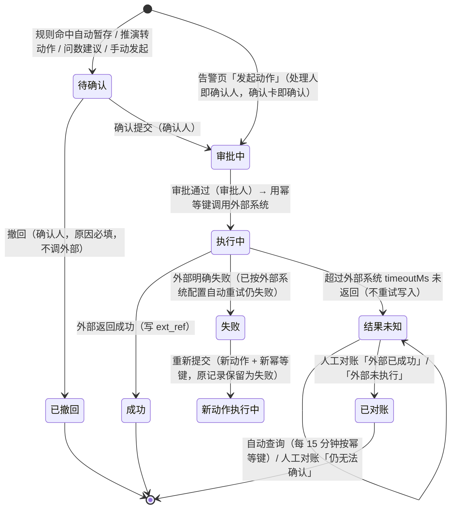
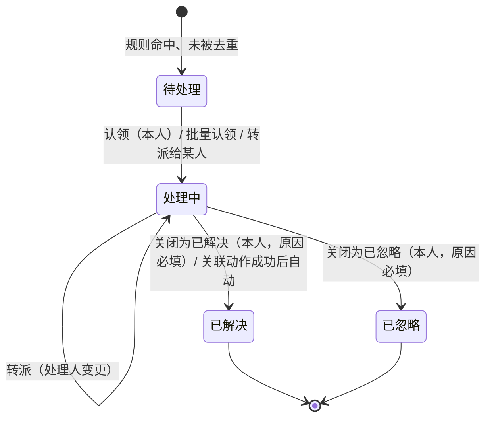
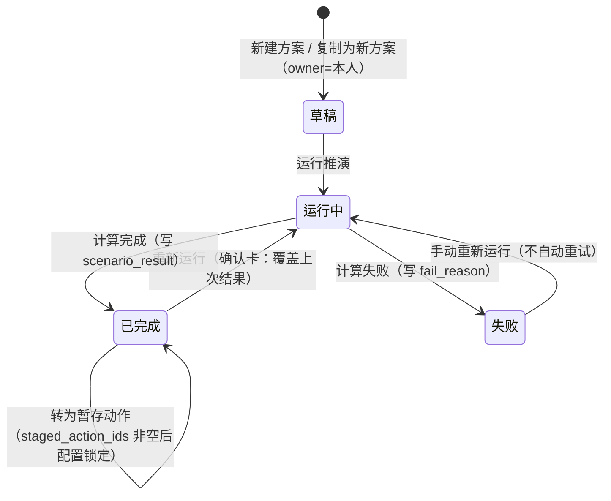

# 动态本体：后台实体、业务链路与接口（v0.1 草案）

> 依据：`/workspace/ui-vue` master `5fb26ab`（同 GitHub `zhenhuiwu/rengu_ontology` main 的 `frontend/`），只读，未改源码。
> 范围：告警处理 `ops/Alerts.vue`、动作中心 `ops/Actions.vue`、规则与自动化 `ontology/Rules.vue`、情景推演 `ops/Scenarios.vue`、对象类型「行为」页签 `ObjBehaviorLifecycle / ObjBehaviorActions / ObjBehaviorAutomation.vue`；mock：`dynamic.ts`、`actions.ts`、`rules.ts`、`scenarios.ts`、`lifecycle.ts`、`changes.ts`（引用 `actionEvent.ts`、`extsys.ts`、`releases.ts`）；公共：`stageAction`、`useDraftView`、`useReadonly`、`CHANGE_REQUESTS`。
> 标注：**[推断]** = 代码里没有直接体现，按页面行为推出；**[待定]** = 见第 7 节。全站路径与字段清单以 PDE 汇总为准，本文第 4 节只列关键业务接口。
> 用户要求：**后台逐条实现前端界面逻辑（1:1），当前 mock 数据作为种子数据入库**（第 5、6 节）。
> 前缀统一 `/api/ontology/v1`。mock 里的当前用户固定为 `王敏`（`CURRENT_USER` / `ME`），后台改为登录身份。

## 1. 总览：核心实体与表结构

### 1.1 实体与关系

| 实体 | 前端来源 | 说明 |
|---|---|---|
| 告警 alert | `mock/dynamic.ts` `ALERTS`（`Alert`） | 规则命中且输出=告警、未被去重时生成；级别、对象、触发值/阈值、数据截至、状态、处理人 |
| 告警处理记录 alert_log | `alertTimeline()`、`Alerts.vue` 各操作 `log.push` | 生成、认领、转派、关闭、发起动作、动作结果联动 |
| 规则 rule（按版本） | `mock/rules.ts` `RULE_DEFS`、`dynamic.ts` `RULES` | 条件（引用 `metric@version`）、逻辑、表达式、去重键、冷却、触发方式、输出、自动暂存配置、负责人 |
| 规则命中 rule_hit | `hitsOf()`（`Hit`） | 每次命中一行；结果 = 告警状态 / 已通知 / 已去重 |
| 回放试跑 rule_replay | `replay()`（`ReplaySample`） | 用历史数据重算，只读结果，不生成告警和动作 |
| 动作执行 action_run | `mock/actions.ts` `ACTIONS`（`ActionRecord`） | 一次动作实例：来源、对象、参数、确认人、审批人、幂等键、外部系统、外部单号、状态、重新提交链 |
| 动作执行记录 action_log | `buildLog()`、`Actions.vue` 各操作 | 触发 → 生成 → 确认 → 审批 → 调用 → 结果 / 对账 |
| 外部调用 ext_call | `extsys.ts`（`ExtCall`）[推断：动作中心未直接展示] | 每次 HTTP 调用一行：幂等键、耗时、http、结果、第几次 attempt |
| 情景方案 scenario | `mock/scenarios.ts` `SCENARIOS` | 范围（区域、品类、周数）+ 驱动（价格、补货、安全库存、促销）、基于的本体版本、状态、已暂存动作 |
| 推演结果 scenario_result | `simulate()`（`ScResult`） | 周序列、KPI、SKU×门店影响；每次运行覆盖 |
| 生命周期 lifecycle / lifecycle_state / lifecycle_transition | `mock/lifecycle.ts` `LIFECYCLES` | 对象类型的状态字段、状态（初始/中间/终态、SLA）、迁移（触发、来源、条件、结果）、版本 |
| 状态变化 lifecycle_change | `changesOf()`（`LcChange`） | 数据同步收到的逐条状态变化；`trId=null` 即非法迁移 |
| 变更单 change_request 等 | `mock/changes.ts`、`useDraftView` | **复用静态文档 `static-api.md` 第 1、2 节**；动态侧 target_kind = `rule`、`object`（生命周期）、`action`、`event` |

关系要点：
- 规则 → 命中 → （未去重且输出=告警）告警 → （配了自动暂存）动作 `待确认`。**规则永远不直接执行动作。**
- 动作来源五类：`规则`、`告警`（告警页人工发起）、`问数`、`手动`、`推演`；`source` 里带 `ruleId/ruleVersion/alertId/session/scenarioId/confirmer`。
- 生命周期 `order` v4 与规则 `SM-ORD`、动作类型 `correct_order_status` 同一口径：不在迁移表里的变化 = 非法迁移 → SM-ORD 告警 → 暂存「订单状态修正」。
- 规则、生命周期的定义按「已发布快照 + CR 草稿增量」存，与静态一致；告警、命中、动作、方案是运行数据，不进版本快照，但记录产生时的 `rule_version` / `type_version` / `base_release`。

### 1.2 表与字段

状态值统一存英文码，界面显示中文（对照见每表）。时间一律 `timestamptz`，mock 字符串为北京时间。

**alert**

| 字段 | 类型 | 说明 / mock 对应 |
|---|---|---|
| id PK | varchar | `AL-20261025-0143` |
| rule_id FK, rule_version | varchar, int | `ruleId`，命中时的规则版本 |
| hit_id FK | varchar | 产生本告警的命中 |
| level | varchar | `high/medium/low` = 高/中/低（来自规则） |
| obj_kind, obj_id, obj_label | varchar | `store/product/order`（规则 R-027 为 region，只发通知） |
| store_id, store_label | varchar | 商品类告警所在门店（R-007/R-012 去重键含门店） |
| value, threshold | varchar | 触发值 / 阈值展示串 |
| dedupe_key | varchar | 按规则去重键拼出，见 2.6 |
| triggered_at, data_cutoff | timestamptz | `triggeredAt`、`cutoff`（数据截至） |
| status | varchar | `open/processing/resolved/ignored` = 待处理/处理中/已解决/已忽略 |
| assignee | varchar null | 未认领为空 |
| close_reason | text | 关闭必填 |
| action_run_id FK null | varchar | 关联动作（`actionRef`，按 `source.alertId` 匹配最近一条） |
| lock_version | int | 乐观锁 |

**alert_log**：`id, alert_id FK, at, actor（'系统' 或用户）, op（created/claim/transfer/close/start_action/action_result）, text, from_status, to_status, abnormal bool`。

**rule**（按 `(id, version)` 存已发布版本；草稿在 cr_item）

| 字段 | 类型 | 说明 |
|---|---|---|
| id, version PK | varchar, int | `R-007` v3；版本整数 |
| name, desc, owner | varchar | |
| status | varchar | `published/changing/disabled` = 已发布/变更中/已停用；列表显示的「草稿中/审核中」由所在 CR 状态推导（`ruleStatus()`） |
| core | bool | 5 条核心规则（产生告警）|
| obj_kind | varchar | store/product/order/region |
| level | varchar | 高/中/低 |
| output | varchar | `alert/notify` = 告警/通知 |
| conds | jsonb | `[{metric, metricVer, field, op, value}]` |
| logic, expr | varchar, text | 且/或；编译后表达式 |
| dedupe, cooldown | varchar | 如「规则 + 商品 + 门店 + 日期」/「7 天」「不重复」 |
| trigger | jsonb | `{kind: 定时/事件, cron, text, eventId, filter}` |
| action_type_id | varchar | 绑定的动作类型 |
| auto_stage | jsonb | `{enabled, actionTypeId, confirmer, mapping:[{param, from}]}` |
| release | varchar | 随哪次本体发布生效 |
| published_by, published_at, change_note | | 版本历史 `ruleVersions()` |

**rule_hit**：`id PK（告警编号或 HIT-R003-102500）, rule_id, rule_version, at, obj_kind, obj_id, obj_label, store_id, store_label, value, threshold, dedupe_key, result（alert/notified/deduped = 产生告警/已通知/已去重）, alert_id FK null`。

**action_run**

| 字段 | 类型 | 说明 |
|---|---|---|
| id PK | varchar | `ACT-20261025-0552`，后台序列分配 |
| action_type_id, type_version | varchar | 名称取动作类型目录；`typeVersion` 如 v3 |
| source_type | varchar | rule/alert/qa/manual/scenario = 规则/告警/问数/手动/推演 |
| rule_id, rule_version, alert_id, qa_session, scenario_id | varchar null | `source.*` |
| obj_kind, obj_id, obj_label | varchar | 含 member/segment/region/alert |
| params | jsonb + params_text | mock 只有摘要串 `params` [推断：后台按动作类型参数存结构化值] |
| initiator | varchar | 规则来源记「规则 R-xxx」 |
| confirmer | varchar | 规则来源 = 规则固定确认人；推演 = 方案 owner；其余 = 发起人 |
| approver | varchar | 动作类型审批配置解析出的审批人 |
| idem_key UNIQUE | varchar | 见 2.1 |
| status | varchar | `staged/approving/executing/succeeded/failed/unknown/withdrawn/reconciled` = 待确认/审批中/执行中/成功/失败/结果未知/已撤回/已对账 |
| sys_id, ext_ref | varchar | `EXT-OA/ERP/OMS/CRM`；外部单号 |
| fail_reason, unknown_reason | text | 外部返回原因 / 超时说明 |
| reconcile_result, reconcile_note | varchar, text | `外部已成功/外部未执行` |
| auto_query_count, next_query_at | int, timestamptz | 结果未知自动查询计数与下次时间 |
| retry_of, retried_as | varchar FK | 重新提交链 |
| withdraw_reason | text | |
| submitted_at, confirmed_at, approved_at, finished_at | timestamptz | |
| lock_version | int | |

**action_log**：`id, action_run_id, at, actor, text, level（done/warn/error/unknown）`（= `ActionLog{time,text,desc,status}`）。

**scenario**：`id PK（SCN-0018）, name, owner, created_at, base_release（baseVer v2026.10.3）, status（draft/running/done/failed = 草稿/运行中/已完成/失败）, scope jsonb {area, category, weeks∈4|8|12}, drivers jsonb {pricePct −20~+10, replenishPct −30~+50, safetyDays 3~14, promo 无/满减/折扣/会员券, promoDepth 0~30, promoWeeks 0~4}, fail_reason, staged_action_ids text[], lock_version`。

**scenario_result**：`scenario_id PK, ran_at, scope_snapshot, drivers_snapshot, weeks[], base_sales[], sales[], base_margin[], margin[], kpis jsonb[{key,label,unit,base,value,better}]`；**scenario_impact**：`scenario_id, sku, name, category, store_id, store_name, base_sales, sales, stockout_base, stockout, suggest`（分页读）。

**lifecycle**：`object_type_id, version PK, field, owner, updated_at, rule_id（校验非法迁移的规则，如 SM-ORD）, desc, release, change_note, status（生效中/已替代）, undo jsonb`。
**lifecycle_state**：`object_type_id, version, key PK, name, kind（initial/middle/final = 初始/中间/终态）, desc, sla, x, y（画布坐标）`；`count` 为统计值，不入定义表 [推断：按对象状态实时聚合]。
**lifecycle_transition**：`object_type_id, version, id PK（T1…）, from_state, to_state, trigger（event/action/system/manual = 事件/动作/系统/人工）, by, event_type_id, action_type_id, guard, effect`；`weekly`（近 7 天次数）为统计值。
**lifecycle_change**：`id, object_type_id, at, obj_id, obj_label, from_state, to_state, transition_id null（null=非法）, by, alert_id`。

## 2. 核心链路

### 2.1 动作：暂存 → 确认 → 审批 → 提交 → 结果 / 对账

| 步骤 | 谁 | 前置条件（后端必须校验） | 结果 / 写什么 |
|---|---|---|---|
| 暂存 | 系统（规则）/ 发起人 | 规则 `auto_stage.enabled` 且必填参数都有取值来源；推演见 2.5 | 新 `action_run(status=staged)`，`confirmer` 定好；log「规则 R-xxx vN 命中…自动暂存动作」「生成动作…幂等键」「等待确认提交」。**不调用外部系统** |
| 确认提交 | 仅 `confirmer`（规则来源为规则固定确认人，别人只能看，提示「只有确认人可以确认提交或撤回」） | status=staged；非只读 | → approving；log「确认提交」「等待审批 · 审批人 X」 |
| 撤回 | 仅 `confirmer` | status=staged；原因必填 | → withdrawn（终态）；不写外部 |
| 审批通过 | `approver` | status=approving | → executing，调用外部；log「审批通过」「调用 {系统}：{调用说明} · 幂等键」 |
| 审批驳回 | `approver` | — | **前端没有这一步** [待定] |
| 外部成功 | 系统 | — | → succeeded，写 `ext_ref` |
| 外部明确失败 | 系统 | 按 `ext_system.maxRetry` 自动重试（同一幂等键，如 CRM/ERP/OMS 最多 3 次 1s/2s/4s）仍失败 | → failed，写 `fail_reason`（外部错误码原文，如 `NC-2071 …`） |
| 超时 | 系统 | 超过 `ext_system.timeoutMs`（CRM/OMS 5 秒、ERP 10 秒…） | → unknown；**绝不重试写入**；log「N 秒未返回结果，标记为结果未知（不重试写入）」 |
| 自动查询 | 对账任务 | status=unknown | 每 15 分钟按幂等键查外部；mock 文案「自动查询 3 次（每 15 分钟），仍无法确认」→ log「转人工对账」。查到结果后的自动转换前端未展示 [推断：查到成功 → reconciled(外部已成功)，查到未执行 → reconciled(外部未执行)] |
| 人工对账 | 确认人（mock 写对账人 = `source.confirmer ?? initiator`）[推断：前端未限制操作人] | status=unknown；结论必选、说明必填 | 外部已成功 / 外部未执行 → reconciled；仍无法确认 → 保持 unknown，log，继续自动查询 |
| 重新提交 | 有执行权限的人 [推断：前端只校验状态] | status=failed 且 `retried_as` 为空；**不可逆**确认卡 | 新 `action_run`：新 id、幂等键 `{原键去掉 -rN}-r{N+1}`、`retry_of=原 id`、`status=executing`、沿用原审批（不再确认、不再审批）、`source.confirmer` 清空；原记录写 `retried_as`、log「已重新提交为 X」，状态仍为失败 |

**幂等键规则**（`actions.ts`）：
- 告警关联的动作：`act-<告警编号小写>`，如 `act-al-20261025-0127`（告警页与动作中心一致）。
- 其他来源：`act-<动作编号去掉 ACT- 后小写>`，如 `act-20261025-0552`。
- 重新提交：在原键后加 `-r1`、`-r2`…；每次重新提交都是新键。
- 传给外部系统的字段名按外部系统登记：CRM `X-Idempotency-Key`、ERP `srcBillNo`、OMS `X-Request-Id`、WMS `requestNo`；短信平台不支持幂等（`maxRetry=0`）。
- `idem_key` 全表唯一；同一幂等键重复提交返回已有记录，不再调外部。

**告警页发起动作**：确认卡字段 = 来源告警、触发值、审批人、幂等键 `act-<告警号>`；确认后直接 `审批中`（处理人即确认人）。一条告警只对应一个动作（幂等键由告警号决定）。

### 2.2 告警：生成 → 认领 → 处理 → 关闭

| 操作 | 谁 / 条件 | 写什么 |
|---|---|---|
| 认领 | 任何人；status=open | → processing，assignee=本人；log「认领，状态 待处理 → 处理中」 |
| 批量认领 | 勾选项中 status=open 的 | 同上，逐条 |
| 转派 | 任何人；未关闭；**关联动作在途（待确认/审批中/执行中/结果未知）时禁止** | assignee 改为目标人；open 时同时 → processing；log「转派：A → B」 |
| 关闭 | 仅 `status=processing && assignee=本人`；动作在途时禁止；结果（已解决/已忽略）+ 原因必填 | → resolved/ignored；log「关闭为X：原因（from → to）」 |
| 批量关闭 | 只作用于勾选项中「本人处理中」的；原因必填 | 同上 |
| 发起动作 | 仅本人处理中、规则绑定了动作、尚无关联动作 | 新 action_run（见 2.1），alert.action_run_id；log「发起动作…动作成功后告警自动转为已解决」 |
| 动作结果联动 | 系统 | 动作 succeeded → 告警 resolved，log「关联动作执行成功，状态 处理中 → 已解决」；失败/已对账后解锁，由处理人手动关闭 [推断] |

已关闭告警没有重开入口。详情显示「近 7 天同一规则、同一对象第 N 次触发」（含本条，按 rule_id+obj_id 计数）。

### 2.3 规则与生命周期：草稿 → 变更单 → 整版发布

完全复用静态的 CR 状态机（`static-api.md` 2.1/2.2：草稿 → 审核中 → 已通过 → 整版发布；驳回、撤回、改回草稿；只有本体管理员能发布；不能自审）。动态侧补充：

| 规则 | 说明 |
|---|---|
| 已发布只读 | 规则、生命周期的所有编辑按钮只在 `?view=draft` 且该对象在某张 CR 里时可用；否则提示「已发布版本只读，请先发起变更」；唯一入口「发起变更」（新建 CR 或加入已有 CR，`useDraftView.start`） |
| 状态显示 | 规则所在 CR=审核中 → 橙色「审核中」；CR=草稿 → 灰色「草稿中」；否则用规则自身状态 |
| 草稿版本号 | 草稿 = 当前版本 + 1（R-007 v3 → 草稿 v4，随 CR-0011 把毛利率口径 v2 → v3） |
| 规则保存校验 | 自动暂存开启时，动作类型的必填参数都要有取值来源，否则「保存到草稿」禁用并列出缺的参数；可选动作类型 = `targetKind=规则对象` 且非草稿的动作类型；改动作类型清空映射 |
| 口径升版提示 | 草稿条件引用的指标版本变了时提示「口径升版后需回放试跑，确认命中变化再提交审核」（前端只提示，不拦截）[待定] |
| 草稿生效范围 | 草稿里的修改只在回放试跑中生效；发布后才按新条件/触发方式运行 |
| 规则回滚 | 版本历史「回滚」到已替代版本 = **生成一张新 CR**，审核通过后随整版发布生效 |
| 新建规则 | 先建 CR（`StartChangeModal`），在草稿里编辑 |
| 生命周期草稿 | 改动按 `CR号:对象类型` 存：新增状态（名称不重复、必填）、新增迁移（原/新状态、触发来源必填；同一 from→to 不重复）、修改迁移（触发、来源、条件、结果）、删除迁移（确认卡写明发布后该变化会被 SM-ORD 判为非法迁移）、删除草稿新增状态（连带删除其新增迁移）；每项可撤销 |
| 发布联动 | 生命周期发布后，SM-ORD 的「合法迁移」集合随之切换（规则表达式引用 `lifecycle("SalesOrder", 4)`）[推断：需按版本绑定] |
| 行为页签 | 对象类型的「动作」「自动化」页签只读汇总（动作类型在动作类型页维护，规则在规则页维护），草稿视图同样只读 |

### 2.4 回放试跑

- 入参：`rule_id`、`range=7d|30d`、`version=current|draft`（只有存在草稿时可选草稿）。
- 用历史数据重算，**不生成告警、不暂存动作、不写命中表**。
- 出参：`actual`（实际命中数）、`would`（试跑会命中 = 一致 + 新增命中）、`added`、`removed`、`deduped`、`samples[{at, obj, store, value, diff: 一致/新增命中/不再命中/被去重}]`（分页 9 条）。
- 命中数只算会产生告警/通知的命中；去重键相同且在冷却期内的样本列为「被去重」，不计入（与 CR 影响面「近 7 天回放命中 3 → 5」同口径）。
- 只读模式（`?ver=`）下不能开始试跑。

### 2.5 情景推演：运行 → 对比 → 转为暂存动作

| 操作 | 条件（后端校验） | 结果 |
|---|---|---|
| 新建 / 复制为新方案 | 非只读；复制对任何人的方案都可用 | 新 `SCN-NNNN`，status=draft，owner=本人，`base_release`=当前版本，复制带 scope/drivers |
| 改名 | owner | 只改 name |
| 运行 / 重新运行 | owner；非只读；status≠running；未转过动作；至少调整一个驱动（价格≠0、补货≠0、安全库存≠7、或促销≠无且力度>0） | 保存当前 scope/drivers，status=running，清空旧结果和 fail_reason；异步计算 → done 或 failed。改动范围/驱动后旧结果作废，需重新运行 |
| 失败 | 示例原因：库存快照截止早于推演起点，无法计算缺货率 | 只能手动重新运行 |
| 对比 | 只能勾选 `已完成` 的方案，最多 3 个（`?cmp=a,b,c`），`?pick=` 为选定方案 | 并排 KPI、周销售；范围不同时不画基线 |
| 转为暂存动作 | 非只读；status=done；owner=本人；当前配置与已运行配置一致；尚未转过；建议清单非空 | 按 `stagePlanOf()` 生成建议（降/提价 → 发起调价审批 ≤6 条；补货/安全库存 → 补货申请 ≤6 条；促销 → 发放复购召回优惠券 1 条），用户勾选至少一条；每条调 `stageAction` 生成 `待确认` 动作，`source={type:推演, scenarioId, scenarioName, confirmer:本人}`；`scenario.staged_action_ids` 写入，之后方案配置锁定（「如需调整请复制为新方案」） |
| 别人的方案 | — | 只读：不能改、运行、转动作，只能复制 |

重新运行不影响已暂存到动作中心的动作。推演计算模型属示意（价格弹性 −1.6 等写死在 mock），真实模型 [待定]。

### 2.6 告警去重与冷却

- 每条规则定义 `dedupe`（去重键维度）和 `cooldown`（冷却期）。示例：R-007「规则 + 商品 + 门店 + 日期」冷却 7 天；R-012「规则 + 商品 + 门店」24 小时；R-015「规则 + 订单」不重复；R-021「规则 + 门店 + 周」7 天；SM-ORD「事件 ID」不重复。
- 命中时先算 `dedupe_key`；同键在冷却期内已有命中 → 写 `rule_hit(result=deduped)`，**不生成告警、不发通知、不暂存动作**；「不重复」= 同键永久只触发一次。
- 被去重原因文案由去重键与冷却期推出（`dedupeReason()`）：如「同一商品门店 7 天内已命中」「同一订单已命中过」。
- 输出=通知的规则命中写 `result=notified`，不生成告警（通知渠道 [待定]）。
- R-007 只在越线那一次触发（条件含「上次计算 ≥ 18%」）。

## 3. 权限与只读

| 场景 | 规则 |
|---|---|
| 历史版本 `?ver=` | 所有动态页只读：告警不能处理、动作不能确认/撤回/重提/对账、规则不能发起变更/试跑/回滚、方案不能新建/运行/转动作；悬停「正在查看历史版本 X，只读」。生命周期显示该版本发布时生效的状态机（按 `undo` 倒推）；状态变化和非法迁移列表为空 |
| 以此用户预览 | 同只读，原因「正在以 X 的权限预览，只读」；后端按真实身份拒写 `READONLY_PREVIEW` |
| 已发布 vs 草稿 | 规则、生命周期只在草稿视图可编辑（见 2.3） |
| 他人所有 | 规则暂存的动作只有指定确认人能确认/撤回；告警只有本人处理中才能关闭/发起动作；方案只有 owner 能改/运行/转动作 |
| 动作在途锁 | 关联动作在途时告警不能转派、关闭 |

后端不能只靠前端置灰，以上每条都要在写接口里校验。

## 4. 关键业务接口（字段清单以 PDE 汇总为准）

| 用途 | 接口 | 要点 |
|---|---|---|
| 告警列表 | `GET /alerts?status=open|processing|closed|all&level&rule_id&kw&page&size` | 一屏 12；kw 匹配编号或对象；返回各页签计数 |
| 告警详情 | `GET /alerts/{id}` | 含规则摘要、指标、去重说明、近 7 天次数、关联动作、log |
| 认领 / 批量认领 | `POST /alerts/{id}:claim`、`POST /alerts:batch-claim {ids}` | |
| 转派 | `POST /alerts/{id}:transfer {to}` | 在途锁 |
| 关闭 / 批量关闭 | `POST /alerts/{id}:close {as, reason}`、`POST /alerts:batch-close` | 仅本人处理中 |
| 告警发起动作 | `POST /alerts/{id}:start-action` | 生成 action_run(approving)，返回幂等键 |
| 动作列表 | `GET /action-runs?tab=pending|records|unknown&status&action&sys&kw&page&size` | 一屏 16；kw 匹配编号/对象/幂等键/外部单号/告警号/规则号/会话号；unknown 页签待对账排前 |
| 动作详情 | `GET /action-runs/{id}` | 含 log、确认人、能否操作及原因 |
| 暂存（内部） | `POST /action-runs:stage` | 规则引擎、推演、问数调用；只生成待确认 |
| 确认提交 / 撤回 | `POST /action-runs/{id}:confirm`、`:withdraw {reason}` | 仅 confirmer |
| 审批 | `POST /action-runs/{id}:approve` | 前端无页面，审批入口 [待定] |
| 重新提交 | `POST /action-runs/{id}:resubmit` | 返回新动作 id 与新幂等键 |
| 人工对账 | `POST /action-runs/{id}:reconcile {result, note}` | result ∈ 外部已成功/外部未执行/仍无法确认 |
| 规则列表 / 详情 | `GET /rules?trigger&status&kw&page`、`GET /rules/{id}?view=draft&cr` | 每页 16 |
| 命中历史 | `GET /rules/{id}/hits?range=7d|30d&page&size`、`GET /rule-hits/{id}` | 一屏 12；详情含告警时间线和关联动作 |
| 规则草稿保存 | `PUT /change-requests/{cr}/items`（`target_kind=rule`） | 复用静态；校验必填映射 |
| 回放试跑 | `POST /rules/{id}:replay {range, version}` | 不落业务数据 |
| 版本历史 / 回滚 | `GET /rules/{id}/versions`、`POST /rules/{id}:rollback {to_version}` | 回滚生成新 CR |
| 方案 CRUD | `GET /scenarios?status&kw&page`、`POST /scenarios {from?}`、`PATCH /scenarios/{id} {name}` | |
| 运行 | `POST /scenarios/{id}:run {scope, drivers}` | 异步；`GET /scenarios/{id}` 轮询状态 |
| 结果 / 影响 | `GET /scenarios/{id}/result`、`/impacts?page&size` | 影响一屏 6 |
| 对比 | `GET /scenarios:compare?ids=a,b,c` | ≤3 个已完成 |
| 转动作 | `GET /scenarios/{id}/stage-plan`、`POST /scenarios/{id}:stage {keys}` | |
| 生命周期 | `GET /object-types/{id}/lifecycle?view&cr&release` | 状态、迁移、版本；草稿带 mark |
| 状态变化 / 非法迁移 | `GET /object-types/{id}/lifecycle/changes?illegal=1&page&size`、`/illegal?since=7d` | 一屏 6；非法迁移按 from→to 汇总，取 SM-ORD 命中 |
| 行为汇总 | `GET /object-types/{id}/action-types`、`/action-runs?status&action&page`、`/rules`、`/rule-hits?rule&page` | 只读 |

错误码（在静态错误码基础上新增）：`NOT_CONFIRMER`、`NOT_ASSIGNEE`、`ALERT_LOCKED_BY_ACTION`、`ACTION_STATE_INVALID`、`ALREADY_RESUBMITTED`、`IDEMPOTENCY_CONFLICT`、`STAGE_MAPPING_MISSING`、`SCENARIO_NOT_OWNER`、`SCENARIO_RUNNING`、`SCENARIO_STAGED_LOCKED`、`SCENARIO_NO_DRIVER`、`SCENARIO_CONFIG_DIRTY`、`COMPARE_LIMIT`、`REASON_REQUIRED`。`message` 直接用作前端悬停原因（与现有文案一致）。

## 5. 种子数据方案

原则：**不手抄数据**，直接执行前端 mock 模块导出 JSON 再入库，保证后台返回的数据与前端现在显示的一模一样。按 PDE 约定：统一由 `npm run export-mock` 把 `src/mock/*` 原样导出到 `backend/seeds/json/<模块>/`（时间保持北京时间原值），动态各模块（alerts / actions / rules / scenarios / lifecycle）的 Python seed 放在 `backend/app/modules/<模块>/seeds/`，读这里的 JSON，由统一的 `make seed` 按下表写表，不各自跑 tsx。

| mock 文件 / 导出 | 写入表 | 当前条数（master `5fb26ab` 实跑） | 注意 |
|---|---|---|---|
| `dynamic.ts` `RULES` | rule（与 rules.ts 合并） | 5 条核心规则 | 版本 `v3` 字符串转整数 |
| `dynamic.ts` `ALERTS`（含 `fillHistory` 补的历史告警、`storeOfKey` 补的门店） | alert | 154（待处理 4、处理中 4、已解决 115、已忽略 31） | 随机数有固定种子，结果稳定 |
| `dynamic.ts` `alertTimeline()` + `Alerts.vue` 关联动作行 | alert_log | 每条告警 1–3 行 | 关联动作那行来自 ACTIONS |
| `rules.ts` `RULE_DEFS` | rule（当前版本） | 16 | |
| `rules.ts` `ruleVersions()` | rule（历史版本行，只有元数据） | 每条规则 version 行 | 历史版本的条件内容 mock 没有 [待定] |
| `rules.ts` `RULE_DRAFTS` + `useDraftView` TARGETS | cr_item / cr_target（R-007 在 CR-0011） | 1 | 与静态共用 CR 表 |
| `rules.ts` `hitsOf(ruleId)` 全部规则 | rule_hit | 1186 | 核心规则命中 = 告警 + 合成的「已去重」；其余为已通知/已去重 |
| `actions.ts` `ACTIONS`（含 `buildLog`） | action_run、action_log | 141（待确认 25、审批中 7、执行中 4、失败 11、结果未知 20、成功 58、已撤回 5、已对账 11；来源 规则 33、问数 72、手动 36） | 幂等键、编号已由 build 算好，原样入库；`RULE_CONFIRMER` 写 confirmer |
| `actions.ts` `SEGMENTS`、`QA_SESSIONS`、`ACTION_META` | 引用数据（会员分群、问数会话、动作类型本地审批人） | 6 / 3 / 7 | 会话归问数模块；审批人示例与动作类型审批规则的关系 [待定] |
| `scenarios.ts` `SCENARIOS` | scenario | 18（已完成 15、失败 1、草稿 2） | |
| `scenarios.ts` `simulate()`（已完成方案在构造时已算） | scenario_result、scenario_impact | 15 份结果 | `ranAt` 原样保留 |
| `lifecycle.ts` `LIFECYCLES` | lifecycle、lifecycle_state、lifecycle_transition | order v4（6 状态/9 迁移）、store v2（4/5）、product v3（4/6）、member v2（4/6）、promotion v1（6/6）、refund v2（4/3） | `versions[].undo` 存版本历史，历史版本内容按 `lifecycleAsOf` 预先展开存快照更简单 [推断] |
| `lifecycle.ts` `changesOf()` | lifecycle_change | order 68、store 10、其余各 42 | 非法迁移由 SM-ORD 命中派生，`illegalOf()` 不单独存 |
| `changes.ts` `CHANGE_REQUESTS`、`CR_DETAILS`；`releases.ts` `RELEASES`、`DRAFTS` | 静态侧 CR / 发布表 | — | 由静态种子负责，动态只引用 |
| `actionEvent.ts` `ACTION_TYPES`、`EVENT_TYPES`；`extsys.ts` `EXT_SYSTEMS` | 动作类型、事件类型、外部系统表 | — | 归 Palantir专家 / PDE 种子；动态表外键引用 `id` |
| `orders.ts`、`products.ts`、`stores.ts` | 业务对象 | — | 告警、动作的 obj_id 都引用这套 ID |

种子约束：
1. 时间：mock 时间是北京时间字符串，入库转 `timestamptz +08:00`。mock 把「现在」视为 2026-10-25 16:xx，种子保留原时间，不要按入库时间平移，否则「今天」「近 7 天」（`SINCE_7D = 2026-10-19`）对不上。
2. 编号序列：入库后把 ACT / AL / SCN / CR 各序列设为现有最大号 + 1。
3. 运行时状态：结果未知的动作种子入库后会被对账任务扫到；种子环境要么关掉外部调用（适配器用 mock），要么把 `next_query_at` 置空 [待定]。
4. 校验：入库后用同一套前端页面对比 4 个列表的页签计数与首屏数据，一致才算通过。

## 6. 前端操作 → 后端 1:1 对照清单

评审时逐行勾。「前端条件」= 按钮可用条件，后端必须同样校验。

### 6.1 告警处理 `/use/ops/alerts`

| # | 按钮 / 操作 | 前端条件 | 接口 | 状态变化 / 副作用 |
|---|---|---|---|---|
| A1 | 页签 待处理/处理中/已关闭/全部 + 级别/规则/搜索 + 分页 | — | `GET /alerts` | — |
| A2 | 选中一条看详情 | — | `GET /alerts/{id}` | — |
| A3 | 认领 | status=待处理；非只读 | `:claim` | 待处理 → 处理中；log |
| A4 | 批量认领 | 勾选；只处理待处理项 | `:batch-claim` | 同上 |
| A5 | 转派 | 未关闭；动作不在途；选了目标人 | `:transfer` | 处理人变；待处理 → 处理中；log |
| A6 | 关闭（已解决/已忽略 + 原因） | 本人处理中；动作不在途；原因非空 | `:close` | 处理中 → 已解决/已忽略；log |
| A7 | 批量关闭 | 只作用于本人处理中；原因非空 | `:batch-close` | 同上 |
| A8 | 发起动作（按钮名 = 规则绑定动作名） | 本人处理中；规则有动作；无关联动作 | `:start-action` | 新动作 审批中；alert 关联动作；log |
| A9 | 动作成功联动 | 系统 | 事件 | 处理中 → 已解决；log |
| A10 | 点对象 / 规则 / 指标 | — | 公共对象抽屉、规则页 | — |

### 6.2 动作中心 `/use/ops/actions`

| # | 按钮 / 操作 | 前端条件 | 接口 | 状态变化 / 副作用 |
|---|---|---|---|---|
| C1 | 页签 待确认 / 执行记录 / 结果未知与对账 + 动作/系统/状态/搜索 + 分页 | — | `GET /action-runs` | — |
| C2 | 详情 | — | `GET /action-runs/{id}` | — |
| C3 | 确认提交 | 待确认；本人是确认人；非只读 | `:confirm` | 待确认 → 审批中；log ×2 |
| C4 | 撤回（原因） | 待确认；本人是确认人；原因非空 | `:withdraw` | 待确认 → 已撤回 |
| C5 | 重新提交（不可逆确认卡） | 失败；未重提过 | `:resubmit` | 新动作 执行中 + 新幂等键 `-rN`；原动作写 retried_as |
| C6 | 发起对账（结论 + 说明） | 结果未知；结论已选；说明非空 | `:reconcile` | → 已对账，或「仍无法确认」保持结果未知 |
| C7 | 跳到重提后的新动作 / 原动作 | retried_as / retry_of 存在 | `GET /action-runs/{id}` | — |
| C8 | 审批通过 | （前端无按钮） | `:approve` | 审批中 → 执行中 → 调外部 |
| C9 | 外部结果回写 | 系统 | 适配器 | 执行中 → 成功/失败/结果未知 |
| C10 | 自动查询 | 系统，每 15 分钟 | 对账任务 | 结果未知 → 已对账 / 保持 [推断] |

### 6.3 规则与自动化 `/build/ontology/rules`

| # | 按钮 / 操作 | 前端条件 | 接口 | 状态变化 / 副作用 |
|---|---|---|---|---|
| R1 | 列表（触发/状态/搜索，每页 16） | — | `GET /rules` | — |
| R2 | 新建规则 | 非只读 | `POST /change-requests` | 新 CR 草稿 |
| R3 | 发起变更（新建 / 加入已有 CR） | 无草稿或只读时显示；非只读 | `POST /change-requests`、`/targets` | 进入草稿视图 |
| R4 | 已发布 / 草稿视图切换 | 有草稿 | `GET /rules/{id}?view=draft&cr` | — |
| R5 | 添加条件、改阈值、修改触发方式 | 草稿视图 | CR items | 草稿改动 |
| R6 | 自动暂存开关、动作类型、确认人、参数映射 | 草稿视图；开关打开 | CR items | 改动作类型清空映射 |
| R7 | 保存到草稿 | 草稿视图；必填映射齐全 | `PUT /change-requests/{cr}/items` | CR 改动数 +1 |
| R8 | 命中历史（7/30 天，分页）+ 命中抽屉 | — | `GET /rules/{id}/hits`、`/rule-hits/{id}` | — |
| R9 | 开始试跑（范围、版本 当前/草稿） | 非只读 | `:replay` | 无 |
| R10 | 去回放试跑（口径升版提示） | 草稿口径升版 | — | 跳 replay，版本=草稿 |
| R11 | 版本历史 对比 / 回滚 | 回滚：已替代版本、非只读 | `GET /versions`、`:rollback` | 新 CR |
| R12 | 已暂存待确认数 / 跳动作中心 | — | `GET /action-runs?rule_id` | — |
| R13 | 提交审核 / 通过 / 驳回 / 发布 | 在变更与发布页 | 复用静态 3.1 | CR 状态机 |

### 6.4 情景推演 `/use/ops/scenarios`

| # | 按钮 / 操作 | 前端条件 | 接口 | 状态变化 / 副作用 |
|---|---|---|---|---|
| S1 | 列表（状态/搜索，一屏 12） | — | `GET /scenarios` | — |
| S2 | 新建方案 | 非只读；有未保存改动先确认放弃 | `POST /scenarios` | → 草稿 |
| S3 | 复制为新方案 | 非只读 | `POST /scenarios {from}` | → 草稿，owner=本人 |
| S4 | 保存名称 | owner；名称非空 | `PATCH /scenarios/{id}` | — |
| S5 | 运行推演 / 重新运行（确认卡） | owner；非只读；非运行中；未转动作；至少一个驱动 | `:run` | → 运行中 → 已完成/失败 |
| S6 | 失败后重新运行 | 同 S5 | `:run` | 失败 → 运行中 |
| S7 | 影响明细分页 | 已完成 | `GET /impacts` | — |
| S8 | 对比模式、勾选（≤3 已完成）、选定方案 | — | `GET /scenarios:compare` | — |
| S9 | 转为暂存动作 → 预览勾选 → 确认卡「暂存 N 条」 | 见 2.5 | `GET /stage-plan`、`:stage` | 生成 N 条待确认动作；方案锁定 |
| S10 | 去动作中心确认 | 已转动作 | — | 跳 `/use/ops/actions?tab=pending` |

### 6.5 对象类型 · 行为页签

| # | 按钮 / 操作 | 前端条件 | 接口 | 状态变化 / 副作用 |
|---|---|---|---|---|
| L1 | 生命周期图 + 迁移定义（一页 6）+ 选中状态/迁移/非法迁移 | — | `GET /lifecycle` | — |
| L2 | 近期状态变化（一页 6，只看非法） | 非历史版本 | `GET /lifecycle/changes` | — |
| L3 | 新增状态 | 草稿视图；名称非空不重复 | CR items `section=lc_states` | 草稿新增 |
| L4 | 新增 / 修改迁移 | 草稿视图；原/新状态、来源必填；不重复 | CR items `section=lc_transitions` | 草稿新增/修改 |
| L5 | 删除迁移 / 删除新增状态（确认卡） | 草稿视图 | CR items `op=delete` | 草稿删除；连带删除新增迁移 |
| L6 | 改动清单「撤销」 | 草稿视图 | 删除对应 cr_item | — |
| L7 | 动作页签：动作类型表 + 抽屉、该对象动作列表（状态/动作筛选，一页 10）、点编号去动作中心 | 只读 | `GET /object-types/{id}/action-types`、`/action-runs` | — |
| L8 | 自动化页签：规则表、事件类型、近 7 天命中（按规则筛选、分页） | 只读 | `GET /object-types/{id}/rules`、`/rule-hits` | — |

## 7. 待定问题（只列不答）

1. **事件总线**：库存变动、订单状态变更、门店价格变更、退款单创建等事件从哪来（CDC / 消息队列 / 定时拉取），投递语义（至少一次？），规则按事件 ID 去重（SM-ORD）依赖事件 ID 全局唯一。
2. **任务调度**：定时规则（cron，如 `0 8 * * *`、`*/15 * * * *`）、结果未知每 15 分钟的对账查询、情景推演的异步运行、关联质量等后台任务用什么调度器；是否需要分布式锁防重复执行。
3. **外部系统适配器**：OA/ERP/OMS/CRM 各自的提交与「按幂等键查询」接口是否都存在；超时、明确失败、限流的判定口径；不支持幂等的系统（短信平台）怎么对账。
4. **审计日志**：alert_log、action_log、cr_event 之外是否要统一的全局审计表（谁、何时、对象、前后值）；推演运行、试跑、只读拒绝要不要记。
5. **审批**：审批在本系统内做还是由外部系统（如泛微 OA）回调；审批驳回后动作进入什么状态（前端没有）；动作类型里「免审」条件（如补货 ≤2 万元、改为合法状态）满足时是否跳过 审批中。
6. **自动查询次数**：mock 写「自动查询 3 次仍无法确认 → 转人工对账」，人工选「仍无法确认」后又写「系统继续每 15 分钟查询」：是查 3 次后停，还是一直查到有结果；自动查到结果后转「已对账」还是「成功」。
7. **外部明确失败的自动重试**：按外部系统 `maxRetry` 同一幂等键重试，和「重新提交 = 新幂等键」区分是否就是这样。
8. **幂等键格式**：动作中心用 `act-<告警号>` / `act-<动作号>`，动作类型目录写的是业务键模板（如 `correctOrderStatus:{订单号}:{目标状态}`），以哪个为准。
9. **重新提交、人工对账的操作人**：前端没有限制，是否只限确认人或有执行权限的角色（动作类型 `runners`）。
10. **重新提交是否重新审批**：前端「沿用原审批」直接执行中；参数不可改，是否允许改参数后重提。
11. **告警与动作联动**：动作失败、已对账（外部未执行）、已撤回后告警是否自动变化；已关闭告警能否重开。
12. **通知渠道**：输出=通知的规则通知到哪里（站内、企业微信、短信）。
13. **回放试跑**：口径升版后是否强制先跑试跑才能提交审核；试跑结果是否存档供审核人查看；30 天回放的数据量和耗时。
14. **生命周期版本绑定**：SM-ORD 表达式写死 `lifecycle("SalesOrder", 4)`，生命周期升版时规则是否必须同一张 CR 一起升。
15. **推演模型**：示意模型（弹性 −1.6 等）换成真实模型的来源与运行时长；推演用哪个本体版本的数据快照。
16. **规则历史版本内容**：mock 只有版本元数据，回滚需要完整历史定义，是否按版本存全量。
17. **种子环境的外部调用**：种子里 20 条结果未知动作入库后会触发对账任务，开发/测试环境的适配器是否统一走 mock。
18. 动态侧的发布校验（规则映射齐全、生命周期迁移引用的动作/事件存在等）是否并入静态 V 系列（同静态待定 12）。
