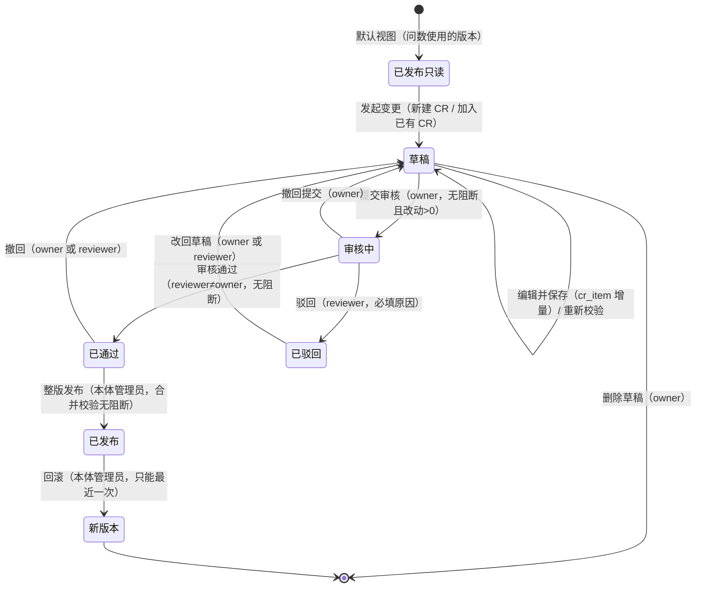

# 静态本体：后台实体、变更发布链路与接口（v0.2 草案）

> 依据：`/workspace/ui-vue` master `5fb26ab` 的前端代码与 mock（只读，未改源码）；表结构在 `/workspace/palantir-ontology/静态本体-后台表结构与接口定义-v0.1.md` 基础上按前端补齐。
> 范围：对象类型（定义页签 + 使用与治理页签）、关系类型、指标口径、维度与字典、业务知识、变更与发布。
> 标注：**[推断]** = 代码里没有直接体现，是按页面行为推出来的；**[第二期]** = 前端显示「暂未开放」。全站接口路径和字段清单由 PDE 统一从代码提取，本文第 3 节只列业务逻辑接口。
> 前缀统一 `/api/ontology/v1`。

## 1. 总览：核心实体与表结构

### 1.1 实体与关系

| 实体 | 前端来源 | 说明 |
|---|---|---|
| 对象类型 object_type | `ObjectTypes.vue`、`mock/objectProps.ts`（ObjMeta） | 分组/业务域、主键、标题属性、冲突策略、生命周期、同步方式、示例问法 |
| 属性 property | `ObjProp` | api、名称、类型、分组、pk/title/dim/sensitive、枚举字典、来源列、描述 |
| 数据源映射 object_mapping / property_mapping | 「数据源与映射」页签、`mock/datasources.ts` | 对象 → 源表；属性 → 源列/表达式；「重新采集元数据」刷新源表结构 |
| 关系类型 link_type | `mock/links.ts`（LinkType） | from/to、基数 `1:1/1:N/N:1/N:M`、关联键、via 中间对象、物理 JOIN、反向名、可空 |
| 关联质量 link_quality | `LinkQuality` | 命中率、孤儿记录、空值、重复、孤儿样例；每日 06:00 检查 |
| 问数路径 qa_path | `QaPath/PathGroup` | 两对象间多条路径及默认路径（V13） |
| 指标 metric（按版本） | `mock/metrics.ts`、`Metrics.vue` | 公式、单位、允许维度、口径版本 vN；版本列表含「生效中/已替代」 |
| 维度/码表 dimension | `mock/dimensions.ts`（DimItem） | kind=维度/码表，来源对象+属性+列，取值来源与同步，层级 levels，问数口径 qa |
| 维度层级 dim_level | `DimLevel` | 名称、api、来源、成员数 |
| 维度取值 dim_value | `DimValue` | code、名称、层级、父级、启用/停用、同义词、有效期 since/until |
| 说法映射 dim_mapping | `DimMapping` | 说法 → 取值（可多值），匹配方式 精确/包含/多值，来源（取值同义词/取值名称/业务知识/问数反馈），命中数，歧义与处理方式 |
| 业务知识 knowledge | `mock/knowledge.ts`（KEntry） | 类型 术语/业务规则/财务日历/口径说明，定义、计算说明、同义词、适用对象/指标、过滤条件、财务日历区间、试一试问句 |
| 变更单 change_request（CR） | `mock/changes.ts` | 标题、说明 reason、owner、reviewer、状态、级别 重大/一般/修订、改动数、驳回原因、进入的版本 |
| 变更项 cr_item | `DiffRow`、`useDraftEdits.section()` | 每处改动：类型、目标、字段、新增/修改/删除、原值、新值 |
| 变更目标 cr_target | `useDraftView` 的 TARGETS、`CRDetail.touches` | 一张 CR 改了哪些定义（`metric:gross_margin`、`property:store.format`…），用于草稿归属与合并校验 M1 |
| 校验结果 cr_check | `CheckRow` V1–V17 | 结果 阻断/警告/信息/通过/不适用 + 说明；含目标库（V14：达梦 DM8、金仓 KES） |
| 影响分析 cr_impact | `ImpactItem` | 直接/定义/使用三组：指标、认证问答、评测题、看板、规则、外部系统… |
| 试跑 cr_trial | `TrialRow` | 按月旧口径/新口径/差异 |
| 评审记录 cr_event | `ReviewEvent`、`reviewLog()` | 创建、校验、提交、驳回/通过、撤回、改回草稿、发布、回滚 |
| 版本 ontology_release | `mock/releases.ts` | ver（如 v2026.10.3）、发布时间、发布人、说明；当前版本指针 |
| 权限 | `PermissionsTab.vue`、`mock/roles.ts`、预览 store | 功能级（none/view/edit/manage）、对象级+行级范围、敏感列；本体管理员名单 |
| 视图 object_view | `mock/objectViews.ts` | 我的页面/对象列表/工作台视图，可见范围，近 30 天使用（只读展示，归问数/公共模块） |

关系要点：
- 所有定义表都按 **「已发布快照 + CR 草稿增量」** 存：已发布内容只来自 `ontology_release`，草稿只存在 `cr_item` 里，不直接改已发布行。
- 一张 CR 可以改多个对象、指标、维度、知识（「加入已有变更单」）；同一个定义在多张已通过 CR 中出现时，整版发布被 M1 阻断。
- 属性/关系/指标/维度取值/知识同义词的改动，都以 `cr_item(target_kind, target_id, section, item_key)` 记录，与前端 `section(name, base, keyOf)` 一一对应。

### 1.2 ER 图

```mermaid
erDiagram
  DOMAIN ||--o{ OBJECT_TYPE : groups
  OBJECT_TYPE ||--o{ PROPERTY : has
  OBJECT_TYPE ||--o{ OBJECT_MAPPING : maps_to
  OBJECT_MAPPING ||--o{ PROPERTY_MAPPING : columns
  PROPERTY ||--o{ PROPERTY_MAPPING : mapped_by
  DATASOURCE_REF ||--o{ OBJECT_MAPPING : source
  ENUM_TYPE ||--o{ PROPERTY : enum_of
  OBJECT_TYPE ||--o{ LINK_TYPE : from_to
  LINK_TYPE ||--o| LINK_QUALITY : checked
  LINK_TYPE ||--o{ QA_PATH_STEP : used_in
  QA_PATH ||--o{ QA_PATH_STEP : steps
  OBJECT_TYPE ||--o{ METRIC : base_object
  DIMENSION ||--o{ DIM_LEVEL : levels
  DIMENSION ||--o{ DIM_VALUE : values
  DIM_VALUE ||--o{ DIM_VALUE : parent
  DIMENSION ||--o{ DIM_MAPPING : phrases
  PROPERTY ||--o| DIMENSION : source_attr
  KNOWLEDGE ||--o{ KNOWLEDGE_APPLY : applies_to
  KNOWLEDGE ||--o{ SYNONYM : defines
  CHANGE_REQUEST ||--o{ CR_TARGET : touches
  CHANGE_REQUEST ||--o{ CR_ITEM : diffs
  CHANGE_REQUEST ||--o{ CR_CHECK : checks
  CHANGE_REQUEST ||--o{ CR_IMPACT : impacts
  CHANGE_REQUEST ||--o{ CR_TRIAL : trials
  CHANGE_REQUEST ||--o{ CR_EVENT : log
  ONTOLOGY_RELEASE ||--o{ CHANGE_REQUEST : contains
  ONTOLOGY_RELEASE ||--o| ONTOLOGY_RELEASE : parent
  ONTOLOGY_RELEASE ||--o{ RELEASE_CHECK : merge_checks
  ROLE ||--o{ ROLE_OBJECT_SCOPE : row_scope
  OBJECT_TYPE ||--o{ ROLE_OBJECT_SCOPE : scoped

  CHANGE_REQUEST {
    varchar id PK "CR-0016"
    varchar title
    text reason
    varchar owner FK
    varchar reviewer FK
    varchar status "draft|in_review|approved|rejected|published"
    varchar level "major|minor|patch"
    varchar base_release FK "起草时基于的版本"
    varchar release FK "进入的版本"
    text reject_reason
    text migration "V15 迁移方式"
    int changes "改动数（冗余）"
    int lock_version "乐观锁"
    timestamptz created_at
    timestamptz submitted_at
    timestamptz reviewed_at
    timestamptz updated_at
  }
  CR_TARGET {
    varchar cr_id PK,FK
    varchar target_kind PK "object|link|metric|dimension|knowledge|action|event|rule"
    varchar target_id PK "member / gross_margin / K-018"
    boolean is_new "本单新建的定义"
  }
  CR_ITEM {
    bigint id PK
    varchar cr_id FK
    varchar target_kind
    varchar target_id
    varchar section "properties|links|mapping|values|mappings|def|sensitive..."
    varchar item_key "属性 api / 取值 code / 字段名"
    varchar op "add|update|delete"
    jsonb before "已发布值，新增为空"
    jsonb after "草稿值，删除为空"
    varchar type_label "前端改动类型列：属性/关系/指标/枚举值..."
    varchar field_label
    varchar updated_by
    timestamptz updated_at
  }
  CR_CHECK {
    varchar cr_id PK,FK
    varchar code PK "V1..V17"
    varchar target_db PK "'' 或 dm8|kes（V14）"
    varchar result "block|warn|info|pass|na"
    text note
    timestamptz checked_at
  }
  CR_IMPACT {
    bigint id PK
    varchar cr_id FK
    varchar grp "direct|defs|usage"
    varchar kind "指标/认证问答/评测题/看板/规则/外部系统"
    varchar name
    text note
    int cnt
    varchar ref_kind
    varchar ref_id
  }
  CR_TRIAL {
    varchar cr_id PK,FK
    varchar period PK "2026-09"
    varchar before_val
    varchar after_val
    varchar delta
    varchar scope "全部门店 / 华东大区"
  }
  CR_EVENT {
    bigint id PK
    varchar cr_id FK
    varchar action "create|check|submit|withdraw|approve|reject|unapprove|reopen|publish|rollback|note"
    varchar actor
    text detail
    varchar from_status
    varchar to_status
    timestamptz at
  }
  ONTOLOGY_RELEASE {
    varchar ver PK "v2026.10.3"
    varchar parent_ver FK
    jsonb snapshot "整版快照"
    varchar snapshot_sha256
    jsonb change_summary
    varchar status "published|rolled_back"
    varchar rollback_of FK "回滚生成的版本指向被回滚版"
    varchar published_by
    text note
    timestamptz published_at
  }
  RELEASE_CHECK {
    varchar ver PK,FK
    varchar code PK "M1/V9/V17/V1-V17/提示"
    varchar result
    text note
  }
  OBJECT_TYPE {
    varchar api_name PK "order"
    varchar display_name
    bigint domain_id FK
    varchar pk_property
    varchar title_property
    varchar conflict_strategy "user_edit_wins|latest_source_ts"
    varchar source_ts_column
    varchar lifecycle "active|experimental|deprecated"
    varchar sync "每小时增量..."
    text description_nl
    jsonb sample_questions "示例问法+是否认证"
  }
  PROPERTY {
    varchar object_type PK,FK
    varchar api_name PK
    varchar display_name
    varchar data_type
    varchar prop_group
    boolean is_pk
    boolean is_title
    boolean is_dimension
    boolean is_sensitive
    varchar enum_type FK
    varchar unit
    text description_nl
    varchar lifecycle "active|deprecated（V7 不删只弃用）"
  }
  LINK_TYPE {
    varchar api_name PK
    varchar display_name
    varchar from_object FK
    varchar to_object FK
    varchar cardinality "1:1|1:N|N:1|N:M"
    varchar from_property
    varchar to_property
    varchar via_object FK
    text join_sql "物理 JOIN"
    varchar reverse_name
    boolean nullable
    text description_nl
    varchar owner
  }
  LINK_QUALITY {
    varchar link_type PK,FK
    numeric hit_rate
    bigint orphans
    bigint nulls
    bigint dups
    jsonb orphan_samples
    timestamptz checked_at
  }
  METRIC {
    varchar api_name PK
    int version PK
    varchar display_name
    varchar base_object FK
    varchar kind "simple|derived|ratio"
    text expression
    varchar time_property
    jsonb default_filters
    jsonb allowed_dims
    varchar unit
    varchar owner
    varchar status "生效中|已替代|草稿|已下线"
    varchar since_release FK
  }
  DIMENSION {
    varchar api_name PK
    varchar display_name
    varchar kind "dimension|codelist"
    varchar dim_group
    varchar source_object FK
    varchar source_property
    varchar source_column
    varchar value_source
    varchar sync
    jsonb qa_rule "默认粒度/未指定/空值/排序"
    text description_nl
    varchar owner
  }
  DIM_LEVEL {
    varchar dimension PK,FK
    int level_no PK
    varchar api_name
    varchar display_name
    varchar source
  }
  DIM_VALUE {
    varchar dimension PK,FK
    varchar code PK
    date valid_from PK
    varchar label
    int level_no
    varchar parent_code
    varchar status "enabled|disabled"
    jsonb synonyms
    date valid_to
  }
  DIM_MAPPING {
    bigint id PK
    varchar dimension FK
    varchar phrase
    jsonb targets "取值 code 列表"
    varchar match "exact|contains|multi"
    varchar source "value_synonym|value_name|knowledge|qa_feedback"
    varchar resolve "歧义处理方式"
    bigint hits
  }
  KNOWLEDGE {
    varchar id PK "K-018"
    varchar name
    varchar type "term|rule|fiscal_calendar|metric_note"
    text definition
    text calc
    jsonb filters
    jsonb periods "财务日历区间"
    jsonb tries "试一试问句"
    varchar owner
    varchar status "published|disabled"
    varchar since_release
    varchar stopped_release
  }
  KNOWLEDGE_APPLY {
    varchar knowledge_id PK,FK
    varchar ref_kind PK "object_type|metric"
    varchar ref_id PK
  }
  SYNONYM {
    bigint id PK
    varchar term
    varchar target_kind
    varchar target_ref
    boolean is_default "V17"
    varchar source_kind "knowledge|dimension|metric|feedback"
    varchar source_id
  }
  ROLE_OBJECT_SCOPE {
    varchar role_id PK,FK
    varchar object_type PK,FK
    text row_filter "大区 = 华东；空=全部"
    jsonb plain_columns "可明文查看的敏感列"
  }
```

### 1.3 表设计说明

- **已发布定义表**（object_type、property、link_type、metric、dimension…）只由发布任务写入，内容等于当前版本快照的「展开表」，供查询层/问数快速读；历史版本读 `ontology_release.snapshot`（`?ver=`）。[推断：前端只需要按版本读，不关心存储方式]
- **草稿 = 已发布 + cr_item 增量**：读草稿视图时后台把 cr_item 按 `(section, item_key)` 叠加到已发布行上，返回每行 `mark: 新增|修改|删除|''` 和 `base`（已发布值）。删除已发布行只打 `op=delete`，新增后又删除则直接删掉 cr_item（与 `useDraftEdits.remove` 一致）。
- **id 规则**：CR 号 `CR-NNNN` 由后台序列分配（前端 `nextCrId` 只是 mock）；新建知识 `K-xxx`、新建关系/对象 api 在 CR 提交前可改，发布后 api 不能改（V7）。
- **指标按 (api_name, version) 复合主键**：改公式或过滤必须升版本（V8）；已保存页面和告警继续引用旧 `metric@version`。
- **敏感属性**：`property.is_sensitive` 走变更单（`PermissionsTab.toggleSens` 写入草稿，发布后生效）；明文授权在 `role_object_scope.plain_columns`。
- **mock 与 v0.1 的状态值对照**：草稿=draft、审核中=in_review、已通过=approved、已驳回=rejected、已发布=published；级别 重大=major、一般=minor、修订=patch。

## 2. 核心链路：变更单 → 校验 → 整版发布

### 2.1 状态图

### 2.2 各状态允许的操作

| 状态 | owner（提交人） | reviewer（审核人） | 本体管理员 | 其他有编辑权限的人 | 只读（`?ver=` 历史版本 / 以此用户预览） |
|---|---|---|---|---|---|
| 已发布（无草稿） | 发起变更 | 发起变更 | 发起变更 | 发起变更 | 全部置灰，悬停给原因 |
| 草稿 | 编辑、保存、放弃本对象改动、删除整单、重新校验、提交审核 | 查看、编辑（`canManage` 允许跳编辑）[推断：前端编辑按钮不限 owner] | 同左 | 「加入已有变更单」后可编辑 [推断] | 只读 |
| 审核中 | 撤回提交；草稿锁定不可编辑 | 通过 / 驳回 | — | 查看 | 只读 |
| 已通过 | 撤回（回草稿，不进下一版） | 撤回 | 整版发布（页头「发布 vNext」） | 查看 | 只读 |
| 已驳回 | 改回草稿 | 改回草稿 | — | 查看 | 只读 |
| 已发布 | — | — | 回滚（仅当前版本对应的单子） | 查看 | 只读 |

后端必须校验的规则（不能只靠前端置灰）：
1. **已发布只读**：任何定义写接口都必须带 `cr_id`，且 CR 状态为 `draft`；没有直接改已发布定义的接口。
2. **提交审核**：CR 有改动（`changes>0`）、最新一次校验无「阻断」、调用方是 owner；提交后锁定，`cr_item` 写接口返回 `CR_LOCKED`。前端在本对象有未保存修改时拦截提交，后端以 `lock_version` 防止提交的是旧内容。
3. **审核**：reviewer 不能是 owner（不能自审）；通过前再次检查无阻断；驳回必须带原因（前端给了 5 个预设：口径与财务不一致 / 影响范围没写清楚 / 迁移方式不完整 / 与其他变更单冲突 / 权限或可见范围未定）。
4. **撤回、改回草稿**：只有 owner 或 reviewer；回到 `draft` 后需重新提交审核。
5. **整版发布**：只有本体管理员（`ONTOLOGY_ADMINS`）；纳入全部 `approved` 的 CR；先跑合并校验，有阻断拒绝发布。
6. **回滚**：只能回滚最近一次发布；生成一个新版本，内容等于上一版本，被回滚版本标 `rolled_back`（前端文案）。指标页的「回滚口径版本」则是**生成一张新变更单**，走正常审核后随下一次整版发布生效。
7. **预览身份**（以此用户预览）：所有写接口拒绝，返回 `READONLY_PREVIEW`；读接口按被预览用户的功能级和行级范围过滤。[推断：前端只做了置灰，后端需按真实身份拒写]

### 2.3 发布校验（单张 CR，V1–V17）

结果五档：`阻断`（不能提交/通过/发布）、`警告`（可提交，审核人看）、`信息`、`通过`、`不适用`。触发时机：每次保存草稿后异步跑 + 手动「重新校验」+ 提交前同步再跑一次 [推断]。已发布 CR 不再校验。

| 编号 | 校验项 | 默认级别 | 前端实例 |
|---|---|---|---|
| V1 | 主键与映射完整 | 阻断 | — |
| V2 | 主键唯一性抽检 | 阻断 | CR-0012 抽检 10 万条 |
| V3 | 关系两端与类型兼容 | 阻断 | CR-0006 |
| V4 | 枚举挂取值字典（源数据有字典外值时警告） | 警告 | CR-0001 CRM 无 L5 |
| V5 | 指标引用的属性已映射 | 阻断 | CR-0011 促销补贴未映射 |
| V6 | 允许的维度可到达 | 阻断 | — |
| V7 | 已发布 API 名不删不改（只能弃用） | 阻断 | CR-0012 保留 stored_balance |
| V8 | 改公式或过滤须升版本 | 阻断 | CR-0007 |
| V9 | 同义词冲突 | 警告（合并时可升阻断） | CR-0010、CR-0009（信息） |
| V10 | 层级成员唯一父级 | 阻断 | CR-0005 |
| V11 | 自然语言描述齐全 | 警告 | CR-0013 |
| V12 | 影响分析 | 信息/警告 | CR-0006 敏感对象 |
| V13 | 多路径须指定默认路径 | 阻断 | 关系页「问数路径」 |
| V14 | 各目标库 EXPLAIN 通过（**达梦 DM8、金仓 KES**，按库分别出结果） | 阻断 | CR-0011 KES 失败 |
| V15 | 重大改动写明迁移方式 | 阻断（前端示例多为警告，口径待定） | CR-0012、CR-0014 |
| V16 | 冲突策略时间字段 | 阻断 | CR-0012 |
| V17 | 同名词唯一默认 | 阻断 | CR-0007 |

PDE 已定口径：发布校验「警告」保留橙色（发布前必须看）；维度歧义、同义词冲突属于质量提示，不卡流程。

### 2.4 整版合并校验（发布前，`mergeCheck`）

把全部已通过 CR 合起来再查：
- **M1** 同一定义（`cr_target` 键）只被一张单子改动，否则阻断，提示「CR-a、CR-b 都改了 xxx」。
- **V9** 各单新增同义词合起来不冲突（同一词指向不同目标 → 阻断）。
- **V17** 同一词被重复添加 → 警告，发布时只保留一条。
- **V1–V17** 各单自身无阻断。
- 提示（信息）：多张单改同义词 → 发布后重建同义词索引（约 2 分钟）；评测题回放结果（按 vNext 草稿回放 N 题，失败 0）。

### 2.5 发布事务

1. 加全局发布锁（同一时刻只允许一次发布）[推断]。
2. 合并校验 → 把所有 approved CR 的 cr_item 按顺序叠加到当前版本快照 → 生成 vNext 快照与 change_summary。
3. 写 `ontology_release`，移动当前版本指针，CR 状态改 `published`、`release=vNext`，写 cr_event。
4. 异步：展开已发布定义表、重建同义词/召回索引、触发评测回放、通知相关人（顶栏通知 `N-0104 指标口径已变更`）。
5. 发布后新提问按新版本；已有答案、页面、告警保留各自 `metric@version`。

### 2.6 历史版本只读

- 顶栏选版本 → URL `?ver=v2026.10.1`；所有读接口带 `release=ver`，返回该版本快照；页面整页只读（发起变更、新建、导入、编辑全部置灰，原因「正在查看历史版本 x，只读」）。
- 业务知识在历史版本下只显示 `since <= ver` 的条目；维度显示 `levelsBefore`（该版本时的层级）。

## 3. 按页面的业务接口（只列业务逻辑；字段清单以 PDE 汇总为准）

### 3.1 变更单与草稿（所有静态页共用）

| 页面操作 | 接口 | 关键字段 / 规则 |
|---|---|---|
| 发起变更（新建） | `POST /change-requests` | 入：`title`(≤40)、`reason`、`target{kind,id}`、`reviewer?`；出：`id`、`status=draft`、`base_release` |
| 发起变更（加入已有） | `POST /change-requests/{id}/targets` | 入：`target{kind,id,is_new}`；只能加入 draft；同一 target 已在别的 draft 里时返回 `TARGET_IN_OTHER_CR` [推断] |
| 可加入的草稿下拉 | `GET /change-requests?status=draft&page&size` | 出：`id,title,owner` |
| 读草稿视图 | `GET /{kind}/{id}?view=draft&cr={crId}` | 出：每行 `mark`、`base`；`locked`（审核中） |
| 保存到草稿 | `PUT /change-requests/{id}/items` | 入：`target`、`section`、`rows[{key,op,after}]`、`lock_version`；草稿锁定返回 `CR_LOCKED` |
| 放弃本对象草稿 | `DELETE /change-requests/{id}/targets/{kind}/{targetId}` | 丢弃该对象全部 cr_item |
| 删除草稿单 | `DELETE /change-requests/{id}` | 仅 owner + draft |
| 重新校验 | `POST /change-requests/{id}:validate` | 异步返回 `job_id`，结果写 cr_check；已发布 CR 拒绝 |
| 提交审核 | `POST /change-requests/{id}:submit` | 规则见 2.2-2 |
| 撤回提交 | `POST /change-requests/{id}:withdraw` | owner，in_review → draft |
| 审核通过 / 驳回 | `POST /change-requests/{id}:approve` / `:reject` | reject 必填 `reason` |
| 撤回已通过 | `POST /change-requests/{id}:unapprove` | owner/reviewer，approved → draft |
| 改回草稿 | `POST /change-requests/{id}:reopen` | owner/reviewer，rejected → draft |
| 变更单列表 | `GET /change-requests?status&kw&page&size` | 左栏每页 17；kw 匹配标题或单号 |
| 详情各页签 | `GET /change-requests/{id}` + `/diffs` `/checks` `/impact` `/trial` `/events` | 改动、发布校验、影响分析、试跑对比、评审记录 |
| 补充迁移方式 | `PATCH /change-requests/{id}` `{migration}` | 记一条 cr_event(note)；影响 V15 [推断] |
| 合并校验预览 | `POST /releases:merge-check` | 出：`rows[{code,name,result,note}]`、`blocked` |
| 整版发布 | `POST /releases` `{note, lock_version}` | 仅本体管理员；出 `ver` |
| 回滚版本 | `POST /releases/{ver}:rollback` | 仅最近一次；生成新版本 |
| 版本列表 / 版本对比 | `GET /releases`、`GET /releases/{a}/diff/{b}` | 对比 **[第二期]** |

### 3.2 对象类型

| 页面操作 | 接口 | 规则 |
|---|---|---|
| 新增属性（草稿） | 走 `PUT /change-requests/{id}/items`，`section=properties`、`op=add` | api 在对象内唯一；已存在返回 `DUPLICATE_KEY` |
| 新增关系 | 跳关系类型页新建（`?from=对象`），走关系的 CR 流程 | — |
| 设为/取消敏感属性 | cr_item `section=sensitive` | 写入草稿，发布后生效 |
| 从数据源导入 / 新建对象类型 | 先 `POST /change-requests`（标题「从数据源导入对象类型」「新建对象类型」），再 `POST /object-types:import-preview` 读源表结构生成草稿 [推断] | — |
| 重新采集元数据 | `POST /object-types/{id}/mappings:refresh-metadata` | 异步，完成后刷新映射；不改定义，不走 CR [推断] |
| 引用与影响（指标、视图、版本历史页签） | `GET /object-types/{id}/usage?kind=metric|view|cr&page&size` | 指标按「基础对象或维度涉及」聚合；CR 按 touches 聚合 |
| 预览数据、批量编辑、视图「打开」 | — | **[第二期]** |

### 3.3 关系类型

| 页面操作 | 接口 | 规则 |
|---|---|---|
| 新建/编辑关系 | CR items，`target_kind=link` | 新建 api 发布前可改 |
| 关联质量 | `GET /link-types/{id}/quality` | 每日 06:00 任务写；草稿跑测试环境 |
| 问数路径与默认路径 | `GET /link-types/paths?from&to`；改默认走 CR | V13 |
| 引用与影响 | `GET /link-types/{id}/usage` | 指标、认证问答、视图、规则、评测题 |

### 3.4 指标口径

| 页面操作 | 接口 | 规则 |
|---|---|---|
| 指标试算（近 30 日） | `POST /metrics/{id}:trial` `{cr?, range}` | 草稿按 CR 口径、否则按已发布；返回趋势和数据截止时间；不落库 |
| 口径版本列表 | `GET /metrics/{id}/versions?page&size` | 生效中/已替代 |
| 回滚口径版本 | `POST /metrics/{id}:rollback` `{to_version}` | **生成新 CR**（不直接生效） |
| 引用页签 | `GET /metrics/{id}/refs?page&size` | 指标、规则可跳转；看板、认证问答为纯文本 |
| 导入 / 新建指标 | 先建 CR 再导入 [推断] | — |
| 版本对比 | — | **[第二期]** |

### 3.5 维度与字典

| 页面操作 | 接口 | 规则 |
|---|---|---|
| 新增/编辑/停用取值 | CR items，`section=values` | 停用的取值不参与问数匹配，历史数据仍按原取值统计 |
| 新增/编辑说法映射 | CR items，`section=mappings` | 多值时需写 `resolve` |
| 匹配试算（试一试） | `POST /dimensions:match` `{text, dimension?, all, cr?}` | 出：`exact[]`、`contains[]`、`crossDim`、`groups[]`；顺序 精确 › 同义词 › 包含；空输入返回 `EMPTY_INPUT` |
| 只看冲突 | `GET /dimensions/{id}/mappings?conflict=1&page&size` | V9 警告，不阻断 |

### 3.6 业务知识

| 页面操作 | 接口 | 规则 |
|---|---|---|
| 新建/编辑/停用知识 | CR items，`target_kind=knowledge` | 停用确认卡「记入变更单」 |
| 业务知识解析（试一试） | `POST /knowledge:resolve` `{question, cr?}` | 返回命中的条目、展开后的过滤条件与口径；空输入提示 |
| 同义词冲突 | `GET /knowledge/synonym-conflicts` | 灰色提示，原因悬停 |
| 引用 | `GET /knowledge/{id}/refs` | 指标、认证问答、规则、看板、评测题 |

## 4. 通用约定

- **分页**：`page`（从 1）、`size`；响应 `{items, total, page, size}`。前端部分列表只显示 `‹ 1/N ›` 不显示总数，`total` 仍返回。列表筛选/搜索变化后前端回到第 1 页。
- **版本参数**：读接口都接受 `release`（`?ver=`）、`view=published|draft`、`cr`；响应带 `release_tag`。
- **错误码**：`READONLY_HISTORY`、`READONLY_PREVIEW`、`NOT_IN_DRAFT`（已发布版本只读，请先发起变更）、`CR_LOCKED`（已提交审核）、`CR_STATE_INVALID`、`NOT_OWNER`、`NOT_REVIEWER`、`SELF_REVIEW`、`NOT_ONTOLOGY_ADMIN`、`CHECK_BLOCKED`（带阻断项列表）、`MERGE_BLOCKED`、`TARGET_IN_OTHER_CR`、`DUPLICATE_KEY`、`VERSION_CONFLICT`、`ROLLBACK_NOT_LATEST`、`NO_PERMISSION`。错误体 `{code, message, details}`，`message` 可直接用作前端悬停或确认卡阻断原因。
- **乐观锁**：CR 带 `lock_version`，每次保存/状态变更 +1；不匹配返回 `VERSION_CONFLICT`，前端提示刷新。发布带当前版本号，防止并发发布。
- **审计日志**：所有 CR 状态变更、保存草稿、校验、发布、回滚、敏感属性变更写 `cr_event` + 全局审计日志（谁、何时、对象、前后值）；预览身份下的写尝试也记一条拒绝 [推断]。
- **未保存提示与确认卡**：前端 `useUnsavedGuard` 只管本地未保存；后端对应的是「提交时以服务端已保存内容为准」+ `lock_version`。每张确认卡对应的后端校验：提交（有改动、无阻断、owner）、驳回（原因必填）、删除草稿（owner + draft）、发布（管理员 + 合并校验）、回滚（最近一次）、敏感属性（写入草稿）。确认卡上的数字（改动数、校验摘要、影响摘要）由后端返回，不由前端计算。

## 5. 待定问题（只列不答）

1. 大模型部署方式：外部模型 API 还是本地 GPU；影响召回索引、知识解析、评测回放的实现与耗时。
2. 信创要求：元数据库用 PostgreSQL+pgvector 还是国产库（达梦/金仓）；后台用 Python 还是 Java 技术栈。
3. 系统是否对外分发（私有化部署、多租户），影响版本号、发布锁、审计的设计。
4. 达梦 DM8、金仓 KES 测试库从哪来，V14 EXPLAIN 校验在哪个环境跑。
5. 回滚语义：前端是「生成内容等于上一版的新版本」，v0.1 是「只移动当前版本指针」，二选一。
6. V15 迁移方式缺失是阻断还是警告（v0.1 定阻断，mock 多为警告）。
7. reviewer 由提交人选，还是按对象/指标 owner 自动指派；是否需要多人或二级审批。
8. 一个定义能否同时出现在两张草稿里（目前只在合并发布时 M1 阻断）。
9. 快照存一整份 jsonb 还是按对象拆行。
10. 校验是保存后自动跑还是只在手动和提交时跑；V2 抽检、V14 EXPLAIN 的耗时和超时处理。
11. 问数反馈「转为同义词」等跨模块生成的变更单（`registerChange`）由哪个服务创建，单号如何统一。
12. 动作类型、事件类型、规则也走同一套 CR 与整版发布，动态侧的校验项是否并入 V 系列。
