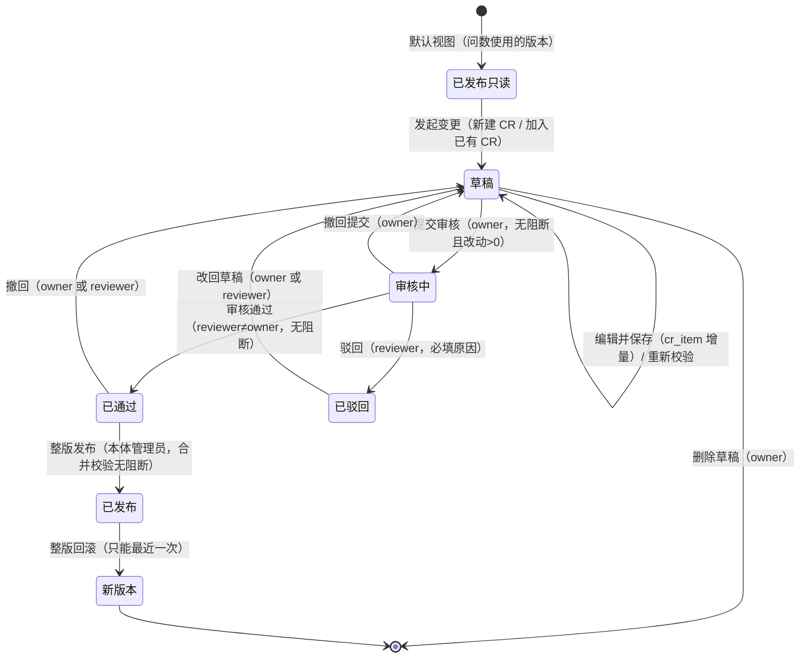

# 静态本体：后台实体、变更发布链路与接口（v0.3 草案）

> 依据：`/workspace/ui-vue` 前端代码与 mock（以前端为准）；表结构在 `/workspace/palantir-ontology/静态本体-后台表结构与接口定义-v0.1.md` 基础上按前端补齐。v0.3 按本体小白审核意见（阻断 1–3 + 非阻断建议）和 PDE 对 api-index 的意见修订。
> 范围：对象类型（定义页签 + 使用与治理页签）、关系类型、指标口径、维度与字典、业务知识、变更与发布。
> 标注：**[推断]** = 前端没有限制或没有体现，是按页面行为推出来的；**[第二期]** = 前端没有入口或显示「暂未开放」；**[待用户定]** = 需要用户或 PDE 拍板。
> 前缀 `/api/ontology/v1`。**读接口的路径、参数、返回字段以 api-index §3.5、§3.6、§3.9–3.11、§3.15–3.16 为准**；本文第 3 节只写写接口、计算接口和业务规则，读接口只写与 api-index 不同或补充的部分。
> 命名：表名不加模块前缀，单数 snake_case 业务名词，只有关键字或易混的名字加限定词（`ontology_release`）。**接口 JSON 一律 camelCase**（`baseRelease`、`lockVersion`、`isNew`、`jobId`、`toVersion`、`releaseTag`、`rejectReason`…），枚举值与 mock 完全一致（中文）；ER 图和表字段用 snake_case，状态列存英文码，由 Pydantic 转换（对照见 §1.3）。

## 1. 总览：核心实体与表结构

### 1.0 表 → 所属模块

| 表 | 模块 | 说明 |
|---|---|---|
| object_type、property、object_mapping、property_mapping、domain | 静态 | 对象类型页 |
| link_type、link_quality、qa_path、qa_path_step | 静态 | 关系类型页 |
| metric（含各版本） | 静态 | 指标口径页 |
| dimension、dim_level、dim_value、dim_mapping | 静态 | 维度与字典页；码表即 `dimension(kind=codelist)`，不另建 ENUM_TYPE |
| knowledge、knowledge_apply、synonym（同义词主表） | 静态 | 业务知识页；见 §1.3 同义词 |
| change_request、cr_target、cr_item、cr_check、cr_impact、cr_trial、cr_event | 静态 | 变更单；动作、事件、规则也用这套（§5 #12 已定） |
| release_check | 静态 | 发布前合并校验结果 |
| ontology_release | 版本层 versioning（本体小白） | 只追加；由唯一入口 `create_version(change_order_ids, rollback_of=None)` 写入；快照各节由负责模块登记的组装函数提供（§2.8）。不加前缀（PDE 已定，骨架 `1aeb5d1` 已是 `ontology_release`） |
| CR 号序列 `CR-NNNN` | 静态 | 全局一个序列、不重置；静态、动态规则、动作、事件共用（它们共用变更单）；种子后从 mock 最大号（CR-0016）之后继续 |
| object_view | 静态 | 对象类型「视图」页签（`mock/objectViews.ts`）。与问数的 `qa_object_type_view`（问数工作台的对象视图）不是一张表 |
| `create_version`、版本号 `vYYYY.MM.N`、发布锁 | 版本层 versioning | 版本号由 `create_version` 生成，静态不拼版本号 |
| role_object_scope（`row_filter` jsonb）、`apply_row_filter` / `to_sql` | 底层（本体小白） | 结构与 SQL 注入见 CONVENTIONS §10，静态只引用 |
| sys_role、sys_user | PDE（系统管理） | `roles.ts` |
| datasource、源表元数据（`dsTables`） | 数据连接 data 模块 | 种子用 `seeds/json/system/derived/dsTables.json`；静态不导入，`datasource_ref` 只存引用 |
| dict_item | 动作模块 | 动作分组、事件来源等系统下拉，不进版本、不走 CR；业务码表一律用 dimension(kind=codelist) |
| qa_synonym_link、调优同义词（`TUNED_SYNONYMS`） | 问数 | 问数调优页写入；种子由问数负责（按 word+cr upsert），静态不导 |
| notice、quality_check | PDE / 公共 | `NOTICES`、`QUALITY_CHECKS` 虽从 static 目录导出，表不归静态（见 §4.1） |
| function、fn_param、fn_version、fn_pending、fn_use | 静态（PDE 已定，骨架契约第 11 条） | 函数页 `/build/ontology/functions`（`pages/functions/Functions.vue`、`mock/functions.ts`），接口见 §3.8 |

### 1.1 实体与关系

| 实体 | 前端来源 | 说明 |
|---|---|---|
| 对象类型 object_type | `ObjectTypes.vue`、`mock/objectProps.ts`（ObjMeta） | 分组/业务域、主键、标题属性、冲突策略、生命周期、同步方式、示例问法 |
| 属性 property | `ObjProp` | api、名称、类型、分组、pk/title/dim/sensitive、码表名 `enumName`、来源列、描述 |
| 数据源映射 object_mapping / property_mapping | 「数据源与映射」页签、`mock/datasources.ts` | 对象 → 源表；属性 → 源列/表达式；「重新采集元数据」刷新源表结构 |
| 关系类型 link_type | `mock/links.ts`（LinkType） | from/to、基数 `1:1/1:N/N:1/N:M`、关联键、via 中间对象、物理 JOIN、反向名、可空 |
| 关联质量 link_quality | `LinkQuality` | 命中率、孤儿记录、空值、重复、孤儿样例；每日 06:00 检查 |
| 问数路径 qa_path | `QaPath/PathGroup` | 两对象间多条路径及默认路径（V13） |
| 指标 metric（按版本） | `mock/metrics.ts`、`mock/metricCatalog.ts` | 公式、单位、允许维度、口径版本 vN；版本列表「生效中/已替代」 |
| 维度/码表 dimension | `mock/dimensions.ts`（DimItem） | kind=维度/码表，来源对象+属性+列，取值来源与同步，层级 levels，问数口径 qa |
| 维度层级 dim_level | `DimLevel` | 名称、api、来源、成员数 |
| 维度取值 dim_value | `DimValue` | code、名称、层级、父级、启用/停用、同义词、有效期 since/until |
| 说法映射 dim_mapping | `DimMapping` | 说法 → 取值（可多值），匹配方式 精确/包含/多值，来源，命中数，歧义与处理方式 |
| 业务知识 knowledge | `mock/knowledge.ts`（KEntry） | 类型 术语/业务规则/财务日历/口径说明，定义、计算说明、同义词、适用对象/指标、过滤条件、财务日历区间、试一试问句 |
| 变更单 change_request（CR） | `mock/changes.ts` | 标题、说明 reason、owner、reviewer、状态、级别、改动数、驳回原因、进入的版本 |
| 变更项 cr_item | `DiffRow`、`useDraftEdits.section()` | 每处改动：类型、目标、字段、新增/修改/删除、原值、新值 |
| 变更目标 cr_target | `releases.ts` 的 `DRAFT_TARGETS`（草稿单）、`CRDetail.touches` | 一张 CR 改了哪些定义，用于草稿归属与合并校验 M1 |
| 校验结果 cr_check | `CheckRow` V1–V17 | 结果 + 说明；含目标库（V14：达梦 DM8、金仓 KES） |
| 影响分析 cr_impact | `ImpactItem` | 直接/定义/使用三组 |
| 试跑 cr_trial | `TrialRow` | 按月旧口径/新口径/差异 |
| 评审记录 cr_event | `ReviewEvent`、`reviewLog()` | 创建、校验、提交、驳回/通过、撤回、改回草稿、发布、回滚。**只追加**：不带 `lock_version`、不软删、不改旧行 |
| 版本 ontology_release | `mock/releases.ts` | ver、发布时间、发布人、说明 |
| 权限 | `PermissionsTab.vue`、`mock/roles.ts`、预览 store | 功能级 none/view/manage、对象级 + 行级范围（底层）、敏感列；本体管理员名单 |
| 视图 object_view | `mock/objectViews.ts` | 我的页面/对象列表/工作台视图，可见范围，近 30 天使用（只读展示） |

关系要点：
- 所有定义表都按 **「已发布快照 + CR 草稿增量」** 存：已发布内容只来自版本快照，草稿只存在 `cr_item` 里，不直接改已发布行。
- 一张 CR 可以改多个对象、指标、维度、知识（「加入已有变更单」）；同一个定义在多张已通过 CR 中出现时，整版发布被 M1 阻断。
- 改动都记在 `cr_item(cr_id, target_kind, target_id, section, item_key)`，这 5 列是唯一键（`cr_id` 为 `bigint`，指向 `change_request.id`；`target_id` **保留业务编码字符串**，如 `member`、`gross_margin`、`K-018`、`request_replenish`，因为它跨对象/关系/指标/维度/知识/动作/事件/规则多种表，不做外键，按 `(target_kind, target_id)` 解析到各表的业务键），与前端 `section(name, base, keyOf)` 一一对应，草稿叠加和按行 upsert 都靠它。`section` 取值：静态 `properties|links|mapping|values|mappings|def`；动作 `params|conds|edits|effects|config`、事件 `payload|subs`（Palantir，`item_key` 与前端重名键一致：参数 `api`、条件 `name`、本体编辑 `op:obj`、副作用 `target`、订阅方 `name`、载荷 `api`、`config` 固定 `-`）；规则、生命周期（动态，来源 `dynamic-api.md` §2.9 @ `a43f15a`，见下）。没有 `sensitive` 节。
  - **规则**（`target_kind=rule`，`target_id`=规则编号如 `R-007`）：`conds`（`item_key` 固定 `-`，整组 `conds[]+logic+expr`，只有 `op=update`；前端只按下标改阈值、没有单条增删，用 `-` 是 [推断]）；`mapping`（`item_key`=参数名 `param`，`add|update|delete`）；`config`（`item_key` 固定 `-`，自动暂存开关、动作类型、确认人）。
  - **生命周期**（`target_kind=object`，`target_id`=对象类型前端 id 如 `order`，与静态对象同一目标；节名加 `lc_` 前缀避免和静态对象的节撞名）：`lc_states`（`item_key`=状态 key，只有 `add`；删除草稿新增的状态 = 删掉那条 add）；`lc_transitions`（`item_key`=迁移编号 `T{n}`，`add|update|delete`；新增时同一 `(from, to)` 在「已发布 + 草稿」里重复返回 `DUPLICATE_KEY`）。生命周期整体字段界面不能改，不设 `-` 节（以后要改再加 `lc_config`，[推断]）。
  - **种子**：只有 1 条，CR-0011 `target_kind=rule, target_id=R-007, section=conds, item_key=-, op=update`（对应 `CR_DETAILS['CR-0011'].diffs` 第 4 行）。这一行由动态的种子按 §2.9 写入（`before/after` 为结构化的 `{conds, logic, expr}`），静态导入 diffs 时跳过 `type_label=规则` 的行，CR-0011 仍是 6 行改动。生命周期没有种子（`LC_DRAFT_EDITS` 初始为空）。

### 1.2 ER 图

ER 图字段为表字段（snake_case、英文码），接口字段见第 3 节（camelCase、中文枚举）。按骨架约定：
- **全表代理主键 + 业务键唯一约束**（PDE 已定，全员统一，无例外）：每张表主键都是 `id bigint generated always as identity`（图中 `PK`）；业务编码只做唯一约束（图中 `UK`）。编号类的前端 id（`CR-0016`、`K-018`、`V-ORD0002`、指标 `gross_margin`）放 `code varchar` 列；本身有含义的自然键保留原列名（版本 `ver`、关系/维度 `api_name`）。对象类型两列都有：`code` = 前端 id（`order`，快照节的键、接口路径里的 `{id}`），`api_name` = API 名（`SalesOrder`，快照里的 `api`）。mock 里的复合键都改成多列唯一约束。部分唯一索引 `WHERE NOT is_seed` 只用于种子幂等键重复这类例外，本文静态表目前没有这种情况。
- **外键一律指向 `id`**（图中 `FK`，列名 `xxx_id bigint`，如 `owner_id`、`cr_id`、`release_id`、`object_type_id`）。跨多种表的多态引用（`cr_item`/`cr_target` 的 `target_id`、`knowledge_apply.ref_id`、`synonym.target_ref`/`source_id`、`cr_impact.ref_id`）保留业务编码字符串，不做外键。
- **接口对外只用业务编码**：路径参数、请求体、响应里的 `id` 照旧是前端编号（`CR-0016`、`v2026.10.3`、`order`、`K-018`），接口层按业务编码（唯一约束）查 `id`，库内 `id` 不出接口；快照 JSON 的键也照旧用前端 id（§2.8）。
- **种子按业务编码解析外键**：种子 JSON 里写的是业务编码，导入时先按业务编码（唯一约束）upsert 父表，再按业务编码查出父表 `id` 填进子表的 `xxx_id`（如 `CR-0016 → change_request.id`、`v2026.10.3 → ontology_release.id`、`order → object_type.id`）。
- **公共列（图中省略）**：可改的表（定义表、change_request、cr_item、cr_target、cr_check、cr_trial、object_view…）带 `created_at`、`updated_at`、`created_by`、`is_seed`、`lock_version`；只追加的表（cr_event、cr_impact 快照、release_check、ontology_release）不带 `lock_version`、不软删。
- **软删只用在前端有删除/恢复的地方**：change_request（删除草稿单）。其他定义「删除」都是 cr_item(op=delete) 或 lifecycle=弃用，不软删。

```mermaid
erDiagram
  DOMAIN ||--o{ OBJECT_TYPE : groups
  OBJECT_TYPE ||--o{ PROPERTY : has
  OBJECT_TYPE ||--o{ OBJECT_MAPPING : maps_to
  OBJECT_MAPPING ||--o{ PROPERTY_MAPPING : columns
  PROPERTY ||--o{ PROPERTY_MAPPING : mapped_by
  DATASOURCE_REF ||--o{ OBJECT_MAPPING : source
  DIMENSION ||--o{ PROPERTY : enum_of
  OBJECT_TYPE ||--o{ LINK_TYPE : from_to
  LINK_TYPE ||--o| LINK_QUALITY : checked
  LINK_TYPE ||--o{ QA_PATH_STEP : used_in
  QA_PATH ||--o{ QA_PATH_STEP : steps
  OBJECT_TYPE ||--o{ METRIC : base_object
  DIMENSION ||--o{ DIM_LEVEL : levels
  DIMENSION ||--o{ DIM_VALUE : values
  DIM_VALUE ||--o{ DIM_VALUE : parent
  DIMENSION ||--o{ DIM_MAPPING : phrases
  PROPERTY ||--o| DIMENSION : source_attr
  KNOWLEDGE ||--o{ KNOWLEDGE_APPLY : applies_to
  KNOWLEDGE ||--o{ SYNONYM : defines
  CHANGE_REQUEST ||--o{ CR_TARGET : touches
  CHANGE_REQUEST ||--o{ CR_ITEM : diffs
  CHANGE_REQUEST ||--o{ CR_CHECK : checks
  CHANGE_REQUEST ||--o{ CR_IMPACT : impacts
  CHANGE_REQUEST ||--o{ CR_TRIAL : trials
  CHANGE_REQUEST ||--o{ CR_EVENT : log
  ONTOLOGY_RELEASE ||--o{ CHANGE_REQUEST : contains
  ONTOLOGY_RELEASE ||--o| ONTOLOGY_RELEASE : parent
  ONTOLOGY_RELEASE ||--o{ RELEASE_CHECK : merge_checks
  OBJECT_TYPE ||--o{ ROLE_OBJECT_SCOPE : scoped_by_base
  OBJECT_TYPE ||--o{ OBJECT_VIEW : views

  CHANGE_REQUEST {
    bigint id PK
    varchar code UK "CR-0016"
    varchar title
    text reason
    bigint owner_id FK "sys_user.id"
    bigint reviewer_id FK "sys_user.id"
    varchar status "draft|in_review|approved|rejected|published"
    varchar level "major|minor|patch"
    bigint base_release_id FK "起草时基于的版本"
    bigint release_id FK "进入的版本"
    text reject_reason
    text migration "V15 迁移方式"
    int changes "改动数（冗余）"
    int lock_version "乐观锁"
    timestamptz created_at
    timestamptz submitted_at
    timestamptz reviewed_at
    timestamptz updated_at
  }
  CR_TARGET {
    bigint id PK
    bigint cr_id UK,FK
    varchar target_kind UK "object|link|metric|dimension|knowledge|action|event|rule"
    varchar target_id UK "业务编码，跨种类不做外键：member / gross_margin / K-018"
    boolean is_new "本单新建的定义"
  }
  CR_ITEM {
    bigint id PK
    bigint cr_id FK
    varchar target_kind
    varchar target_id "业务编码，跨种类不做外键"
    varchar section "static: properties|links|mapping|values|mappings|def; action: params|conds|edits|effects|config; event: payload|subs; rule: conds|mapping|config; object 生命周期: lc_states|lc_transitions（dynamic-api §2.9）"
    unique uk_cr_target "(cr_id,target_kind,target_id,section,item_key)"
    varchar item_key "属性 api / 取值 code / 字段名；动作 params=api conds=name edits=op:obj effects=target config=-；事件 subs=name payload=api；规则 conds=- mapping=param config=-；生命周期 lc_states=状态 key lc_transitions=T 编号"
    varchar op "add|update|delete"
    jsonb before "已发布值，新增为空"
    jsonb after "草稿值，删除为空"
    varchar type_label "前端改动类型列：属性/关系/指标/枚举值..."
    varchar field_label
    varchar updated_by
    timestamptz updated_at
  }
  CR_CHECK {
    bigint id PK
    bigint cr_id UK,FK
    varchar code UK "V1..V17"
    varchar target_db UK "'' 或 dm8|kes（V14）"
    varchar result "block|warn|info|pass|na"
    text note
    timestamptz checked_at
  }
  CR_IMPACT {
    bigint id PK
    bigint cr_id FK
    varchar grp "direct|defs|usage"
    varchar kind "指标/认证问答/评测题/看板/规则/外部系统"
    varchar name
    text note
    int cnt
    varchar ref_kind
    varchar ref_id
  }
  CR_TRIAL {
    bigint id PK
    bigint cr_id UK,FK
    varchar period UK "2026-09"
    varchar before_val
    varchar after_val
    varchar delta
    varchar scope "全部门店 / 华东大区"
  }
  CR_EVENT {
    bigint id PK
    bigint cr_id FK
    varchar action "create|check|submit|withdraw|approve|reject|unapprove|reopen|publish|rollback|note"
    varchar actor "人名软引用，非外键"
    text detail
    varchar from_status
    varchar to_status
    timestamptz at
  }
  ONTOLOGY_RELEASE {
    bigint id PK
    varchar ver UK "v2026.10.3，create_version 生成"
    bigint parent_id FK "上一版"
    varchar kind "publish|rollback"
    bigint rollback_of_id FK "回滚生成的新版本指向被回滚版；旧行不改"
    jsonb snapshot "静态定义的快照结构（§2.8）"
    varchar snapshot_sha256
    varchar_array change_order_ids
    jsonb change_summary
    bigint published_by FK "sys_user.id"
    text note
    timestamptz published_at
  }
  RELEASE_CHECK {
    bigint id PK
    bigint release_id FK "可空：发布前校验时版本行还不存在，发布成功后在同一事务回填"
    varchar code "M1/V9/V17/V1-V17/提示；UK(release_id, code)"
    varchar result
    text note
  }
  OBJECT_TYPE {
    bigint id PK
    varchar code UK "前端 id：order"
    varchar api_name UK "SalesOrder"
    varchar display_name
    bigint domain_id FK
    varchar pk_property
    varchar title_property
    varchar conflict_strategy "user_edit_wins|latest_source_ts"
    varchar source_ts_column
    varchar lifecycle "active|experimental|deprecated"
    varchar sync "每小时增量..."
    text description_nl
    jsonb sample_questions "示例问法+是否认证"
  }
  PROPERTY {
    bigint id PK
    bigint object_type_id UK,FK
    varchar api_name UK
    varchar display_name
    varchar data_type
    varchar prop_group
    boolean is_pk
    boolean is_title
    boolean is_dimension
    boolean is_sensitive
    varchar enum_name "码表名，软引用 dimension(kind=codelist)"
    varchar unit
    text description_nl
    varchar lifecycle "active|deprecated（V7 不删只弃用）"
  }
  LINK_TYPE {
    bigint id PK
    varchar api_name UK
    varchar display_name
    bigint from_object_id FK
    bigint to_object_id FK
    varchar cardinality "1:1|1:N|N:1|N:M"
    varchar from_property
    varchar to_property
    bigint via_object_id FK
    text join_sql "物理 JOIN"
    varchar reverse_name
    boolean nullable
    text description_nl
    varchar owner "人名软引用，非外键"
  }
  LINK_QUALITY {
    bigint id PK
    bigint link_type_id UK,FK
    numeric hit_rate
    bigint orphans
    bigint nulls
    bigint dups
    jsonb orphan_samples
    timestamptz checked_at
  }
  METRIC {
    bigint id PK
    varchar code UK "前端 id：gross_margin"
    int version UK
    varchar api_name "页面 API 名：gross_margin_rate"
    varchar display_name
    bigint base_object_id FK
    varchar kind "simple|derived|ratio"
    text expression
    varchar time_property
    jsonb default_filters
    jsonb allowed_dims
    varchar unit
    varchar owner "人名软引用，非外键"
    varchar status "active|superseded|offline（草稿只在 cr_item）"
    varchar since_release "版本号软引用，不做外键（v2026.03.2 等无 release 行）"
  }
  DIMENSION {
    bigint id PK
    varchar api_name UK
    varchar display_name
    varchar kind "dimension|codelist"
    varchar dim_group
    bigint source_object_id FK
    varchar source_property
    varchar source_column
    varchar value_source
    varchar sync
    jsonb qa_rule "默认粒度/未指定/空值/排序"
    text description_nl
    varchar owner "人名软引用，非外键"
  }
  DIM_LEVEL {
    bigint id PK
    bigint dimension_id UK,FK
    int level_no UK
    varchar api_name
    varchar display_name
    varchar source
  }
  DIM_VALUE {
    bigint id PK
    bigint dimension_id UK,FK
    varchar code UK
    date valid_from UK
    varchar label
    int level_no
    varchar parent_code "同维度内按 code 引用（取值按 valid_from 分版，不做外键）"
    varchar status "enabled|disabled"
    jsonb synonyms
    date valid_to
  }
  DIM_MAPPING {
    bigint id PK
    bigint dimension_id FK
    varchar phrase
    jsonb targets "取值 code 列表"
    varchar match "exact|contains|multi"
    varchar source "value_synonym|value_name|knowledge|qa_feedback"
    varchar resolve "歧义处理方式"
    bigint hits
  }
  KNOWLEDGE {
    bigint id PK
    varchar code UK "K-018"
    varchar name
    varchar type "term|rule|fiscal_calendar|metric_note"
    text definition
    text calc
    jsonb filters
    jsonb periods "财务日历区间"
    jsonb tries "试一试问句"
    varchar owner "人名软引用，非外键"
    varchar status "published|disabled（历史版本按 stopped_release 推）"
    varchar since_release
    varchar stopped_release
  }
  KNOWLEDGE_APPLY {
    bigint id PK
    bigint knowledge_id UK,FK
    varchar ref_kind UK "object_type|metric"
    varchar ref_id UK "业务编码，跨种类不做外键"
  }
  SYNONYM {
    bigint id PK
    varchar term
    varchar target_kind
    varchar target_ref
    boolean is_default "V17"
    varchar source_kind "knowledge|dimension|metric|feedback"
    varchar source_id
  }
  ROLE_OBJECT_SCOPE {
    bigint id PK
    bigint role_id UK,FK "sys_role.id；底层表，静态只引用"
    bigint object_type_id UK,FK
    jsonb row_filter "底层表达式（CONVENTIONS §10）"
    jsonb plain_columns "可明文查看的敏感列"
  }
```



### 1.3 表设计说明

- **已发布定义表**（object_type、property、link_type、metric、dimension…）是当前版本快照的「展开表」，供查询层和问数直接读。**在发布事务内同步展开**（与写快照同一事务，不异步），发布提交后问数立刻读到新定义。历史版本读快照（§2.6、§2.7）。
- **草稿 = 已发布 + cr_item 增量**：静态提供纯函数 `apply(snapshot, items) -> snapshot`，按 `(target_kind, target_id, section, item_key)` 把 cr_item 叠加到快照上；读草稿视图、试跑、合并校验、`create_version` 都调它。读草稿时每行返回 `mark: 新增|修改|删除|''` 和 `base`（已发布值）。删除已发布行只记 `op=delete`；新增后又删除则直接删掉该 cr_item（与 `useDraftEdits.remove` 一致）。
- **状态由 CR 推出、不落定义表**：页面上「草稿」「已驳回」的关系、知识、指标（如 `LINKS` 里 1 条草稿、1 条已驳回，`KNOWLEDGE` 里 1 条草稿）只存在 cr_item(op=add) 里，接口按所属 CR 状态返回该值。
- **id 规则**：库内主键一律 `id bigint`，接口只出业务编码（§1.2）。CR 号 `CR-NNNN` 存 `change_request.code`，由后台序列分配（前端 `nextCrId` 只是 mock）；新建知识 `K-xxx`、新建关系/对象 api 在 CR 发布前可改，发布后 api 不能改（V7）。
- **指标按 `(code, version)` 唯一约束**（主键仍是 `id bigint`，每个口径版本一行）：`code` 用 mock 的 id（`gross_margin`），页面上的 API 名（`gross_margin_rate`，`mock/metricCatalog.ts` `METRIC_LIST[].api`）存 `api_name`。规则 `conds.metric`、问数 `QA_METRIC` 都按 id 引用。改公式或过滤必须升版本（V8，后台规则；前端「编辑定义」按钮没有接编辑逻辑，见 §3.4）。
- **版本只增不改**：`ontology_release` 不设状态列，不改旧行。某版本「已回滚」= 存在一个新版本的 `rollback_of_id` 指向它，接口按此推出。
- **敏感属性**：`property.is_sensitive` 走变更单（`PermissionsTab.toggleSens` 写入草稿，发布后生效）；明文授权在底层 `role_object_scope.plain_columns`。
- **码表**：`ObjProp.enumName` 指向 `dimension(kind=codelist)` 的名称，不另建 ENUM_TYPE。mock 里 24 个 enumName 只有 6 个在 `DIM_ITEMS` 里有码表（订单状态、退款原因、门店状态、支付方式、配送方式、商品状态），其余 18 个没有取值数据。`property.enum_name` 先存名称、做软引用，不加外键，以免种子新增码表、改变维度页的计数。**[待用户定]** 这 18 个是否要补进 `dimensions.ts`。`dict_item`（动作模块）只放系统下拉，不放业务码表。
- **同义词主表**：`synonym` 为唯一主表（`term, target_kind, target_ref, is_default, source_kind, source_id`）。`dim_value.synonyms` 和 `dim_mapping`（`source=取值同义词/业务知识`）在导入时写进主表，原 jsonb 不再单独存；页面按维度、按知识读的是主表上的视图。问数的 `qa_synonym_link` / 调优同义词归问数，作为 `source_kind=feedback` 引用主表，表由问数建。

**状态与枚举：库值 ↔ 接口值（Pydantic 转换，接口只出中文）**

| 字段 | 库值 → 接口值 |
|---|---|
| change_request.status | draft→草稿、in_review→审核中、approved→已通过、rejected→已驳回、published→已发布 |
| change_request.level | major→重大、minor→一般、patch→修订 |
| cr_check.result | block→阻断、warn→警告、info→信息、pass→通过、na→不适用 |
| metric.status（版本） | active→生效中、superseded→已替代 |
| 指标列表状态 | 已发布 / 草稿（有进行中的 CR）/ 已下线（`offline`）|
| knowledge.type | term→术语、rule→业务规则、fiscal_calendar→财务日历、metric_note→口径说明 |
| knowledge.status | published→已发布、disabled→已停用（草稿由 CR 推出） |
| dimension.kind | dimension→维度、codelist→码表 |
| dim_value.status | enabled→启用、disabled→停用 |
| dim_mapping.match | exact→精确、contains→包含、multi→多值 |
| dim_mapping.source | value_synonym→取值同义词、value_name→取值名称、knowledge→业务知识、qa_feedback→问数反馈 |
| link_type.cardinality | 按 mock `CARD_API`：one_to_one→`1 : 1`、one_to_many→`1 : N`、many_to_one→`N : 1`、many_to_many→`N : M` |
| object_type.lifecycle | active→正式（mock 只有这一个值）；experimental、deprecated [推断] |
| object_type.conflict_strategy | user_edit_wins→用户编辑优先、latest_source_ts→源系统优先（括号里的说明另存 `conflict_note`） |
| cr_event | 原样存 `ReviewEvent{time,text,desc}`；另加 `action` 码便于筛选 [推断] |

### 1.4 补充表字段（审核意见阻断 3b）

主键、外键、唯一约束按 §1.2：`id` 是 `bigint` 代理主键，`xxx_id` 外键指向父表 `id`；接口仍只出业务编码（对象 `code`、视图 `code` 等），不出库内 `id`。

| 表 | 字段 | 前端来源 |
|---|---|---|
| domain | `id` PK、`name` UK（零售交易/会员运营/供应链/售后/商品/组织与门店，共 6 个）、`seq` | `objectMeta().domain` |
| datasource_ref | `id` PK、`datasource_id` FK（指向 data 模块 `datasource.id`）、`db_schema`、`table_name`（`(datasource_id, db_schema, table_name)` UK）、`comment`、`rows`、`cols`、`updated_at`、`ref_note` | `DsTable{schema,name,comment,rows,cols,objectType,updatedAt,ref?}`；`dsTables(ds)` 已由 system 模块导出，静态只建引用、不重复导 |
| object_mapping | `id` PK、`object_type_id` FK + UK（一个对象一条映射）、`datasource_ref_id` FK、`source_table`（如 `ERP.T_SALE_ORDER`）、`pk_mapping`、`sync_mode`（每小时增量…，全量时增量字段为空）、`incr_column`（`update_time`）、`last_sync_at`、`data_cutoff` | `ObjectTypes.vue:372-380` 映射头；`LINK_OBJECTS.table`；`Q_OBJECT_TYPES.source/cutoff`；`objectMeta().sync` |
| property_mapping | `id` PK、`object_mapping_id` FK、`property_id` FK（`(object_mapping_id, property_id)` UK）、`source_column`、`source_type`（VARCHAR2(32)…）、`transform`（字典映射、时区、脱敏、表达式） | `mock/objectProps.ts` `ORDER_MAP_ROWS`（订单 7 行覆盖，`ObjectTypes.vue:175-182` 引用）+ `SRC_TYPE`（按属性类型推源类型）+ `ObjProp.source` |
| qa_path | `id` PK、`from_object_id` FK、`to_object_id` FK、`seq`（`(from_object_id, to_object_id, seq)` UK）、`is_default`、`hint`；`(from_object_id, to_object_id)` 下 `is_default` 恰好 1 条（V13） | `PathGroup{from,to,paths,examples,check}`、`QaPath{links[],isDefault,hint?}` |
| qa_path_step | `id` PK、`path_id` FK、`step_no`（`(path_id, step_no)` UK）、`link_type_id` FK | `QaPath.links[]` |
| qa_path_example | `id` PK、`from_object_id` FK、`to_object_id` FK、`seq`（`(from_object_id, to_object_id, seq)` UK）、`question`、`path_id` FK [推断] | `PathGroup.examples` |
| object_view | `id` PK、`code` UK（V-ORD0002）、`object_type_id` FK、`name`、`kind`（我的页面/对象列表/工作台视图）、`owner`（人名软引用，非外键）、`visibility`（仅自己/指定人员/角色/全员）、`visible_to`、`filter_text`、`props` jsonb、`last_used_at`、`uses_30d` | `ObjectView`；`viewsOf(objectId, objName)` |

### 1.5 行级范围（审核意见阻断 1：引用底层）

- `role_object_scope.row_filter` 的 jsonb 结构、`from_row_scope({prop, op, values})` 转换、`apply_row_filter` / `to_sql` 注入都由底层负责（CONVENTIONS §10：`{field, op, value|valueFrom}`，`and/or` 组合，`∈` 等同 `in`，字段走白名单、值走绑定参数）。静态不建表、不定义格式。
- 静态负责两件事：(1) `property` 表提供属性 API 名，`field` 只能是其中标为权限依据的属性，`apply_row_filter` 的白名单按它声明，跨对象的字段同时声明一跳关系路径（如 `order.store_id → store.region_code`），底层生成 `EXISTS`；(2) 有行级过滤的接口调底层注入（见第 3 节「行级」列）。
- 显示文字按前端 `scopeText = "${prop} ${op} ${values.join('、')}"` 生成，另存一列，不参与注入。`defaultDeny` 角色（R-05/R-06/R-08）没配范围时看不到数据，由底层 `row_filter()` 扩展点处理。
- 种子时中文名换成 API 名：对象按 `PERM_OBJECTS`（订单→SalesOrder…），属性按 `OBJECT_PROPS`。mock 里 12 条范围、6 种 (对象, 属性)：

| mock (objType, prop) | 静态 property | 说明 |
|---|---|---|
| 门店.大区 | `store.region_code`（所属大区） | 名称不完全一致，按此对应 |
| 订单.门店 | `order.store_id` | values 是门店名，需按 `ALL_STORES` 换 code |
| 商品.品类 | `product.category_id`（所属品类） | values 是品类名 |
| 库存快照.仓库 | `inventory.warehouse_id` | values 是仓库名 |
| 订单.大区 | 无直接属性，走 `order.store_id → store.region_code` | 已定：一期 `to_sql` 支持沿白名单里声明的关系路径走**一跳**（`EXISTS` 子查询）；两跳以上或未声明的路径返回 `BAD_ROW_FILTER` |
| 会员.常去门店所属大区 | 无此属性（会员只有 `reg_store_id` 注册门店） | **[推断]** 先按「注册门店所属大区」（`member.reg_store_id → store.region_code`，一跳）处理，请用户确认 |

## 2. 核心链路：变更单 → 校验 → 整版发布

### 2.1 状态图



### 2.2 各状态允许的操作

| 状态 | owner（提交人） | reviewer（审核人） | 本体管理员 | 其他有编辑权限的人 | 只读（`?ver=` 历史版本 / `?previewAs=` 预览） |
|---|---|---|---|---|---|
| 已发布（无草稿） | 发起变更 | 发起变更 | 发起变更 | 发起变更 | 全部置灰，悬停给原因 |
| 草稿 | 编辑、保存、放弃本对象改动、删除整单、重新校验、提交审核 | 查看、编辑（前端编辑按钮不限 owner，`Releases.vue:234-236`；只许 owner 编辑是 [推断]，默认不做，见 §5） | 同左 | 「加入已有变更单」后可编辑 [推断] | 只读 |
| 审核中 | 撤回提交；草稿锁定不可编辑 | 通过 / 驳回 | — | 查看 | 只读 |
| 已通过 | 撤回（回草稿，不进下一版） | 撤回 | 整版发布（页头「发布 vNext」） | 查看 | 只读 |
| 已驳回 | 改回草稿 | 改回草稿 | — | 查看 | 只读 |
| 已发布 | — | — | 回滚（仅最近一次发布对应的单子） | 查看 | 只读 |

后端必须校验的规则（不能只靠前端置灰）：
1. **已发布只读**：任何定义写接口都必须带 `crId`，且 CR 状态为草稿；没有直接改已发布定义的接口。
2. **提交审核**：CR 有改动（`changes>0`）、最新一次校验无阻断、调用方不限（前端「提交审核」按钮不看提交人，`Releases.vue:237-238`；只许 owner 提交是 [推断]，默认不做，见 §5）；提交后锁定，cr_item 写接口返回 `CR_LOCKED`。前端在本对象有未保存修改时拦截提交，后端以 `lockVersion` 防止提交的是旧内容。
3. **审核**：只有 reviewer 能通过/驳回，且 reviewer 不能是 owner（前端 `isReviewer = reviewer === 我 && !isOwner`，`Releases.vue:73`、`:242`）；通过前再次检查无阻断；驳回必须带 `rejectReason`（前端 5 个预设：口径与财务不一致 / 影响范围没写清楚 / 迁移方式不完整 / 与其他变更单冲突 / 权限或可见范围未定）。
4. **撤回、改回草稿**：只有 owner 或 reviewer；回到草稿后需重新提交审核。
5. **整版发布**：只有本体管理员（`ONTOLOGY_ADMINS`，前端 `Releases.vue:195-196` 也限制）；纳入全部已通过的 CR；先跑合并校验，有阻断拒绝发布。
6. **回滚**（与前端一一对应，两种）：
   - **整版回滚**（`Releases.vue:267`，逻辑在 `:183-189`）：只能回滚最近一次发布，否则返回 409 `ROLLBACK_NOT_LATEST`（前端按钮在非最近一次时置灰，提示「只能回滚最近一次发布」）。按骨架契约（`app/contracts/versioning.py` 第 4、8 条），回滚也走版本层唯一入口 `create_version(change_order_ids=[回滚单], rollback_of=cur_ver)`（本体小白已定，不设 `create_version_from`）：**`rollback_of` = 当前最新版本 `cur_ver`**（不是最新 → 409 `ROLLBACK_NOT_LATEST`），**内容取它的上一版** `prev_ver`（`cur_ver.parent_id` 指向的那一版，记入 `change_summary.restoredFrom`）。静态在同一事务里依次：
     1. 用静态 CR 序列建一张回滚变更单：`code`（CR 序列）、`title=回滚 {当前版本}`、`owner_id=reviewer_id=操作人`、`status=已发布`、`level=一般`、`reason=备注`、`changes=0`、`release_id=新版本的 id`；没有 cr_item，没有校验；`cr_event` 记一条「{操作人} 回滚 {当前版本}」。
     2. 调 `create_version(..., rollback_of=cur_ver)`：新版本 `kind=rollback`、`parent_id=cur_ver 的 id`、`rollback_of_id=cur_ver 的 id`、`change_order_ids=[回滚单]`，**快照原样复制 `prev_ver`，不调用任何节的 `build_section`**。
     3. 给被回滚版本里的原变更单各写一条 `cr_event`：「{操作人} 回滚 {当前版本}」，说明「生成新版本，内容同 {prev_ver}」，级别 warn（与前端 `extraLog[cur.id]` 一致，`Releases.vue:188`）。
     4. 定义表恢复到 `prev_ver`：静态各节的 builder 实现骨架可选钩子 `async restore_section(session: AsyncSession, content: Any | None) -> None`（`app/contracts/versioning.py` 第 4 条），`content` = `prev_ver` 快照里这一节的内容；由版本层在 `create_version` 回滚分支里、**同一事务**内逐节调用。静态按 `content` 把对象类型/属性/映射/关系/指标/维度/知识/问答路径定义表改回去（按业务编码 upsert，`content` 里没有的行标停用/软删）。若 `prev_ver` 快照里根本没有这一节（`content=None`），什么都不做、定义表不动，跟 `dynamic-api.md` §2.8 一致 [推断]；注意与「`content` 不为空但缺某些行」区分，后者仍按上句停用/软删。没实现钩子的节只回快照、不动定义表——静态 7 节都实现。
     - **没有 `rolled_back` 状态，不移动指针，不改任何旧版本行**；页面上的「已回滚」由新版本的 `rollback_of_id` 推出（接口按 `ver` 返回）。前端不限只有管理员能回滚，限制为管理员是 [推断]，默认不做，按 `releases:manage` 判断（见 §5）。
   - **指标口径回滚**（`Metrics.vue:70-77`）：`POST /metrics/{id}:rollback {toVersion, crId?}`，走前端「发起变更」弹窗，可新建草稿单，也可加入已有草稿单（带 `crId`）；走正常审核，随下一次整版发布生效。
7. **只读模式**（与 api-index §1 一致）：和前端一样用查询参数 `?ver=<ver>`、`?previewAs=<userId>`，前端把页面 URL 上的这两个参数原样带到每个请求。只要带了其中一个，**写接口一律返回 403 `READONLY`**，`details.mode = history | preview`，`message` 用前端文案（「正在查看历史版本 x，只读」/「正在以 X 的权限预览，只读」）。不落库的计算接口只有列入骨架只读白名单（`@allow_in_readonly`）才放行，列哪些按前端是否置灰定（见第 3 节各表「历史」「预览」列）。预览时读接口按被预览用户的功能级和行级范围过滤。

### 2.3 发布校验（单张 CR，V1–V17）

结果五档：`阻断`（不能提交/通过/发布）、`警告`（可提交，审核人看）、`信息`、`通过`、`不适用`。触发时机：每次保存草稿后异步跑 + 手动「重新校验」+ 提交前同步再跑一次 [推断]。已发布 CR 不再校验。

| 编号 | 校验项 | 默认级别 | 前端实例 |
|---|---|---|---|
| V1 | 主键与映射完整 | 阻断 | — |
| V2 | 主键唯一性抽检 | 阻断 | CR-0012 抽检 10 万条 |
| V3 | 关系两端与类型兼容 | 阻断 | CR-0006 |
| V4 | 枚举挂取值字典（源数据有字典外值时警告） | 警告 | CR-0001 CRM 无 L5 |
| V5 | 指标引用的属性已映射 | 阻断 | CR-0011 促销补贴未映射 |
| V6 | 允许的维度可到达 | 阻断 | — |
| V7 | 已发布 API 名不删不改（只能弃用） | 阻断 | CR-0012 保留 stored_balance |
| V8 | 改公式或过滤须升版本 | 阻断 | CR-0007 |
| V9 | 同义词冲突 | 警告（合并时可升阻断） | CR-0010、CR-0009（信息） |
| V10 | 层级成员唯一父级 | 阻断 | CR-0005 |
| V11 | 自然语言描述齐全 | 警告 | CR-0013 |
| V12 | 影响分析 | 信息/警告 | CR-0006 敏感对象 |
| V13 | 多路径须指定默认路径 | 阻断 | 关系页「问数路径」 |
| V14 | 各目标库 EXPLAIN 通过（**达梦 DM8、金仓 KES**，按库分别出结果） | 阻断 | CR-0011 KES 失败 |
| V15 | 重大改动写明迁移方式 | 警告（2026-10-25 群内已定） | CR-0012、CR-0014 |
| V16 | 冲突策略时间字段 | 阻断 | CR-0012 |
| V17 | 同名词唯一默认 | 阻断 | CR-0007 |

PDE 已定口径：发布校验「警告」保留橙色（发布前必须看）；维度歧义、同义词冲突属于质量提示，不卡流程。

### 2.4 整版合并校验（发布前，`mergeCheck`）

把全部已通过 CR 合起来再查：
- **M1** 同一定义（`cr_target` 键）只被一张单子改动，否则阻断，提示「CR-a、CR-b 都改了 xxx」。
- **V9** 各单新增同义词合起来不冲突（同一词指向不同目标 → 阻断）。
- **V17** 同一词被重复添加 → 警告，发布时只保留一条。
- **V1–V17** 各单自身无阻断。
- 提示（信息）：多张单改同义词 → 发布后重建同义词索引（约 2 分钟）；评测题回放结果（按 vNext 草稿回放 N 题，失败 0）。

### 2.5 发布事务

1. 合并校验（§2.4），有阻断拒绝发布。
2. 调用版本层 `create_version(change_order_ids, publishedBy, note)`。`publishedBy` 在接口上传/返回 `sys_user.code`（前端 userId，如 `U010001`），库里存外键 `sys_user.id`；code 查不到返回 422 `USER_NOT_FOUND`（骨架错误码，`ba89483`）。版本层加全局锁 `ontology.publish`，**按登记顺序调用各节的组装函数**（`register_section` 登记的 `SnapshotSectionBuilder.build_section(base, change_order_ids)`），拼成整版快照，生成版本号 `vYYYY.MM.N`。
   - 静态只登记自己的节（§2.8）：内部按 `apply(上一版本节, 各单 cr_item)` 算出新节，同时在同一事务里同步展开到定义表。
   - `actionTypes`、`eventTypes` 由 Palantir 登记（结构见 `action-event-api.md` §4.2 @ `b7ffba4`），`rules`、`lifecycles` 由动态登记；没登记的节原样沿用上一版。**已定。**
3. 同一事务里静态再：CR 置为已发布并写 `release_id`（vNext 那一行的 `id`）、回填本次 release_check 的 `release_id`、写 cr_event。（发布前 `release_id` 为空，`UNIQUE(release_id, code)` 拦不住重复；靠本事务的回填兜住。）`release.published` outbox 事件由**版本层在 `create_version` 里**（发布和回滚都发）同事务写入，静态不另发。展开在事务内同步完成（不用异步 `release.expand`）。
4. 事务提交后异步：重建同义词/召回索引、触发评测回放、通知相关人（顶栏通知如 `N-0104 指标口径已变更`）。
5. 发布后新提问按新版本；已有答案、页面、告警保留各自的 `metric@version`。

### 2.6 历史版本与预览（只读）

- 顶栏选版本 → URL `?ver=v2026.10.1` → 请求同样带 `?ver=v2026.10.1`；「以此用户预览」→ `?previewAs=U…` → 请求同样带 `?previewAs=`。两种都由前端 `useReadonly()` 判定只读（`app.viewMode==='history' || preview.active`），原因分别是「正在查看历史版本 x，只读」「正在以 X 的权限预览，只读」。
- 读接口按 `ver` 读快照；响应带 `releaseTag`。

### 2.7 历史快照怎么组装（审核意见阻断 3a）

`RELEASES` 只有 5 个版本的元数据（v2026.09.3、09.4、10.1、10.2、10.3）。种子从旧到新逐版回放：对每个版本 V，先用下面的规则从 mock 算出「V 时的快照」，`CHANGE_REQUESTS` 里 `release=V` 的已发布 CR（每版 1 张，共 5 张）作为 `change_order_ids`。规则与前端 `?ver=` 的过滤逻辑一一对应，所以回放出来的历史版本与页面一致：

| 内容 | V 时的快照包含 | 前端依据 |
|---|---|---|
| 关系类型 | `status=已发布` 且 `since ≤ V`（24 条 since=v2026.03.2，1 条 v2026.10.2） | `LinkTypes.vue:37-41` |
| 业务知识 | `since ≤ V`；`stoppedIn ≤ V` 的状态为已停用，否则已发布 | `Glossary.vue:37-46` |
| 知识历史页签 | `history` 中 `ver ≤ V` 且非草稿的行 | `Glossary.vue:290` |
| 维度 | `since ≤ V` | `Dimensions.vue:39-42`、`OntologyOverview.vue:46` |
| 维度取值 | `since ≤ V < until`（mock 里各 1 条 since/until=v2026.10.1） | `Dimensions.vue:41` `live()` |
| 维度层级 | `V < levelsBefore.ver` 时用 `levelsBefore` 的 levels、qa、desc、attr（只有 `org`，ver=v2026.10.2） | `Dimensions.vue:97-107`、`:360` |
| 版本列表 | `ver ≤ V` 的版本 | `OntologyOverview.vue:155` |
| 对象版本历史 | `legacyRevs(objectId, objName)` 给出 v2026.06.1–v2026.09.2 的 CR 之前的修订，按 `ver ≤ V` 截取 | `mock/objectHistory.ts` |
| 对象类型、属性、指标 | 与当前一致（前端历史模式下内容不变，只是只读） | `ObjectTypes.vue`、`Metrics.vue` |

- 版本号比较按字符串字典序，与前端 `since <= ver` 一致（格式固定 `vYYYY.MM.N`）。
- v2026.09.3 之前的版本（v2026.03.2、v2026.08.2、legacyRevs 里的 v2026.06.1–09.2）只作为 `since` 值出现，没有 RELEASES 行，不生成快照；第一次回放 v2026.09.3 时把 `since` 更早的内容一并放进去。

- 对象生命周期（`ObjBehaviorLifecycle.vue:42`，时间按 `releaseByVer(V).publishedAt`）属于动态的 `lifecycles` 节，由动态组装，静态不管。
- 种子不调 `create_version`（版本号按时钟生成，对不上 mock 的版本号）。版本层的 release 种子调 `seed_snapshot(ver)`，它和发布一样**按节调用登记的组装函数**（`seed_section(ver, ctx)`）：静态登记自己各节的 seed 组装（按上表规则读 `json/static/`）；`actionTypes`、`eventTypes` 的 seed 组装由 Palantir 提供，`rules`、`lifecycles` 由动态提供。**种子顺序 versioning 在 static 之前**（骨架契约第 10 条）：版本层先写 `ontology_release`，静态导入时按 `ver` 查出 `id` 填 `change_request.release_id`、`base_release_id`、`release_check.release_id`，外键是普通外键，不用 `DEFERRABLE`。**已定**（契约在骨架 `app/contracts/versioning.py` 第 5、10 条）。

### 2.8 快照 JSON 结构（按节登记，版本层原样存）

快照 = `{节名: 节内容}`。节名以骨架 `SECTION_OWNERS` 为准；每节由负责模块实现 `SnapshotSectionBuilder`（`build_section` 用于发布，`seed_section` 用于种子），在版本层 `register_section` 登记。版本层只按登记顺序调用、存储、算 sha256，不解析内容。节内键用前端 id（URL 里用的键）：对象类型 `order`、指标 `gross_margin`、关系 id、维度 id、知识 `K-018`；页面上的 API 名（`SalesOrder`、`gross_margin_rate`）是定义里的字段。节内的键和引用都是业务编码，**不用库内 `id bigint`**（代理主键不进快照，重建库后快照照样可用）。字段名 camelCase，取值与接口一致（中文枚举）。

静态登记的节：

```json
{
  "objectTypes": { "order": { "name": "订单", "api": "SalesOrder", "domain": "零售交易", "pk": "order_id", "title": "...", "conflict": "...", "lifecycle": "正式", "sync": "...", "desc": "...", "sampleQuestions": [], "mapping": { "datasourceRef": "...", "sourceTable": "ERP.T_SALE_ORDER", "incrColumn": "update_time" } } },
  "properties":  { "order": { "order_id": { "name": "订单号", "type": "string", "group": "...", "pk": true, "sensitive": false, "enumName": null, "source": "order_id", "transform": "", "desc": "..." } } },
  "links":       { "order_belongs_to_store": { "from": "order", "to": "store", "card": "N : 1", "via": null, "join": "...", "since": "v2026.03.2" } },
  "qaPaths":     { "order→store": { "paths": [ { "links": ["order_belongs_to_store"], "isDefault": true } ], "examples": [] } },
  "metrics":     { "gross_margin": { "version": "v2", "api": "gross_margin_rate", "formula": "...", "unit": "%", "synonyms": [], "dims": [], "disallowed": [] } },
  "dimensions":  { "org": { "kind": "维度", "levels": [], "qa": {}, "values": [ { "code": "...", "since": null, "until": null } ], "mappings": [] } },
  "terms":       { "K-018": { "type": "术语", "status": "已发布", "since": "v2026.08.2", "stoppedIn": null, "synonyms": [], "applies": [], "filters": [], "periods": [] } }
}
```

- 敏感标记只放在 `properties.*.sensitive`，不另设节（前端没有单独的敏感属性列表页，只在对象的权限页签里逐个切换，`PermissionsTab.vue`）。
- 同义词跟着各自的目标走（指标 `synonyms`、维度 `mappings`、知识 `synonyms`），不另设节；同义词冲突（V9）由静态在组装时跨节检查。
- 骨架 `SECTION_OWNERS` 已确认静态的节名：`objectTypes`、`properties`、`links`、`metrics`、`dimensions`、`terms`、`qaPaths`（`qaPaths` 已登记为 static）。
- `objectTypes` 里的 `lifecycle` 只是对象类型自身的状态（正式/弃用），**不含生命周期定义**。
- 其他模块登记的节（结构由各模块定，静态不组装，**已定**）：

  | 节 | 负责 | 内容 |
  |---|---|---|
  | `actionTypes` | Palantir专家 | 参数、提交条件、回写、业务键模板（`action-event-api.md` §4.2 @ `b7ffba4`） |
  | `eventTypes` | Palantir专家 | 载荷、订阅方（同上） |
  | `rules` | 动态 | 每条规则当前生效的完整定义 |
  | `lifecycles` | 动态 | 生命周期定义，键为对象类型前端 id（`order`） |

- 只放「定义」：告警、运行记录、命中数、生命周期状态变化、使用统计、质量结果、视图等运行数据一律不进快照。
- 函数不进快照（CONVENTIONS §11：`fn_version` 单独存，表归静态，见 §3.8）。

## 3. 按页面的业务接口

读接口的完整字段以 api-index 为准（见文首）；下表只列写接口、计算接口、CR 子资源和与 api-index 不同的读接口。

**权限列说明**（每个接口都标，含不落库的计算接口）：
- **页面权限**：`pageKey:level`，level 为 `view` / `manage`（`roles.ts` `FuncLevel`）。「目标页」= 按 `target.kind` 取页面：object→`object-types`、link→`link-types`、metric→`metrics`、dimension→`dimensions`、knowledge→`glossary`、action→`action-types`、event→`event-types`、rule→`rules`。
- **密钥范围**：API 密钥可调用时需要的 `KEY_SCOPES`；「—」= 不对密钥开放 **[推断：`apikeys.ts` `API_PATHS` 只列了读接口]**。
- **历史** / **预览**：带 `?ver=` / `?previewAs=` 时是否放行；✗ = 403 `READONLY`（`details.mode = history | preview`）。✓ 的不落库计算接口列入骨架只读白名单（`@allow_in_readonly`），按前端在只读模式下是否置灰来定，按参数里的版本或被预览用户计算。
- **行级**：是否经底层 `apply_row_filter` 按调用人（预览时按被预览用户）过滤。定义类数据是元数据，不过滤。

> 动作类路径一律用冒号形式（`:submit`、`:stage`、`:confirm`、`:rollback`），PDE 已定，CONVENTIONS §1 的子路径写法不用。

### 3.1 变更单与草稿（所有静态页共用；动作、事件、规则共用同一套）

| 页面操作 | 接口 | 关键字段 / 规则 | 页面权限 | 密钥 | 历史 | 预览 | 行级 |
|---|---|---|---|---|---|---|---|
| 发起变更（新建） | `POST /change-requests` | 入 `title`(≤40)、`reason`、`target{kind,id,isNew}`（`StartChangeModal` 只有标题和说明，不选审核人）；出 `id`（静态 CR 序列）、`status=草稿`、`baseRelease` | 目标页:manage | — | ✗ | ✗ | 否 |
| 发起变更（加入已有） | `POST /change-requests/{id}/targets` | 入 `target{kind,id,isNew}`；只能加入草稿；同一目标已在别的草稿里时返回 `TARGET_IN_OTHER_CR` [推断] | 目标页:manage | — | ✗ | ✗ | 否 |
| 可加入的草稿下拉 | `GET /change-requests?status=草稿` | 出 `id,title,owner`；弹窗一次显示全部，不分页 | 目标页:view | — | ✓ | ✓ | 否 |
| 读草稿视图 | `GET /{kind}/{id}?view=draft&cr={crId}` | 每行 `mark`、`base`；`locked`（审核中） | 目标页:view | 元数据读取 | ✓（历史版本下没有草稿视图，返回已发布） | ✓ | 否 |
| 保存到草稿 | `PUT /change-requests/{id}/items` | 入 `target`、`section`、`rows[{key,op,after}]`、`lockVersion`；锁定返回 `CR_LOCKED` | 目标页:manage | — | ✗ | ✗ | 否 |
| 放弃本对象草稿 | `DELETE /change-requests/{id}/targets/{kind}/{targetId}` | 丢弃该目标全部 cr_item | 目标页:manage | — | ✗ | ✗ | 否 |
| 删除草稿单 | `DELETE /change-requests/{id}` | 仅 owner + 草稿；软删 | releases:manage | — | ✗ | ✗ | 否 |
| 重新校验 | `POST /change-requests/{id}:validate` | 异步，出 `jobId`，结果写 cr_check；已发布 CR 拒绝。前端只读时置灰（`Releases.vue:312`） | releases:manage | — | ✗ | ✗ | 否 |
| 提交审核 | `POST /change-requests/{id}:submit` | 规则见 §2.2-2；不限提交人（限 owner 是 [推断]，默认不做） | releases:manage | — | ✗ | ✗ | 否 |
| 撤回提交 | `POST /change-requests/{id}:withdraw` | owner（`Releases.vue:250`），审核中 → 草稿 | releases:manage + owner | — | ✗ | ✗ | 否 |
| 审核通过 / 驳回 | `POST /change-requests/{id}:approve` / `:reject` | reject 必填 `rejectReason` | releases:manage + reviewer | — | ✗ | ✗ | 否 |
| 撤回已通过 | `POST /change-requests/{id}:unapprove` | owner/reviewer，已通过 → 草稿 | releases:manage | — | ✗ | ✗ | 否 |
| 改回草稿 | `POST /change-requests/{id}:reopen` | owner/reviewer，已驳回 → 草稿 | releases:manage | — | ✗ | ✗ | 否 |
| 变更单列表 | `GET /change-requests?status&kw&page&size&focusId` | 每页 17（`Releases.vue:42`、`:216`）；`focusId`（深链 `?cr=`）返回含该单的那一页 | releases:view | — | ✓ | ✓ | 否 |
| 变更单详情 | `GET /change-requests/{id}` | 头部、说明、迁移方式、`times{created,checked,submitted}`，并一次带回 `checks`（V1–V17 全部）、`impact{direct[],defs[],usage[]}`、`trial{rows[],scope}`（没有试跑为 `null`）、`events`（`ReviewEvent[]`）、`touches`（原样）；前端详情一次取整份 `CRDetail`，不设这四个子接口 | releases:view | — | ✓ | ✓ | 否 |
| 改动 | `GET /change-requests/{id}/diffs?page&size` | 每页 10（`Releases.vue:83`、`:292`） | releases:view | — | ✓ | ✓ | 否 |
| 补充迁移方式 | `PATCH /change-requests/{id}` `{migration}` | **[推断：前端只显示迁移方式（`Releases.vue:294-295`），没有编辑入口]**，先不做 | — | — | ✗ | ✗ | 否 |
| 合并校验预览 | `POST /releases:merge-check` | 不落库；出 `rows[{code,name,result,note}]`、`blocked`。由「发布」触发，发布按钮在只读时置灰（`Releases.vue:195-196`） | releases:manage | — | ✗ | ✗ | 否 |
| 版本列表 | `GET /releases` | 不分页：返回 `{items: Release[], current}`（`current` 为当前生效版本号）；顶栏版本选择器对所有页面都显示（`TopBar.vue:70` `VersionPicker`） | 任意已登录用户 | 元数据读取 | ✓ | ✓ | 否 |
| 整版发布 | `POST /releases` `{note, lockVersion}` | 本体管理员；出 `ver`（版本层生成） | releases:manage + 管理员 | — | ✗ | ✗ | 否 |
| 回滚版本 | `POST /releases/{ver}:rollback` | 只能最近一次，否则 409 `ROLLBACK_NOT_LATEST`；经 `create_version(rollback_of=…)`（§2.2-6）；不限管理员（限管理员是 [推断]，默认不做） | releases:manage | — | ✗ | ✗ | 否 |
| 版本对比 | `GET /releases/{a}/diff/{b}` | **[第二期]** | releases:view | — | ✓ | ✓ | 否 |

### 3.2 对象类型

| 页面操作 | 接口 | 规则 | 页面权限 | 密钥 | 历史 | 预览 | 行级 |
|---|---|---|---|---|---|---|---|
| 新增/改属性、设敏感 | 走 `PUT /change-requests/{id}/items`（都记 `section=properties`，`item_key`=属性 api；敏感标记是该行的 `sensitive` 字段，不另设节） | api 在对象内唯一，否则 `DUPLICATE_KEY` | object-types:manage | — | ✗ | ✗ | 否 |
| 新增关系 | 跳关系类型页新建（`?from=对象`） | — | link-types:manage | — | ✗ | ✗ | 否 |
| 从数据源导入 / 新建对象类型 | `POST /object-types:import-preview` | **[第二期：前端按钮只打开发起变更弹窗，没有读源表的步骤]** | object-types:manage | — | ✗ | ✗ | 否 |
| 重新采集元数据 | `POST /object-types/{id}/mappings:refresh-metadata` | 异步，出 `jobId`；不改定义，不走 CR [推断]。前端只读时没有置灰（`ObjectTypes.vue:387`），按 api-index 的规则（写接口一律拒绝）处理，**[推断]** 前端应补置灰，请用户确认 | object-types:manage | — | ✗ | ✗ | 否 |
| 属性列表 | `GET /object-types/{id}/properties?page&size` | 每页 12（`ObjectTypes.vue:135`、`:348`） | object-types:view | 元数据读取 | ✓ | ✓ | 否 |
| 字段映射 | `GET /object-types/{id}/mappings?page&size` | 每页 12（`ObjectTypes.vue:205`、`:391`） | object-types:view | 元数据读取 | ✓ | ✓ | 否 |
| 引用：指标 / 视图 / 版本历史 | `GET /object-types/{id}/usage?kind=metric\|view\|cr&page&size` | 分页见 §4.1 | object-types:view | 元数据读取 | ✓ | ✓ | 否 |
| 预览数据、批量编辑、视图「打开」 | — | **[第二期]** | — | — | — | — | — |

### 3.3 关系类型

| 页面操作 | 接口 | 规则 | 页面权限 | 密钥 | 历史 | 预览 | 行级 |
|---|---|---|---|---|---|---|---|
| 新建/编辑关系、改默认路径 | CR items，`target.kind=link` | 新建 api 发布前可改；V13 | link-types:manage | — | ✗ | ✗ | 否 |
| 列表 | `GET /link-types?page&size&focusId` | 每页 18（`LinkTypes.vue:58`、`:308`）；`focusId`（深链 `?link=`） | link-types:view | 元数据读取 | ✓ | ✓ | 否 |
| 关联质量 | `GET /link-types/{id}/quality` | 每日 06:00 任务写 | link-types:view | 元数据读取 | ✓ | ✓ | 否 |
| 问数路径 | `GET /link-types/paths?from&to` | 不分页 | link-types:view | 元数据读取 | ✓ | ✓ | 否 |
| 引用与影响 | `GET /link-types/{id}/usage?page&size` | 每页 10（`LinkTypes.vue:568`） | link-types:view | 元数据读取 | ✓ | ✓ | 否 |

### 3.4 指标口径

| 页面操作 | 接口 | 规则 | 页面权限 | 密钥 | 历史 | 预览 | 行级 |
|---|---|---|---|---|---|---|---|
| 试算（近 30 日） | `POST /metrics/{id}:trial` `{crId?, range}` | 不落库；草稿按 CR 口径，否则按已发布；出趋势和 `dataCutoff`。前端只读时不置灰（`Metrics.vue:140`），所以放行 | metrics:view | 指标读取 | ✓ | ✓ | 是 [推断：试算读业务数据] |
| 口径版本列表 | `GET /metrics/{id}/versions?page&size` | 每页 10（`Metrics.vue:201`）；生效中/已替代 | metrics:view | 指标读取 | ✓ | ✓ | 否 |
| 回滚口径版本 | `POST /metrics/{id}:rollback` `{toVersion, crId?}` | 生成新 CR 或加入已有草稿单（`Metrics.vue:70-77`）；只读时链接隐藏（`Metrics.vue:197`） | metrics:manage | — | ✗ | ✗ | 否 |
| 引用 | `GET /metrics/{id}/refs?page&size` | 每页 10（`Metrics.vue:211`）；指标、规则可跳转 | metrics:view | 指标读取 | ✓ | ✓ | 否 |
| 允许的维度 | 随 `GET /metrics/{id}` 返回 `dims[]`、`disallowed[]` | 前端一次显示全部 | metrics:view | 指标读取 | ✓ | ✓ | 否 |
| 导入 / 新建指标 | 先建 CR（`Metrics.vue:104-105`） | 只读时置灰 | metrics:manage | — | ✗ | ✗ | 否 |
| 编辑定义（改公式） | — | **[第二期：「编辑定义」按钮没有接逻辑（`Metrics.vue:157`）]**；V8「改公式须升版本」仍作为后台规则保留 | — | — | — | — | — |
| 版本对比 | — | **[第二期]** | — | — | — | — | — |

### 3.5 维度与字典

| 页面操作 | 接口 | 规则 | 页面权限 | 密钥 | 历史 | 预览 | 行级 |
|---|---|---|---|---|---|---|---|
| 新增/编辑/停用取值、说法映射 | CR items，`section=values` / `mappings` | 停用的取值不参与匹配；多值映射必须写 `resolve` | dimensions:manage | — | ✗ | ✗ | 否 |
| 列表 | `GET /dimensions?page&size&focusId` | 每页 18（`Dimensions.vue:56`、`:390`）；`focusId`（深链 `?dim=`） | dimensions:view | 元数据读取 | ✓ | ✓ | 否 |
| 取值 | `GET /dimensions/{id}/values?page&size` | 每页 10（`Dimensions.vue:132`、`:522`） | dimensions:view | 元数据读取 | ✓ | ✓ | 否 |
| 说法映射 / 只看冲突 | `GET /dimensions/{id}/mappings?conflict&page&size` | 每页 8（`Dimensions.vue:573`） | dimensions:view | 元数据读取 | ✓ | ✓ | 否 |
| 使用情况 | `GET /dimensions/{id}/usage?page&size` | 每页 10（`Dimensions.vue:588`） | dimensions:view | 元数据读取 | ✓ | ✓ | 否 |
| 变更历史 | `GET /dimensions/{id}/history?page&size` | 每页 10（`Dimensions.vue:605`） | dimensions:view | 元数据读取 | ✓ | ✓ | 否 |
| 匹配试算（试一试） | `POST /dimensions:match` `{text, dimension?, all, crId?}` | 不落库；出 `exact[]`、`contains[]`、`crossDim`、`groups[]`；空输入 `EMPTY_INPUT`。前端只读时不置灰（`Dimensions.vue:531`） | dimensions:view | 元数据读取 | ✓ | ✓ | 否 |

### 3.6 业务知识

| 页面操作 | 接口 | 规则 | 页面权限 | 密钥 | 历史 | 预览 | 行级 |
|---|---|---|---|---|---|---|---|
| 新建/编辑/停用知识 | CR items，`target.kind=knowledge` | 只读时置灰（`Glossary.vue:309`、`:352-354`） | glossary:manage | — | ✗ | ✗ | 否 |
| 列表 | `GET /knowledge?page&size&focusId` | 每页 19（`Glossary.vue:73`、`:332`）；`focusId`（深链 `?k=`） | glossary:view | 元数据读取 | ✓ | ✓ | 否 |
| 引用 | `GET /knowledge/{id}/refs?page&size` | 每页 8（`Glossary.vue:277`、`:503`） | glossary:view | 元数据读取 | ✓ | ✓ | 否 |
| 同义词冲突 | `GET /knowledge/synonym-conflicts` | 不分页 | glossary:view | 元数据读取 | ✓ | ✓ | 否 |
| 解析（试一试） | `POST /knowledge:resolve` `{question, crId?}` | 不落库；前端只读时不置灰（`Glossary.vue:473`） | glossary:view | 元数据读取 | ✓ | ✓ | 否 |

### 3.7 内部接口：语义地图（后台内部，无前端对应）

| 用途 | 接口 | 规则 | 权限 | 密钥 | 历史 | 预览 | 行级 |
|---|---|---|---|---|---|---|---|
| 给本体小白的自动建本体集成读本体词表 | 进程内契约函数 `semantic_map(session, ver=None)`，放在 `app/contracts/static.py`（骨架 `ba89483` 还没有这个文件，写静态模块代码时加上）（对应语义 `semantic-map?ver=`，**不开 HTTP**） | **后台内部**，前端没有入口。只读；带 `ver` 读该版快照，不带读当前生效版。返回 `[{kind, id, api, parent, name, synonyms[]}]`，`kind ∈ object\|property\|link\|metric\|dimension\|dimValue\|term`；`id` = 前端 id（快照节里的键，如 `order`、`gross_margin`、`K-018`）；`api` = `api_name`（对象 `SalesOrder`、指标 `gross_margin_rate`；dimValue 没有 api_name，取它的 `code`；term 取 `code`）；`parent` 也取 `api_name`：property 为所属对象的 api_name、dimValue 为所属维度的 api_name，其余为 `null`。由快照的 `objectTypes`、`properties`、`links`、`metrics`、`dimensions`（含 `values`）、`terms` 节拼出；`synonyms` 取指标 `synonyms`、维度 `mappings`、知识 `synonyms`，其余为 `[]`。不分页 | 进程内调用，不经 HTTP、无服务间凭证；不对页面用户开放（以后真要走 HTTP，用 API 密钥绑定服务账号） | — | ✓ | — | 否 |

### 3.8 函数（`/build/ontology/functions`，归静态，PDE 已定）

表：`function`（`code` UK = `FN-003`，`name` UK = Python 函数名，`title`、`runtime`、`status` published/draft/disabled = 已发布/草稿/已停用、`owner_id` FK → sys_user.id、`timeout_s`、`description`、`code_text`、`sample_in`/`sample_out` jsonb、`avg_ms`、`calls_7d`）；`fn_param`（`function_id` FK，`direction` in/out，`seq`，`name`、`type`、`obj_type`、`desc`；UK `(function_id, direction, seq)`）；`fn_use`（`function_id` FK，`kind` 动作/规则，`name`，引用关系，只读展示）；`fn_version`（**只追加，不存 status**：`function_id` FK、`ver` 非空、UK `(function_id, ver)`、`at`、`author_id` FK → sys_user.id、`note`、`snapshot` jsonb）；`fn_pending`（可变，带 `lock_version`：`function_id` FK UK、`cr_id` FK → change_request.id、`at`、`author_id` FK、`note`、`snapshot` jsonb；存 `FN_PENDING` 这种「变更中」草稿）。不进本体快照（CONVENTIONS §11）。

- **版本状态是推出来的**：当前 = 该函数 `ver` 最大的那行（按 `vX.Y.Z` 数字比较）、其余 = 历史；变更中 = `fn_pending` 有行，版本历史接口把它拼成置顶一行（`ver=草稿`、`status=变更中`、`cr`）。草稿不进 `fn_version`，所以 `ver='草稿'` 不会撞 UK。没放进 cr_item：CR-0011 的前端详情（`mock/changes.ts`、`DRAFT_TARGETS`）里没有 FN-003，放进去会让 CR-0011 多一行改动。
- **`?ver=` / `?previewAs=`**：函数不在快照里，读接口**忽略 `ver`**，一律返回当前函数（前端 `FUNCTIONS` 不随版本变）；按 `fn_version.at` 还原历史不做 [推断]。写接口（新建、编辑保存、回滚）返回 403 `READONLY`，与前端只读时置灰一致（`Functions.vue:140`、`:170`、`:245`、`:267`，`useReadonly` `:23`）；「测试运行」不置灰，进只读白名单。

| 页面操作 | 接口 | 规则 | 页面权限 | 密钥 | 历史 | 预览 | 行级 |
|---|---|---|---|---|---|---|---|
| 列表 | `GET /functions?kw&status&page&size` | 每页 12（`Functions.vue:37`）；`kw` 匹配函数名/中文名，`status` 全部/已发布/草稿/已停用 | functions:view | 元数据读取 | ✓ | ✓ | 否 |
| 详情 | `GET /functions/{id}` | 定义、入参出参、签名、代码、引用 `usedBy` | functions:view | 元数据读取 | ✓ | ✓ | 否 |
| 版本历史 | `GET /functions/{id}/versions?page&size` | 每页 12（`Functions.vue:50`）；有变更中的版本（`FN_PENDING`）时置顶一行并带 `cr` | functions:view | 元数据读取 | ✓ | ✓ | 否 |
| 测试运行 | `POST /functions/{id}:test` `{input}` | 不落库；`input` 不是合法 JSON 返回 `VALIDATION_FAILED`；出 `{output, ms, at}`。前端只读时不置灰（`Functions.vue:169`、`:222`），列入只读白名单。一期按 `sampleOut` 返回 [推断：前端是演示数据，真实沙箱执行见 §5] | functions:view | — | ✓ | ✓ | 否 |
| 编辑保存 | `PUT /functions/{id}` `{title, desc, timeoutS, code, lockVersion}` | `title` 必填；**直接生成新版本**（补丁号 +1，`note=在线编辑`），不走变更单（与前端一致，`Functions.vue:127-133`）；函数名不能改 | functions:manage | — | ✗ | ✗ | 否 |
| 回滚到某版本 | `POST /functions/{id}:rollback` `{toVersion}` | 生成新版本（补丁号 +1，内容同目标版，`note=回滚到 vX`）；当前版本不能回滚，返回 409 `STATE_INVALID`（`Functions.vue:64-73`、`:245`） | functions:manage | — | ✗ | ✗ | 否 |
| 新建函数 | `POST /functions` `{name, title, desc, timeoutS, code}` | `name`、`title` 必填，`name` 重名 `DUPLICATE_KEY`；新建为草稿 v1（确认卡文案「测试通过并发布后才能被动作和规则引用」，`Functions.vue:118-125`）。前端确认后并没有加进列表，草稿怎么发布前端没有入口 [推断] | functions:manage | — | ✗ | ✗ | 否 |

- 前端编辑/回滚不走变更单，后台照此实现；是否改为走变更单（像 FN-003 随 CR-0011 那样）列入 §5 [推断]。

## 4. 通用约定

- **前缀**：`/api/ontology/v1`。
- **命名与枚举**：接口 JSON 一律 camelCase；枚举取 mock 里的中文原值，库里存英文码，在 Pydantic 里转换（骨架 `LabelEnum`：成员名为库码，值为接口文字），对照见 §1.3。
- **时间**：库里用 `timestamptz`（北京时间写入）；接口按 mock 原格式返回，默认 `YYYY-MM-DD HH:mm`。以下静态字段例外：

  | 字段 | mock 格式 | 例 |
  |---|---|---|
  | `METRICS[].updatedAt` | `YYYY-MM-DD HH:mm:ss` | `2026-10-25 06:00:12` |
  | `NOTICES[].time` | `HH:mm` | `15:41` |
  | `DAILY_GMV[].date`、`DAILY_GMV_EX[].date` | `M-DD` | `9-26` |

  已扫过 `seeds/json/static/` 全部 JSON 和 derived，带秒的只有 `METRICS.updatedAt`。
- **分页**：只有前端真的分页的列表才用服务端分页，`page`（从 1）、`size`，返回 `{items,total,page,size}`；其余一次返回数组（CONVENTIONS §3）。

  | 页面 | 分页的列表（每页条数，文件:行） |
  |---|---|
  | ObjectTypes | 列表 22（`:109`、`:228`）；属性 12（`:135`、`:348`）；字段映射 12（`:205`、`:391`） |
  | 对象详情 Tab | 版本历史（`HistoryTab.vue:95`）；指标（`MetricsTab.vue:71`）；视图（`ViewsTab.vue:92`）；权限 行 12 / 列 12（`PermissionsTab.vue:41`、`:143`；`:63`、`:168`） |
  | LinkTypes | 列表 18（`:58`、`:308`）；引用 10（`:568`） |
  | Metrics | 列表 18（`:43`、`:123`）；版本 10（`:201`）；引用 10（`:211`） |
  | Dimensions | 列表 18（`:56`、`:390`）；取值 10（`:132`、`:522`）；说法映射 8（`:573`）；使用情况 10（`:588`）；历史 10（`:605`） |
  | Glossary | 列表 19（`:73`、`:332`）；引用 8（`:277`、`:503`） |
  | Releases | 列表 17（`:42`、`:216`）；改动 10（`:83`、`:292`） |

  一次返回数组的：指标允许维度、关系历史/质量、知识历史/适用范围/同义词、维度层级、CR 详情里的 checks/impact/trial/events、对象关系 Tab。
  主列表都支持 `focusId`：返回含该条的那一页（深链 `?cr=` / `?link=` / `?dim=` / `?k=`）。
- **身份**：只取骨架 `CurrentUserDep`（会话 / API 密钥绑定身份 / 校验后的 `?previewAs=`），不读请求体或头里的用户 id；演示身份请求头 `X-Demo-As` 按骨架处理：值为 `sys_user.code`（前端 userId，如 `U010001` 王敏；HTTP 头只能是 ASCII），骨架 `ba89483` 按 code 查用户；只在 dev/test 生效（默认 `RENGU_DEV_USER`，同样传 code），prod 忽略（`app/common/auth.py`，CONVENTIONS）。变更单、发布和函数的人员字段（变更单的 `owner`/`reviewer`、`publishedBy`、函数的 `owner`/`author`）一律传/返回 `sys_user.code`，库里存 `sys_user.id` 外键，未知 code 返回 422 `USER_NOT_FOUND`。定义上的人员字段（对象属性、指标、维度、知识、对象视图的 `owner`，`cr_event.actor`）照前端 mock 存人名，是软引用，不做外键（mock 里有「周晓峰」「吴佳」等不在 `sys_user` 里的人），接口原样传/返回人名。
- **历史版本与预览**：用查询参数，与前端 URL 一致。`?ver=v2026.10.2` 按该版快照读（§2.7）；`?previewAs=<userId>` 按被预览用户的权限和行级范围读。带任一参数的写接口返回 403 `READONLY`，`details.mode = history | preview`；不落库计算接口要放行的列入骨架只读白名单 `@allow_in_readonly`。
- **错误码**（`READONLY`、`VALIDATION_FAILED`、`EMPTY_INPUT`、`DUPLICATE_KEY`（409）、`VERSION_CONFLICT`、`NO_PERMISSION` 是骨架公共错误码，已确认）：`READONLY`、`NOT_IN_DRAFT`、`CR_LOCKED`、`STATE_INVALID`（409，通用）、`NOT_OWNER`、`NOT_REVIEWER`、`SELF_REVIEW`、`NOT_ONTOLOGY_ADMIN`、`CHECK_BLOCKED`、`MERGE_BLOCKED`、`TARGET_IN_OTHER_CR`、`DUPLICATE_KEY`、`VERSION_CONFLICT`、`ROLLBACK_NOT_LATEST`、`EMPTY_INPUT`、`VALIDATION_FAILED`、`USER_NOT_FOUND`（422，骨架 `ba89483`，人员 code 查不到）、`BAD_ROW_FILTER`（底层）、`NO_PERMISSION`。错误体 `{code, message, details, requestId}`，`message` 可直接给前端用。字段校验不通过统一返回 `VALIDATION_FAILED`，`details.fields = [{field, message}]`（`field` 用接口字段名，如 `title`、`target.id`）。
- **乐观锁**：可改的表带 `lock_version`，不匹配返回 `VERSION_CONFLICT`。
- **审计**：CR 状态变更、保存草稿、校验、发布、回滚、敏感属性变更写 `cr_event` 和全局审计日志。

### 4.1 种子数据

- 目录按导出分组：`backend/seeds/json/static/`、`json/static/derived/`、`backend/seeds/extra/static/`。骨架先读 `json/` 再读 `extra/`，同一事务、按业务编码（唯一约束）upsert，`is_seed=true` 自动写（CONVENTIONS §9）。外键按业务编码查父表 `id` 回填（§1.2），所以必须按下面的写库顺序导入。
- 导出命令：`OUT_DIR=<目录> npm run export-mock`，**必须显式给 `OUT_DIR`**（脚本会 `rm -rf` 输出目录）。
- 中文名在种子时换成 API 名（对象按 `PERM_OBJECTS` / `OBJECT_PROPS`，枚举按 §1.3）。
- **导出项 → 表 → 条数**（2026-10-25 实测导出）：

  | 导出项 | 表 | 条数 |
  |---|---|---|
  | `CHANGE_REQUESTS` | change_request | 16（草稿 5、审核中 2、已通过 2、已驳回 2、已发布 5） |
  | `CR_DETAILS.*.diffs` / `edit` / `synonyms` | cr_item | 52 / 6 / 6 |
  | `CR_DETAILS.*.touches` | `change_request.touches`（jsonb 原样存、详情接口原样返回）；非草稿单的 cr_target 由它得出 | 33 |
  | `DRAFT_TARGETS`（`e15300e` 起导出） | cr_target（5 张草稿单的目标以它为准） | 5 张 / 10 个目标 |
  | `DRAFTS` | 不入表（由 `change_request.status=草稿` 推出） | 5 |
  | `CR_DETAILS.*.checks` | cr_check | 272 |
  | `CR_DETAILS.*.impact` | cr_impact | 16 张（直接 25、定义 17、使用 36） |
  | `CR_DETAILS.*.trial` | cr_trial | 6 张 / 18 行 |
  | `CR_DETAILS.*.times`、`notes`、`migration` | change_request 列 | 16 / 1 / 5 |
  | derived `reviewLog` | cr_event | 16 张 / 58 条 |
  | `RELEASES` | ontology_release（版本层写，快照由 `seed_snapshot(ver)` 按节调各模块登记的 seed 组装）、release_check | 5 |
  | `OBJECT_PROPS` | object_type / property | 18 / 211 |
  | derived `objectMeta` | object_type 扩展列 | 18 |
  | derived `viewsOf` | object_view | 18 个对象 / 285 |
  | `LINKS` / `LINK_OBJECTS` | link_type / （对象下拉，不入表） | 27 / 18 |
  | `LINKS.*.quality` / `usage` / `history` | link_quality / usage 视图 / 由 CR 推出 | 26 / 65 / 28 |
  | `PATH_GROUPS` | qa_path / qa_path_step / qa_path_example | 7 / 10 / 9（3 组） |
  | `METRICS` | metric（当前版本） | 7 |
  | `extra/static/metrics.json` | metric（`repeat_sales` v3、`repeat_sales_tax` v1，取自 `mock/metricCatalog.ts` `METRIC_LIST`） | 2 |
  | `DIM_ITEMS` | dimension | 17 |
  | `DIM_ITEMS.*.levels` / `levelsBefore` | dim_level | 30 / 1 |
  | `DIM_ITEMS.*.values` | dim_value | 235（启用 221、停用 14） |
  | `DIM_ITEMS.*.mappings` | synonym（target=dimension） | 34 |
  | `DIM_ITEMS.*.qa` / `metricDims` / `metricNote` | dimension 列 / metric.dims / metric.dims 备注 | 17 / 10 / 6 |
  | `DIM_ITEMS.*.usage` / `history` | 不入表（实时算 / 由 CR 推出） | 52 / 21 |
  | derived `metricUsage` | 不入表（实时算，用于核对） | 17 / 29 |
  | `KNOWLEDGE` | knowledge | 26（已发布 23、已停用 2、草稿 1） |
  | `KNOWLEDGE.*.synonyms` | synonym（target=knowledge） | 59 |
  | `KNOWLEDGE.*.applies` / `filters` / `periods` | knowledge_apply / knowledge 列 | 56 / 17 / 12 |
  | `KNOWLEDGE.*.tries` / `refs` / `history` / `draft` | knowledge 列 / 实时算 / 由 CR 推出 / cr_item | 40 / 55 / 33 / 1 |
  | `K_TYPES`、`CARD_API`、`CONFLICT_RULE` | 枚举常量（§1.3），不入表 | 4 / 4 / 5 |
  | `ONTOLOGY_ADMINS` | 底层角色（本体管理员） | 1 |
  | `CURRENT_VERSION`、`NEXT_VERSION`、`CURRENT_USER`、`TAX_RATE` | 不入表：由 ontology_release、会话、配置得出 | — |
  | derived `draftPropDiff` | cr_item（属性改动） | 已改为按 `DRAFT_TARGETS` 里 object 目标调用（90 → 2 次，PDE `6bac4b1` 已进 master） |

- **touches 与 DRAFT_TARGETS 不对账（已定）**：草稿单的 cr_target 按 `releases.ts` `DRAFT_TARGETS` 写；`touches` 照 mock 原样返回，两者不互相补齐。例：CR-0011 的 `touches`（`changes.ts:217`）没有 `rule:R-007`，而 `DRAFT_TARGETS` 有（`releases.ts:31`），cr_target 写入 R-007，`touches` 仍按原样显示。
- **静态目录里但不归静态的导出项**：`NOTICES`（公共）；`QUALITY_CHECKS`（51，历史 2325）、`Q_OBJECT_TYPES`、`DATA_CUTOFF`（数据质量页）。静态种子不导入它们。
- **函数（归静态）**：`FUNCTIONS`（15，入参 29、引用 22）→ function / fn_param / fn_use；derived `fnVersions` → fn_version；`FN_PENDING`（FN-003 在 CR-0011）→ fn_pending（`cr_id` 指向 CR-0011；`fn_version` 不存 status，见 §3.8）。
- **不由静态导入**：`dsTables`（数据连接 data 模块，用 `json/system/derived/dsTables.json`）；`TUNED_SYNONYMS`（问数 QA 负责）；角色和行级范围 `ROLES`（底层，见 §1.5）。
- **派生配置**：`legacyRevs`（对象历史版本，§2.7 要用）已加进派生配置（18 个对象类型，PDE `6bac4b1` 已进 master）；`fnVersions` 归静态（§3.8），需在派生配置里按 `FUNCTIONS` 的 id 调用；`crDetail` 已被 `CR_DETAILS` 覆盖，不需要。
- **指标口径版本从哪来**：
  - 当前版本：`METRICS`（7）+ `mock/metricCatalog.ts` `METRIC_LIST`（15，含 API 名）；`metrics.ts` 不改，`METRIC_LIST` 里多出的 `repeat_sales`、`repeat_sales_tax` 放 `extra/static/`。
  - 历史版本：`mock/metricCatalog.ts` `METRIC_VERSIONS` 对每个指标都显示同样 3 行 gmv 的版本（v3 v2026.10.3 生效中、v2 v2026.08.1、v1 v2026.03.2）——**[待用户定]**：是按指标补数据，还是种子只给 gmv 写这 3 版、其他指标只有当前版。
  - 草稿版本（gross_margin v3、gross_profit v3、refund_rate v3）只存在 cr_item，发布时才生成 metric 行。
  - `CR_DETAILS` diffs 里的「口径版本」前后值、`rules.ts` 的 `metricVer`（gross_margin 2、gmv 3、ship_ontime 1、order_cnt 1）都是当前版本，可直接对上。
  - 指标页的页内常量已挪进 mock（提交 `89462ac`）：`mock/metricCatalog.ts` 的 `METRIC_LIST`、`METRIC_DEF`、`METRIC_DIMS`、`METRIC_VERSIONS`、`METRIC_REFS`；对象类型的 `MAP_ROWS` 挪进 `mock/objectProps.ts` 的 `ORDER_MAP_ROWS`。需要 PDE 在 export-mock 的 static 组里加上 `metricCatalog.ts`。
- 写库顺序：对象类型 → 属性 → 映射 → 关系 → 维度 → 指标 → 知识 → 同义词 → 变更单与改动 → 校验 → 评审记录（`ontology_release` 已由版本层先种好，按 `ver` 查 `id`；普通外键）。
- 验收：切到真接口后，静态 6 页显示的内容、计数和状态与现在 mock 一致。

## 5. 待定问题（只列不答）

1. 大模型部署方式：外部 API 还是本地 GPU。
2. 信创要求：PostgreSQL+pgvector 还是达梦/金仓；后台技术栈。
3. 是否私有化分发、多租户。
4. 达梦 DM8、金仓 KES 测试库从哪来，V14 EXPLAIN 在哪跑。
5. ~~回滚语义~~ 已定：整版回滚 = `create_version(rollback_of=…)` 生成新版本 + 回滚变更单，不移动指针、不设回滚状态；指标口径回滚 = 变更单走审核（§2.2）。
6. ~~V15 级别~~ 已定：警告。
7. reviewer 由提交人选还是自动指派；是否要多人审批。
8. 一个定义能否同时出现在两张草稿里（现在只在合并发布时 M1 阻断）。
9. 快照存一整份 jsonb 还是按对象拆行（骨架现为整份 jsonb）。
10. 校验是保存后自动跑还是只在手动和提交时跑；V2、V14 的超时处理。
11. 问数反馈「转为同义词」等跨模块生成的变更单由谁创建（单号统一用静态 CR 序列）。
12. ~~动作、事件、规则是否走同一套 CR 与发布~~ 已定：走同一套，CR 号共用；动态侧校验项是否并入 V 系列由动态定。
13. [待用户定] 指标历史版本数据（§4.1）。
14. [待用户定] 码表 24 个 enumName 里 18 个没有维度数据，补数据还是先建空码表（§1.3）。
15. [推断] `会员.常去门店所属大区` 没有对应属性，先按「注册门店所属大区」处理，请用户确认（§1.5）。`订单.大区` 已定：一期支持一跳关系路径。
16. [推断] 「重新采集元数据」在历史/预览下前端没有置灰（`ObjectTypes.vue:387`），后台照常返回 403，前端应补置灰，请用户确认。
17. ~~与骨架的 5 处差异~~ 已定（PDE）：只读用查询参数、写入 403；动作路径用冒号；发布展开在事务内同步；表名不加前缀；版本层种子调 `seed_snapshot(ver)`、按节调各模块登记的 seed 组装、静态种子在前（契约在 contracts）。
18. **[推断] 清单（前端不限制，后台默认不做，请用户确认要不要加）**：
    - 只有 owner 能提交审核（前端「提交审核」不看提交人，`Releases.vue:237-238`）。
    - 只有 owner 能编辑草稿；reviewer 现在也能点「编辑」（`Releases.vue:234-236`）。
    - 整版回滚只限本体管理员（前端回滚不看管理员，`Releases.vue:183-189`；发布才限管理员，`:196-197`）。
    - 函数编辑保存、回滚直接生成新版本，不走变更单（`Functions.vue:127-133`、`:64-73`）；是否改为走变更单。
    - 函数「测试运行」一期返回示例输出；是否接真实沙箱执行。
    - 新建函数后草稿 v1 如何发布（前端没有发布入口）。
19. ~~骨架 `SECTION_OWNERS` 加 `qaPaths`~~ 已登记（static），见 §2.8。
20. 已定（本体小白复审 C′ @ 骨架 `1aeb5d1`）：`release.published` outbox 事件由版本层在 `create_version` 里写（§2.5）；`X-Demo-As` 按骨架（传 `sys_user.code`、dev/test 生效、prod 忽略，§4）；整版回滚 `rollback_of`=当前最新版、内容=上一版、定义表经 `restore_section` 同事务恢复（§2.2-6）；种子 versioning 先于 static（§2.7）。
